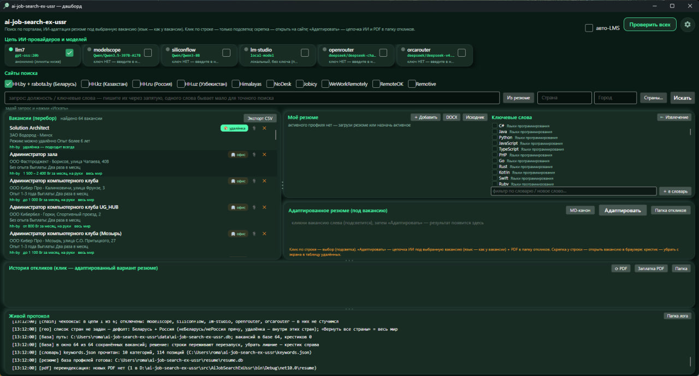

<div align="center">

# ai-job-search-ex-ussr

**Локальный помощник поиска работы: вакансии четырёх зеркал hh (Беларусь,
Россия, Казахстан, Узбекистан) и международных remote-источников — в одной
таблице; фильтры, история откликов и черновик адаптированного резюме под
выбранную вакансию.**

Локальное приложение для Windows. Без аккаунтов и телеметрии. Поиск, фильтры,
база вакансий и экспорт работают полностью локально и без ИИ. Адаптация
резюме — дополнительная функция через ИИ-провайдеров: по умолчанию включён
анонимный доступ к публичному сервису llm7 — удобно для первого запуска,
но лимиты и доступность не гарантируются; бесплатные ключи других
провайдеров делают режим надёжнее
([docs/PROVIDERS.md](docs/PROVIDERS.md)).

[](LICENSE)
[](https://learn.microsoft.com/dotnet/core/install/windows)

</div>

---

## Что это

Вакансии находит не приложение, а поисковая система сайта: вводите слова,
сайт возвращает список. Рутина вокруг этого списка выглядит так: пролистать
выдачу → открыть подходящую → переписать резюме под неё → повторить для
следующей. Программа берёт на себя рутину: делает один проход — собирает
выдачу из нескольких источников в одну таблицу, отсекает чужие страны и
дубли, а для выбранной вакансии готовит черновик адаптированного резюме.
Документы вы проверяете и отправляете сами: автоматической подачи откликов
нет намеренно — она почти везде нарушает правила сайтов.

**Адаптация — это черновик, а не готовый документ.** Промпт прямо запрещает
модели выдумывать опыт и навыки, но языковая модель может неточно
переформулировать ваши факты — перед отправкой сверяйте текст с исходным
резюме. Ответственность за содержимое документа — на вас.

Программа универсальная: поиск и фильтры одинаковы для «системный
администратор», «C#» и «няня».

**Поддерживаются четыре зеркала hh: Беларусь, Россия, Казахстан,
Узбекистан.** Гражданин любой из этих стран отмечает своё зеркало
и выбирает страну в гео-фильтре. Отдельных зеркал hh у других стран нет
(проверено живыми запросами 2026-10-29: hh.kg/hh.tj не отвечают,
hh.md/hh.ge/hh.am — чужие сайты), их вакансии попадают в выдачу зеркал
как удалённые. Оговариваемся честно: качество подсказок географии
и словарей ключевых слов может отличаться между профессиями — полных
измерений по всем сферам пока нет (см. [docs/EXPERIMENTS.md](docs/EXPERIMENTS.md)).

<!-- Скриншот главного окна: добавьте файл docs/screenshots/main.png
     и раскомментируйте строку ниже

-->

## Как этим пользоваться (коротко)

1. **«Моё резюме» → «＋ Добавить»** — загрузите резюме (PDF · DOCX · TXT · MD,
   программа разбирает их сама); активный профиль помечается плашкой
   «АКТИВНОЕ».
2. **Ключевые слова** — отметьте свои умения в словаре; своего слова нет —
   впишите его и нажмите «+ в словарь». Отмечать руками не хочется — нажмите
   **«Извлечение»** в шапке панели ключевых слов: программа сама вытащит
   умения из загруженного резюме и покажет их списком галочек — отметьте
   нужные и примите.
3. **Зачем и резюме, и ключевые слова?** Это два разных инструмента, и
   лучше всего они работают вместе. Резюме — исходник черновика:
   «Адаптировать» переписывает под вакансию именно ваш текст, выдумывать
   опыт модели запрещено — без резюме черновик не собрать. Ключевые
   слова — мерка при поиске: по ним каждая строка таблицы получает
   колонку «Совпадение %» (считается локально, без ИИ), а кнопка
   «Из резюме» подставляет их в строку поиска одним кликом. Набирать
   их вручную не обязательно — «Извлечение» (шаг 2) наполняет их прямо
   из вашего резюме.
4. **«Искать»** — введите запрос через запятую (можно словосочетанием),
   при желании страну/город; выдача всех отмеченных источников сходится
   в таблицу «Вакансии (перебор)» — чужие страны, дубли и удалённые вами
   крестиком строки отсекаются.
5. **«Адаптировать»** — выберите вакансию и нажмите: появится черновик
   адаптированного резюме; PDF — в папку откликов, строка — в «Историю
   откликов». Повторный клик создаёт новый вариант.
6. **Отправка — всегда за вами**: «Откликнуться» на сайте нажимаете вы
   сами, автоматической подачи откликов нет. Готовую таблицу выгружает
   «Экспорт CSV».

Подробный маршрут по кнопкам — окно отклика, правка текста и DOCX, что
именно уходит ИИ и на каком языке, что происходит при обрыве сети —
**[docs/USER-GUIDE.md](docs/USER-GUIDE.md)**.

## Быстрый старт (без ключей)

> Требования: Windows 10/11 x64, интернет для поиска и ИИ-адаптации;
> права администратора не нужны.

1. Распакуйте zip с программой в папку без прав администратора (.NET ставить
   не нужно — рантайм внутри). Про обновление существующей установки —
   [docs/INSTALL.md](docs/INSTALL.md).
2. При первом запуске Windows может показать SmartScreen-предупреждение:
   у неподписанного файла ещё нет репутации. Это не доказательство ни
   вредоносности, ни безопасности — берите дистрибутив только от автора
   проекта и сверяйте контрольную сумму. Инструкция:
   [docs/INSTALL.md → SmartScreen](docs/INSTALL.md#smartscreen--windows-защитила-ваш-компьютер).
3. Запустите `ai-job-search-ex-ussr.exe`, отметьте сайты чекбоксами, впишите запрос
   (можно с городом), нажмите **«Искать»**.
4. Загрузите своё резюме в панель «Моё резюме» (PDF/DOCX/TXT/MD) и
   дополните его своими навыками или профессией через «Ключевые слова» —
   вручную или кнопкой «Извлечение» (см. «Как этим пользоваться»,
   шаги 2–3): ключевые слова включают колонку «Совпадение %» в таблице
   вакансий. Работать можно и без резюме: поиск, фильтры, база и экспорт
   его не требуют, а программа всё равно экономит часы — сводит выдачу
   четырёх зеркал hh и шести remote-фидов в одну таблицу, отсекает чужие
   страны, дубли и мусор. Но черновик адаптации без резюме не собрать:
   его исходник — именно ваш текст, а не выбранная профессия.
5. Выберите вакансию и нажмите **«Адаптировать»**. Кнопка **«Экспорт CSV»**
   выгружает таблицу в Excel.

> Поиск, фильтры, база и экспорт работают полностью локально и без ИИ.
> Генерация документов зависит от доступности ИИ-провайдеров: без ключей
> работает анонимный llm7 (с лимитами), с ключами — надёжнее и быстрее
> (см. [docs/PROVIDERS.md](docs/PROVIDERS.md)).

## Сайты поиска

Сайты — чекбоксы над строкой запроса: отметил — портал участвует, снял — нет.
Выбор переживает перезапуск; каждый портал пишет в протокол, сколько строк
собрал и сколько скрыто фильтрами.

**Зеркала hh — по одному на страну (4 чекбокса).** HH.ru (Россия, area 113),
HH.by + rabota.by (Беларусь, area 16 — `hh.by` перенаправляет на `rabota.by`,
одно зеркало), HH.kz (Казахстан, area 40), HH.uz (Узбекистан, area 97).
Коды регионов — официальный справочник `api.hh.ru/areas/countries`.
Поиск повторяет то, что делает сайт в браузере: ваши слова + регион страны.
Прогон идёт **только по страницам выдачи**: счётчик «Найдено N вакансий» и
пагинатор дают план страниц; каждая следующая страница запрашивается
последовательно, с паузами, — без резкой скачки по страницам, чтобы не
создавать избыточную нагрузку на источник. Страницы кэшируются, карточки
разбираются из кэша с дедупликацией (канонический URL,
затем «название + работодатель» — перепосты hh и сеть филиалов схлопываются).
В окне «Вакансии» — счётчики: «найдено N вакансий» (крестик уменьшает),
«дублей исключено X» и «удалённых вами скрыто Y». Вкладки вакансий
не открываются; регистрация не нужна. Если сайт сменил вёрстку — плохая
страница пропускается с предупреждением, остальные дорабатывают. Если сайт
вместо списка отдаёт заглушки (признак ограничения доступа), приложение
прекращает свежие запросы к нему и показывает окно: поиск стоит повторить
через 20–30 минут — собранное к этому моменту остаётся в базе, повторный
прогон ничего не задвоит. Кнопка «Отмена» возвращает собранное
(скачанные страницы допарсиваются).

**Почему HTML, а не api.hh.ru.** Публичный поиск использует HTML-выдачу
зеркал hh: она ближе к тому, что видит человек в браузере, и позволяет
работать без регистрации и ключей. Официальный API hh в самом поиске не
задействован — с `api.hh.ru` берётся только справочник регионов
(`api.hh.ru/areas/countries`), коды стран для гео-фильтра. В будущих
версиях официальный API может использоваться для отдельных операций.

Остальные шесть порталов — публичные международные remote-фиды без
авторизации:

<!-- PORTAL_TABLE:BEGIN -->
**0 порталов** включены в цепочку по умолчанию (все чекбоксы по умолчанию выключены — цепочку собираешь галочками сам, выбор запоминается). Рабочих адаптеров: **11**.

| Портал | Домен | Страна | Доступ | Оценка автоматизации |
|---|---|---|---|---|
| RemoteOK | `remoteok.com` | 🌍 | без авторизации | публичный API/лента |
| Remotive | `remotive.com` | 🌍 | без авторизации | публичный API/лента |
| Himalayas | `himalayas.app` | 🌍 | RSS | публичный API/лента |
| Jobicy | `jobicy.com` | 🌍 | без авторизации | публичный API/лента |
| WeWorkRemotely | `weworkremotely.com` | 🌍 | RSS | публичный API/лента |
| NoDesk | `nodesk.co` | 🌍 | RSS | публичный API/лента |
| HH.ru (Россия) | `hh.ru` | 🇷🇺 | без авторизации (HTML) | ограниченно допустимо\* |
| HH.by + rabota.by (Беларусь) | `rabota.by (hh.by 302 -> rabota.by — одно зеркало)` | 🇧🇾 | без авторизации (HTML) | ограниченно допустимо\* |
| HH.kz (Казахстан) | `hh.kz` | 🇰🇿 | без авторизации (HTML) | ограниченно допустимо\* |
| HH.uz (Узбекистан) | `hh.uz` | 🇺🇿 | без авторизации (HTML) | ограниченно допустимо\* |
| HN: Who is hiring? | `news.ycombinator.com` | 🌍 | без авторизации | публичный API/лента |

_Счётчик и таблица генерируются из [`config/registry.json`](config/registry.json) — не правьте их руками в README._
<!-- PORTAL_TABLE:END -->

Полный список со статусами каждого источника — [portals-catalog.md](portals-catalog.md);
порталы с явным запретом автоматизации и цитатами из соглашений —
[portals-graveyard.md](portals-graveyard.md).

Поиск вернул 0 вакансий или подозрительно мало — типовые причины и что
крутить: [docs/TROUBLESHOOTING.md](docs/TROUBLESHOOTING.md).

> **Про оценки в таблице.** «Публичный API/лента» — источник сам
> документирует открытый API или RSS-ленту для внешнего использования.
> «Ограниченно допустимо\*» (зеркала hh) — прямого запрета просмотра открытой
> выдачи в их правилах мы не нашли, но и разрешения нет: программа
> запрашивает только страницы выдачи собственных поисковых слов — без
> выгрузки каталога, без входа в аккаунт и без автоматических откликов.
> Это оценка проекта на дату проверки реестра (2026-10-29, поле
> `tos_evidence` в [`config/registry.json`](config/registry.json)),
> **не юридическая гарантия и не разрешение**: правила сайтов меняются,
> ответственность за использование — на вас
> ([portals-catalog.md](portals-catalog.md), [DISCLAIMER.md](DISCLAIMER.md)).
> Если сайт начинает отдавать заглушки или капчу — остановитесь на сутки
> (см. [docs/TROUBLESHOOTING.md](docs/TROUBLESHOOTING.md)).

## Гео-фильтр

Поля «Страна» и «Город» + кнопка «Страны…». По умолчанию разрешены
**Беларусь и Россия**: офисная вакансия обязана совпасть с гео, удалёнка и
гибрид проходят только внутри разрешённых стран, локация авторитетнее текста
описания. Гражданин любой из четырёх стран (Беларусь, Россия, Казахстан,
Узбекистан) отмечает своё зеркало и вписывает свою страну/город — поиск
универсален. Каждая скрытая вакансия — строка в протоколе с причиной.
Почему в выдаче «Минска» прилетают Ташкент и Казань и чем страна источника
отличается от места работы — [portals-catalog.md → География](portals-catalog.md#география-страна-источника-место-работы-и-удалёнка).

## Возможности

<!-- FEATURE_MATRIX:BEGIN -->
| Возможность | Без ключей | С ключом ИИ |
|---|---|---|
| Сбор вакансий: 4 зеркала hh + remote-фиды | ✅ | ✅ |
| Гео-фильтр (Беларусь/Россия по умолчанию) и релевантность | ✅ | ✅ |
| База вакансий между запусками; крестик = «не возвращать» | ✅ | ✅ |
| Экспорт найденного в CSV (Excel) | ✅ | ✅ |
| Черновик адаптированного резюме под вакансию | ⚠️ анонимный llm7 (лимиты) | ✅ |
| PDF/DOCX/HTML экспорт документов | ✅ | ✅ |
| Автоматическая подача отклика | ❌ нет и не планируется | ❌ |
<!-- FEATURE_MATRIX:END -->

**Три уровня входа** — каждый следующий только добавляет возможности:

| Уровень | Что нужно | Что получаете |
|---|---|---|
| **Аноним** — работает сразу | ничего | сбор, фильтры, база, CSV, PDF; черновики — анонимный llm7 с лимитами |
| **Свои ключи** | бесплатные ключи агрегаторов ([docs/PROVIDERS.md](docs/PROVIDERS.md)) | черновики на сильных моделях с большей квотой |
| **Полностью локальный** | LM Studio/Ollama + модель | черновики без облачных запросов (снимите галочки облачных звеньев в цепи) |

Подробности уровней, лимитов и проверки «облачных запросов нет» —
[docs/PROVIDERS.md](docs/PROVIDERS.md).

## Ограничения (честно)

1. **ИИ-бюджет — десятки адаптаций в день, а не сотни.** Адаптация одной
   вакансии стоит 1–2 запроса; бесплатные квоты провайдеров дают порядка
   десятков адаптаций в сутки, и квоты меняются на их стороне. Оценка
   соответствия вакансии — локальная, 0 запросов. Сопроводительное письмо
   в текущей сборке не генерируется.

<!-- QUOTA_TABLE:BEGIN -->
| Действие | Расход запросов |
|---|---|
| Прогон поиска с оценкой соответствия | 0 — локальный скоринг, без ИИ |
| Адаптация резюме под одну вакансию | 1–2 |
| Сопроводительное письмо | в текущей сборке не реализовано (маршрут в цепи подготовлен) |
<!-- QUOTA_TABLE:END -->

2. **Адаптация — черновик.** Модель может неточно переформулировать факты;
   промпт запрещает выдумывать опыт, но финальная проверка — за вами.
   Отдельного автоматического «проверщика фактов» в сборке нет.
3. **История откликов — не факт отправки.** Строка в «Истории откликов»
   появляется в момент успешной адаптации резюме (модель ответила, PDF
   собран) — ещё до всякого отклика на сайте. Автоматической подачи нет:
   «Откликнуться» на странице вакансии нажимаете вы сами, программа
   предупреждает об этом в окне отклика.
4. **Квоты и модели — не константа.** Бесплатные тиры меняются на стороне
   провайдеров; программа читает актуальные лимиты в рантайме там, где это
   возможно. Числа в [docs/PROVIDERS.md](docs/PROVIDERS.md) помечены датой проверки.
5. **Выдача hh шире одной страны** — база группы общая: каждое зеркало ищет
   в своей стране (`area`), но удалённые вакансии других стран группы
   прилетают с любого зеркала — чужие страны прячет гео-фильтр; город,
   которого нет в словаре, может проскочить — такие строки видны в окне,
   их можно скрыть «Страны…».
6. **Порталы — нестабильная субстанция.** Вёрстка меняется, сайты блокируют
   автоматизацию. Отказ портала виден в интерфейсе и протоколе с причиной —
   не молчаливая пустота.
7. **Регион доступа.** OpenRouter проверенно работает из РБ (2026-10-20);
   прямые ключи OpenAI/Anthropic могут не работать — правила самих
   провайдеров. VPN-обход не поддерживается — он запрещён правилами.
8. **Это не сервис.** Нет аккаунтов, синхронизации и командной работы.
   Что уходит наружу при каких действиях — [PRIVACY.md](PRIVACY.md).
9. **Числа без измерений не обещаем.** Измеренный прогон поиска и план
   регулярных замеров — [docs/EXPERIMENTS.md](docs/EXPERIMENTS.md).
10. **Один экземпляр.** Программа работает в единственном экземпляре:
    повторный запуск показывает окошко «уже запущено» и закрывается —
    это защита базы и сайтов от двойной работы. Дождитесь закрытия
    первого окна или работайте в нём.

## Результаты тестового прогона (2026-10-28)

Живой прогон по трём фиксированным запросам (план страниц, парсер и фильтры —
настоящий код приложения; детали и ограничения среды — в
[docs/EXPERIMENTS.md](docs/EXPERIMENTS.md)):

| Запрос | Счётчик сайта | Собрано карточек | Дублей отсечено | Нерелевантных скрыто | Итог в окне |
|---|---|---|---|---|---|
| системный администратор | 159 | 69 (стр. 1–4 из 8*) | 4 | 19 | 46 |
| C# | 45 | 20 (стр. 1 из 3*) | 0 | 11 | 9 |
| няня | 12 | 11 | 0 | 7 | 4 |

\* Часть глубоких страниц в тестовой среде была недоступна — строки
помечены честно как частичные (ограничение среды, не парсера). Полная
методология и ограничения среды — [docs/EXPERIMENTS.md](docs/EXPERIMENTS.md).
Ключевое наблюдение прогона: чужие страны почти не доходят до фильтра —
их отсекает сам параметр региона зеркала.

## Ключи ИИ (коротко)

- **Шаг 0 — без ключей**: llm7 отвечает анонимно, поиск/фильтры/экспорт
  полностью локальны.
- **Шаг 1 — ключи (10 минут)**: ModelScope (2000 запросов/сутки),
  SiliconFlow (постоянно бесплатные модели), LLM7 (поднимает лимиты
  анонимного), OpenRouter (50/сутки бесплатно; депозит $10 → 1000/сутки).
  Ключ вставляется в «Настройки» (шестерёнка) без перезапуска.
- Порядок цепи, лимиты с датами проверки и локальный режим —
  [docs/PROVIDERS.md](docs/PROVIDERS.md).
- **Как отключить ИИ полностью.** Не нажимайте «Адаптировать» — поиск,
  фильтры, база и экспорт работают без ИИ всегда. Для черновиков без
  облачных запросов снимите галочки со всех облачных звеньев цепи
  (llm7 тоже облачный, хоть и анонимный) и оставьте локальный
  lm-studio/ollama — [docs/PROVIDERS.md → «Полностью локальный режим»](docs/PROVIDERS.md).

## Приватность (коротко)

Аккаунтов и телеметрии нет; ключи не покидают машину и не попадают в логи
(гард-тест сканирует код и репо). Что уходит наружу:

| Ваше действие | Что уходит наружу | Кому |
|---|---|---|
| Поиск вакансий | поисковые слова + регион (с браузерными заголовками) | сайтам включённых источников |
| «Адаптировать» | промпт программы + текст вашего резюме + текст вакансии | ИИ-провайдеру из цепи — или локальному, тогда ничего |
| Ввод ключа | ключ | только сервису, которому он принадлежит |
| Всё остальное (база, фильтры, CSV, PDF, история) | ничего | — |

Полная карта потоков, что остаётся локально и как удалить всё полностью —
[PRIVACY.md](PRIVACY.md).

## Данные на диске

Личные данные — в профиле пользователя, не рядом с exe. Папка
`ai-job-search-ex-ussr` хранит всё: базу, ключи, профили и отклики.

```
C:\Users\<юзер>\ai-job-search-ex-ussr\
├── state\     local.json (ключи!), квоты, session-checks.log, keywords.json
├── data\      ai-job-search-ex-ussr.db (вакансии, отклики, журнал процессов, настройки)
└── resume\    resume.db + файлы профилей резюме
C:\Users\<юзер>\ai-job-search-ex-ussr\logs\   — протокол по дням
<папка программы>\resume\                — PDF откликов (папка откликов)
<папка программы>\exports\               — CSV-выгрузки вакансий
```

## Документация

| Документ | О чём |
|---|---|
| [PRIVACY.md](PRIVACY.md) | что уходит наружу при каждом действии, что остаётся локально, как удалить |
| [docs/INSTALL.md](docs/INSTALL.md) | установка, проверка SHA256, SmartScreen, обновление, удаление |
| [docs/USER-GUIDE.md](docs/USER-GUIDE.md) | маршрут по интерфейсу: резюме, поиск, окно отклика, правка текста и DOCX, обрывы связи |
| [docs/PROVIDERS.md](docs/PROVIDERS.md) | ИИ-цепь: порядок, лимиты, ключи, локальный режим |
| [docs/TROUBLESHOOTING.md](docs/TROUBLESHOOTING.md) | типовые проблемы: 401, 429, «0 вакансий», PDF, база |
| [docs/EXPERIMENTS.md](docs/EXPERIMENTS.md) | методология и результаты живых прогонов |
| [portals-catalog.md](portals-catalog.md) | все источники: доступ, статус ToS, география |
| [portals-graveyard.md](portals-graveyard.md) | запрещённые источники с цитатами |
| [architecture.md](architecture.md) | техническая архитектура для разработчика |
| [SECURITY.md](SECURITY.md) / [DISCLAIMER.md](DISCLAIMER.md) | уязвимости; юридическая сторона |

## Регистрация на сайтах вакансий

Откликнуться на вакансию, не зарегистрировавшись на сайте, где она
опубликована, невозможно. Зарегистрируйтесь заранее — на тех сайтах,
которые вам реально нужны и которые вы отметили в приложении для поиска.

| Сайт | Страница регистрации соискателя |
|---|---|
| HH.ru (Россия) | <https://hh.ru/account/signup> |
| Rabota.by / HH.by (Беларусь) | <https://rabota.by/account/signup> |
| HH.kz (Казахстан) | <https://hh.kz/account/signup> |
| HH.uz (Узбекистан) | <https://hh.uz/account/signup> |

Международные remote-фиды из таблицы выше (RemoteOK, Remotive, Himalayas,
Jobicy, WeWorkRemotely, NoDesk, HN: Who is hiring?) отклик обычно ведут
на сайт работодателя — по ссылке из карточки вакансии или контакту из
обсуждения; отдельная учётная запись на самом фиде для отклика, как
правило, не нужна. Если конкретный работодатель просит регистрацию —
она будет на его странице отклика.

## Юридическая сторона

Программа обращается к сторонним сайтам, и у каждого свои правила. Программа
не может гарантировать, что правила сайта не изменятся, и не проверяет их за
вас. **Ответственность за соблюдение правил сайтов — на вас.** Статусы
источников — наша оценка с датой проверки, запрещённые источники отключены
([portals-graveyard.md](portals-graveyard.md)). Полный текст:
[DISCLAIMER.md](DISCLAIMER.md). Персональные данные: [PRIVACY.md](PRIVACY.md).

Используется **QuestPDF Community License** (версия 3.0, действует с 06.07.2026)
— бесплатно для физлиц и организаций с оборотом до 1 000 000 USD в год.
**Государственные организации, публичные компании и публичные акционерные
общества под Community-лицензию не попадают — независимо от оборота.**
Community-лицензия QuestPDF — source-available коммерческая лицензия, а не
OSI-approved open source; MIT-лицензия этого проекта не покрывает и не
управляет использованием QuestPDF. Если вы распространяете приложение,
QuestPDF может входить в него только как скомпилированный компонент вашей
производной программы — исходники QuestPDF в дистрибутив не включаются.
Если вы работаете в госструктуре РБ, используйте QuestPDF Professional или не
используйте этот бинарник. Условия: <https://www.questpdf.com/license/community.html>.
*Built with QuestPDF.*

## Разработка

Стек: .NET 10, Avalonia, SQLite + Dapper (без EF). Из исходников:

```bash
dotnet build src/ai-job-search-ex-ussr.sln -c Debug
dotnet test src/ai-job-search-ex-ussr.sln
```

Сборка и полный прогон тестов выполняются в CI (`.github/workflows/ci.yml`),
зелёный CI — обязательное условие для merge. Техническая архитектура, схема
БД и правила «что не ломать» — [architecture.md](architecture.md).

### Лицензии

Код и доки проекта — MIT, © 2026 ThreeI and the ai-job-search-ex-ussr
contributors — [LICENSE-THREEI.md](LICENSE-THREEI.md). Оригинальная
MIT-лицензия [ai-job-search](https://github.com/MadsLorentzen/ai-job-search)
(Mads Lorentzen) сохранена в [LICENSE](LICENSE) — история проекта началась
с этого репозитория (см. «Благодарности»). Лицензии сторонних компонентов —
[THIRD-PARTY-NOTICES.md](THIRD-PARTY-NOTICES.md); QuestPDF — отдельная
Community-лицензия (см. «Юридическая сторона»).

### Участие и поддержка

Проект делает один человек в свободное время, которого может просто не
быть: гарантий сроков нет, автор вправе не отреагировать на сообщение
вовсе — [CONTRIBUTING.md](CONTRIBUTING.md). Сломалось — быстрее починить
самому: код открыт, форк и PR приветствуются. Полезнее всего: баг-репорты
с журналом (`C:\Users\<юзер>\ai-job-search-ex-ussr\logs\` — проверьте, что в нём нет
персональных данных; ключи в журналы не пишутся) и сообщения о сломанных
порталах. Проект бесплатный: платных функций, подписки, телеметрии и продажи
данных не будет; поддержать — ⭐ звёздочкой или баг-репортом.

## Благодарности

Идея проекта — **ИИ-адаптация резюме под конкретную вакансию** — принадлежит
**Mads Lorentzen** и его репозиторию
[ai-job-search](https://github.com/MadsLorentzen/ai-job-search). Спасибо за
идею и рабочий референс, с которого всё началось, — основной вектор именно
его.

Проект начинался как адаптация того репозитория, но в ходе разработки вся
логика и код переписаны с нуля — под .NET 10 / Avalonia, зеркала hh и
местные реалии; файлы оригинала дословно не переносятся (детали —
[THIRD-PARTY-NOTICES.md](THIRD-PARTY-NOTICES.md)). Оригинальная MIT-лицензия
Mads Lorentzen сохранена в [LICENSE](LICENSE).
