# .NET DEEP DEPENDENCY GRAPH FOR LLM CONTEXT

- Generated: 2026-10-22 18:40:12
- Builder: dotnet_graph_builder_v8.py
- Project root: `D:\ai-job-search-by`

*Generated for: ai-job-search-by*  

*Sections 1-5 = static analysis | Section 0 = consistency warnings | Sections 6-7 = derived (public API, csproj props) | Section 8 = architecture & hygiene*

## 0. WARNINGS (review before commit)

(No warnings)

## 1. PROJECT-LEVEL DEPENDENCIES (csproj)

### [AiJobSearchBy.csproj]
**NuGet:** Avalonia (v12.1.1), Avalonia.Desktop (v12.1.1), Avalonia.Themes.Fluent (v12.1.1), CommunityToolkit.Mvvm (v8.4.2), Microsoft.Data.Sqlite (v10.0.10), Dapper (v2.1.79), PdfPig (v0.1.16), QuestPDF (v2026.8.0), SQLitePCLRaw.bundle_e_sqlite3 (v2.1.14), Microsoft.Extensions.DependencyInjection (v10.0.10)

### [AiJobSearchBy.Tests.csproj]
**NuGet:** Microsoft.NET.Test.Sdk (v17.14.1), xunit (v2.9.2), xunit.runner.visualstudio (v2.8.2)
-> AiJobSearchBy.csproj

## 2. FILE-LEVEL DEPENDENCIES (using statements)

*`ns:` = declared namespace of the file (см. WARNINGS для расхождений)*

**src/AiJobSearchBy/App.axaml.cs**
  ns: AiJobSearchBy
  -> AiJobSearchBy.ViewModels

**src/AiJobSearchBy/CompositionRoot.cs**
  ns: AiJobSearchBy
  -> AiJobSearchBy.Services

**src/AiJobSearchBy/MainWindow.axaml.cs**
  ns: AiJobSearchBy
  -> AiJobSearchBy.Models
  -> AiJobSearchBy.Services
  -> AiJobSearchBy.ViewModels
  -> AiJobSearchBy.Views

**src/AiJobSearchBy/Program.cs**
  ns: AiJobSearchBy
  -> AiJobSearchBy.Services

**src/AiJobSearchBy/Controls/SparklingProgressBar.cs**
  ns: AiJobSearchBy.Controls

**src/AiJobSearchBy/Models/JobPosting.cs**
  ns: AiJobSearchBy.Models

**src/AiJobSearchBy/Portals/ApiPortalBase.cs**
  ns: AiJobSearchBy.Portals
  -> AiJobSearchBy.Models
  -> AiJobSearchBy.Services

**src/AiJobSearchBy/Portals/BuiltInPortals.cs**
  ns: AiJobSearchBy.Portals

**src/AiJobSearchBy/Portals/FeedPortalBase.cs**
  ns: AiJobSearchBy.Portals
  -> AiJobSearchBy.Models
  -> AiJobSearchBy.Services

**src/AiJobSearchBy/Portals/GovernmentPortalBase.cs**
  ns: AiJobSearchBy.Portals

**src/AiJobSearchBy/Portals/HhByPortal.cs**
  ns: AiJobSearchBy.Portals
  -> AiJobSearchBy.Models
  -> AiJobSearchBy.Services

**src/AiJobSearchBy/Portals/HimalayasPortal.cs**
  ns: AiJobSearchBy.Portals
  -> AiJobSearchBy.Models
  -> AiJobSearchBy.Services

**src/AiJobSearchBy/Portals/IPortalService.cs**
  ns: AiJobSearchBy.Portals
  -> AiJobSearchBy.Models

**src/AiJobSearchBy/Portals/JobicyPortal.cs**
  ns: AiJobSearchBy.Portals
  -> AiJobSearchBy.Models
  -> AiJobSearchBy.Services

**src/AiJobSearchBy/Portals/NodeskPortal.cs**
  ns: AiJobSearchBy.Portals
  -> AiJobSearchBy.Models
  -> AiJobSearchBy.Services

**src/AiJobSearchBy/Portals/PortalBase.cs**
  ns: AiJobSearchBy.Portals
  -> AiJobSearchBy.Models
  -> AiJobSearchBy.Services

**src/AiJobSearchBy/Portals/PortalDescriptor.cs**
  ns: AiJobSearchBy.Portals

**src/AiJobSearchBy/Portals/PortalEnums.cs**
  ns: AiJobSearchBy.Portals

**src/AiJobSearchBy/Portals/PortalExceptions.cs**
  ns: AiJobSearchBy.Portals

**src/AiJobSearchBy/Portals/PortalRegistry.cs**
  ns: AiJobSearchBy.Portals

**src/AiJobSearchBy/Portals/RabotaByPortal.cs**
  ns: AiJobSearchBy.Portals
  -> AiJobSearchBy.Models

**src/AiJobSearchBy/Portals/RemoteOkPortal.cs**
  ns: AiJobSearchBy.Portals
  -> AiJobSearchBy.Models
  -> AiJobSearchBy.Services

**src/AiJobSearchBy/Portals/RemotivePortal.cs**
  ns: AiJobSearchBy.Portals
  -> AiJobSearchBy.Models
  -> AiJobSearchBy.Services

**src/AiJobSearchBy/Portals/ScrapePortalBase.cs**
  ns: AiJobSearchBy.Portals
  -> AiJobSearchBy.Models

**src/AiJobSearchBy/Portals/WwrPortal.cs**
  ns: AiJobSearchBy.Portals
  -> AiJobSearchBy.Models
  -> AiJobSearchBy.Services

**src/AiJobSearchBy/Services/ApplicationStore.cs**
  ns: AiJobSearchBy.Services
  -> AiJobSearchBy.Models
  -> Dapper

**src/AiJobSearchBy/Services/ConfigService.cs**
  ns: AiJobSearchBy.Services

**src/AiJobSearchBy/Services/DedupeHasher.cs**
  ns: AiJobSearchBy.Services

**src/AiJobSearchBy/Services/ILocalSecrets.cs**
  ns: AiJobSearchBy.Services

**src/AiJobSearchBy/Services/ILogService.cs**
  ns: AiJobSearchBy.Services

**src/AiJobSearchBy/Services/KeysCheckService.cs**
  ns: AiJobSearchBy.Services
  -> AiJobSearchBy.Portals

**src/AiJobSearchBy/Services/PdfExportService.cs**
  ns: AiJobSearchBy.Services
  -> AiJobSearchBy.Services
  -> QuestPDF.Fluent
  -> QuestPDF.Helpers
  -> QuestPDF.Infrastructure

**src/AiJobSearchBy/Services/PdfIndexerService.cs**
  ns: AiJobSearchBy.Services
  -> AiJobSearchBy.Services.Ai

**src/AiJobSearchBy/Services/ResumeAdaptationService.cs**
  ns: AiJobSearchBy.Services
  -> AiJobSearchBy.Models
  -> AiJobSearchBy.Services.Ai

**src/AiJobSearchBy/Services/Ai/AiChatModels.cs**
  ns: AiJobSearchBy.Services.Ai

**src/AiJobSearchBy/Services/Ai/IAiChatProvider.cs**
  ns: AiJobSearchBy.Services.Ai

**src/AiJobSearchBy/Services/Ai/Llm7Provider.cs**
  ns: AiJobSearchBy.Services.Ai
  -> AiJobSearchBy.Services

**src/AiJobSearchBy/Services/Ai/LocalEmbeddingService.cs**
  ns: AiJobSearchBy.Services.Ai

**src/AiJobSearchBy/Services/Ai/LocalMatchScorer.cs**
  ns: AiJobSearchBy.Services.Ai
  -> AiJobSearchBy.Services

**src/AiJobSearchBy/Services/Ai/OpenAiCompatibleProvider.cs**
  ns: AiJobSearchBy.Services.Ai
  -> AiJobSearchBy.Services

**src/AiJobSearchBy/Services/Ai/ResponseCostCounter.cs**
  ns: AiJobSearchBy.Services.Ai
  -> AiJobSearchBy.Services

**src/AiJobSearchBy/Services/Ai/TaskRoutingPolicy.cs**
  ns: AiJobSearchBy.Services.Ai
  -> AiJobSearchBy.Services

**src/AiJobSearchBy/Services/Ai/VectorJson.cs**
  ns: AiJobSearchBy.Services.Ai

**src/AiJobSearchBy/ViewModels/ApplicationRow.cs**
  ns: AiJobSearchBy.ViewModels

**src/AiJobSearchBy/ViewModels/MainViewModel.cs**
  ns: AiJobSearchBy.ViewModels

**src/AiJobSearchBy/ViewModels/ProviderStatusRow.cs**
  ns: AiJobSearchBy.ViewModels

**src/AiJobSearchBy/ViewModels/SettingsViewModel.cs**
  ns: AiJobSearchBy.ViewModels

**src/AiJobSearchBy/ViewModels/SiteToggleRow.cs**
  ns: AiJobSearchBy.ViewModels

**src/AiJobSearchBy/ViewModels/VacancyRow.cs**
  ns: AiJobSearchBy.ViewModels
  -> AiJobSearchBy.Models

**src/AiJobSearchBy/Views/ApplicationDetailsWindow.axaml.cs**
  ns: AiJobSearchBy.Views
  -> AiJobSearchBy.ViewModels

**src/AiJobSearchBy/Views/SettingsWindow.axaml.cs**
  ns: AiJobSearchBy.Views
  -> AiJobSearchBy.ViewModels

**src/AiJobSearchBy.Tests/ApplicationStoreTests.cs**
  ns: AiJobSearchBy.Tests
  -> AiJobSearchBy.Models
  -> AiJobSearchBy.Services
  -> AiJobSearchBy.Services.Ai
  -> AiJobSearchBy.Tests.Logging
  -> Xunit

**src/AiJobSearchBy.Tests/BuiltInPortalsTests.cs**
  ns: AiJobSearchBy.Tests
  -> AiJobSearchBy.Portals
  -> Xunit

**src/AiJobSearchBy.Tests/CompositionRootTests.cs**
  ns: AiJobSearchBy.Tests
  -> Xunit

**src/AiJobSearchBy.Tests/ConfigServiceTests.cs**
  ns: AiJobSearchBy.Tests
  -> AiJobSearchBy.Services
  -> Xunit

**src/AiJobSearchBy.Tests/ConfigUpdateKeyTests.cs**
  ns: AiJobSearchBy.Tests
  -> AiJobSearchBy.Services
  -> AiJobSearchBy.Tests.Logging
  -> Xunit

**src/AiJobSearchBy.Tests/DedupeHasherTests.cs**
  ns: AiJobSearchBy.Tests
  -> AiJobSearchBy.Services
  -> Xunit

**src/AiJobSearchBy.Tests/Fakes.cs**
  ns: AiJobSearchBy.Tests
  -> AiJobSearchBy.Models
  -> AiJobSearchBy.Portals
  -> AiJobSearchBy.Services

**src/AiJobSearchBy.Tests/HhByPortalTests.cs**
  ns: AiJobSearchBy.Tests
  -> AiJobSearchBy.Models
  -> AiJobSearchBy.Portals
  -> AiJobSearchBy.Services
  -> Xunit

**src/AiJobSearchBy.Tests/KeysCheckServiceTests.cs**
  ns: AiJobSearchBy.Tests
  -> AiJobSearchBy.Portals
  -> AiJobSearchBy.Services
  -> Xunit

**src/AiJobSearchBy.Tests/LocalEmbeddingServiceTests.cs**
  ns: AiJobSearchBy.Tests
  -> AiJobSearchBy.Services.Ai
  -> AiJobSearchBy.Tests
  -> Xunit

**src/AiJobSearchBy.Tests/MainViewModelTests.cs**
  ns: AiJobSearchBy.Tests
  -> AiJobSearchBy.Services
  -> AiJobSearchBy.Services.Ai
  -> AiJobSearchBy.Tests.Logging
  -> AiJobSearchBy.ViewModels
  -> Xunit

**src/AiJobSearchBy.Tests/MainViewModelWpu1Tests.cs**
  ns: AiJobSearchBy.Tests
  -> AiJobSearchBy.Models
  -> AiJobSearchBy.Services
  -> AiJobSearchBy.Services.Ai
  -> AiJobSearchBy.Tests.Logging
  -> AiJobSearchBy.ViewModels
  -> Xunit

**src/AiJobSearchBy.Tests/PdfExportServiceTests.cs**
  ns: AiJobSearchBy.Tests
  -> AiJobSearchBy.Services
  -> AiJobSearchBy.Tests.Logging
  -> Xunit

**src/AiJobSearchBy.Tests/PdfIndexerServiceTests.cs**
  ns: AiJobSearchBy.Tests
  -> AiJobSearchBy.Services
  -> AiJobSearchBy.Services.Ai
  -> AiJobSearchBy.Tests
  -> AiJobSearchBy.Tests.Logging
  -> Xunit

**src/AiJobSearchBy.Tests/PortalAdapterTests.cs**
  ns: AiJobSearchBy.Tests
  -> AiJobSearchBy.Portals
  -> AiJobSearchBy.Services
  -> AiJobSearchBy.Tests
  -> Xunit

**src/AiJobSearchBy.Tests/PortalBasesTests.cs**
  ns: AiJobSearchBy.Tests
  -> AiJobSearchBy.Models
  -> AiJobSearchBy.Portals
  -> AiJobSearchBy.Services
  -> Xunit

**src/AiJobSearchBy.Tests/PortalRegistryTests.cs**
  ns: AiJobSearchBy.Tests
  -> AiJobSearchBy.Portals
  -> Xunit

**src/AiJobSearchBy.Tests/RabotaByPortalTests.cs**
  ns: AiJobSearchBy.Tests
  -> AiJobSearchBy.Models
  -> AiJobSearchBy.Portals
  -> Xunit

**src/AiJobSearchBy.Tests/RepoSecretsGuardTests.cs**
  ns: AiJobSearchBy.Tests
  -> AiJobSearchBy.Services
  -> Xunit

**src/AiJobSearchBy.Tests/ResumeAdaptationServiceTests.cs**
  ns: AiJobSearchBy.Tests
  -> AiJobSearchBy.Models
  -> AiJobSearchBy.Services
  -> AiJobSearchBy.Services.Ai
  -> AiJobSearchBy.Tests
  -> Xunit

**src/AiJobSearchBy.Tests/SettingsViewModelTests.cs**
  ns: AiJobSearchBy.Tests
  -> AiJobSearchBy.Services
  -> AiJobSearchBy.Tests.Logging
  -> AiJobSearchBy.ViewModels
  -> Xunit

**src/AiJobSearchBy.Tests/TestConfigEnv.cs**
  ns: AiJobSearchBy.Tests

**src/AiJobSearchBy.Tests/Ai/Llm7ProviderTests.cs**
  ns: AiJobSearchBy.Tests.Ai
  -> AiJobSearchBy.Services
  -> AiJobSearchBy.Services.Ai
  -> AiJobSearchBy.Tests.Logging
  -> Xunit

**src/AiJobSearchBy.Tests/Ai/OpenAiCompatibleProviderTests.cs**
  ns: AiJobSearchBy.Tests.Ai
  -> AiJobSearchBy.Services
  -> AiJobSearchBy.Services.Ai
  -> AiJobSearchBy.Tests.Logging
  -> Xunit

**src/AiJobSearchBy.Tests/Ai/RoutingScorerCostTests.cs**
  ns: AiJobSearchBy.Tests.Ai
  -> AiJobSearchBy.Services
  -> AiJobSearchBy.Services.Ai
  -> AiJobSearchBy.Tests.Logging
  -> Xunit

**src/AiJobSearchBy.Tests/Logging/LogServiceTests.cs**
  ns: AiJobSearchBy.Tests.Logging
  -> AiJobSearchBy.Services
  -> Xunit

## 3. CLASS HIERARCHY & INTERFACES (Inheritance)

*Format: ChildClass -> [ParentClass, IInterface] or just 'class: Name'*

**src/AiJobSearchBy/App.axaml.cs**
  class: App

**src/AiJobSearchBy/CompositionRoot.cs**
  class: CompositionRoot

**src/AiJobSearchBy/MainWindow.axaml.cs**
  class: MainWindow

**src/AiJobSearchBy/Program.cs**
  class: Program

**src/AiJobSearchBy/Controls/SparklingProgressBar.cs**
  SparklingProgressBar -> ProgressBar
  class: Spark

**src/AiJobSearchBy/Models/JobPosting.cs**
  class: JobPosting

**src/AiJobSearchBy/Portals/ApiPortalBase.cs**
  ApiPortalBase -> PortalBase

**src/AiJobSearchBy/Portals/BuiltInPortals.cs**
  class: BuiltInPortals

**src/AiJobSearchBy/Portals/FeedPortalBase.cs**
  FeedPortalBase -> PortalBase
  class: FeedItem
  class: LinkCandidate

**src/AiJobSearchBy/Portals/GovernmentPortalBase.cs**
  GovernmentPortalBase -> ScrapePortalBase

**src/AiJobSearchBy/Portals/HhByPortal.cs**
  HhByPortal -> ApiPortalBase

**src/AiJobSearchBy/Portals/HimalayasPortal.cs**
  HimalayasPortal -> FeedPortalBase

**src/AiJobSearchBy/Portals/IPortalService.cs**
  interface: IPortalService
  class: PortalHealthReport

**src/AiJobSearchBy/Portals/JobicyPortal.cs**
  JobicyPortal -> ApiPortalBase

**src/AiJobSearchBy/Portals/NodeskPortal.cs**
  NodeskPortal -> FeedPortalBase

**src/AiJobSearchBy/Portals/PortalBase.cs**
  PortalBase -> IPortalService

**src/AiJobSearchBy/Portals/PortalDescriptor.cs**
  class: PortalDescriptor

**src/AiJobSearchBy/Portals/PortalExceptions.cs**
  ParseFailedException -> Exception
  BreakerOpenException -> Exception

**src/AiJobSearchBy/Portals/PortalRegistry.cs**
  class: PortalRegistry
  class: PortalOrderEntry

**src/AiJobSearchBy/Portals/RabotaByPortal.cs**
  RabotaByPortal -> ApiPortalBase

**src/AiJobSearchBy/Portals/RemoteOkPortal.cs**
  RemoteOkPortal -> ApiPortalBase

**src/AiJobSearchBy/Portals/RemotivePortal.cs**
  RemotivePortal -> ApiPortalBase

**src/AiJobSearchBy/Portals/ScrapePortalBase.cs**
  ScrapePortalBase -> PortalBase
  class: PolitenessOptions

**src/AiJobSearchBy/Portals/WwrPortal.cs**
  WwrPortal -> FeedPortalBase

**src/AiJobSearchBy/Services/ApplicationStore.cs**
  class: ApplicationRecord
  class: PdfDocumentRecord
  interface: IApplicationStore
  ApplicationStore -> IApplicationStore
  class: Row

**src/AiJobSearchBy/Services/ConfigService.cs**
  ConfigService -> ILocalSecrets

**src/AiJobSearchBy/Services/DedupeHasher.cs**
  class: DedupeHasher

**src/AiJobSearchBy/Services/ILocalSecrets.cs**
  interface: ILocalSecrets
  NullLocalSecrets -> ILocalSecrets

**src/AiJobSearchBy/Services/ILogService.cs**
  interface: ILogService
  LogService -> ILogService

**src/AiJobSearchBy/Services/KeysCheckService.cs**
  interface: IKeysCheckService
  class: KeyCheckReport
  class: KeyPingOutcome
  KeysCheckService -> IKeysCheckService

**src/AiJobSearchBy/Services/PdfExportService.cs**
  interface: IPdfExporter
  PdfExportService -> IPdfExporter

**src/AiJobSearchBy/Services/PdfIndexerService.cs**
  class: PdfIndexerService

**src/AiJobSearchBy/Services/ResumeAdaptationService.cs**
  class: ResumeAdaptationService

**src/AiJobSearchBy/Services/Ai/AiChatModels.cs**
  class: AiChatRequest
  class: AiChatUsage
  class: AiChatResult
  AiProviderBusyException -> Exception

**src/AiJobSearchBy/Services/Ai/IAiChatProvider.cs**
  interface: IAiChatProvider

**src/AiJobSearchBy/Services/Ai/Llm7Provider.cs**
  Llm7Provider -> IAiChatProvider
  class: AiBudgetLedger

**src/AiJobSearchBy/Services/Ai/LocalEmbeddingService.cs**
  interface: IEmbeddingService
  LocalEmbeddingService -> IEmbeddingService

**src/AiJobSearchBy/Services/Ai/LocalMatchScorer.cs**
  class: LocalMatchVerdict
  class: LocalMatchScorer

**src/AiJobSearchBy/Services/Ai/OpenAiCompatibleProvider.cs**
  OpenAiCompatibleProvider -> IAiChatProvider

**src/AiJobSearchBy/Services/Ai/ResponseCostCounter.cs**
  class: StageCost
  class: ResponseCostCounter

**src/AiJobSearchBy/Services/Ai/TaskRoutingPolicy.cs**
  class: TaskRoutingPolicy

**src/AiJobSearchBy/Services/Ai/VectorJson.cs**
  class: VectorJson

**src/AiJobSearchBy/ViewModels/ApplicationRow.cs**
  class: ApplicationRow

**src/AiJobSearchBy/ViewModels/MainViewModel.cs**
  class: MainViewModel

**src/AiJobSearchBy/ViewModels/ProviderStatusRow.cs**
  class: ProviderStatusRow

**src/AiJobSearchBy/ViewModels/SettingsViewModel.cs**
  class: SettingsRow
  class: SettingsViewModel

**src/AiJobSearchBy/ViewModels/SiteToggleRow.cs**
  class: SiteToggleRow

**src/AiJobSearchBy/ViewModels/VacancyRow.cs**
  class: VacancyRow

**src/AiJobSearchBy/Views/ApplicationDetailsWindow.axaml.cs**
  class: ApplicationDetailsWindow

**src/AiJobSearchBy/Views/SettingsWindow.axaml.cs**
  class: SettingsWindow

**src/AiJobSearchBy.Tests/ApplicationStoreTests.cs**
  class: ApplicationStoreTests

**src/AiJobSearchBy.Tests/BuiltInPortalsTests.cs**
  class: BuiltInPortalsTests
  class: BuiltInPortalsDeferredTests

**src/AiJobSearchBy.Tests/CompositionRootTests.cs**
  class: TestBootLogs
  class: CompositionRootTests
  class: CompositionRootWpp1Tests
  class: CompositionRootLogContractTests
  class: CompositionRootWpu1Tests

**src/AiJobSearchBy.Tests/ConfigServiceTests.cs**
  class: ConfigServiceTests

**src/AiJobSearchBy.Tests/ConfigUpdateKeyTests.cs**
  class: ConfigUpdateKeyTests

**src/AiJobSearchBy.Tests/DedupeHasherTests.cs**
  class: DedupeHasherTests

**src/AiJobSearchBy.Tests/Fakes.cs**
  FakePortal -> IPortalService
  FakeHttpHandler -> HttpMessageHandler
  FakeLocalSecrets -> ILocalSecrets
  SilentLog -> ILogService

**src/AiJobSearchBy.Tests/HhByPortalTests.cs**
  class: HhByPortalTests

**src/AiJobSearchBy.Tests/KeysCheckServiceTests.cs**
  class: KeysCheckServiceTests

**src/AiJobSearchBy.Tests/LocalEmbeddingServiceTests.cs**
  class: LocalEmbeddingServiceTests

**src/AiJobSearchBy.Tests/MainViewModelTests.cs**
  class: MainViewModelTests

**src/AiJobSearchBy.Tests/MainViewModelWpu1Tests.cs**
  class: MainViewModelWpu1Tests

**src/AiJobSearchBy.Tests/PdfExportServiceTests.cs**
  class: PdfExportServiceTests

**src/AiJobSearchBy.Tests/PdfIndexerServiceTests.cs**
  class: PdfIndexerServiceTests
  FakeEmbeddings -> IEmbeddingService

**src/AiJobSearchBy.Tests/PortalAdapterTests.cs**
  class: PortalAdapterTests

**src/AiJobSearchBy.Tests/PortalBasesTests.cs**
  class: PortalBasesTests
  class: FakeApiPortal
  class: FakeFeedPortal
  class: FakeScrapePortal

**src/AiJobSearchBy.Tests/PortalRegistryTests.cs**
  class: PortalRegistryTests
  class: PortalRegistryDefaultEnabledTests

**src/AiJobSearchBy.Tests/RabotaByPortalTests.cs**
  class: RabotaByPortalTests

**src/AiJobSearchBy.Tests/RepoSecretsGuardTests.cs**
  class: RepoSecretsGuardTests

**src/AiJobSearchBy.Tests/ResumeAdaptationServiceTests.cs**
  class: ResumeAdaptationServiceTests
  class: FakeProvider
  BusyProvider -> IAiChatProvider

**src/AiJobSearchBy.Tests/SettingsViewModelTests.cs**
  class: SettingsViewModelTests

**src/AiJobSearchBy.Tests/TestConfigEnv.cs**
  class: TestConfigEnv

**src/AiJobSearchBy.Tests/Ai/Llm7ProviderTests.cs**
  class: Llm7ProviderTests
  StubHandler -> HttpMessageHandler

**src/AiJobSearchBy.Tests/Ai/OpenAiCompatibleProviderTests.cs**
  class: OpenAiCompatibleProviderTests
  StubHandler -> HttpMessageHandler
  SerialStubHandler -> HttpMessageHandler

**src/AiJobSearchBy.Tests/Ai/RoutingScorerCostTests.cs**
  class: RoutingScorerCostTests
  StubProvider -> IAiChatProvider

**src/AiJobSearchBy.Tests/Logging/LogServiceTests.cs**
  class: LogServiceTests

## 4. XAML VIEW BINDINGS (x:DataType)

*Shows which ViewModel/Model is bound to the View*

**src/AiJobSearchBy/MainWindow.axaml**
  x:DataType -> MainViewModel
  x:DataType -> ProviderStatusRow
  x:DataType -> SiteToggleRow
  x:DataType -> VacancyRow
  x:DataType -> ApplicationRow

**src/AiJobSearchBy/Views/SettingsWindow.axaml**
  x:DataType -> SettingsViewModel
  x:DataType -> SettingsRow

## 5. RUNTIME DATA FLOW (Hybrid: static analysis + manual annotations)

> 💡 **Tip for developers:** Add comments like `// FLOW: A -> B`, `// LIFECYCLE: creates X`, `// STATE: writes _cache`, `// THREAD: UI` in your C# code to enrich this section.


### 5.1 Event Chains & Signal Flow

*Manual `// FLOW:` annotations + detected event declarations*

```mermaid
graph TD
    n_8d47a5["протокол"] -->|raises/triggers| MainWindow.
    n_6e6e7f["старт приложения"] -->|raises/triggers| n_13221a["фоновая проба каталога моделей каждого облачного"]
    CompositionRoot -->|raises/triggers| Initialize_cd7a15["Initialize при"]
    Program.Main -->|raises/triggers| n_ead8cb["ленивая фабрика"]
    resolve_DI_26a41e["первый resolve из DI"] -->|raises/triggers| n_5d917b["снапшот готов."]
    n_9ddbb3["любой сервис/адаптер"] -->|raises/triggers| logs_ai_job_search_by_YYYYMMDD_log_a4043f["диск logs/ai-job-search-by-YYYYMMDD.log"]
    MainViewModel.SendCommand -->|raises/triggers| n_6b1d2c["путь файла"]
    PDF_91d46d["старт приложения (фон) / кнопка «⟳ PDF»"] -->|raises/triggers| IndexNewPdfsAsync
    MainViewModel_646d74["MainViewModel (клик по вакансии)"] -->|raises/triggers| TaskRoutingPolicy
    n_016e52["типы ИИ-цепи"] -->|raises/triggers| IAiChatProvider_llm7_OpenAI_cd5fa2["IAiChatProvider (llm7; далее цепь OpenAI-совместимых)"]
    TaskRoutingPolicy -->|raises/triggers| AiChatResult_ResponseCostCounter_eb86fe["AiChatResult; расход уходит в ResponseCostCounter оркестратора"]
    n_0dc237["регистр исчерпан?"] -->|raises/triggers| n_c8d1b1["429/402 = Busy"]
    GET_models_9696f0["старт цепи: GET models"] -->|raises/triggers| n_837134["модель в каталоге?;"]
    Add -->|raises/triggers| Save__gate_732e7d["Save (всё под _gate)"]
    CompositionRoot -->|raises/triggers| PdfIndexerService_MainViewModel_SendAsync_2f1b5e["PdfIndexerService / MainViewModel.SendAsync"]
    n_2ebb72["оркестратор отклика"] -->|raises/triggers| LocalMatchVerdict_scorer_e2fa17["LocalMatchVerdict + строка [scorer] в протокол;"]
    TaskRoutingPolicy -->|raises/triggers| AiChatResult_ResponseCostCounter_f5df64["AiChatResult (расход уходит в ResponseCostCounter оркестратора);"]
    payload_enable_thinking_f897d4["payload (enable_thinking по профилю)"] -->|raises/triggers| choices_usage_f546c2["разбор choices/usage"]
    GET_models_da27f4["GET models"] -->|raises/triggers| WARN_3_749d24["модель в каталоге?; падение пробы = WARN, не краш (НИ-3)"]
    BeginResponse_05bc97["цикл отклика: BeginResponse"] -->|raises/triggers| cost_5_f75c39["[cost] в протокол (НИ-5);"]
    n_b74d11["факт стадии"] -->|raises/triggers| StageCost__gate_cost_EndResponse_d25ca6["StageCost в копилку под _gate; итог выйдет строкой [cost] в EndResponse"]
    n_9ab089["копилки"] -->|raises/triggers| n_130502["возврат вызывающему;"]
    AiTaskKind -->|raises/triggers| LocalMatchScorer
    RunAsync_a8e2b5["оркестратор: RunAsync(стадия)"] -->|raises/triggers| AiChatResult_null_d728e1["AiChatResult|null;"]
    coverLetterOrder_135b0a["coverLetterOrder (по дешевизне)"] -->|raises/triggers| n_3418f3["имена сверяются с зарегистрированными;"]
    MainViewModel_SendAsync_PdfIndexerService_d45e12["MainViewModel.SendAsync / PdfIndexerService"] -->|raises/triggers| VectorJson.To
    MainWindow -->|raises/triggers| n_b29f63["поиск по порталам,"]
    MainWindow_HistoryList_SelectionChanged_c737d4["MainWindow.HistoryList SelectionChanged"] -->|raises/triggers| ShowDialog_9c9cd1["ShowDialog(владелец)."]
    MainViewModel -->|raises/triggers| MVVM_WP_U0_b32799["тесты (смоук MVVM-генераторов + гейты WP-U0)"]
    n_e8bd27["тесты"] -->|raises/triggers| n_19b334["разбор/лимиты/регистр"]
    n_e8bd27["тесты"] -->|raises/triggers| OpenAiCompatibleProvider_HttpMessageHandler_733fee["OpenAiCompatibleProvider поверх фейкового HttpMessageHandler (без сети)"]
    n_e8bd27["тесты"] -->|raises/triggers| TaskRoutingPolicy_LocalMatchScorer_ResponseCostCounter_StubProvider_fd0d10["TaskRoutingPolicy / LocalMatchScorer / ResponseCostCounter на StubProvider-цепи"]
    n_e8bd27["тесты"] -->|raises/triggers| LogService_4a2aaf["LogService (в память-кольцо + диск во временный каталог)"]
    MainViewModel -->|event SettingsRequested| Action?
    SettingsRow -->|event CloseRequested| Action?
    SiteToggleRow -->|event Toggled| EventHandler?
```



**Raw FLOW annotations:**
- `src/AiJobSearchBy/App.axaml.cs`: `контейнер поднят в Program.Main; в дизайнере он null —`
- `src/AiJobSearchBy/CompositionRoot.cs`: `сборка графа зависимостей — единственное место регистрации сервисов.`
- `src/AiJobSearchBy/MainWindow.axaml.cs`: `DI-ctor — единая точка привязки контекста; дизайнера и тесты`
- `src/AiJobSearchBy/Program.cs`: `протокол -> crash-хендлеры -> контейнер -> Avalonia -> MainWindow.`
- `src/AiJobSearchBy/Program.cs`: `старт приложения -> фоновая проба каталога моделей каждого облачного`
- `src/AiJobSearchBy/Program.cs`: `единая точка конфигурации рантайма и XAML-дизайнера.`
- `src/AiJobSearchBy/Models/JobPosting.cs`: `нормализованная вакансия — единственная валюта портального слоя.`
- `src/AiJobSearchBy/Portals/ApiPortalBase.cs`: `официальный JSON API (RFC-003 §2.1): BuildSearchUrl → GET → Parse.`
- `src/AiJobSearchBy/Portals/BuiltInPortals.cs`: `каталог коробки v1 — 6 порталов без ключей (RFC-003 §2.3, международные`
- `src/AiJobSearchBy/Portals/FeedPortalBase.cs`: `RSS/Atom (RFC-003 §2.1): BuildFeedUrl → GET → ParseFeed → MapItem.`
- `src/AiJobSearchBy/Portals/GovernmentPortalBase.cs`: `госсектор (WP-P7, RFC-003 §2.1): строгий polite-crawl + обязательный`
- `src/AiJobSearchBy/Portals/HhByPortal.cs`: `адаптер HeadHunter.by (группа hh) на официальном JSON API`
- `src/AiJobSearchBy/Portals/HimalayasPortal.cs`: `адаптер Himalayas на RSS-ленте (Access=Feed, Auth=None, карточка`
- `src/AiJobSearchBy/Portals/IPortalService.cs`: `контракт портала (architecture.md §3.3, RFC-003 §2.1). Реализации —`
- `src/AiJobSearchBy/Portals/JobicyPortal.cs`: `адаптер Jobicy на публичном JSON API v2 (Access=OfficialApi, Auth=None,`
- `src/AiJobSearchBy/Portals/NodeskPortal.cs`: `адаптер NoDesk на RSS-ленте (Access=Feed, Auth=None, карточка`
- `src/AiJobSearchBy/Portals/PortalBase.cs`: `общий корень всех адаптеров — манифест + HTTP-клиент + каркас контракта.`
- `src/AiJobSearchBy/Portals/PortalDescriptor.cs`: `манифест портала — неизменяемые данные карточки §2.11; объявляются`
- `src/AiJobSearchBy/Portals/PortalEnums.cs`: `типы-каноны портального слоя; consumed всеми адаптерами и реестром,`
- `src/AiJobSearchBy/Portals/PortalExceptions.cs`: `типизированные ошибки портального слоя. Оркестратор (WP-P1+) отображает`
- `src/AiJobSearchBy/Portals/PortalRegistry.cs`: `реестр порталов (architecture.md §3.3, RFC-003 §2.2): порядок = массив`
- `src/AiJobSearchBy/Portals/RabotaByPortal.cs`: `адаптер Rabota.by — ЗАГЛУШКА С ЮРИДИЧЕСКИМ ВЕРДИКТОМ, не рабочий путь.`
- `src/AiJobSearchBy/Portals/RemoteOkPortal.cs`: `адаптер RemoteOK на публичном JSON API (Access=OfficialApi, Auth=None,`
- `src/AiJobSearchBy/Portals/RemotivePortal.cs`: `адаптер Remotive на публичном JSON API (Access=OfficialApi, Auth=None,`
- `src/AiJobSearchBy/Portals/ScrapePortalBase.cs`: `polite-crawl (RFC-003 §2.1/§2.10): паузы между запросами + рандомизация`
- `src/AiJobSearchBy/Portals/WwrPortal.cs`: `адаптер WeWorkRemotely на RSS-ленте (Access=Feed, Auth=None, карточка`
- `src/AiJobSearchBy/Services/ApplicationStore.cs`: `CompositionRoot -> IApplicationStore (синглтон) -> Initialize при`
- `src/AiJobSearchBy/Services/ConfigService.cs`: `Program.Main -> CompositionRoot.AddRegistrations -> ленивая фабрика`
- `src/AiJobSearchBy/Services/ConfigService.cs`: `первый resolve из DI -> файл/шаблон/merge -> снапшот готов.`
- `src/AiJobSearchBy/Services/DedupeHasher.cs`: `вербатим-порт из Atlas/Atlas/Services/DedupeHasher.cs (исходник`
- `src/AiJobSearchBy/Services/ILocalSecrets.cs`: `seam для чтения ключей порталов из слоя секретов (config/local.json,`
- `src/AiJobSearchBy/Services/ILogService.cs`: `любой сервис/адаптер -> ILogService -> диск logs/ai-job-search-by-YYYYMMDD.log`
- `src/AiJobSearchBy/Services/KeysCheckService.cs`: `keys-check (RFC-003 §2.9) — on-demand диагностика ключей и пингов`
- `src/AiJobSearchBy/Services/PdfExportService.cs`: `MainViewModel.SendCommand -> SaveResumePdfAsync -> путь файла ->`
- `src/AiJobSearchBy/Services/PdfIndexerService.cs`: `старт приложения (фон) / кнопка «⟳ PDF» -> IndexNewPdfsAsync ->`
- `src/AiJobSearchBy/Services/ResumeAdaptationService.cs`: `MainViewModel (клик по вакансии) -> AdaptAsync -> TaskRoutingPolicy ->`
- `src/AiJobSearchBy/Services/Ai/AiChatModels.cs`: `типы ИИ-цепи -> TaskRoutingPolicy -> IAiChatProvider (llm7; далее цепь OpenAI-совместимых)`
- `src/AiJobSearchBy/Services/Ai/IAiChatProvider.cs`: `TaskRoutingPolicy -> CompleteAsync -> AiChatResult; расход уходит в ResponseCostCounter оркестратора`
- `src/AiJobSearchBy/Services/Ai/Llm7Provider.cs`: `регистр исчерпан? -> фейл-фаст Busy (без HTTP); payload chat/completions -> 429/402 = Busy`
- `src/AiJobSearchBy/Services/Ai/Llm7Provider.cs`: `старт цепи: GET models -> каталог в протокол (turbo-тир) -> модель в каталоге?;`
- `src/AiJobSearchBy/Services/Ai/Llm7Provider.cs`: `Add -> RollDay -> UsedToday += tokens -> Save (всё под _gate)`
- `src/AiJobSearchBy/Services/Ai/LocalEmbeddingService.cs`: `CompositionRoot -> PdfIndexerService / MainViewModel.SendAsync ->`
- `src/AiJobSearchBy/Services/Ai/LocalMatchScorer.cs`: `оркестратор отклика -> Score(резюме, вакансия) -> LocalMatchVerdict + строка [scorer] в протокол;`
- `src/AiJobSearchBy/Services/Ai/OpenAiCompatibleProvider.cs`: `TaskRoutingPolicy -> CompleteAsync -> AiChatResult (расход уходит в ResponseCostCounter оркестратора);`
- `src/AiJobSearchBy/Services/Ai/OpenAiCompatibleProvider.cs`: `payload (enable_thinking по профилю) -> POST chat/completions -> разбор choices/usage`
- `src/AiJobSearchBy/Services/Ai/OpenAiCompatibleProvider.cs`: `GET models -> каталог в протокол -> модель в каталоге?; падение пробы = WARN, не краш (НИ-3)`
- `src/AiJobSearchBy/Services/Ai/ResponseCostCounter.cs`: `цикл отклика: BeginResponse -> Record на каждую стадию -> EndResponse -> [cost] в протокол (НИ-5);`
- `src/AiJobSearchBy/Services/Ai/ResponseCostCounter.cs`: `факт стадии -> StageCost в копилку под _gate; итог выйдет строкой [cost] в EndResponse`
- `src/AiJobSearchBy/Services/Ai/ResponseCostCounter.cs`: `копилки -> строка [cost] в протокол (окно+диск, НИ-5) -> возврат вызывающему;`
- `src/AiJobSearchBy/Services/Ai/TaskRoutingPolicy.cs`: `AiTaskKind -> switch -> порядок цепи; MatchAssessment = осознанный отказ (LogWarn) -> LocalMatchScorer`
- `src/AiJobSearchBy/Services/Ai/TaskRoutingPolicy.cs`: `оркестратор: RunAsync(стадия) -> OrderFor -> цепь провайдеров -> AiChatResult|null;`
- `src/AiJobSearchBy/Services/Ai/TaskRoutingPolicy.cs`: `coverLetterOrder (по дешевизне) -> имена сверяются с зарегистрированными;`
- `src/AiJobSearchBy/Services/Ai/VectorJson.cs`: `MainViewModel.SendAsync / PdfIndexerService -> VectorJson.To ->`
- `src/AiJobSearchBy/ViewModels/MainViewModel.cs`: `MainWindow -> MainViewModel (DataContext) -> поиск по порталам,`
- `src/AiJobSearchBy/Views/ApplicationDetailsWindow.axaml.cs`: `MainWindow.HistoryList SelectionChanged -> ShowDialog(владелец).`
- `src/AiJobSearchBy/Views/SettingsWindow.axaml.cs`: `DI-ctor — модель из CompositionRoot (ConfigService + store + log).`
- `src/AiJobSearchBy.Tests/ApplicationStoreTests.cs`: `ApplicationStore (WP-U1) — схема §4 + EnsureColumn-расширения,`
- `src/AiJobSearchBy.Tests/BuiltInPortalsTests.cs`: `пин коробки v1 (RFC-003 §2.3): 6 порталов без ключей; генератор README`
- `src/AiJobSearchBy.Tests/CompositionRootTests.cs`: `каркасный гейт WP-0 — контейнер собирается, регистрации на месте.`
- `src/AiJobSearchBy.Tests/ConfigUpdateKeyTests.cs`: `WP-U1 — окно настроек пишет ключи обратно в local.json`
- `src/AiJobSearchBy.Tests/DedupeHasherTests.cs`: `гейты дедупа (RFC-003 §2.8, architecture.md §10): композит ДО`
- `src/AiJobSearchBy.Tests/Fakes.cs`: `общие фейки тестов портального каркаса WP-P0 — без сети (FakeHttpHandler)`
- `src/AiJobSearchBy.Tests/HhByPortalTests.cs`: `гейты адаптера hh-by (карточка §2.11 в portals-catalog.md): парсинг`
- `src/AiJobSearchBy.Tests/KeysCheckServiceTests.cs`: `гейты keys-check (RFC-003 §2.9): auth=none зелёный сразу; ключевой —`
- `src/AiJobSearchBy.Tests/LocalEmbeddingServiceTests.cs`: `LocalEmbeddingService (WP-U2) — самопробник (идентичная пара обязана`
- `src/AiJobSearchBy.Tests/MainViewModelTests.cs`: `MainViewModel -> тесты (смоук MVVM-генераторов + гейты WP-U0)`
- `src/AiJobSearchBy.Tests/MainViewModelWpu1Tests.cs`: `MainViewModel WP-U1 — сайты из реестра, флаг HasVacancies, история,`
- `src/AiJobSearchBy.Tests/PdfExportServiceTests.cs`: `PdfExportService (WP-U1) — имя файла по требованию владельца`
- `src/AiJobSearchBy.Tests/PdfIndexerServiceTests.cs`: `PdfIndexerService (WP-U1) — «первый запуск векторизует все PDF, которые`
- `src/AiJobSearchBy.Tests/PortalAdapterTests.cs`: `Core-адаптеры WP-U1 (remoteok/remotive/jobicy — JSON API, wwr/`
- `src/AiJobSearchBy.Tests/PortalBasesTests.cs`: `гейты базовых классов адаптеров (RFC-003 §2.1/§2.10): API-цикл,`
- `src/AiJobSearchBy.Tests/PortalRegistryTests.cs`: `гейты PortalRegistry (architecture.md §3.3, RFC-003 §2.2): конфиг`
- `src/AiJobSearchBy.Tests/RabotaByPortalTests.cs`: `гейты юридического стуба rabota-by (карточка §2.11): любые`
- `src/AiJobSearchBy.Tests/ResumeAdaptationServiceTests.cs`: `ResumeAdaptationService (WP-U1) — промпт несёт резюме + требования`
- `src/AiJobSearchBy.Tests/SettingsViewModelTests.cs`: `SettingsViewModel (WP-U1) — модальное окно настроек: ключи из`
- `src/AiJobSearchBy.Tests/Ai/Llm7ProviderTests.cs`: `тесты -> Llm7Provider поверх фейкового HttpMessageHandler (без сети) -> разбор/лимиты/регистр`
- `src/AiJobSearchBy.Tests/Ai/OpenAiCompatibleProviderTests.cs`: `тесты -> OpenAiCompatibleProvider поверх фейкового HttpMessageHandler (без сети)`
- `src/AiJobSearchBy.Tests/Ai/RoutingScorerCostTests.cs`: `тесты -> TaskRoutingPolicy / LocalMatchScorer / ResponseCostCounter на StubProvider-цепи`
- `src/AiJobSearchBy.Tests/Logging/LogServiceTests.cs`: `тесты -> LogService (в память-кольцо + диск во временный каталог)`

**Detected events:**
- `MainViewModel.SettingsRequested` : `Action?` (private)
- `SettingsRow.CloseRequested` : `Action?` (private)
- `SiteToggleRow.Toggled` : `EventHandler?` (private)


### 5.2 Object Lifecycle (creates / disposes)

*Detected `new X()` in constructors + manual `// LIFECYCLE:` annotations. Атрибуция: span-контейнмент (owner = минимальный тип-контейнер позиции new; позиции на comment/string-stripped тексте).*

```mermaid
graph TD
    App -->|creates| MainWindow
    MainWindow -->|creates| ApplicationDetailsWindow
    MainWindow -->|creates| MainViewModel
    MainWindow -->|creates| SettingsViewModel
    MainWindow -->|creates| SettingsWindow
    Program -->|creates| LogService
    SparklingProgressBar -->|creates| DispatcherTimer
    SparklingProgressBar -->|creates| GradientStop
    SparklingProgressBar -->|creates| LinearGradientBrush
    SparklingProgressBar -->|creates| Pen
    SparklingProgressBar -->|creates| Point
    SparklingProgressBar -->|creates| RadialGradientBrush
    SparklingProgressBar -->|creates| RelativePoint
    SparklingProgressBar -->|creates| Spark
    FeedPortalBase -->|creates| LinkCandidate
    FeedPortalBase -->|creates| NotSupportedException
    FeedPortalBase -->|creates| ParseFailedException
    HhByPortal -->|creates| JobPosting
    HhByPortal -->|creates| NotSupportedException
    HhByPortal -->|creates| ParseFailedException
    HhByPortal -->|creates| PortalHealthReport
    JobicyPortal -->|creates| JobPosting
    JobicyPortal -->|creates| NotSupportedException
    JobicyPortal -->|creates| ParseFailedException
    NodeskPortal -->|creates| JobPosting
    PortalBase -->|creates| PortalHealthReport
    PortalRegistry -->|creates| ArgumentException
    RabotaByPortal -->|creates| NotSupportedException
    RabotaByPortal -->|creates| PortalHealthReport
    RemoteOkPortal -->|creates| JobPosting
    RemoteOkPortal -->|creates| NotSupportedException
    RemoteOkPortal -->|creates| ParseFailedException
    RemotivePortal -->|creates| JobPosting
    RemotivePortal -->|creates| NotSupportedException
    RemotivePortal -->|creates| ParseFailedException
    ScrapePortalBase -->|creates| BreakerOpenException
    WwrPortal -->|creates| JobPosting
    ApplicationStore -->|creates| ApplicationRecord
    ApplicationStore -->|creates| PdfDocumentRecord
    ApplicationStore -->|creates| SqliteConnection
    ApplicationStore -->|creates| SqliteConnectionStringBuilder
    ConfigService -->|creates| ConfigService
    ConfigService -->|creates| Exception
    ConfigService -->|creates| InvalidOperationException
    KeysCheckService -->|creates| KeyCheckReport
    KeysCheckService -->|creates| KeyPingOutcome
    PdfExportService -->|creates| string
    PdfIndexerService -->|creates| PdfDocumentRecord
    ResumeAdaptationService -->|creates| AiChatRequest
    Llm7Provider -->|creates| AiBudgetLedger
    Llm7Provider -->|creates| AiChatResult
    Llm7Provider -->|creates| AiChatUsage
    Llm7Provider -->|creates| AiProviderBusyException
    Llm7Provider -->|creates| HttpRequestException
    Llm7Provider -->|creates| TimeoutException
    Llm7Provider -->|creates| Uri
    LocalMatchScorer -->|creates| LocalMatchVerdict
    OpenAiCompatibleProvider -->|creates| AiBudgetLedger
    OpenAiCompatibleProvider -->|creates| AiChatResult
    OpenAiCompatibleProvider -->|creates| AiChatUsage
    OpenAiCompatibleProvider -->|creates| AiProviderBusyException
    OpenAiCompatibleProvider -->|creates| HttpRequestException
    OpenAiCompatibleProvider -->|creates| SemaphoreSlim
    OpenAiCompatibleProvider -->|creates| TimeoutException
    OpenAiCompatibleProvider -->|creates| Uri
    ResponseCostCounter -->|creates| StageCost
    MainViewModel -->|creates| ApplicationRow
    MainViewModel -->|creates| SiteToggleRow
    MainViewModel -->|creates| VacancyRow
    ProviderStatusRow -->|creates| ProviderStatusRow
    SettingsViewModel -->|creates| SettingsRow
    SettingsWindow -->|creates| SettingsViewModel
    ApplicationStoreTests -->|creates| ApplicationRecord
    ApplicationStoreTests -->|creates| ApplicationStore
    ApplicationStoreTests -->|creates| DateTimeOffset
    ApplicationStoreTests -->|creates| LogService
    ApplicationStoreTests -->|creates| PdfDocumentRecord
    ConfigUpdateKeyTests -->|creates| LogService
    FakePortal -->|creates| NotSupportedException
    FakePortal -->|creates| PortalDescriptor
    FakePortal -->|creates| PortalHealthReport
    HhByPortalTests -->|creates| FakeHttpHandler
    HhByPortalTests -->|creates| HhByPortal
    HhByPortalTests -->|creates| HttpRequestException
    HhByPortalTests -->|creates| PortalRegistry
    HhByPortalTests -->|creates| SilentLog
    KeysCheckServiceTests -->|creates| FakeLocalSecrets
    KeysCheckServiceTests -->|creates| FakePortal
    KeysCheckServiceTests -->|creates| HttpRequestException
    KeysCheckServiceTests -->|creates| KeyPingOutcome
    KeysCheckServiceTests -->|creates| KeysCheckService
    KeysCheckServiceTests -->|creates| PortalRegistry
    LocalEmbeddingServiceTests -->|creates| FakeHttpHandler
    LocalEmbeddingServiceTests -->|creates| LocalEmbeddingService
    LocalEmbeddingServiceTests -->|creates| SilentLog
    MainViewModelTests -->|creates| Llm7Provider
    MainViewModelTests -->|creates| LogService
    MainViewModelTests -->|creates| MainViewModel
    MainViewModelTests -->|creates| OpenAiCompatibleProvider
    MainViewModelWpu1Tests -->|creates| ApplicationRecord
    MainViewModelWpu1Tests -->|creates| DateTimeOffset
    MainViewModelWpu1Tests -->|creates| FakePortal
    MainViewModelWpu1Tests -->|creates| MainViewModel
    MainViewModelWpu1Tests -->|creates| ResumeAdaptationService
    MainViewModelWpu1Tests -->|creates| TaskRoutingPolicy
    MainViewModelWpu1Tests -->|creates| VacancyRow
    PdfExportServiceTests -->|creates| DateTimeOffset
    PdfExportServiceTests -->|creates| LogService
    PdfExportServiceTests -->|creates| PdfExportService
    PdfIndexerServiceTests -->|creates| ApplicationStore
    PdfIndexerServiceTests -->|creates| FakeEmbeddings
    PdfIndexerServiceTests -->|creates| LogService
    PdfIndexerServiceTests -->|creates| PdfExportService
    PdfIndexerServiceTests -->|creates| PdfIndexerService
    PortalAdapterTests -->|creates| FakeHttpHandler
    PortalAdapterTests -->|creates| InvalidOperationException
    PortalAdapterTests -->|creates| JobicyPortal
    PortalAdapterTests -->|creates| RemoteOkPortal
    PortalAdapterTests -->|creates| RemotivePortal
    PortalAdapterTests -->|creates| SilentLog
    PortalBasesTests -->|creates| DateTimeOffset
    PortalBasesTests -->|creates| FakeApiPortal
    PortalBasesTests -->|creates| FakeFeedPortal
    PortalBasesTests -->|creates| FakeHttpHandler
    PortalBasesTests -->|creates| FakeScrapePortal
    FakeApiPortal -->|creates| NotSupportedException
    FakeApiPortal -->|creates| ParseFailedException
    FakeApiPortal -->|creates| SilentLog
    PortalRegistryTests -->|creates| FakePortal
    PortalRegistryDefaultEnabledTests -->|creates| PortalRegistry
    RabotaByPortalTests -->|creates| FakeHttpHandler
    RabotaByPortalTests -->|creates| InvalidOperationException
    RabotaByPortalTests -->|creates| PortalRegistry
    RabotaByPortalTests -->|creates| SilentLog
    RepoSecretsGuardTests -->|creates| DirectoryInfo
    RepoSecretsGuardTests -->|creates| InvalidOperationException
    FakeProvider -->|creates| AiChatResult
    FakeProvider -->|creates| AiChatUsage
    BusyProvider -->|creates| AiProviderBusyException
    ResumeAdaptationServiceTests -->|creates| BusyProvider
    ResumeAdaptationServiceTests -->|creates| FakeProvider
    ResumeAdaptationServiceTests -->|creates| ResumeAdaptationService
    ResumeAdaptationServiceTests -->|creates| SilentLog
    ResumeAdaptationServiceTests -->|creates| TaskRoutingPolicy
    ResumeAdaptationServiceTests -->|creates| string
    SettingsViewModelTests -->|creates| ApplicationStore
    SettingsViewModelTests -->|creates| LogService
    SettingsViewModelTests -->|creates| SettingsViewModel
    Llm7ProviderTests -->|creates| AiChatRequest
    Llm7ProviderTests -->|creates| Llm7Provider
    Llm7ProviderTests -->|creates| StubHandler
    Llm7ProviderTests -->|creates| Uri
    OpenAiCompatibleProviderTests -->|creates| AiChatRequest
    OpenAiCompatibleProviderTests -->|creates| HttpRequestException
    OpenAiCompatibleProviderTests -->|creates| OpenAiCompatibleProvider
    OpenAiCompatibleProviderTests -->|creates| SerialStubHandler
    OpenAiCompatibleProviderTests -->|creates| StubHandler
    OpenAiCompatibleProviderTests -->|creates| Uri
    RoutingScorerCostTests -->|creates| AiChatRequest
    RoutingScorerCostTests -->|creates| LocalMatchScorer
    RoutingScorerCostTests -->|creates| ResponseCostCounter
    RoutingScorerCostTests -->|creates| StubProvider
    RoutingScorerCostTests -->|creates| TaskRoutingPolicy
    StubProvider -->|creates| AiChatResult
    StubProvider -->|creates| AiChatUsage
    StubProvider -->|creates| AiProviderBusyException
    LogServiceTests -->|creates| LogService
```



**Detected instantiations by class:**
- `App` creates: `MainWindow`
- `MainWindow` creates: `ApplicationDetailsWindow`, `MainViewModel`, `SettingsViewModel`, `SettingsWindow`
- `Program` creates: `LogService`
- `SparklingProgressBar` creates: `DispatcherTimer`, `GradientStop`, `LinearGradientBrush`, `Pen`, `Point`, `RadialGradientBrush`, `RelativePoint`, `Spark`
- `FeedPortalBase` creates: `LinkCandidate`, `NotSupportedException`, `ParseFailedException`
- `HhByPortal` creates: `JobPosting`, `NotSupportedException`, `ParseFailedException`, `PortalHealthReport`
- `JobicyPortal` creates: `JobPosting`, `NotSupportedException`, `ParseFailedException`
- `NodeskPortal` creates: `JobPosting`
- `PortalBase` creates: `PortalHealthReport`
- `PortalRegistry` creates: `ArgumentException`
- `RabotaByPortal` creates: `NotSupportedException`, `PortalHealthReport`
- `RemoteOkPortal` creates: `JobPosting`, `NotSupportedException`, `ParseFailedException`
- `RemotivePortal` creates: `JobPosting`, `NotSupportedException`, `ParseFailedException`
- `ScrapePortalBase` creates: `BreakerOpenException`
- `WwrPortal` creates: `JobPosting`
- `ApplicationStore` creates: `ApplicationRecord`, `PdfDocumentRecord`, `SqliteConnection`, `SqliteConnectionStringBuilder`
- `ConfigService` creates: `ConfigService`, `Exception`, `InvalidOperationException`
- `KeysCheckService` creates: `KeyCheckReport`, `KeyPingOutcome`
- `PdfExportService` creates: `string`
- `PdfIndexerService` creates: `PdfDocumentRecord`
- `ResumeAdaptationService` creates: `AiChatRequest`
- `Llm7Provider` creates: `AiBudgetLedger`, `AiChatResult`, `AiChatUsage`, `AiProviderBusyException`, `HttpRequestException`, `TimeoutException`, `Uri`
- `LocalMatchScorer` creates: `LocalMatchVerdict`
- `OpenAiCompatibleProvider` creates: `AiBudgetLedger`, `AiChatResult`, `AiChatUsage`, `AiProviderBusyException`, `HttpRequestException`, `SemaphoreSlim`, `TimeoutException`, `Uri`
- `ResponseCostCounter` creates: `StageCost`
- `MainViewModel` creates: `ApplicationRow`, `SiteToggleRow`, `VacancyRow`
- `ProviderStatusRow` creates: `ProviderStatusRow`
- `SettingsViewModel` creates: `SettingsRow`
- `SettingsWindow` creates: `SettingsViewModel`
- `ApplicationStoreTests` creates: `ApplicationRecord`, `ApplicationStore`, `DateTimeOffset`, `LogService`, `PdfDocumentRecord`
- `ConfigUpdateKeyTests` creates: `LogService`
- `FakePortal` creates: `NotSupportedException`, `PortalDescriptor`, `PortalHealthReport`
- `HhByPortalTests` creates: `FakeHttpHandler`, `HhByPortal`, `HttpRequestException`, `PortalRegistry`, `SilentLog`
- `KeysCheckServiceTests` creates: `FakeLocalSecrets`, `FakePortal`, `HttpRequestException`, `KeyPingOutcome`, `KeysCheckService`, `PortalRegistry`
- `LocalEmbeddingServiceTests` creates: `FakeHttpHandler`, `LocalEmbeddingService`, `SilentLog`
- `MainViewModelTests` creates: `Llm7Provider`, `LogService`, `MainViewModel`, `OpenAiCompatibleProvider`
- `MainViewModelWpu1Tests` creates: `ApplicationRecord`, `DateTimeOffset`, `FakePortal`, `MainViewModel`, `ResumeAdaptationService`, `TaskRoutingPolicy`, `VacancyRow`
- `PdfExportServiceTests` creates: `DateTimeOffset`, `LogService`, `PdfExportService`
- `PdfIndexerServiceTests` creates: `ApplicationStore`, `FakeEmbeddings`, `LogService`, `PdfExportService`, `PdfIndexerService`
- `PortalAdapterTests` creates: `FakeHttpHandler`, `InvalidOperationException`, `JobicyPortal`, `RemoteOkPortal`, `RemotivePortal`, `SilentLog`
- `PortalBasesTests` creates: `DateTimeOffset`, `FakeApiPortal`, `FakeFeedPortal`, `FakeHttpHandler`, `FakeScrapePortal`
- `FakeApiPortal` creates: `NotSupportedException`, `ParseFailedException`, `SilentLog`
- `PortalRegistryTests` creates: `FakePortal`
- `PortalRegistryDefaultEnabledTests` creates: `PortalRegistry`
- `RabotaByPortalTests` creates: `FakeHttpHandler`, `InvalidOperationException`, `PortalRegistry`, `SilentLog`
- `RepoSecretsGuardTests` creates: `DirectoryInfo`, `InvalidOperationException`
- `FakeProvider` creates: `AiChatResult`, `AiChatUsage`
- `BusyProvider` creates: `AiProviderBusyException`
- `ResumeAdaptationServiceTests` creates: `BusyProvider`, `FakeProvider`, `ResumeAdaptationService`, `SilentLog`, `TaskRoutingPolicy`, `string`
- `SettingsViewModelTests` creates: `ApplicationStore`, `LogService`, `SettingsViewModel`
- `Llm7ProviderTests` creates: `AiChatRequest`, `Llm7Provider`, `StubHandler`, `Uri`
- `OpenAiCompatibleProviderTests` creates: `AiChatRequest`, `HttpRequestException`, `OpenAiCompatibleProvider`, `SerialStubHandler`, `StubHandler`, `Uri`
- `RoutingScorerCostTests` creates: `AiChatRequest`, `LocalMatchScorer`, `ResponseCostCounter`, `StubProvider`, `TaskRoutingPolicy`
- `StubProvider` creates: `AiChatResult`, `AiChatUsage`, `AiProviderBusyException`
- `LogServiceTests` creates: `LogService`


### 5.3 Shared Mutable State

*Fields with collection/engine types + manual `// STATE:` annotations*

| Field | Type | Accessed By | Operation |
|-------|------|-------------|-----------|
| `_sparks` | `List<Spark>` | `SparklingProgressBar` | writes |
| `_renderTimer` | `DispatcherTimer?` | `SparklingProgressBar` | writes |
| `Portals` | `IReadOnlyList<IPortalService>` | `PortalRegistry` | writes |
| `_http` | `HttpClient` | `Llm7Provider` | writes |
| `_http` | `HttpClient` | `IEmbeddingService` | writes |
| `_http` | `HttpClient` | `OpenAiCompatibleProvider` | writes |
| `StopWords` | `HashSet<string>` | `LocalMatchVerdict` | writes |
| `_serialGate` | `SemaphoreSlim?` | `OpenAiCompatibleProvider` | writes |
| `_stages` | `List<StageCost>` | `StageCost` | writes |
| `_providers` | `List<IAiChatProvider>` | `TaskRoutingPolicy` | writes |
| `_coverLetterOrder` | `IReadOnlyList<string>?` | `TaskRoutingPolicy` | writes |
| `_searchCts` | `CancellationTokenSource?` | `MainViewModel` | writes |
| `_requests` | `List<HttpRequestMessage>` | `FakePortal` | writes |
| `Requests` | `IReadOnlyList<HttpRequestMessage>` | `FakePortal` | writes |
| `RequestUris` | `List<string>` | `Llm7ProviderTests` | writes |
| `RequestUris` | `List<string>` | `OpenAiCompatibleProviderTests` | writes |
| `Bodies` | `List<string>` | `OpenAiCompatibleProviderTests` | writes |

**Raw STATE annotations:**
- `src/AiJobSearchBy/CompositionRoot.cs`: `без состояния — чистая фабрика графа.`
- `src/AiJobSearchBy/Program.cs`: `единственный DI-контейнер приложения; поднимается до старта UI,`
- `src/AiJobSearchBy/Models/JobPosting.cs`: `значения канона §5; в БД хранится строкой (Vacancies.Status).`
- `src/AiJobSearchBy/Portals/PortalEnums.cs`: `неизменяемые константы — хранения состояния нет.`
- `src/AiJobSearchBy/Portals/PortalRegistry.cs`: `реестр неизменяем после конструктора — потокобезопасен.`
- `src/AiJobSearchBy/Portals/ScrapePortalBase.cs`: `breaker и вежливость — единственное мутируемое состояние адаптера.`
- `src/AiJobSearchBy/Services/ApplicationStore.cs`: `путь базы передаётся снаружи (%APPDATA%\ai-job-search-by\data\`
- `src/AiJobSearchBy/Services/ConfigService.cs`: `_root — снапшот local.json на момент загрузки; мутации только`
- `src/AiJobSearchBy/Services/DedupeHasher.cs`: `static-класс без полей — состояния нет.`
- `src/AiJobSearchBy/Services/ILogService.cs`: `Logs — кольцевой буфер на 300 строк; файл протокола выбирается по текущей`
- `src/AiJobSearchBy/Services/KeysCheckService.cs`: `сервис без мутируемого состояния — потокобезопасен.`
- `src/AiJobSearchBy/Services/PdfExportService.cs`: `без состояния; папка откликов передаётся на вызов (SettingsKV,`
- `src/AiJobSearchBy/Services/PdfIndexerService.cs`: `без состояния — повторный вызов индексирует только новые файлы.`
- `src/AiJobSearchBy/Services/ResumeAdaptationService.cs`: `без состояния — потокобезопасен.`
- `src/AiJobSearchBy/Services/Ai/AiChatModels.cs`: `исключение-сигнал «занят/без бюджета» для фолбэка цепи — не сбой, на выброс`
- `src/AiJobSearchBy/Services/Ai/IAiChatProvider.cs`: `только чтение остатка дневного бюджета провайдера`
- `src/AiJobSearchBy/Services/Ai/Llm7Provider.cs`: `AiBudgetLedger — сутки/потрачено (ротация в полночь); IsAnonymous — по AIJOB_LLM7_API_KEY`
- `src/AiJobSearchBy/Services/Ai/Llm7Provider.cs`: `расход списывается в _ledger под её _gate; мутируемого у провайдера больше нет`
- `src/AiJobSearchBy/Services/Ai/Llm7Provider.cs`: `сутки/потрачено, ротация в полночь (RollDay); капа фиксируется на старте`
- `src/AiJobSearchBy/Services/Ai/LocalMatchScorer.cs`: `мутируемого нет — всё локальные переменные (детерминированный порядок вывода)`
- `src/AiJobSearchBy/Services/Ai/OpenAiCompatibleProvider.cs`: `имена полей — как в анонимном типе (без camelCase-политики);`
- `src/AiJobSearchBy/Services/Ai/OpenAiCompatibleProvider.cs`: `единственные мутации — расход в _reqLedger/_tokenLedger (под их _gate); _serialGate — вход/выход`
- `src/AiJobSearchBy/Services/Ai/ResponseCostCounter.cs`: `единственная мутируемая коллекция _stages, доступ только под _gate`
- `src/AiJobSearchBy/Services/Ai/TaskRoutingPolicy.cs`: `мутируемого нет — списки read-only после ctor; coverLetterOrder — конфиг порядка письма (llm7 первым)`
- `src/AiJobSearchBy/Services/Ai/TaskRoutingPolicy.cs`: `читает только конфиг порядка и список провайдеров — мутируемого нет`
- `src/AiJobSearchBy/ViewModels/ApplicationRow.cs`: `immutable проекция ApplicationRecord.`
- `src/AiJobSearchBy/ViewModels/MainViewModel.cs`: `LogFeed — живая лента протокола; Vacancies/History — списки окон;`
- `src/AiJobSearchBy/ViewModels/SiteToggleRow.cs`: `IsChecked — единственное мутируемое поле; событие Toggled — для`
- `src/AiJobSearchBy/Views/ApplicationDetailsWindow.axaml.cs`: `рендерит снимок ApplicationRecord; мутаций нет — окно чтения.`
- `src/AiJobSearchBy.Tests/MainViewModelTests.cs`: `смоук MVVM-генераторов CommunityToolkit (RFC-001 §2) —`
- `src/AiJobSearchBy.Tests/Ai/Llm7ProviderTests.cs`: `StubHandler фиксирует вызовы/заголовки; эхо консоли выключено`
- `src/AiJobSearchBy.Tests/Ai/OpenAiCompatibleProviderTests.cs`: `StubHandler фиксирует вызовы/заголовки/параллельность; эхо консоли выключено`
- `src/AiJobSearchBy.Tests/Ai/RoutingScorerCostTests.cs`: `StubProvider(name, rank, busy) — сценарии фолбэка и порядков стадий`
- `src/AiJobSearchBy.Tests/Logging/LogServiceTests.cs`: `tmp-каталоги одноразовые; echoToConsole: false — чтобы не шуметь в выводе тестов`


### 5.4 Thread Boundaries

*`Dispatcher.UIThread` vs `Task.Run` / background + manual `// THREAD:` annotations*

```mermaid
graph LR
    MainWindow -->|runs on| Dispatcher.UIThread
    Program -->|runs on| Background Task
    ScrapePortalBase -->|runs on| Background Task
    ILogService -->|runs on| Dispatcher.UIThread
    PdfIndexerService -->|runs on| Background Task
    ResumeAdaptationService -->|runs on| Background Task
    MainViewModel -->|runs on| Dispatcher.UIThread
    MainViewModel -->|runs on| Background Task
    OpenAiCompatibleProviderTests -->|runs on| Background Task
    LogServiceTests -->|runs on| Background Task
```

**Detected thread usage:**
- `MainWindow`: `Dispatcher.UIThread`
- `Program`: `Background Task`
- `ScrapePortalBase`: `Background Task`
- `ILogService`: `Dispatcher.UIThread`
- `PdfIndexerService`: `Background Task`
- `ResumeAdaptationService`: `Background Task`
- `MainViewModel`: `Dispatcher.UIThread`, `Background Task`
- `OpenAiCompatibleProviderTests`: `Background Task`
- `LogServiceTests`: `Background Task`


### 5.5 All Manual Annotations (raw)

| File | Tag | Value |
|------|-----|-------|
| `src/AiJobSearchBy/App.axaml.cs` | `LIFECYCLE` | корень Avalonia-приложения; окно выдаётся DI-контейнером |
| `src/AiJobSearchBy/App.axaml.cs` | `FLOW` | контейнер поднят в Program.Main; в дизайнере он null — |
| `src/AiJobSearchBy/CompositionRoot.cs` | `FLOW` | сборка графа зависимостей — единственное место регистрации сервисов. |
| `src/AiJobSearchBy/CompositionRoot.cs` | `STATE` | без состояния — чистая фабрика графа. |
| `src/AiJobSearchBy/MainWindow.axaml.cs` | `LIFECYCLE` | у каждого Window публичный ctor без параметров (RFC-001 §2). |
| `src/AiJobSearchBy/MainWindow.axaml.cs` | `FLOW` | DI-ctor — единая точка привязки контекста; дизайнера и тесты |
| `src/AiJobSearchBy/Program.cs` | `STATE` | единственный DI-контейнер приложения; поднимается до старта UI, |
| `src/AiJobSearchBy/Program.cs` | `THREAD` | STAThread обязателен — Avalonia требует STA UI-поток. |
| `src/AiJobSearchBy/Program.cs` | `FLOW` | протокол -> crash-хендлеры -> контейнер -> Avalonia -> MainWindow. |
| `src/AiJobSearchBy/Program.cs` | `FLOW` | старт приложения -> фоновая проба каталога моделей каждого облачного |
| `src/AiJobSearchBy/Program.cs` | `FLOW` | единая точка конфигурации рантайма и XAML-дизайнера. |
| `src/AiJobSearchBy/Models/JobPosting.cs` | `FLOW` | нормализованная вакансия — единственная валюта портального слоя. |
| `src/AiJobSearchBy/Models/JobPosting.cs` | `STATE` | значения канона §5; в БД хранится строкой (Vacancies.Status). |
| `src/AiJobSearchBy/Portals/ApiPortalBase.cs` | `FLOW` | официальный JSON API (RFC-003 §2.1): BuildSearchUrl → GET → Parse. |
| `src/AiJobSearchBy/Portals/ApiPortalBase.cs` | `THREAD` | HttpClient потокобезопасен; вызовы оркестратора последовательны (§6). |
| `src/AiJobSearchBy/Portals/BuiltInPortals.cs` | `FLOW` | каталог коробки v1 — 6 порталов без ключей (RFC-003 §2.3, международные |
| `src/AiJobSearchBy/Portals/FeedPortalBase.cs` | `FLOW` | RSS/Atom (RFC-003 §2.1): BuildFeedUrl → GET → ParseFeed → MapItem. |
| `src/AiJobSearchBy/Portals/FeedPortalBase.cs` | `THREAD` | состояние нет — потокобезопасен. |
| `src/AiJobSearchBy/Portals/FeedPortalBase.cs` | `LIFECYCLE` | чистая функция — golden-фикстуры лент тестируют её без сети. |
| `src/AiJobSearchBy/Portals/GovernmentPortalBase.cs` | `FLOW` | госсектор (WP-P7, RFC-003 §2.1): строгий polite-crawl + обязательный |
| `src/AiJobSearchBy/Portals/HhByPortal.cs` | `FLOW` | адаптер HeadHunter.by (группа hh) на официальном JSON API |
| `src/AiJobSearchBy/Portals/HhByPortal.cs` | `THREAD` | HttpClient потокобезопасен; вызовы оркестратора последовательны (§6). |
| `src/AiJobSearchBy/Portals/HimalayasPortal.cs` | `FLOW` | адаптер Himalayas на RSS-ленте (Access=Feed, Auth=None, карточка |
| `src/AiJobSearchBy/Portals/HimalayasPortal.cs` | `THREAD` | состояние нет — потокобезопасен. |
| `src/AiJobSearchBy/Portals/IPortalService.cs` | `FLOW` | контракт портала (architecture.md §3.3, RFC-003 §2.1). Реализации — |
| `src/AiJobSearchBy/Portals/JobicyPortal.cs` | `FLOW` | адаптер Jobicy на публичном JSON API v2 (Access=OfficialApi, Auth=None, |
| `src/AiJobSearchBy/Portals/JobicyPortal.cs` | `THREAD` | HttpClient потокобезопасен; вызовы оркестратора последовательны (§6). |
| `src/AiJobSearchBy/Portals/NodeskPortal.cs` | `FLOW` | адаптер NoDesk на RSS-ленте (Access=Feed, Auth=None, карточка |
| `src/AiJobSearchBy/Portals/NodeskPortal.cs` | `THREAD` | состояние нет — потокобезопасен. |
| `src/AiJobSearchBy/Portals/PortalBase.cs` | `FLOW` | общий корень всех адаптеров — манифест + HTTP-клиент + каркас контракта. |
| `src/AiJobSearchBy/Portals/PortalBase.cs` | `LIFECYCLE` | адаптеры — синглтоны DI; собственного сетевого состояния не держат |
| `src/AiJobSearchBy/Portals/PortalDescriptor.cs` | `FLOW` | манифест портала — неизменяемые данные карточки §2.11; объявляются |
| `src/AiJobSearchBy/Portals/PortalEnums.cs` | `FLOW` | типы-каноны портального слоя; consumed всеми адаптерами и реестром, |
| `src/AiJobSearchBy/Portals/PortalEnums.cs` | `LIFECYCLE` | инстансов не создаёт; значения живут в PortalDescriptor.Id/Access/Auth |
| `src/AiJobSearchBy/Portals/PortalEnums.cs` | `STATE` | неизменяемые константы — хранения состояния нет. |
| `src/AiJobSearchBy/Portals/PortalEnums.cs` | `THREAD` | enum потокобезопасен по определению. |
| `src/AiJobSearchBy/Portals/PortalExceptions.cs` | `FLOW` | типизированные ошибки портального слоя. Оркестратор (WP-P1+) отображает |
| `src/AiJobSearchBy/Portals/PortalRegistry.cs` | `FLOW` | реестр порталов (architecture.md §3.3, RFC-003 §2.2): порядок = массив |
| `src/AiJobSearchBy/Portals/PortalRegistry.cs` | `STATE` | реестр неизменяем после конструктора — потокобезопасен. |
| `src/AiJobSearchBy/Portals/RabotaByPortal.cs` | `FLOW` | адаптер Rabota.by — ЗАГЛУШКА С ЮРИДИЧЕСКИМ ВЕРДИКТОМ, не рабочий путь. |
| `src/AiJobSearchBy/Portals/RabotaByPortal.cs` | `THREAD` | состояния нет; вызовы оркестратора последовательны (§6). |
| `src/AiJobSearchBy/Portals/RemoteOkPortal.cs` | `FLOW` | адаптер RemoteOK на публичном JSON API (Access=OfficialApi, Auth=None, |
| `src/AiJobSearchBy/Portals/RemoteOkPortal.cs` | `THREAD` | HttpClient потокобезопасен; вызовы оркестратора последовательны (§6). |
| `src/AiJobSearchBy/Portals/RemotivePortal.cs` | `FLOW` | адаптер Remotive на публичном JSON API (Access=OfficialApi, Auth=None, |
| `src/AiJobSearchBy/Portals/RemotivePortal.cs` | `THREAD` | HttpClient потокобезопасен; вызовы оркестратора последовательны (§6). |
| `src/AiJobSearchBy/Portals/ScrapePortalBase.cs` | `FLOW` | polite-crawl (RFC-003 §2.1/§2.10): паузы между запросами + рандомизация |
| `src/AiJobSearchBy/Portals/ScrapePortalBase.cs` | `THREAD` | прогон строго последовательный (architecture.md §6) — состояние без |
| `src/AiJobSearchBy/Portals/ScrapePortalBase.cs` | `STATE` | breaker и вежливость — единственное мутируемое состояние адаптера. |
| `src/AiJobSearchBy/Portals/WwrPortal.cs` | `FLOW` | адаптер WeWorkRemotely на RSS-ленте (Access=Feed, Auth=None, карточка |
| `src/AiJobSearchBy/Portals/WwrPortal.cs` | `THREAD` | состояние нет — потокобезопасен. |
| `src/AiJobSearchBy/Services/ApplicationStore.cs` | `FLOW` | CompositionRoot -> IApplicationStore (синглтон) -> Initialize при |
| `src/AiJobSearchBy/Services/ApplicationStore.cs` | `STATE` | путь базы передаётся снаружи (%APPDATA%\ai-job-search-by\data\ |
| `src/AiJobSearchBy/Services/ApplicationStore.cs` | `THREAD` | одна запись SQLite в момент времени — все операции под lock; |
| `src/AiJobSearchBy/Services/ConfigService.cs` | `FLOW` | Program.Main -> CompositionRoot.AddRegistrations -> ленивая фабрика |
| `src/AiJobSearchBy/Services/ConfigService.cs` | `THREAD` | LoadOrCreate — одноразовый при старте (DI-синглтон, ленивая |
| `src/AiJobSearchBy/Services/ConfigService.cs` | `STATE` | _root — снапшот local.json на момент загрузки; мутации только |
| `src/AiJobSearchBy/Services/ConfigService.cs` | `FLOW` | первый resolve из DI -> файл/шаблон/merge -> снапшот готов. |
| `src/AiJobSearchBy/Services/DedupeHasher.cs` | `FLOW` | вербатим-порт из Atlas/Atlas/Services/DedupeHasher.cs (исходник |
| `src/AiJobSearchBy/Services/DedupeHasher.cs` | `STATE` | static-класс без полей — состояния нет. |
| `src/AiJobSearchBy/Services/DedupeHasher.cs` | `THREAD` | SHA256.Create на каждый вызов (как в доноре) — без общего |
| `src/AiJobSearchBy/Services/ILocalSecrets.cs` | `FLOW` | seam для чтения ключей порталов из слоя секретов (config/local.json, |
| `src/AiJobSearchBy/Services/ILogService.cs` | `LIFECYCLE` | создаётся в CompositionRoot как singleton (AddSingleton<ILogService, LogService>); |
| `src/AiJobSearchBy/Services/ILogService.cs` | `FLOW` | любой сервис/адаптер -> ILogService -> диск logs/ai-job-search-by-YYYYMMDD.log |
| `src/AiJobSearchBy/Services/ILogService.cs` | `STATE` | Logs — кольцевой буфер на 300 строк; файл протокола выбирается по текущей |
| `src/AiJobSearchBy/Services/ILogService.cs` | `THREAD` | вызовы допустимы с любого потока; все обращения к общему состоянию — под |
| `src/AiJobSearchBy/Services/KeysCheckService.cs` | `FLOW` | keys-check (RFC-003 §2.9) — on-demand диагностика ключей и пингов |
| `src/AiJobSearchBy/Services/KeysCheckService.cs` | `STATE` | сервис без мутируемого состояния — потокобезопасен. |
| `src/AiJobSearchBy/Services/PdfExportService.cs` | `FLOW` | MainViewModel.SendCommand -> SaveResumePdfAsync -> путь файла -> |
| `src/AiJobSearchBy/Services/PdfExportService.cs` | `STATE` | без состояния; папка откликов передаётся на вызов (SettingsKV, |
| `src/AiJobSearchBy/Services/PdfExportService.cs` | `THREAD` | QuestPDF.GeneratePdf потокобезопасен для разных документов; вызовы |
| `src/AiJobSearchBy/Services/PdfIndexerService.cs` | `FLOW` | старт приложения (фон) / кнопка «⟳ PDF» -> IndexNewPdfsAsync -> |
| `src/AiJobSearchBy/Services/PdfIndexerService.cs` | `STATE` | без состояния — повторный вызов индексирует только новые файлы. |
| `src/AiJobSearchBy/Services/PdfIndexerService.cs` | `THREAD` | вызовы — Task.Run; внутри последовательно (вежливость к диску). |
| `src/AiJobSearchBy/Services/ResumeAdaptationService.cs` | `FLOW` | MainViewModel (клик по вакансии) -> AdaptAsync -> TaskRoutingPolicy -> |
| `src/AiJobSearchBy/Services/ResumeAdaptationService.cs` | `STATE` | без состояния — потокобезопасен. |
| `src/AiJobSearchBy/Services/ResumeAdaptationService.cs` | `THREAD` | вызов с фонового потока (Task.Run в VM). |
| `src/AiJobSearchBy/Services/Ai/AiChatModels.cs` | `FLOW` | типы ИИ-цепи -> TaskRoutingPolicy -> IAiChatProvider (llm7; далее цепь OpenAI-совместимых) |
| `src/AiJobSearchBy/Services/Ai/AiChatModels.cs` | `LIFECYCLE` | создаётся на каждый запрос; STATE: иммутабельный record |
| `src/AiJobSearchBy/Services/Ai/AiChatModels.cs` | `THREAD` | безопасен с любого потока — только неизменяемые данные |
| `src/AiJobSearchBy/Services/Ai/AiChatModels.cs` | `STATE` | исключение-сигнал «занят/без бюджета» для фолбэка цепи — не сбой, на выброс |
| `src/AiJobSearchBy/Services/Ai/IAiChatProvider.cs` | `STATE` | только чтение остатка дневного бюджета провайдера |
| `src/AiJobSearchBy/Services/Ai/IAiChatProvider.cs` | `FLOW` | TaskRoutingPolicy -> CompleteAsync -> AiChatResult; расход уходит в ResponseCostCounter оркестратора |
| `src/AiJobSearchBy/Services/Ai/IAiChatProvider.cs` | `LIFECYCLE` | реализации — синглтоны DI (CompositionRoot) |
| `src/AiJobSearchBy/Services/Ai/IAiChatProvider.cs` | `THREAD` | реализации обязаны быть потокобезопасны — общий ILogService (НИ-5) один на процесс |
| `src/AiJobSearchBy/Services/Ai/Llm7Provider.cs` | `LIFECYCLE` | синглтон DI; свой HttpClient (base api.llm7.io/v1/, таймаут 60с); регистр бюджета |
| `src/AiJobSearchBy/Services/Ai/Llm7Provider.cs` | `STATE` | AiBudgetLedger — сутки/потрачено (ротация в полночь); IsAnonymous — по AIJOB_LLM7_API_KEY |
| `src/AiJobSearchBy/Services/Ai/Llm7Provider.cs` | `THREAD` | AiBudgetLedger под _gate; HttpClient потокобезопасен; вызовы с любого потока |
| `src/AiJobSearchBy/Services/Ai/Llm7Provider.cs` | `FLOW` | регистр исчерпан? -> фейл-фаст Busy (без HTTP); payload chat/completions -> 429/402 = Busy |
| `src/AiJobSearchBy/Services/Ai/Llm7Provider.cs` | `STATE` | расход списывается в _ledger под её _gate; мутируемого у провайдера больше нет |
| `src/AiJobSearchBy/Services/Ai/Llm7Provider.cs` | `FLOW` | старт цепи: GET models -> каталог в протокол (turbo-тир) -> модель в каталоге?; |
| `src/AiJobSearchBy/Services/Ai/Llm7Provider.cs` | `STATE` | сутки/потрачено, ротация в полночь (RollDay); капа фиксируется на старте |
| `src/AiJobSearchBy/Services/Ai/Llm7Provider.cs` | `THREAD` | всё состояние под _gate; Load/Save вызываются из-под того же замка |
| `src/AiJobSearchBy/Services/Ai/Llm7Provider.cs` | `FLOW` | Add -> RollDay -> UsedToday += tokens -> Save (всё под _gate) |
| `src/AiJobSearchBy/Services/Ai/LocalEmbeddingService.cs` | `FLOW` | CompositionRoot -> PdfIndexerService / MainViewModel.SendAsync -> |
| `src/AiJobSearchBy/Services/Ai/LocalEmbeddingService.cs` | `THREAD` | HttpClient потокобезопасен; пробник — под lock с двойной проверкой. |
| `src/AiJobSearchBy/Services/Ai/LocalMatchScorer.cs` | `LIFECYCLE` | синглтон DI; состояния между вызовами нет |
| `src/AiJobSearchBy/Services/Ai/LocalMatchScorer.cs` | `THREAD` | безопасен — стоп-лист и regex static readonly, остальное — локальные переменные |
| `src/AiJobSearchBy/Services/Ai/LocalMatchScorer.cs` | `FLOW` | оркестратор отклика -> Score(резюме, вакансия) -> LocalMatchVerdict + строка [scorer] в протокол; |
| `src/AiJobSearchBy/Services/Ai/LocalMatchScorer.cs` | `STATE` | мутируемого нет — всё локальные переменные (детерминированный порядок вывода) |
| `src/AiJobSearchBy/Services/Ai/OpenAiCompatibleProvider.cs` | `STATE` | имена полей — как в анонимном типе (без camelCase-политики); |
| `src/AiJobSearchBy/Services/Ai/OpenAiCompatibleProvider.cs` | `LIFECYCLE` | экземпляры — синглтоны DI (CompositionRoot); лимит-регистры |
| `src/AiJobSearchBy/Services/Ai/OpenAiCompatibleProvider.cs` | `THREAD` | регистры под своими _gate; _serialGate сериализует вызовы (ModelScope: 1 одновременный) |
| `src/AiJobSearchBy/Services/Ai/OpenAiCompatibleProvider.cs` | `FLOW` | TaskRoutingPolicy -> CompleteAsync -> AiChatResult (расход уходит в ResponseCostCounter оркестратора); |
| `src/AiJobSearchBy/Services/Ai/OpenAiCompatibleProvider.cs` | `STATE` | единственные мутации — расход в _reqLedger/_tokenLedger (под их _gate); _serialGate — вход/выход |
| `src/AiJobSearchBy/Services/Ai/OpenAiCompatibleProvider.cs` | `FLOW` | payload (enable_thinking по профилю) -> POST chat/completions -> разбор choices/usage |
| `src/AiJobSearchBy/Services/Ai/OpenAiCompatibleProvider.cs` | `FLOW` | GET models -> каталог в протокол -> модель в каталоге?; падение пробы = WARN, не краш (НИ-3) |
| `src/AiJobSearchBy/Services/Ai/ResponseCostCounter.cs` | `LIFECYCLE` | синглтон DI; гранд-итоги «за процесс» копятся от старта, |
| `src/AiJobSearchBy/Services/Ai/ResponseCostCounter.cs` | `THREAD` | все обращения к состоянию — под _gate |
| `src/AiJobSearchBy/Services/Ai/ResponseCostCounter.cs` | `FLOW` | цикл отклика: BeginResponse -> Record на каждую стадию -> EndResponse -> [cost] в протокол (НИ-5); |
| `src/AiJobSearchBy/Services/Ai/ResponseCostCounter.cs` | `FLOW` | факт стадии -> StageCost в копилку под _gate; итог выйдет строкой [cost] в EndResponse |
| `src/AiJobSearchBy/Services/Ai/ResponseCostCounter.cs` | `STATE` | единственная мутируемая коллекция _stages, доступ только под _gate |
| `src/AiJobSearchBy/Services/Ai/ResponseCostCounter.cs` | `FLOW` | копилки -> строка [cost] в протокол (окно+диск, НИ-5) -> возврат вызывающему; |
| `src/AiJobSearchBy/Services/Ai/TaskRoutingPolicy.cs` | `LIFECYCLE` | синглтон DI; список провайдеров и порядок письма фиксируются при регистрации (CompositionRoot) |
| `src/AiJobSearchBy/Services/Ai/TaskRoutingPolicy.cs` | `STATE` | мутируемого нет — списки read-only после ctor; coverLetterOrder — конфиг порядка письма (llm7 первым) |
| `src/AiJobSearchBy/Services/Ai/TaskRoutingPolicy.cs` | `THREAD` | безопасен с любого потока |
| `src/AiJobSearchBy/Services/Ai/TaskRoutingPolicy.cs` | `FLOW` | AiTaskKind -> switch -> порядок цепи; MatchAssessment = осознанный отказ (LogWarn) -> LocalMatchScorer |
| `src/AiJobSearchBy/Services/Ai/TaskRoutingPolicy.cs` | `STATE` | читает только конфиг порядка и список провайдеров — мутируемого нет |
| `src/AiJobSearchBy/Services/Ai/TaskRoutingPolicy.cs` | `FLOW` | оркестратор: RunAsync(стадия) -> OrderFor -> цепь провайдеров -> AiChatResult|null; |
| `src/AiJobSearchBy/Services/Ai/TaskRoutingPolicy.cs` | `THREAD` | безопасен — последовательный прогон, состояние только локальные переменные |
| `src/AiJobSearchBy/Services/Ai/TaskRoutingPolicy.cs` | `FLOW` | coverLetterOrder (по дешевизне) -> имена сверяются с зарегистрированными; |
| `src/AiJobSearchBy/Services/Ai/VectorJson.cs` | `FLOW` | MainViewModel.SendAsync / PdfIndexerService -> VectorJson.To -> |
| `src/AiJobSearchBy/Services/Ai/VectorJson.cs` | `THREAD` | без состояния. |
| `src/AiJobSearchBy/ViewModels/ApplicationRow.cs` | `STATE` | immutable проекция ApplicationRecord. |
| `src/AiJobSearchBy/ViewModels/MainViewModel.cs` | `FLOW` | MainWindow -> MainViewModel (DataContext) -> поиск по порталам, |
| `src/AiJobSearchBy/ViewModels/MainViewModel.cs` | `LIFECYCLE` | синглтон DI (CompositionRoot); InitializeAsync зовёт MainWindow |
| `src/AiJobSearchBy/ViewModels/MainViewModel.cs` | `STATE` | LogFeed — живая лента протокола; Vacancies/History — списки окон; |
| `src/AiJobSearchBy/ViewModels/MainViewModel.cs` | `THREAD` | свойства — только с UI-потока; сеть/база — Task.Run/await с |
| `src/AiJobSearchBy/ViewModels/MainViewModel.cs` | `THREAD` | вызывается и с фоновых потоков (probe в Task.Run) — мутации |
| `src/AiJobSearchBy/ViewModels/SiteToggleRow.cs` | `STATE` | IsChecked — единственное мутируемое поле; событие Toggled — для |
| `src/AiJobSearchBy/ViewModels/SiteToggleRow.cs` | `THREAD` | свойства — только с UI-потока (Avalonia). |
| `src/AiJobSearchBy/Views/ApplicationDetailsWindow.axaml.cs` | `LIFECYCLE` | у каждого Window публичный ctor без параметров (RFC-001 §2). |
| `src/AiJobSearchBy/Views/ApplicationDetailsWindow.axaml.cs` | `FLOW` | MainWindow.HistoryList SelectionChanged -> ShowDialog(владелец). |
| `src/AiJobSearchBy/Views/ApplicationDetailsWindow.axaml.cs` | `STATE` | рендерит снимок ApplicationRecord; мутаций нет — окно чтения. |
| `src/AiJobSearchBy/Views/SettingsWindow.axaml.cs` | `LIFECYCLE` | у каждого Window публичный ctor без параметров (RFC-001 §2). |
| `src/AiJobSearchBy/Views/SettingsWindow.axaml.cs` | `FLOW` | DI-ctor — модель из CompositionRoot (ConfigService + store + log). |
| `src/AiJobSearchBy.Tests/ApplicationStoreTests.cs` | `FLOW` | ApplicationStore (WP-U1) — схема §4 + EnsureColumn-расширения, |
| `src/AiJobSearchBy.Tests/ApplicationStoreTests.cs` | `LIFECYCLE` | каждый тест — своя temp-база (SQLite); состояния между тестами нет. |
| `src/AiJobSearchBy.Tests/ApplicationStoreTests.cs` | `THREAD` | однопоточно. |
| `src/AiJobSearchBy.Tests/BuiltInPortalsTests.cs` | `FLOW` | пин коробки v1 (RFC-003 §2.3): 6 порталов без ключей; генератор README |
| `src/AiJobSearchBy.Tests/CompositionRootTests.cs` | `FLOW` | каркасный гейт WP-0 — контейнер собирается, регистрации на месте. |
| `src/AiJobSearchBy.Tests/ConfigUpdateKeyTests.cs` | `FLOW` | WP-U1 — окно настроек пишет ключи обратно в local.json |
| `src/AiJobSearchBy.Tests/ConfigUpdateKeyTests.cs` | `LIFECYCLE` | каждый тест — свой temp-каталог конфига (RFC-004 §2.3). |
| `src/AiJobSearchBy.Tests/DedupeHasherTests.cs` | `FLOW` | гейты дедупа (RFC-003 §2.8, architecture.md §10): композит ДО |
| `src/AiJobSearchBy.Tests/Fakes.cs` | `FLOW` | общие фейки тестов портального каркаса WP-P0 — без сети (FakeHttpHandler) |
| `src/AiJobSearchBy.Tests/HhByPortalTests.cs` | `FLOW` | гейты адаптера hh-by (карточка §2.11 в portals-catalog.md): парсинг |
| `src/AiJobSearchBy.Tests/KeysCheckServiceTests.cs` | `FLOW` | гейты keys-check (RFC-003 §2.9): auth=none зелёный сразу; ключевой — |
| `src/AiJobSearchBy.Tests/LocalEmbeddingServiceTests.cs` | `FLOW` | LocalEmbeddingService (WP-U2) — самопробник (идентичная пара обязана |
| `src/AiJobSearchBy.Tests/LocalEmbeddingServiceTests.cs` | `THREAD` | сетевой слой выключен — FakeHttpHandler (паттерн WP-P0). |
| `src/AiJobSearchBy.Tests/MainViewModelTests.cs` | `FLOW` | MainViewModel -> тесты (смоук MVVM-генераторов + гейты WP-U0) |
| `src/AiJobSearchBy.Tests/MainViewModelTests.cs` | `LIFECYCLE` | каждый тест строит свою модель и свой tmp-каталог протокола; |
| `src/AiJobSearchBy.Tests/MainViewModelTests.cs` | `STATE` | смоук MVVM-генераторов CommunityToolkit (RFC-001 §2) — |
| `src/AiJobSearchBy.Tests/MainViewModelTests.cs` | `THREAD` | однопоточно — UI-поток не нужен; живую ленту (диспетчер) тесты |
| `src/AiJobSearchBy.Tests/MainViewModelWpu1Tests.cs` | `FLOW` | MainViewModel WP-U1 — сайты из реестра, флаг HasVacancies, история, |
| `src/AiJobSearchBy.Tests/MainViewModelWpu1Tests.cs` | `LIFECYCLE` | каждый тест — свои temp-база/протокол; диспетчер не крутится — |
| `src/AiJobSearchBy.Tests/PdfExportServiceTests.cs` | `FLOW` | PdfExportService (WP-U1) — имя файла по требованию владельца |
| `src/AiJobSearchBy.Tests/PdfExportServiceTests.cs` | `LIFECYCLE` | каждый тест — своя temp-папка; сгенерированные файлы удаляются. |
| `src/AiJobSearchBy.Tests/PdfIndexerServiceTests.cs` | `FLOW` | PdfIndexerService (WP-U1) — «первый запуск векторизует все PDF, которые |
| `src/AiJobSearchBy.Tests/PdfIndexerServiceTests.cs` | `THREAD` | FakeEmbeddings вместо сети. |
| `src/AiJobSearchBy.Tests/PortalAdapterTests.cs` | `FLOW` | Core-адаптеры WP-U1 (remoteok/remotive/jobicy — JSON API, wwr/ |
| `src/AiJobSearchBy.Tests/PortalBasesTests.cs` | `FLOW` | гейты базовых классов адаптеров (RFC-003 §2.1/§2.10): API-цикл, |
| `src/AiJobSearchBy.Tests/PortalRegistryTests.cs` | `FLOW` | гейты PortalRegistry (architecture.md §3.3, RFC-003 §2.2): конфиг |
| `src/AiJobSearchBy.Tests/RabotaByPortalTests.cs` | `FLOW` | гейты юридического стуба rabota-by (карточка §2.11): любые |
| `src/AiJobSearchBy.Tests/ResumeAdaptationServiceTests.cs` | `FLOW` | ResumeAdaptationService (WP-U1) — промпт несёт резюме + требования |
| `src/AiJobSearchBy.Tests/ResumeAdaptationServiceTests.cs` | `THREAD` | FakeProvider вместо сети; SilentLog для проверок НИ. |
| `src/AiJobSearchBy.Tests/SettingsViewModelTests.cs` | `FLOW` | SettingsViewModel (WP-U1) — модальное окно настроек: ключи из |
| `src/AiJobSearchBy.Tests/SettingsViewModelTests.cs` | `LIFECYCLE` | temp-каталог конфига и temp-база на каждый тест (RFC-004 §2.3). |
| `src/AiJobSearchBy.Tests/Ai/Llm7ProviderTests.cs` | `FLOW` | тесты -> Llm7Provider поверх фейкового HttpMessageHandler (без сети) -> разбор/лимиты/регистр |
| `src/AiJobSearchBy.Tests/Ai/Llm7ProviderTests.cs` | `LIFECYCLE` | каждый тест — свой tmp-каталог протокола и свой StubHandler |
| `src/AiJobSearchBy.Tests/Ai/Llm7ProviderTests.cs` | `STATE` | StubHandler фиксирует вызовы/заголовки; эхо консоли выключено |
| `src/AiJobSearchBy.Tests/Ai/Llm7ProviderTests.cs` | `THREAD` | однопоточные тесты; один конкурентный сценарий — фейл-фаст регистра |
| `src/AiJobSearchBy.Tests/Ai/OpenAiCompatibleProviderTests.cs` | `FLOW` | тесты -> OpenAiCompatibleProvider поверх фейкового HttpMessageHandler (без сети) |
| `src/AiJobSearchBy.Tests/Ai/OpenAiCompatibleProviderTests.cs` | `LIFECYCLE` | каждый тест — свой tmp-каталог протокола и свой StubHandler |
| `src/AiJobSearchBy.Tests/Ai/OpenAiCompatibleProviderTests.cs` | `STATE` | StubHandler фиксирует вызовы/заголовки/параллельность; эхо консоли выключено |
| `src/AiJobSearchBy.Tests/Ai/OpenAiCompatibleProviderTests.cs` | `THREAD` | однопоточные сценарии; один конкурентный тест — сериализация ModelScope |
| `src/AiJobSearchBy.Tests/Ai/RoutingScorerCostTests.cs` | `FLOW` | тесты -> TaskRoutingPolicy / LocalMatchScorer / ResponseCostCounter на StubProvider-цепи |
| `src/AiJobSearchBy.Tests/Ai/RoutingScorerCostTests.cs` | `LIFECYCLE` | каждый тест — свой tmp-каталог протокола |
| `src/AiJobSearchBy.Tests/Ai/RoutingScorerCostTests.cs` | `THREAD` | однопоточные тесты |
| `src/AiJobSearchBy.Tests/Ai/RoutingScorerCostTests.cs` | `STATE` | StubProvider(name, rank, busy) — сценарии фолбэка и порядков стадий |
| `src/AiJobSearchBy.Tests/Logging/LogServiceTests.cs` | `FLOW` | тесты -> LogService (в память-кольцо + диск во временный каталог) |
| `src/AiJobSearchBy.Tests/Logging/LogServiceTests.cs` | `LIFECYCLE` | каждый тест создаёт свой LogService со своим tmp-каталогом протокола |
| `src/AiJobSearchBy.Tests/Logging/LogServiceTests.cs` | `STATE` | tmp-каталоги одноразовые; echoToConsole: false — чтобы не шуметь в выводе тестов |
| `src/AiJobSearchBy.Tests/Logging/LogServiceTests.cs` | `THREAD` | 8 потоков x 50 записей — каждая обязана дойти до диска |


### 5.6 Event Subscriptions (who listens to whom)

*Detected `obj.Event += handler` patterns in code (including lambdas)*

```mermaid
graph TD
    MainWindow -->|subscribes CollectionChanged| LogFeed
    MainWindow -->|subscribes SettingsRequested| viewModel
    MainWindow -->|subscribes SelectionChanged| VacancyList
    MainWindow -->|subscribes SelectionChanged| HistoryList
    Program -->|subscribes UnhandledException| CurrentDomain
    Program -->|subscribes UnobservedTaskException| TaskScheduler
    SparklingProgressBar -->|subscribes Tick| _renderTimer
    SparklingProgressBar -->|subscribes Lifetime| spark
    SparklingProgressBar -->|subscribes WobblePhase| spark
    MainViewModel -->|subscribes CollectionChanged| Logs
    MainViewModel -->|subscribes Toggled| row
    ApplicationDetailsWindow -->|subscribes Click| OpenPdfButton
    ApplicationDetailsWindow -->|subscribes Click| OpenVacancyButton
    ApplicationDetailsWindow -->|subscribes Click| CloseButton
    SettingsWindow -->|subscribes CloseRequested| viewModel
    SettingsWindow -->|subscribes Click| PickFolderButton
    MainViewModelTests -->|subscribes PropertyChanged| viewModel
    SettingsViewModelTests -->|subscribes CloseRequested| vm
```



**Raw subscriptions:**
| Subscriber Class | Target Object | Event | Handler |
|------------------|---------------|-------|---------|
| `MainWindow` | `LogFeed` | `CollectionChanged` | `lambda()` |
| `MainWindow` | `viewModel` | `SettingsRequested` | `OpenSettings()` |
| `MainWindow` | `VacancyList` | `SelectionChanged` | `lambda()` |
| `MainWindow` | `HistoryList` | `SelectionChanged` | `lambda()` |
| `Program` | `CurrentDomain` | `UnhandledException` | `lambda()` |
| `Program` | `TaskScheduler` | `UnobservedTaskException` | `lambda()` |
| `SparklingProgressBar` | `_renderTimer` | `Tick` | `OnTick()` |
| `SparklingProgressBar` | `spark` | `Lifetime` | `elapsed()` |
| `SparklingProgressBar` | `spark` | `WobblePhase` | `spark()` |
| `MainViewModel` | `Logs` | `CollectionChanged` | `OnProtocolChanged()` |
| `MainViewModel` | `row` | `Toggled` | `lambda()` |
| `ApplicationDetailsWindow` | `OpenPdfButton` | `Click` | `lambda()` |
| `ApplicationDetailsWindow` | `OpenVacancyButton` | `Click` | `lambda()` |
| `ApplicationDetailsWindow` | `CloseButton` | `Click` | `lambda()` |
| `SettingsWindow` | `viewModel` | `CloseRequested` | `Close()` |
| `SettingsWindow` | `PickFolderButton` | `Click` | `async()` |
| `MainViewModelTests` | `viewModel` | `PropertyChanged` | `lambda()` |
| `SettingsViewModelTests` | `vm` | `CloseRequested` | `lambda()` |
| `SettingsViewModelTests` | `vm` | `CloseRequested` | `lambda()` |

## 6. PUBLIC API SURFACE (public/internal members per type)

*Ctors, methods (with return types), properties, const/static fields. Comment/string-stripped sources; positional record props видны через [primary ctor]. Эвристика: экзотический синтаксис может быть пропущен.*

**src/AiJobSearchBy/App.axaml.cs**
  App (class):
    - Initialize(): void
    - OnFrameworkInitializationCompleted(): void

**src/AiJobSearchBy/CompositionRoot.cs**
  CompositionRoot (class):
    - static AddRegistrations(IServiceCollection services, ILogService? bootLog = null): IServiceCollection
    - static Build(ILogService? bootLog = null): ServiceProvider

**src/AiJobSearchBy/MainWindow.axaml.cs**
  MainWindow (class):
    - MainWindow()  [ctor]
    - MainWindow(MainViewModel viewModel)  [ctor]

**src/AiJobSearchBy/Program.cs**
  Program (class):
    - static Main(string[] args): void
    - static BuildAvaloniaApp(): AppBuilder
    - static Services: ServiceProvider?

**src/AiJobSearchBy/Controls/SparklingProgressBar.cs**
  SparklingProgressBar (class):
    - TrailEndBrush: IBrush?
    - SparklesEnabled: bool
    - static readonly TrailEndBrushProperty: StyledProperty<IBrush?>
    - static readonly SparklesEnabledProperty: StyledProperty<bool>
    - Render(DrawingContext context): void

**src/AiJobSearchBy/Models/JobPosting.cs**
  JobPosting (record):
    - Id: string
    - PortalId: string
    - ExternalId: string?
    - CanonicalUrl: string
    - Title: string?
    - Company: string?
    - Location: string?
    - SalaryText: string?
    - DescriptionMd: string?
    - SourceClass: Portals.PortalSourceClass
    - AccessKind: Portals.PortalAccessKind
    - Quality: string
    - DedupeHash: string
    - FetchedAt: DateTimeOffset
    - Status: VacancyStatus

**src/AiJobSearchBy/Portals/ApiPortalBase.cs**
  ApiPortalBase (class):
    - SearchAsync(string query, CancellationToken ct = default): Task<IReadOnlyList<JobPosting>>

**src/AiJobSearchBy/Portals/BuiltInPortals.cs**
  BuiltInPortals (class):
    - static Core: IReadOnlyList<PortalDescriptor>
    - static Deferred: IReadOnlyList<PortalDescriptor>

**src/AiJobSearchBy/Portals/FeedPortalBase.cs**
  FeedPortalBase (class):
    - SearchAsync(string query, CancellationToken ct = default): Task<IReadOnlyList<JobPosting>>
    - DetailAsync(string idOrUrl, CancellationToken ct = default): Task<JobPosting>
    - static ParseFeed(string xml, Action<string>? onSkip = null): IReadOnlyList<FeedItem>
  FeedItem (record):
    - FeedItem(string? Title, string Link, string? Summary, DateTimeOffset? Published, string? ExternalId)  [primary ctor]
  LinkCandidate (record):
    - LinkCandidate(string? Href, string? Rel)  [primary ctor]

**src/AiJobSearchBy/Portals/GovernmentPortalBase.cs**
  GovernmentPortalBase (class):
    - const DisclaimerText: string

**src/AiJobSearchBy/Portals/HhByPortal.cs**
  HhByPortal (class):
    - HhByPortal(HttpClient http, Services.ILogService log)  [ctor]
    - DetailAsync(string idOrUrl, CancellationToken ct = default): Task<JobPosting>
    - HealthCheckAsync(CancellationToken ct = default): Task<PortalHealthReport>

**src/AiJobSearchBy/Portals/HimalayasPortal.cs**
  HimalayasPortal (class):
    - HimalayasPortal(HttpClient http, Services.ILogService log)  [ctor]

**src/AiJobSearchBy/Portals/IPortalService.cs**
  IPortalService (interface):
    - Descriptor: PortalDescriptor
    - SearchAsync(string query, CancellationToken ct = default): Task<IReadOnlyList<JobPosting>>
    - DetailAsync(string idOrUrl, CancellationToken ct = default): Task<JobPosting>
    - HealthCheckAsync(CancellationToken ct = default): Task<PortalHealthReport>
  PortalHealthReport (record):
    - PortalHealthReport(PortalHealthStatus Status, string? Detail)  [primary ctor]

**src/AiJobSearchBy/Portals/JobicyPortal.cs**
  JobicyPortal (class):
    - JobicyPortal(HttpClient http, Services.ILogService log)  [ctor]
    - DetailAsync(string idOrUrl, CancellationToken ct = default): Task<JobPosting>

**src/AiJobSearchBy/Portals/NodeskPortal.cs**
  NodeskPortal (class):
    - NodeskPortal(HttpClient http, Services.ILogService log)  [ctor]

**src/AiJobSearchBy/Portals/PortalBase.cs**
  PortalBase (class):
    - SearchAsync(string query, CancellationToken ct = default): Task<IReadOnlyList<JobPosting>>
    - DetailAsync(string idOrUrl, CancellationToken ct = default): Task<JobPosting>
    - HealthCheckAsync(CancellationToken ct = default): Task<PortalHealthReport>
    - Descriptor: PortalDescriptor

**src/AiJobSearchBy/Portals/PortalDescriptor.cs**
  PortalDescriptor (record):
    - Id: string
    - DisplayName: string
    - SourceClass: PortalSourceClass
    - Access: PortalAccessKind
    - Auth: PortalAuthKind
    - DefaultPriority: int
    - ApplySupported: bool
    - ApplyWarning: string?
    - DefaultEnabled: bool

**src/AiJobSearchBy/Portals/PortalExceptions.cs**
  ParseFailedException (class):
    - ParseFailedException(string message, Exception? inner = null)  [ctor]
  BreakerOpenException (class):
    - BreakerOpenException(string portalId, int threshold)  [ctor]

**src/AiJobSearchBy/Portals/PortalRegistry.cs**
  PortalRegistry (class):
    - PortalRegistry(IEnumerable<IPortalService>? portals = null)  [ctor]
    - Portals: IReadOnlyList<IPortalService>
    - ResolveChain(IReadOnlyList<PortalOrderEntry>? configured = null): IReadOnlyList<IPortalService>
  PortalOrderEntry (record):
    - PortalOrderEntry(string PortalId, bool Enabled)  [primary ctor]

**src/AiJobSearchBy/Portals/RabotaByPortal.cs**
  RabotaByPortal (class):
    - RabotaByPortal(HttpClient http, Services.ILogService log)  [ctor]
    - SearchAsync(string query, CancellationToken ct = default): Task<IReadOnlyList<JobPosting>>
    - DetailAsync(string idOrUrl, CancellationToken ct = default): Task<JobPosting>
    - HealthCheckAsync(CancellationToken ct = default): Task<PortalHealthReport>
    - const VerdictReason: string

**src/AiJobSearchBy/Portals/RemoteOkPortal.cs**
  RemoteOkPortal (class):
    - RemoteOkPortal(HttpClient http, Services.ILogService log)  [ctor]
    - DetailAsync(string idOrUrl, CancellationToken ct = default): Task<JobPosting>
    - ApplyQuery(IReadOnlyList<JobPosting> items, string query): IReadOnlyList<JobPosting>

**src/AiJobSearchBy/Portals/RemotivePortal.cs**
  RemotivePortal (class):
    - RemotivePortal(HttpClient http, Services.ILogService log)  [ctor]
    - DetailAsync(string idOrUrl, CancellationToken ct = default): Task<JobPosting>

**src/AiJobSearchBy/Portals/ScrapePortalBase.cs**
  ScrapePortalBase (class):
    - SearchAsync(string query, CancellationToken ct = default): Task<IReadOnlyList<JobPosting>>
    - IsBreakerOpen: bool
    - RespectUntil: DateTimeOffset
    - ConsecutiveParseFailures: int
  PolitenessOptions (record):
    - PolitenessOptions(TimeSpan MinDelay, double JitterFraction, int MaxPagesPerRun, int BreakerThreshold, int QuotaStopThreshold = 20)  [primary ctor]
    - static Default: PolitenessOptions

**src/AiJobSearchBy/Portals/WwrPortal.cs**
  WwrPortal (class):
    - WwrPortal(HttpClient http, Services.ILogService log)  [ctor]

**src/AiJobSearchBy/Services/ApplicationStore.cs**
  ApplicationRecord (record):
    - Id: Guid
    - VacancyId: Guid
    - Employer: string
    - VacancyTitle: string?
    - VacancyUrl: string
    - Status: string
    - CvPath: string?
    - LetterPath: string?
    - SentAt: DateTimeOffset
    - CreatedAt: DateTimeOffset
    - ResumeText: string?
    - VectorJson: string?
    - VectorModel: string?
  PdfDocumentRecord (record):
    - Id: Guid
    - FilePath: string
    - FileHash: string
    - ExtractedText: string?
    - VectorJson: string?
    - VectorModel: string?
    - IndexedAt: DateTimeOffset
  IApplicationStore (interface):
    - DbPath: string
    - Initialize(): void
    - UpsertVacancies(IReadOnlyList<JobPosting> items): int
    - EnsureVacancy(JobPosting item): Guid
    - FindVacancyIdByHash(string dedupeHash): Guid?
    - SaveApplication(ApplicationRecord record): void
    - RecentApplications(int limit = 50): IReadOnlyList<ApplicationRecord>
    - GetApplication(Guid id): ApplicationRecord?
    - ListIndexedPdfs(): IReadOnlyList<PdfDocumentRecord>
    - SavePdfIndex(PdfDocumentRecord record): void
    - GetSetting(string key): string?
    - SetSetting(string key, string value): void
  ApplicationStore (class):
    - ApplicationStore(string dbPath, ILogService log)  [ctor]
    - Initialize(): void
    - UpsertVacancies(IReadOnlyList<JobPosting> items): int
    - EnsureVacancy(JobPosting item): Guid
    - FindVacancyIdByHash(string dedupeHash): Guid?
    - SaveApplication(ApplicationRecord record): void
    - RecentApplications(int limit = 50): IReadOnlyList<ApplicationRecord>
    - GetApplication(Guid id): ApplicationRecord?
    - ListIndexedPdfs(): IReadOnlyList<PdfDocumentRecord>
    - SavePdfIndex(PdfDocumentRecord record): void
    - GetSetting(string key): string?
    - SetSetting(string key, string value): void
    - static DefaultDataDir: string
    - static DefaultOutboxDir: string
    - DbPath: string
  Row (class):
    - Id: string
    - VacancyId: string?
    - Status: string?
    - CvPath: string?
    - LetterPath: string?
    - SentAt: string?
    - CreatedAt: string?
    - Employer: string?
    - VacancyTitle: string?
    - VacancyUrl: string?
    - ResumeText: string?
    - VectorJson: string?
    - VectorModel: string?
    - FilePath: string?
    - FileHash: string?
    - ExtractedText: string?
    - IndexedAt: string?

**src/AiJobSearchBy/Services/ConfigService.cs**
  ConfigService (class):
    - static LoadOrCreate(ILogService log, string? baseDirOverride = null): ConfigService
    - GetPortalKey(string portalId): string?
    - PeekAiKey(string providerId): string?
    - UpdateAiKey(string providerId, string? value): void
    - UpdateEmbeddings(string baseUrl, string model): void
    - static Mask(string? value): string
    - FilePath: string
    - WasCreated: bool
    - AddedFields: IReadOnlyList<string>
    - const ConfigFileName: string

**src/AiJobSearchBy/Services/DedupeHasher.cs**
  DedupeHasher (class):
    - static Compute(string input): string
    - static ComputeComposite(string portalId, string? externalId, string canonicalUrl): string

**src/AiJobSearchBy/Services/ILocalSecrets.cs**
  ILocalSecrets (interface):
    - GetPortalKey(string portalId): string?
  NullLocalSecrets (class):
    - GetPortalKey(string portalId): string?

**src/AiJobSearchBy/Services/ILogService.cs**
  ILogService (interface):
    - Logs: ObservableCollection<string>
    - Log(string message): void
    - LogSuccess(string message): void
    - LogError(string message): void
    - LogWarn(string message): void
    - Clear(): void
  LogService (class):
    - LogService(string? logDirectory = null, bool echoToConsole = true)  [ctor]
    - Log(string message): void
    - LogSuccess(string message): void
    - LogError(string message): void
    - LogWarn(string message): void
    - Clear(): void
    - Logs: ObservableCollection<string>
    - DiskWriteFailures: int
    - CurrentLogFilePath: string

**src/AiJobSearchBy/Services/KeysCheckService.cs**
  IKeysCheckService (interface):
    - CheckAllAsync(CancellationToken ct = default): Task<IReadOnlyList<KeyCheckReport>>
    - CheckAsync(IPortalService portal, CancellationToken ct = default): Task<KeyCheckReport>
  KeyCheckReport (record):
    - KeyCheckReport(string PortalId, KeyCheckStatus Status, string Reason)  [primary ctor]
  KeyPingOutcome (record):
    - KeyPingOutcome(bool Succeeded, bool GeoBlocked = false, string? Detail = null)  [primary ctor]
  KeysCheckService (class):
    - KeysCheckService(PortalRegistry registry, ILocalSecrets secrets, Func<PortalDescriptor, CancellationToken, Task<KeyPingOutcome>>? ping = null)  [ctor]
    - CheckAllAsync(CancellationToken ct = default): Task<IReadOnlyList<KeyCheckReport>>
    - CheckAsync(IPortalService portal, CancellationToken ct = default): Task<KeyCheckReport>

**src/AiJobSearchBy/Services/PdfExportService.cs**
  IPdfExporter (interface):
    - SaveResumePdfAsync(string employer, string? vacancyTitle, string resumeText, DateTimeOffset createdAt, string outDir): Task<string>
  PdfExportService (class):
    - PdfExportService(ILogService log)  [ctor]
    - static BuildPdfFileName(string employer, DateTimeOffset at): string
    - static SanitizeFileName(string name): string
    - SaveResumePdfAsync(string employer, string? vacancyTitle, string resumeText, DateTimeOffset createdAt, string outDir): Task<string>

**src/AiJobSearchBy/Services/PdfIndexerService.cs**
  PdfIndexerService (class):
    - PdfIndexerService(IApplicationStore store, IEmbeddingService embeddings, ILogService log, Func<string> outboxDir)  [ctor]
    - IndexNewPdfsAsync(CancellationToken ct = default): Task<int>
    - static ExtractText(string path): string?

**src/AiJobSearchBy/Services/ResumeAdaptationService.cs**
  ResumeAdaptationService (class):
    - ResumeAdaptationService(ILogService log, TaskRoutingPolicy routing)  [ctor]
    - AdaptAsync(string resume, JobPosting posting, CancellationToken ct = default): Task<AiChatResult?>
    - const MaxVacancyDescriptionChars: int

**src/AiJobSearchBy/Services/Ai/AiChatModels.cs**
  AiChatRequest (record):
    - AiChatRequest(string SystemPrompt, string UserPrompt, int MaxTokens, double Temperature = 0.4)  [primary ctor]
  AiChatUsage (record):
    - AiChatUsage(long PromptTokens, long CompletionTokens)  [primary ctor]
    - TotalTokens: long
  AiChatResult (record):
    - AiChatResult(string Content, string Model, AiChatUsage Usage, string ProviderName, TimeSpan Duration)  [primary ctor]
  AiProviderBusyException (class):
    - AiProviderBusyException(string message)  [ctor]

**src/AiJobSearchBy/Services/Ai/IAiChatProvider.cs**
  IAiChatProvider (interface):
    - Name: string
    - QualityRank: int
    - RemainingDailyTokens(): long?
    - CompleteAsync(AiChatRequest request, CancellationToken ct = default): Task<AiChatResult>

**src/AiJobSearchBy/Services/Ai/Llm7Provider.cs**
  Llm7Provider (class):
    - Llm7Provider(ILogService log, HttpClient? httpClient = null, string? apiKey = null, string? model = null, string? baseUrl = null, long dailyTokenCap = DefaultDailyTokenCap, string? budgetFilePath = null)  [ctor]
    - RemainingDailyTokens(): long?
    - CompleteAsync(AiChatRequest request, CancellationToken ct = default): Task<AiChatResult>
    - ProbeModelsAsync(CancellationToken ct = default): Task<bool>
    - Name: string
    - Model: string
    - QualityRank: int
    - IsAnonymous: bool
    - const DefaultBaseUrl: string
    - const DefaultModel: string
    - const DefaultDailyTokenCap: long
    - const AnonymousKey: string
  AiBudgetLedger (class):
    - AiBudgetLedger(long dailyCap, string? filePath, ILogService log)  [ctor]
    - Add(long tokens): void
    - Cap: long
    - Day: DateTime
    - UsedToday: long
    - Remaining: long
    - IsExhausted: bool

**src/AiJobSearchBy/Services/Ai/LocalEmbeddingService.cs**
  IEmbeddingService (interface):
    - Enabled: bool
    - Model: string
    - EmbedAsync(string text, CancellationToken ct = default): Task<float[]?>
    - EmbedBatchAsync(IReadOnlyList<string> texts, CancellationToken ct = default): Task<IReadOnlyList<float[]>?>
  LocalEmbeddingService (class):
    - LocalEmbeddingService(HttpClient http, ILogService log, string baseUrl, string model)  [ctor]
    - ResetProbe(): void
    - EmbedAsync(string text, CancellationToken ct = default): Task<float[]?>
    - EmbedBatchAsync(IReadOnlyList<string> texts, CancellationToken ct = default): Task<IReadOnlyList<float[]>?>
    - Enabled: bool
    - Model: string
    - const DefaultBaseUrl: string
    - const DefaultModel: string

**src/AiJobSearchBy/Services/Ai/LocalMatchScorer.cs**
  LocalMatchVerdict (record):
    - LocalMatchVerdict(int Score, IReadOnlyList<string> Matched, IReadOnlyList<string> Missing)  [primary ctor]
    - Level: string
  LocalMatchScorer (class):
    - LocalMatchScorer(ILogService log, int highThreshold = 70, int mediumThreshold = 40)  [ctor]
    - Score(string resumeText, string vacancyText): LocalMatchVerdict

**src/AiJobSearchBy/Services/Ai/OpenAiCompatibleProvider.cs**
  OpenAiCompatibleProvider (class):
    - OpenAiCompatibleProvider(ILogService log, string name, string baseUrl, string? model = null, string? apiKey = null, string? modelEnvVar = null, string? apiKeyEnvVar = null, int qualityRank = 9, long? dailyRequestCap = null, long? dailyTokenCap = null, int? maxConcurrent = null, bool requireApiKey = true, string? requestLedgerPath = null, string? tokenLedgerPath = null, string? signupHint = null, bool disableThinking = false, HttpClient? httpClient = null)  [ctor]
    - RemainingDailyTokens(): long?
    - CompleteAsync(AiChatRequest request, CancellationToken ct = default): Task<AiChatResult>
    - ProbeModelsAsync(CancellationToken ct = default): Task<bool>
    - Name: string
    - QualityRank: int
    - IsKeyMissing: bool
    - IsLocal: bool
    - Model: string
    - const ModelScopeBaseUrl: string
    - const ModelScopeDefaultModel: string
    - const ModelScopeDailyRequestCap: long
    - const SiliconFlowBaseUrl: string
    - const SiliconFlowDefaultModel: string
    - const OllamaLocalBaseUrl: string
    - const LmStudioBaseUrl: string

**src/AiJobSearchBy/Services/Ai/ResponseCostCounter.cs**
  StageCost (record):
    - StageCost(string Stage, string Provider, long PromptTokens, long CompletionTokens, int Requests, TimeSpan Duration)  [primary ctor]
  ResponseCostCounter (class):
    - ResponseCostCounter(ILogService log)  [ctor]
    - BeginResponse(int responseNumber): void
    - Record(string stage, string provider, long promptTokens, long completionTokens, int requests, TimeSpan duration): void
    - EndResponse(): string

**src/AiJobSearchBy/Services/Ai/TaskRoutingPolicy.cs**
  TaskRoutingPolicy (class):
    - TaskRoutingPolicy(ILogService log, IEnumerable<IAiChatProvider> providers, IReadOnlyList<string>? coverLetterOrder = null)  [ctor]
    - OrderFor(AiTaskKind kind): IReadOnlyList<IAiChatProvider>
    - RunAsync(AiTaskKind kind, AiChatRequest request, CancellationToken ct = default): Task<AiChatResult?>

**src/AiJobSearchBy/Services/Ai/VectorJson.cs**
  VectorJson (class):
    - static To(IReadOnlyList<float> vector): string
    - static From(string? json): float[]?

**src/AiJobSearchBy/ViewModels/ApplicationRow.cs**
  ApplicationRow (class):
    - Record: Services.ApplicationRecord
    - Employer: string
    - SentDisplay: string
    - Title: string
    - PdfName: string
    - PdfExists: bool
    - VectorPresent: bool

**src/AiJobSearchBy/ViewModels/MainViewModel.cs**
  MainViewModel (class):
    - MainViewModel()  [ctor]
    - MainViewModel(Services.ILogService? log, IEnumerable<Services.Ai.IAiChatProvider>? providers, Portals.PortalRegistry? registry = null, Services.IApplicationStore? store = null, Services.ResumeAdaptationService? adaptation = null, Services.IPdfExporter? pdf = null, Services.Ai.IEmbeddingService? embeddings = null, Services.PdfIndexerService? pdfIndexer = null)  [ctor]
    - InitializeAsync(): Task
    - LoadSites(): void
    - ApplyVacancies(IReadOnlyList<Models.JobPosting> postings): void
    - ApplyHistory(IReadOnlyList<Services.ApplicationRecord> records): void
    - LogFeed: ObservableCollection<string>
    - Providers: ObservableCollection<ProviderStatusRow>
    - Sites: ObservableCollection<SiteToggleRow>
    - Vacancies: ObservableCollection<VacancyRow>
    - History: ObservableCollection<ApplicationRow>
    - IsDesignerMode: bool
    - ShutdownAsync(): Task

**src/AiJobSearchBy/ViewModels/ProviderStatusRow.cs**
  ProviderStatusRow (class):
    - static From(Services.Ai.IAiChatProvider provider): ProviderStatusRow
    - Name: string
    - Model: string
    - KeyPresent: bool
    - InChain: bool
    - KeyNote: string

**src/AiJobSearchBy/ViewModels/SettingsViewModel.cs**
  SettingsRow (class):
    - ProviderId: string
    - DisplayName: string
    - Hint: string
  SettingsViewModel (class):
    - SettingsViewModel()  [ctor]
    - SettingsViewModel(Services.ConfigService config, Services.IApplicationStore store, Services.ILogService log)  [ctor]
    - Rows: ObservableCollection<SettingsRow>
    - ConfigPath: string

**src/AiJobSearchBy/ViewModels/SiteToggleRow.cs**
  SiteToggleRow (class):
    - PortalId: string
    - DisplayName: string
    - DefaultEnabled: bool

**src/AiJobSearchBy/ViewModels/VacancyRow.cs**
  VacancyRow (class):
    - Posting: JobPosting
    - Title: string
    - Site: string
    - Meta: string
    - Salary: string
    - Footer: string

**src/AiJobSearchBy/Views/ApplicationDetailsWindow.axaml.cs**
  ApplicationDetailsWindow (class):
    - ApplicationDetailsWindow()  [ctor]
    - ApplicationDetailsWindow(ApplicationRow application)  [ctor]

**src/AiJobSearchBy/Views/SettingsWindow.axaml.cs**
  SettingsWindow (class):
    - SettingsWindow()  [ctor]
    - SettingsWindow(SettingsViewModel viewModel)  [ctor]

**src/AiJobSearchBy.Tests/ApplicationStoreTests.cs**
  ApplicationStoreTests (class):
    - ApplicationStoreTests()  [ctor]
    - Dispose(): void
    - Initialize_IsIdempotent(): void
    - UpsertVacancies_DedupesByDedupeHash(): void
    - EnsureVacancy_ReturnsSameRowId_ForSameHash(): void
    - SaveApplication_RoundTrip_WithVector(): void
    - RecentApplications_OrdersBySentAtDesc(): void
    - PdfIndex_UpsertsByFilePath(): void
    - SettingsKV_RoundTrip(): void

**src/AiJobSearchBy.Tests/BuiltInPortalsTests.cs**
  BuiltInPortalsTests (class):
    - Core_BoxIsSixPortals(): void
    - Core_IdsAreUnique_AndRegistryStyle(): void
    - Core_AllAuthNone_StartWithoutKeys(): void
    - Core_PrioritiesMatchRegistryTable(): void
    - Core_AccessMatchesBaseClassLayout(): void
    - Core_SearchWithoutApplyWarnings(): void
  BuiltInPortalsDeferredTests (class):
    - Deferred_IsTwoRbPortals(): void
    - Deferred_AllDisabledByDefault(): void
    - Deferred_DoesNotOverlapCore_UnionIsEight(): void

**src/AiJobSearchBy.Tests/CompositionRootTests.cs**
  TestBootLogs (class):
    - static Fresh(): Services.LogService
  CompositionRootTests (class):
    - Build_ResolvesMainViewModel_AsSingleton(): void
    - Build_RegistersMainWindow_AsSingleton(): void
    - Build_RegistersPortalStack_Wpp0(): void
  CompositionRootWpp1Tests (class):
    - Build_RegistryHasEightPortals_CoreSixInDefaultChain(): void
    - Build_HttpClientIsSingleton_WithDonorTimeout(): void
  CompositionRootLogContractTests (class):
    - Build_RegistersLogService_AsSingleton(): void
    - Build_WithBootLog_KeepsSameInstance_InGraph(): void
    - Build_AdaptersReceiveLogService_PortalRegistryResolvable(): void
  CompositionRootWpu1Tests (class):
    - Build_RegistersApplicationStack(): void
    - Build_MainViewModel_ReceivesRegistry(): void

**src/AiJobSearchBy.Tests/ConfigServiceTests.cs**
  ConfigServiceTests (class):
    - ConfigServiceTests()  [ctor]
    - Dispose(): void
    - Missing_File_Created_FromTemplate(): void
    - Existing_Keys_Preserved_NewFields_Merged(): void
    - Corrupt_File_Backup_And_Rebuild(): void
    - ResolveAiKey_Env_Wins_Over_File_And_Dirty_Warns(): void
    - ResolveAiKey_Falls_To_File_With_Mask(): void
    - Unknown_Typo_Field_Warns(): void
    - GetPortalKey_FromFile_Via_ILocalSecrets_Seam(): void
    - ResolveEmbeddings_FallsToDefaults_WithLog(): void
    - ResolveEmbeddings_FileThenEnvWins(): void
    - UpdateEmbeddings_EmptyValue_FallsBackToDefaults(): void

**src/AiJobSearchBy.Tests/ConfigUpdateKeyTests.cs**
  ConfigUpdateKeyTests (class):
    - Dispose(): void
    - UpdateAiKey_WritesFile_ReloadSeesValue(): void
    - UpdateAiKey_PreservesOtherFields(): void
    - UpdateAiKey_EmptyValue_ClearsKey(): void
    - UpdateAiKey_TrimsWhitespace(): void
    - UpdateEmbeddings_WritesFile_ReloadSeesValue(): void
    - UpdateEmbeddings_PreservesKeys_AndViceVersa(): void

**src/AiJobSearchBy.Tests/DedupeHasherTests.cs**
  DedupeHasherTests (class):
    - Compute_ReturnsKnownSha256Hex(): void
    - Compute_IsDeterministicUppercaseHex(): void
    - ComputeComposite_IsDeterministic_And64Hex(): void
    - ComputeComposite_DelimiterPreventsGluing(): void
    - ComputeComposite_DiffersByPortal_AndByUrl(): void
    - ComputeComposite_HashesRawValues_BeforeNormalization(): void
    - ComputeComposite_NullExternalId_ParticipatesAsEmpty(): void
    - ComputeComposite_BlankPortalIdOrUrl_Throws(string portalId, string externalId, string canonicalUrl): void

**src/AiJobSearchBy.Tests/Fakes.cs**
  FakePortal (class):
    - FakePortal(string id, int priority = 5, PortalAuthKind auth = PortalAuthKind.None, bool defaultEnabled = true)  [ctor]
    - SearchAsync(string query, CancellationToken ct = default): Task<IReadOnlyList<JobPosting>>
    - DetailAsync(string idOrUrl, CancellationToken ct = default): Task<JobPosting>
    - HealthCheckAsync(CancellationToken ct = default): Task<PortalHealthReport>
    - Descriptor: PortalDescriptor
  FakeHttpHandler (class):
    - FakeHttpHandler(Func<HttpRequestMessage, HttpResponseMessage> respond)  [ctor]
    - static Of(string body, string mediaType, int status = 200): HttpResponseMessage
    - RequestCount: int
    - Requests: IReadOnlyList<HttpRequestMessage>
  FakeLocalSecrets (class):
    - FakeLocalSecrets(IReadOnlyDictionary<string, string> keys)  [ctor]
    - GetPortalKey(string portalId): string?
  SilentLog (class):
    - Log(string message): void
    - LogSuccess(string message): void
    - LogError(string message): void
    - LogWarn(string message): void
    - Clear(): void
    - Logs: ObservableCollection<string>

**src/AiJobSearchBy.Tests/KeysCheckServiceTests.cs**
  KeysCheckServiceTests (class):
    - AuthNone_IsGreen_WithoutKeyOrPing(): Task
    - PersonalKey_MissingKey_IsNoKey_WithReason(): Task
    - PersonalKey_KeyPresent_PingOk_IsOk(): Task
    - PersonalKey_PingFails_IsPingFailed_WithReason(): Task
    - PersonalKey_PingThrows_IsPingFailed_NotCrash(): Task
    - PersonalKey_PingGeoBlocked_IsGeoBlocked(): Task
    - PersonalKey_KeyPresent_PingNotConfigured_IsHonestSkeletonStatus(): Task
    - CheckAll_CoversEveryRegisteredPortal(): Task

**src/AiJobSearchBy.Tests/LocalEmbeddingServiceTests.cs**
  LocalEmbeddingServiceTests (class):
    - Probe_Passes_ServiceEnabled_PostsCorrectShape(): Task
    - Probe_DeadEndpoint_Disables_WithoutNetworkSpam(): Task
    - Probe_DegenerateVectors_Fail(): Task
    - EmbedBatch_ParsesVectors_InInputOrder(): Task
    - EmbedBatch_ResponseSortedByIndex(): Task
    - EmbedBatch_HttpError_ReturnsNull_WithLog(): Task
    - EmbedBatch_CountMismatch_ReturnsNull_WithLog(): Task
    - ResetProbe_AllowsRetry_AfterFailure(): Task
    - VectorJson_RoundTrip(): void

**src/AiJobSearchBy.Tests/MainViewModelTests.cs**
  MainViewModelTests (class):
    - Dispose(): void
    - Greeting_IsNotEmpty(): void
    - Greeting_Set_RaisesPropertyChangedOnce(): void
    - LogFeed_History_Copied_From_LogService(): void
    - Providers_ReflectChainState_FromConcreteTypes(): void
    - Parameterless_Ctor_Empty_Collections_ForDesigner(): void

**src/AiJobSearchBy.Tests/MainViewModelWpu1Tests.cs**
  MainViewModelWpu1Tests (class):
    - Dispose(): void
    - LoadSites_BuildsToggles_FromRegistry(): void
    - LoadSites_RestoresChecked_FromStore(): Task
    - ApplyVacancies_SetsHasVacanciesFlag(): void
    - ApplyHistory_FillsHistoryRows(): void
    - SelectVacancy_WithoutResume_LogsHint(): Task
    - ShutdownAsync_PersistsResume(): Task

**src/AiJobSearchBy.Tests/PdfExportServiceTests.cs**
  PdfExportServiceTests (class):
    - Dispose(): void
    - BuildPdfFileName_EmployerAndTimestamp(): void
    - SanitizeFileName_StripsInvalidChars(string input, string expected): void
    - SaveResumePdf_CreatesValidPdfFile(): Task

**src/AiJobSearchBy.Tests/PdfIndexerServiceTests.cs**
  PdfIndexerServiceTests (class):
    - PdfIndexerServiceTests()  [ctor]
    - Dispose(): void
    - IndexNewPdfs_ExtractsText_AndWritesVectorLink(): Task
    - IndexNewPdfs_ReembedsStaleVectors_UnderCurrentModel(): Task
    - IndexNewPdfs_SecondRun_SkipsIndexed(): Task
    - IndexNewPdfs_MissingFolder_IsSkipped_WithWarn(): Task
  FakeEmbeddings (class):
    - FakeEmbeddings(string model = "")  [ctor]
    - EmbedAsync(string text, CancellationToken ct = default): Task<float[]?>
    - EmbedBatchAsync(IReadOnlyList<string> texts, CancellationToken ct = default): Task<IReadOnlyList<float[]>?>
    - Enabled: bool
    - Model: string

**src/AiJobSearchBy.Tests/PortalAdapterTests.cs**
  PortalAdapterTests (class):
    - RemoteOk_ParsesItems_SkipsMetaRecord(): Task

**src/AiJobSearchBy.Tests/PortalBasesTests.cs**
  PortalBasesTests (class):
    - ApiPortalBase_SearchAsync_MapsPostings(): Task
    - ApiPortalBase_HttpError_PropagatesToOrchestrator(): Task
    - ApiPortalBase_BrokenPayload_ThrowsParseFailed(): Task
  FakeApiPortal (class):
    - FakeApiPortal(FakeHttpHandler handler, PortalDescriptor? descriptor = null)  [primary ctor]
    - DetailAsync(string idOrUrl, CancellationToken ct = default): Task<JobPosting>
    - Handler: FakeHttpHandler
  FakeScrapePortal (class):
    - FakeScrapePortal(FakeHttpHandler handler, ScrapePortalBase.PolitenessOptions? options = null)  [primary ctor]
    - DetailAsync(string idOrUrl, CancellationToken ct = default): Task<JobPosting>
    - Handler: FakeHttpHandler

**src/AiJobSearchBy.Tests/PortalRegistryTests.cs**
  PortalRegistryTests (class):
    - Ctor_DuplicatePortalId_Throws(): void
    - ResolveChain_NoConfig_OrdersByPriorityThenId(): void
    - ResolveChain_ConfigOrderWins(): void
    - ResolveChain_UnmentionedPortals_AppendedToTailByPriority(): void
    - ResolveChain_DisabledEntry_ExcludedFromChain(): void
    - ResolveChain_UnknownOrDuplicateConfigIds_Ignored(): void
    - ResolveChain_ReturnsIndependentSnapshot(): void
    - Portals_Property_IsStablyOrdered(): void
  PortalRegistryDefaultEnabledTests (class):
    - ResolveChain_DefaultDisabled_ExcludedFromTail(): void
    - ResolveChain_ConfigEnabledTrue_OverridesDefaultDisabled(): void
    - ResolveChain_ConfigEnabledFalse_StillExcluded(): void
    - Portals_Listing_IncludesDefaultDisabledPortals(): void

**src/AiJobSearchBy.Tests/RabotaByPortalTests.cs**
  RabotaByPortalTests (class):
    - Descriptor_MatchesCardSection211(): void
    - SearchAsync_ThrowsNotSupported_WithVerdict(): Task
    - DetailAsync_ThrowsNotSupported_WithVerdict(): Task
    - HealthCheck_ReportsDegraded_WithVerdict(): Task
    - Registry_DefaultChain_ExcludesRabotaBy(): void

**src/AiJobSearchBy.Tests/RepoSecretsGuardTests.cs**
  RepoSecretsGuardTests (class):
    - Repo_Contains_No_Key_Shape_Strings(): void

**src/AiJobSearchBy.Tests/ResumeAdaptationServiceTests.cs**
  ResumeAdaptationServiceTests (class):
    - BuildPrompt_ContainsResumeAndVacancyFields(): void
    - BuildPrompt_TruncatesLongDescription(): void
    - AdaptAsync_RunsResumeAdaptationStage_AcrossChain(): Task
    - AdaptAsync_ChainExhausted_ReturnsNull_WithLog(): Task
  FakeProvider (class):
    - FakeProvider(string name, int rank)  [primary ctor]
    - RemainingDailyTokens(): long?
    - CompleteAsync(AiChatRequest request, CancellationToken ct = default): Task<AiChatResult>
    - Name: string
    - QualityRank: int
    - Requests: int
  BusyProvider (class):
    - RemainingDailyTokens(): long?
    - CompleteAsync(AiChatRequest request, CancellationToken ct = default): Task<AiChatResult>
    - Name: string
    - QualityRank: int

**src/AiJobSearchBy.Tests/SettingsViewModelTests.cs**
  SettingsViewModelTests (class):
    - Dispose(): void
    - Load_FillsThreeProviderRows_EmbeddingsDefaults_AndDefaultOutbox(): void
    - Load_ShowsExistingKeys_FromConfig(): void
    - Save_WritesKeysEmbeddingsAndOutbox_FiresCloseRequested(): void
    - Save_EmptyOutboxPath_FallsBackToDefault(): void
    - Done_FiresCloseRequested_WithoutWriting(): void

**src/AiJobSearchBy.Tests/TestConfigEnv.cs**
  TestConfigEnv (class):
    - static Init(): void

**src/AiJobSearchBy.Tests/Ai/Llm7ProviderTests.cs**
  Llm7ProviderTests (class):
    - Dispose(): void
    - Success_Parses_Usage_And_Updates_Ledger(): Task
    - DefaultModel_Is_Live_Turbo_Model(): void
    - Anonymous_Mode_Uses_Placeholder_And_Warns(): Task
    - TooManyRequests_Means_Busy_With_RetryAfter(): Task
    - Server_Error_Is_Loud_Not_Silent(): Task
    - Exhausted_Local_Ledger_Fails_Fast_Without_Http(): Task
    - Ledger_Persists_Across_Instances_Same_Day(): Task
    - Probe_Models_Reports_Catalog_And_Missing_Model(): Task
  StubHandler (class):
    - StubHandler(Func<HttpRequestMessage, HttpResponseMessage> responder)  [ctor]
    - RequestsTo(string path): System.Collections.Generic.IEnumerable<string>
    - readonly RequestUris: List<string>

**src/AiJobSearchBy.Tests/Ai/OpenAiCompatibleProviderTests.cs**
  OpenAiCompatibleProviderTests (class):
    - Dispose(): void
    - Success_Parses_Usage_And_Counts_Request(): Task
    - Missing_Key_Fails_Fast_Without_Http(): Task
    - Local_Profile_Works_Without_Key(): Task
    - TooManyRequests_Is_Busy_With_RetryAfter(): Task
    - Server_Error_Is_Loud_Not_Silent(): Task
    - Local_Server_Down_Is_Busy_Not_Crash(): Task
    - Cloud_Connection_Error_Is_Loud_Exception(): Task
    - Request_Cap_Exhausted_Fails_Fast_Without_Http(): Task
    - Request_Ledger_Persists_Across_Instances_Same_Day(): Task
    - Token_Cap_Tracks_Remaining(): Task
    - ModelScope_Serializes_Concurrent_Requests(): Task
    - DisableThinking_Sends_Enable_Thinking_False(): Task
    - Enable_Thinking_Absent_By_Default(): Task
  StubHandler (class):
    - StubHandler(Func<HttpRequestMessage, HttpResponseMessage> responder)  [ctor]
    - RequestsTo(string path): System.Collections.Generic.IEnumerable<string>
    - readonly RequestUris: List<string>
    - readonly Bodies: List<string>
  SerialStubHandler (class):
    - MaxParallel: int

**src/AiJobSearchBy.Tests/Ai/RoutingScorerCostTests.cs**
  RoutingScorerCostTests (class):
    - Dispose(): void
    - Match_Assessment_Is_Refused_With_Loud_Warn(): void
    - Resume_Uses_Quality_Order_Letter_Uses_Cheap_Order(): void
    - Chain_Failover_Busy_To_Next(): Task
    - Chain_Exhaustion_Is_Loud_Error(): Task
    - Scorer_Scores_Keywords_Without_Ai(): void
    - Scorer_Gives_Low_Score_For_Unrelated_Resume(): void
    - Cost_Counter_Builds_Summary_Line(): void
  StubProvider (class):
    - StubProvider(string name, int qualityRank, bool busy = false)  [ctor]
    - RemainingDailyTokens(): long?
    - CompleteAsync(AiChatRequest request, CancellationToken ct = default): Task<AiChatResult>
    - Name: string
    - QualityRank: int

**src/AiJobSearchBy.Tests/Logging/LogServiceTests.cs**
  LogServiceTests (class):
    - static TempLogDir(): string
    - Log_Adds_Timestamped_Line_To_LiveFeed(): void
    - CurrentLogFilePath_Points_To_Today_File_On_Disk(): void
    - Success_Error_Warn_Get_Explicit_Markers(): void
    - Ring_Caps_At_300_Like_Donor(): void
    - Every_Entry_Goes_To_Disk_Protocol(): void
    - Clear_Empties_Window_Keeps_Disk_And_Records_Event(): void
    - Disk_Failure_Is_Not_Silent_But_Not_Fatal(): void
    - Concurrent_Logs_All_Reach_Disk(): Task

## 7. CSPROJ PROPERTIES (build/test configuration)

*Key properties: TFM, nullable, output type, test runner selection.*

### [AiJobSearchBy.csproj]
  TargetFramework: net10.0
  Nullable: enable
  ImplicitUsings: enable
  OutputType: WinExe

### [AiJobSearchBy.Tests.csproj]
  TargetFramework: net10.0
  Nullable: enable
  ImplicitUsings: enable
  IsPackable: false

## 8. ARCHITECTURE & HYGIENE (v8)

*Проверки, которых в v7 не было: они ловят то, чего не видно в секциях 1–7 — транзитивные связи, запрещённые using'и, мёртвые using'и, одноимённые типы.*

### UNUSED-USING (6)

- `src/AiJobSearchBy/App.axaml.cs`: `AiJobSearchBy.ViewModels` — ни один тип не встречается в теле (в индексе: `ApplicationRow`, `MainViewModel`, `ProviderStatusRow`, `SettingsRow`, `SettingsViewModel` (+3))
- `src/AiJobSearchBy/MainWindow.axaml.cs`: `AiJobSearchBy.Models` — ни один тип не встречается в теле (в индексе: `JobPosting`)
- `src/AiJobSearchBy/MainWindow.axaml.cs`: `AiJobSearchBy.Services` — ни один тип не встречается в теле (в индексе: `ApplicationRecord`, `ApplicationStore`, `ConfigService`, `DedupeHasher`, `IApplicationStore` (+14))
- `src/AiJobSearchBy.Tests/HhByPortalTests.cs`: `AiJobSearchBy.Models` — ни один тип не встречается в теле (в индексе: `JobPosting`)
- `src/AiJobSearchBy.Tests/PortalAdapterTests.cs`: `AiJobSearchBy.Services` — ни один тип не встречается в теле (в индексе: `ApplicationRecord`, `ApplicationStore`, `ConfigService`, `DedupeHasher`, `IApplicationStore` (+14))
- `src/AiJobSearchBy.Tests/RabotaByPortalTests.cs`: `AiJobSearchBy.Models` — ни один тип не встречается в теле (в индексе: `JobPosting`)

**Итого:** 0 одноимённых типов, 11 namespace'ов в индексе.
