# .NET DEEP DEPENDENCY GRAPH FOR LLM CONTEXT

- Generated: 2026-10-30 09:14:14
- Project root: `\ai-job-search-by`

*Generated for: ai-job-search-by*  

*Sections 1-5 = static analysis | Section 0 = consistency warnings | Sections 6-7 = derived (public API, csproj props) | Section 8 = architecture & hygiene*

## 0. WARNINGS (review before commit)

(No warnings)

## 1. PROJECT-LEVEL DEPENDENCIES (csproj)

### [AiJobSearchBy.csproj]
**NuGet:** Avalonia (v12.1.1), Avalonia.Desktop (v12.1.1), Avalonia.Themes.Fluent (v12.1.1), CommunityToolkit.Mvvm (v8.4.2), Microsoft.Data.Sqlite (v10.0.10), Dapper (v2.1.79), DocumentFormat.OpenXml (v3.2.0), PdfPig (v0.1.16), PDFsharp (v6.1.1), QuestPDF (v2026.8.0), SQLitePCLRaw.bundle_e_sqlite3 (v2.1.14), Microsoft.Extensions.DependencyInjection (v10.0.10)

### [AiJobSearchBy.Tests.csproj]
**NuGet:** Microsoft.NET.Test.Sdk (v17.14.1), xunit (v2.9.2), xunit.runner.visualstudio (v2.8.2)
-> AiJobSearchBy.csproj

## 2. FILE-LEVEL DEPENDENCIES (using statements)

*`ns:` = declared namespace of the file (см. WARNINGS для расхождений)*

**src/AiJobSearchBy/App.axaml.cs**
  ns: AiJobSearchBy
  -> AiJobSearchBy.ViewModels

**src/AiJobSearchBy/CompositionRoot.cs**
  ns: AiJobSearchBy
  -> AiJobSearchBy.Services

**src/AiJobSearchBy/MainWindow.axaml.cs**
  ns: AiJobSearchBy
  -> AiJobSearchBy.Controls
  -> AiJobSearchBy.Models
  -> AiJobSearchBy.Services
  -> AiJobSearchBy.ViewModels
  -> AiJobSearchBy.Views

**src/AiJobSearchBy/Program.cs**
  ns: AiJobSearchBy
  -> AiJobSearchBy.Services

**src/AiJobSearchBy/Controls/LogLineBrushConverter.cs**
  ns: AiJobSearchBy.Controls

**src/AiJobSearchBy/Controls/ModalClose.cs**
  ns: AiJobSearchBy.Controls

**src/AiJobSearchBy/Controls/SparklingProgressBar.cs**
  ns: AiJobSearchBy.Controls

**src/AiJobSearchBy/Controls/UiLayout.cs**
  ns: AiJobSearchBy.Controls

**src/AiJobSearchBy/Models/JobPosting.cs**
  ns: AiJobSearchBy.Models

**src/AiJobSearchBy/Portals/ApiPortalBase.cs**
  ns: AiJobSearchBy.Portals
  -> AiJobSearchBy.Models
  -> AiJobSearchBy.Services

**src/AiJobSearchBy/Portals/BrowserEmulationPortalBase.cs**
  ns: AiJobSearchBy.Portals
  -> AiJobSearchBy.Models
  -> AiJobSearchBy.Services

**src/AiJobSearchBy/Portals/BuiltInPortals.cs**
  ns: AiJobSearchBy.Portals

**src/AiJobSearchBy/Portals/FeedPortalBase.cs**
  ns: AiJobSearchBy.Portals
  -> AiJobSearchBy.Models
  -> AiJobSearchBy.Services

**src/AiJobSearchBy/Portals/GovernmentPortalBase.cs**
  ns: AiJobSearchBy.Portals

**src/AiJobSearchBy/Portals/HhGroupPortal.cs**
  ns: AiJobSearchBy.Portals
  -> AiJobSearchBy.Models
  -> AiJobSearchBy.Services

**src/AiJobSearchBy/Portals/HimalayasPortal.cs**
  ns: AiJobSearchBy.Portals
  -> AiJobSearchBy.Models
  -> AiJobSearchBy.Services

**src/AiJobSearchBy/Portals/IPortalService.cs**
  ns: AiJobSearchBy.Portals
  -> AiJobSearchBy.Models

**src/AiJobSearchBy/Portals/JobicyPortal.cs**
  ns: AiJobSearchBy.Portals
  -> AiJobSearchBy.Models
  -> AiJobSearchBy.Services

**src/AiJobSearchBy/Portals/NodeskPortal.cs**
  ns: AiJobSearchBy.Portals
  -> AiJobSearchBy.Models
  -> AiJobSearchBy.Services

**src/AiJobSearchBy/Portals/PortalBase.cs**
  ns: AiJobSearchBy.Portals
  -> AiJobSearchBy.Models
  -> AiJobSearchBy.Services

**src/AiJobSearchBy/Portals/PortalDescriptor.cs**
  ns: AiJobSearchBy.Portals

**src/AiJobSearchBy/Portals/PortalEnums.cs**
  ns: AiJobSearchBy.Portals

**src/AiJobSearchBy/Portals/PortalExceptions.cs**
  ns: AiJobSearchBy.Portals

**src/AiJobSearchBy/Portals/PortalRegistry.cs**
  ns: AiJobSearchBy.Portals

**src/AiJobSearchBy/Portals/RemoteOkPortal.cs**
  ns: AiJobSearchBy.Portals
  -> AiJobSearchBy.Models
  -> AiJobSearchBy.Services

**src/AiJobSearchBy/Portals/RemotivePortal.cs**
  ns: AiJobSearchBy.Portals
  -> AiJobSearchBy.Models
  -> AiJobSearchBy.Services

**src/AiJobSearchBy/Portals/ScrapePortalBase.cs**
  ns: AiJobSearchBy.Portals
  -> AiJobSearchBy.Models

**src/AiJobSearchBy/Portals/WwrPortal.cs**
  ns: AiJobSearchBy.Portals
  -> AiJobSearchBy.Models
  -> AiJobSearchBy.Services

**src/AiJobSearchBy/Services/ApplicationStore.cs**
  ns: AiJobSearchBy.Services
  -> AiJobSearchBy.Models
  -> Dapper

**src/AiJobSearchBy/Services/ConfigService.cs**
  ns: AiJobSearchBy.Services

**src/AiJobSearchBy/Services/DedupeHasher.cs**
  ns: AiJobSearchBy.Services

**src/AiJobSearchBy/Services/DocxTextEditService.cs**
  ns: AiJobSearchBy.Services
  -> DocumentFormat.OpenXml
  -> DocumentFormat.OpenXml.Packaging
  -> DocumentFormat.OpenXml.Wordprocessing

**src/AiJobSearchBy/Services/ILocalSecrets.cs**
  ns: AiJobSearchBy.Services

**src/AiJobSearchBy/Services/ILogService.cs**
  ns: AiJobSearchBy.Services

**src/AiJobSearchBy/Services/KeysCheckService.cs**
  ns: AiJobSearchBy.Services
  -> AiJobSearchBy.Portals

**src/AiJobSearchBy/Services/LegacyPathMigrator.cs**
  ns: AiJobSearchBy.Services

**src/AiJobSearchBy/Services/PdfExportService.cs**
  ns: AiJobSearchBy.Services
  -> AiJobSearchBy.Services
  -> QuestPDF.Fluent
  -> QuestPDF.Helpers
  -> QuestPDF.Infrastructure

**src/AiJobSearchBy/Services/PdfIndexerService.cs**
  ns: AiJobSearchBy.Services

**src/AiJobSearchBy/Services/PdfOverlayService.cs**
  ns: AiJobSearchBy.Services
  -> PdfSharp.Drawing
  -> PdfSharp.Fonts
  -> PdfSharp.Pdf
  -> PdfSharp.Pdf.IO

**src/AiJobSearchBy/Services/ResumeAdaptationService.cs**
  ns: AiJobSearchBy.Services
  -> AiJobSearchBy.Models
  -> AiJobSearchBy.Services.Ai

**src/AiJobSearchBy/Services/StartupProbeHub.cs**
  ns: AiJobSearchBy.Services

**src/AiJobSearchBy/Services/Ai/AiChatModels.cs**
  ns: AiJobSearchBy.Services.Ai

**src/AiJobSearchBy/Services/Ai/ChainProbe.cs**
  ns: AiJobSearchBy.Services.Ai

**src/AiJobSearchBy/Services/Ai/IAiChatProvider.cs**
  ns: AiJobSearchBy.Services.Ai

**src/AiJobSearchBy/Services/Ai/Llm7Provider.cs**
  ns: AiJobSearchBy.Services.Ai
  -> AiJobSearchBy.Services

**src/AiJobSearchBy/Services/Ai/LmStudioCli.cs**
  ns: AiJobSearchBy.Services.Ai
  -> AiJobSearchBy.Services

**src/AiJobSearchBy/Services/Ai/LocalMatchScorer.cs**
  ns: AiJobSearchBy.Services.Ai
  -> AiJobSearchBy.Services

**src/AiJobSearchBy/Services/Ai/OpenAiCompatibleProvider.cs**
  ns: AiJobSearchBy.Services.Ai
  -> AiJobSearchBy.Services

**src/AiJobSearchBy/Services/Ai/RelatedQueriesService.cs**
  ns: AiJobSearchBy.Services.Ai

**src/AiJobSearchBy/Services/Ai/ResponseCostCounter.cs**
  ns: AiJobSearchBy.Services.Ai
  -> AiJobSearchBy.Services

**src/AiJobSearchBy/Services/Ai/StickyModelLedger.cs**
  ns: AiJobSearchBy.Services.Ai
  -> AiJobSearchBy.Services

**src/AiJobSearchBy/Services/Ai/TaskRoutingPolicy.cs**
  ns: AiJobSearchBy.Services.Ai
  -> AiJobSearchBy.Services

**src/AiJobSearchBy/Services/Resume/CountryTable.cs**
  ns: AiJobSearchBy.Services.Resume

**src/AiJobSearchBy/Services/Resume/GeoMatcher.cs**
  ns: AiJobSearchBy.Services.Resume
  -> AiJobSearchBy.Models

**src/AiJobSearchBy/Services/Resume/KeywordDictionary.cs**
  ns: AiJobSearchBy.Services.Resume

**src/AiJobSearchBy/Services/Resume/KeywordExtractor.cs**
  ns: AiJobSearchBy.Services.Resume

**src/AiJobSearchBy/Services/Resume/MdToDocx.cs**
  ns: AiJobSearchBy.Services.Resume
  -> DocumentFormat.OpenXml
  -> DocumentFormat.OpenXml.Packaging

**src/AiJobSearchBy/Services/Resume/RelevanceFilter.cs**
  ns: AiJobSearchBy.Services.Resume
  -> AiJobSearchBy.Models

**src/AiJobSearchBy/Services/Resume/ResumeDb.cs**
  ns: AiJobSearchBy.Services.Resume
  -> Dapper

**src/AiJobSearchBy/Services/Resume/ResumeParser.cs**
  ns: AiJobSearchBy.Services.Resume
  -> DocumentFormat.OpenXml
  -> DocumentFormat.OpenXml.Packaging

**src/AiJobSearchBy/ViewModels/ApplicationRow.cs**
  ns: AiJobSearchBy.ViewModels

**src/AiJobSearchBy/ViewModels/KeywordItemRow.cs**
  ns: AiJobSearchBy.ViewModels

**src/AiJobSearchBy/ViewModels/MainViewModel.cs**
  ns: AiJobSearchBy.ViewModels

**src/AiJobSearchBy/ViewModels/ProviderStatusRow.cs**
  ns: AiJobSearchBy.ViewModels

**src/AiJobSearchBy/ViewModels/ResumeProfileRow.cs**
  ns: AiJobSearchBy.ViewModels

**src/AiJobSearchBy/ViewModels/ResumeProfilesViewModel.cs**
  ns: AiJobSearchBy.ViewModels

**src/AiJobSearchBy/ViewModels/SettingsViewModel.cs**
  ns: AiJobSearchBy.ViewModels

**src/AiJobSearchBy/ViewModels/SiteToggleRow.cs**
  ns: AiJobSearchBy.ViewModels

**src/AiJobSearchBy/ViewModels/VacancyCsvExport.cs**
  ns: AiJobSearchBy.ViewModels
  -> AiJobSearchBy.Services.Resume

**src/AiJobSearchBy/ViewModels/VacancyRow.cs**
  ns: AiJobSearchBy.ViewModels
  -> AiJobSearchBy.Models
  -> AiJobSearchBy.Services.Resume

**src/AiJobSearchBy/Views/ApplicationDetailsWindow.axaml.cs**
  ns: AiJobSearchBy.Views
  -> AiJobSearchBy.Controls
  -> AiJobSearchBy.Services
  -> AiJobSearchBy.ViewModels

**src/AiJobSearchBy/Views/DocxEditWindow.axaml.cs**
  ns: AiJobSearchBy.Views
  -> AiJobSearchBy.Controls
  -> AiJobSearchBy.Services

**src/AiJobSearchBy/Views/GeoCountriesWindow.axaml.cs**
  ns: AiJobSearchBy.Views
  -> AiJobSearchBy.Controls
  -> AiJobSearchBy.ViewModels

**src/AiJobSearchBy/Views/PdfOverlayWindow.axaml.cs**
  ns: AiJobSearchBy.Views
  -> AiJobSearchBy.Controls
  -> AiJobSearchBy.Services

**src/AiJobSearchBy/Views/SettingsWindow.axaml.cs**
  ns: AiJobSearchBy.Views
  -> AiJobSearchBy.Controls
  -> AiJobSearchBy.ViewModels

**src/AiJobSearchBy.Tests/AppIconGuardTests.cs**
  ns: AiJobSearchBy.Tests
  -> Xunit

**src/AiJobSearchBy.Tests/ApplicationStoreResumeEditTests.cs**
  ns: AiJobSearchBy.Tests
  -> AiJobSearchBy.Models
  -> AiJobSearchBy.Services
  -> AiJobSearchBy.Tests.Logging
  -> Xunit

**src/AiJobSearchBy.Tests/ApplicationStoreTests.cs**
  ns: AiJobSearchBy.Tests
  -> AiJobSearchBy.Models
  -> AiJobSearchBy.Services
  -> AiJobSearchBy.Services.Ai
  -> AiJobSearchBy.Tests.Logging
  -> Xunit

**src/AiJobSearchBy.Tests/BuiltInPortalsTests.cs**
  ns: AiJobSearchBy.Tests
  -> AiJobSearchBy.Portals
  -> Xunit

**src/AiJobSearchBy.Tests/CompositionRootTests.cs**
  ns: AiJobSearchBy.Tests
  -> Xunit

**src/AiJobSearchBy.Tests/ConfigServiceTests.cs**
  ns: AiJobSearchBy.Tests
  -> AiJobSearchBy.Services
  -> Xunit

**src/AiJobSearchBy.Tests/ConfigUpdateKeyTests.cs**
  ns: AiJobSearchBy.Tests
  -> AiJobSearchBy.Services
  -> AiJobSearchBy.Tests.Logging
  -> Xunit

**src/AiJobSearchBy.Tests/DedupeHasherTests.cs**
  ns: AiJobSearchBy.Tests
  -> AiJobSearchBy.Services
  -> Xunit

**src/AiJobSearchBy.Tests/DeletedVacanciesTests.cs**
  ns: AiJobSearchBy.Tests
  -> AiJobSearchBy.Models
  -> AiJobSearchBy.Services
  -> AiJobSearchBy.Tests.Logging
  -> Dapper
  -> Xunit

**src/AiJobSearchBy.Tests/DocxTextEditServiceTests.cs**
  ns: AiJobSearchBy.Tests
  -> AiJobSearchBy.Services
  -> AiJobSearchBy.Tests.Logging
  -> DocumentFormat.OpenXml
  -> DocumentFormat.OpenXml.Packaging
  -> DocumentFormat.OpenXml.Wordprocessing
  -> Xunit

**src/AiJobSearchBy.Tests/Fakes.cs**
  ns: AiJobSearchBy.Tests
  -> AiJobSearchBy.Models
  -> AiJobSearchBy.Portals
  -> AiJobSearchBy.Services

**src/AiJobSearchBy.Tests/GeoCountriesAndExportTests.cs**
  ns: AiJobSearchBy.Tests
  -> AiJobSearchBy.Models
  -> AiJobSearchBy.Services
  -> AiJobSearchBy.Tests.Logging
  -> AiJobSearchBy.ViewModels
  -> Xunit

**src/AiJobSearchBy.Tests/HhGroupPortalTests.cs**
  ns: AiJobSearchBy.Tests
  -> AiJobSearchBy.Models
  -> AiJobSearchBy.Portals
  -> AiJobSearchBy.Services
  -> Xunit

**src/AiJobSearchBy.Tests/KeysCheckServiceTests.cs**
  ns: AiJobSearchBy.Tests
  -> AiJobSearchBy.Portals
  -> AiJobSearchBy.Services
  -> Xunit

**src/AiJobSearchBy.Tests/LegacyPathMigratorTests.cs**
  ns: AiJobSearchBy.Tests
  -> AiJobSearchBy.Services
  -> Xunit

**src/AiJobSearchBy.Tests/MainViewModelTests.cs**
  ns: AiJobSearchBy.Tests
  -> AiJobSearchBy.Services
  -> AiJobSearchBy.Services.Ai
  -> AiJobSearchBy.Tests.Logging
  -> AiJobSearchBy.ViewModels
  -> Xunit

**src/AiJobSearchBy.Tests/MainViewModelWorkspaceTests.cs**
  ns: AiJobSearchBy.Tests
  -> AiJobSearchBy.Models
  -> AiJobSearchBy.Services
  -> AiJobSearchBy.Services.Ai
  -> AiJobSearchBy.Tests.Logging
  -> AiJobSearchBy.ViewModels
  -> Xunit

**src/AiJobSearchBy.Tests/PdfExportServiceTests.cs**
  ns: AiJobSearchBy.Tests
  -> AiJobSearchBy.Services
  -> AiJobSearchBy.Tests.Logging
  -> Xunit

**src/AiJobSearchBy.Tests/PdfIndexerServiceTests.cs**
  ns: AiJobSearchBy.Tests
  -> AiJobSearchBy.Services
  -> AiJobSearchBy.Tests
  -> AiJobSearchBy.Tests.Logging
  -> Xunit

**src/AiJobSearchBy.Tests/PdfOverlayServiceTests.cs**
  ns: AiJobSearchBy.Tests
  -> AiJobSearchBy.Services
  -> AiJobSearchBy.Tests.Logging
  -> PdfSharp.Drawing
  -> PdfSharp.Pdf
  -> PdfSharp.Pdf.IO
  -> Xunit

**src/AiJobSearchBy.Tests/PortalAdapterTests.cs**
  ns: AiJobSearchBy.Tests
  -> AiJobSearchBy.Portals
  -> AiJobSearchBy.Services
  -> AiJobSearchBy.Tests
  -> Xunit

**src/AiJobSearchBy.Tests/PortalBasesTests.cs**
  ns: AiJobSearchBy.Tests
  -> AiJobSearchBy.Models
  -> AiJobSearchBy.Portals
  -> AiJobSearchBy.Services
  -> Xunit

**src/AiJobSearchBy.Tests/PortalChainGateTests.cs**
  ns: AiJobSearchBy.Tests
  -> AiJobSearchBy
  -> AiJobSearchBy.Models
  -> AiJobSearchBy.Portals
  -> AiJobSearchBy.Services
  -> AiJobSearchBy.Services.Ai
  -> AiJobSearchBy.ViewModels
  -> Xunit

**src/AiJobSearchBy.Tests/PortalRegistryTests.cs**
  ns: AiJobSearchBy.Tests
  -> AiJobSearchBy.Portals
  -> Xunit

**src/AiJobSearchBy.Tests/PortalRobustnessTests.cs**
  ns: AiJobSearchBy.Tests
  -> AiJobSearchBy.Models
  -> AiJobSearchBy.Portals
  -> AiJobSearchBy.Services
  -> Xunit

**src/AiJobSearchBy.Tests/RepoSecretsGuardTests.cs**
  ns: AiJobSearchBy.Tests
  -> AiJobSearchBy.Services
  -> Xunit

**src/AiJobSearchBy.Tests/ResumeAdaptationServiceTests.cs**
  ns: AiJobSearchBy.Tests
  -> AiJobSearchBy.Models
  -> AiJobSearchBy.Services
  -> AiJobSearchBy.Services.Ai
  -> AiJobSearchBy.Tests
  -> Xunit

**src/AiJobSearchBy.Tests/SearchPacingTests.cs**
  ns: AiJobSearchBy.Tests
  -> AiJobSearchBy.Models
  -> AiJobSearchBy.Portals
  -> AiJobSearchBy.Services
  -> AiJobSearchBy.ViewModels
  -> Xunit

**src/AiJobSearchBy.Tests/SearchQualityTests.cs**
  ns: AiJobSearchBy.Tests
  -> AiJobSearchBy.Models
  -> AiJobSearchBy.Portals
  -> AiJobSearchBy.Services
  -> AiJobSearchBy.Tests.Logging
  -> AiJobSearchBy.ViewModels
  -> Xunit

**src/AiJobSearchBy.Tests/SettingsViewModelTests.cs**
  ns: AiJobSearchBy.Tests
  -> AiJobSearchBy.Services
  -> AiJobSearchBy.Tests.Logging
  -> AiJobSearchBy.ViewModels
  -> Xunit

**src/AiJobSearchBy.Tests/TestConfigEnv.cs**
  ns: AiJobSearchBy.Tests

**src/AiJobSearchBy.Tests/TestEnvGuard.cs**
  ns: AiJobSearchBy.Tests

**src/AiJobSearchBy.Tests/UiLayoutDefaultsTests.cs**
  ns: AiJobSearchBy.Tests
  -> AiJobSearchBy.Controls
  -> Xunit

**src/AiJobSearchBy.Tests/VacancyDeleteFkTests.cs**
  ns: AiJobSearchBy.Tests
  -> AiJobSearchBy.Models
  -> AiJobSearchBy.Services
  -> AiJobSearchBy.Tests.Logging
  -> Dapper
  -> Xunit

**src/AiJobSearchBy.Tests/VacancyPersistenceTests.cs**
  ns: AiJobSearchBy.Tests
  -> AiJobSearchBy.Models
  -> AiJobSearchBy.Portals
  -> AiJobSearchBy.Services
  -> AiJobSearchBy.Services.Ai
  -> AiJobSearchBy.Tests.Logging
  -> AiJobSearchBy.ViewModels
  -> Xunit

**src/AiJobSearchBy.Tests/Ai/Llm7ProviderTests.cs**
  ns: AiJobSearchBy.Tests.Ai
  -> AiJobSearchBy.Services
  -> AiJobSearchBy.Services.Ai
  -> AiJobSearchBy.Tests.Logging
  -> Xunit

**src/AiJobSearchBy.Tests/Ai/LmStudioCliTests.cs**
  ns: AiJobSearchBy.Tests.Ai
  -> AiJobSearchBy.Services
  -> AiJobSearchBy.Services.Ai
  -> AiJobSearchBy.Tests.Logging
  -> Xunit

**src/AiJobSearchBy.Tests/Ai/OpenAiCompatibleProviderTests.cs**
  ns: AiJobSearchBy.Tests.Ai
  -> AiJobSearchBy.Services
  -> AiJobSearchBy.Services.Ai
  -> AiJobSearchBy.Tests.Logging
  -> Xunit

**src/AiJobSearchBy.Tests/Ai/RoutingScorerCostTests.cs**
  ns: AiJobSearchBy.Tests.Ai
  -> AiJobSearchBy.Services
  -> AiJobSearchBy.Services.Ai
  -> AiJobSearchBy.Tests.Logging
  -> Xunit

**src/AiJobSearchBy.Tests/Ai/StickyFreeCatalogTests.cs**
  ns: AiJobSearchBy.Tests.Ai
  -> AiJobSearchBy.Services
  -> AiJobSearchBy.Services.Ai
  -> AiJobSearchBy.Tests.Logging
  -> Xunit

**src/AiJobSearchBy.Tests/Logging/LogServiceTests.cs**
  ns: AiJobSearchBy.Tests.Logging
  -> AiJobSearchBy.Services
  -> Xunit

**src/AiJobSearchBy.Tests/Resume/GeoMatcherTests.cs**
  ns: AiJobSearchBy.Tests.Resume
  -> AiJobSearchBy.Models
  -> AiJobSearchBy.Services.Resume
  -> Xunit

**src/AiJobSearchBy.Tests/Resume/KeywordDictionaryTests.cs**
  ns: AiJobSearchBy.Tests.Resume
  -> AiJobSearchBy.Services.Resume
  -> Xunit

**src/AiJobSearchBy.Tests/Resume/KeywordExtractorTests.cs**
  ns: AiJobSearchBy.Tests.Resume
  -> AiJobSearchBy.Services.Resume
  -> Xunit

**src/AiJobSearchBy.Tests/Resume/RelevanceFilterTests.cs**
  ns: AiJobSearchBy.Tests.Resume
  -> AiJobSearchBy.Models
  -> AiJobSearchBy.Services.Resume
  -> Xunit

**src/AiJobSearchBy.Tests/Resume/ResumeDbTests.cs**
  ns: AiJobSearchBy.Tests.Resume
  -> AiJobSearchBy.Services.Resume
  -> Xunit

**src/AiJobSearchBy.Tests/Resume/ResumeParserTests.cs**
  ns: AiJobSearchBy.Tests.Resume
  -> AiJobSearchBy.Services.Resume
  -> Xunit

## 3. CLASS HIERARCHY & INTERFACES (Inheritance)

*Format: ChildClass -> [ParentClass, IInterface] or just 'class: Name'*

**src/AiJobSearchBy/App.axaml.cs**
  class: App

**src/AiJobSearchBy/CompositionRoot.cs**
  class: CompositionRoot

**src/AiJobSearchBy/MainWindow.axaml.cs**
  class: MainWindow

**src/AiJobSearchBy/Program.cs**
  class: Program

**src/AiJobSearchBy/Controls/LogLineBrushConverter.cs**
  LogLineBrushConverter -> IValueConverter

**src/AiJobSearchBy/Controls/ModalClose.cs**
  class: ModalClose

**src/AiJobSearchBy/Controls/SparklingProgressBar.cs**
  SparklingProgressBar -> ProgressBar
  class: Spark

**src/AiJobSearchBy/Controls/UiLayout.cs**
  class: UiLayout
  class: LayoutFile
  class: WinState
  class: GridState
  class: Registration

**src/AiJobSearchBy/Models/JobPosting.cs**
  class: JobPosting

**src/AiJobSearchBy/Portals/ApiPortalBase.cs**
  ApiPortalBase -> PortalBase

**src/AiJobSearchBy/Portals/BrowserEmulationPortalBase.cs**
  BrowserEmulationPortalBase -> ScrapePortalBase
  class: Pacing

**src/AiJobSearchBy/Portals/BuiltInPortals.cs**
  class: BuiltInPortals
  class: HhMirror

**src/AiJobSearchBy/Portals/FeedPortalBase.cs**
  FeedPortalBase -> PortalBase
  class: FeedItem
  class: LinkCandidate

**src/AiJobSearchBy/Portals/GovernmentPortalBase.cs**
  GovernmentPortalBase -> ScrapePortalBase

**src/AiJobSearchBy/Portals/HhGroupPortal.cs**
  HhGroupPortal -> BrowserEmulationPortalBase

**src/AiJobSearchBy/Portals/HimalayasPortal.cs**
  HimalayasPortal -> FeedPortalBase

**src/AiJobSearchBy/Portals/IPortalService.cs**
  interface: IPortalService
  class: PortalHealthReport

**src/AiJobSearchBy/Portals/JobicyPortal.cs**
  JobicyPortal -> ApiPortalBase

**src/AiJobSearchBy/Portals/NodeskPortal.cs**
  NodeskPortal -> FeedPortalBase

**src/AiJobSearchBy/Portals/PortalBase.cs**
  PortalBase -> IPortalService

**src/AiJobSearchBy/Portals/PortalDescriptor.cs**
  class: PortalDescriptor

**src/AiJobSearchBy/Portals/PortalExceptions.cs**
  ParseFailedException -> Exception
  BreakerOpenException -> Exception

**src/AiJobSearchBy/Portals/PortalRegistry.cs**
  class: PortalRegistry
  class: PortalOrderEntry

**src/AiJobSearchBy/Portals/RemoteOkPortal.cs**
  RemoteOkPortal -> ApiPortalBase

**src/AiJobSearchBy/Portals/RemotivePortal.cs**
  RemotivePortal -> ApiPortalBase

**src/AiJobSearchBy/Portals/ScrapePortalBase.cs**
  ScrapePortalBase -> PortalBase
  class: PolitenessOptions

**src/AiJobSearchBy/Portals/WwrPortal.cs**
  WwrPortal -> FeedPortalBase

**src/AiJobSearchBy/Services/ApplicationStore.cs**
  class: ApplicationRecord
  class: PdfDocumentRecord
  class: ProcessRunRecord
  interface: IApplicationStore
  ApplicationStore -> IApplicationStore
  class: FkRow
  class: ProcessRow
  class: Row
  class: VacancyRow

**src/AiJobSearchBy/Services/ConfigService.cs**
  class: ChainLinkData
  ConfigService -> ILocalSecrets

**src/AiJobSearchBy/Services/DedupeHasher.cs**
  class: DedupeHasher

**src/AiJobSearchBy/Services/DocxTextEditService.cs**
  interface: IDocxTextEditor
  class: DocxDocumentText
  class: DocxReplaceResult
  DocxTextEditService -> IDocxTextEditor

**src/AiJobSearchBy/Services/ILocalSecrets.cs**
  interface: ILocalSecrets
  NullLocalSecrets -> ILocalSecrets

**src/AiJobSearchBy/Services/ILogService.cs**
  interface: ILogService
  LogService -> ILogService

**src/AiJobSearchBy/Services/KeysCheckService.cs**
  interface: IKeysCheckService
  class: KeyCheckReport
  class: KeyPingOutcome
  KeysCheckService -> IKeysCheckService

**src/AiJobSearchBy/Services/LegacyPathMigrator.cs**
  class: LegacyPathMigrator
  class: Report

**src/AiJobSearchBy/Services/PdfExportService.cs**
  interface: IPdfExporter
  PdfExportService -> IPdfExporter

**src/AiJobSearchBy/Services/PdfIndexerService.cs**
  class: PdfIndexerService

**src/AiJobSearchBy/Services/PdfOverlayService.cs**
  class: PdfOverlayHit
  class: PdfOverlayScan
  class: PdfOverlayResult
  interface: IPdfOverlay
  PdfOverlayService -> IPdfOverlay
  PdfOverlayFontResolver -> IFontResolver

**src/AiJobSearchBy/Services/ResumeAdaptationService.cs**
  class: ResumeAdaptationService

**src/AiJobSearchBy/Services/StartupProbeHub.cs**
  class: StartupProbeHub

**src/AiJobSearchBy/Services/Ai/AiChatModels.cs**
  class: AiChatRequest
  class: AiChatUsage
  class: AiChatResult
  AiProviderBusyException -> Exception

**src/AiJobSearchBy/Services/Ai/ChainProbe.cs**
  class: ChainProbeOutcome
  class: ChainProbe

**src/AiJobSearchBy/Services/Ai/IAiChatProvider.cs**
  interface: IAiChatProvider

**src/AiJobSearchBy/Services/Ai/Llm7Provider.cs**
  Llm7Provider -> IAiChatProvider
  class: AiBudgetLedger

**src/AiJobSearchBy/Services/Ai/LmStudioCli.cs**
  class: LmStudioMismatchInfo
  class: LmStudioCli
  LmStudioBootstrappingProvider -> IAiChatProvider

**src/AiJobSearchBy/Services/Ai/LocalMatchScorer.cs**
  class: LocalMatchVerdict
  class: LocalMatchScorer

**src/AiJobSearchBy/Services/Ai/OpenAiCompatibleProvider.cs**
  OpenAiCompatibleProvider -> IAiChatProvider

**src/AiJobSearchBy/Services/Ai/RelatedQueriesService.cs**
  class: RelatedQueriesService

**src/AiJobSearchBy/Services/Ai/ResponseCostCounter.cs**
  class: StageCost
  class: ResponseCostCounter

**src/AiJobSearchBy/Services/Ai/StickyModelLedger.cs**
  class: StickyModelLedger

**src/AiJobSearchBy/Services/Ai/TaskRoutingPolicy.cs**
  class: TaskRoutingPolicy

**src/AiJobSearchBy/Services/Resume/CountryTable.cs**
  class: CountryTable
  class: Entry

**src/AiJobSearchBy/Services/Resume/GeoMatcher.cs**
  class: GeoFilter
  class: GeoVerdict
  class: GeoMatcher

**src/AiJobSearchBy/Services/Resume/KeywordDictionary.cs**
  class: KeywordCategory
  class: KeywordCatalogFile
  interface: IKeywordDictionary
  KeywordDictionary -> IKeywordDictionary

**src/AiJobSearchBy/Services/Resume/KeywordExtractor.cs**
  class: ExtractedKeyword
  class: KeywordExtractor

**src/AiJobSearchBy/Services/Resume/MdToDocx.cs**
  interface: IMdToDocx
  MdToDocx -> IMdToDocx

**src/AiJobSearchBy/Services/Resume/RelevanceFilter.cs**
  class: RelevanceFilter

**src/AiJobSearchBy/Services/Resume/ResumeDb.cs**
  class: ResumeProfileRecord
  class: ResumeKeywordRecord
  interface: IResumeStore
  ResumeStore -> IResumeStore
  class: ProfileRow

**src/AiJobSearchBy/Services/Resume/ResumeParser.cs**
  class: ResumeParseResult
  interface: IResumeParser
  ResumeParser -> IResumeParser

**src/AiJobSearchBy/ViewModels/ApplicationRow.cs**
  class: ApplicationRow

**src/AiJobSearchBy/ViewModels/KeywordItemRow.cs**
  class: KeywordItemRow

**src/AiJobSearchBy/ViewModels/MainViewModel.cs**
  class: MainViewModel

**src/AiJobSearchBy/ViewModels/ProviderStatusRow.cs**
  class: ProviderStatusRow

**src/AiJobSearchBy/ViewModels/ResumeProfileRow.cs**
  class: ResumeProfileRow

**src/AiJobSearchBy/ViewModels/ResumeProfilesViewModel.cs**
  class: ResumeProfilesViewModel
  class: ExtractedKeywordRow

**src/AiJobSearchBy/ViewModels/SettingsViewModel.cs**
  class: SettingsRow
  class: SettingsViewModel

**src/AiJobSearchBy/ViewModels/SiteToggleRow.cs**
  class: SiteToggleRow

**src/AiJobSearchBy/ViewModels/VacancyCsvExport.cs**
  class: VacancyCsvExport

**src/AiJobSearchBy/ViewModels/VacancyRow.cs**
  class: VacancyRow

**src/AiJobSearchBy/Views/ApplicationDetailsWindow.axaml.cs**
  class: ApplicationDetailsWindow

**src/AiJobSearchBy/Views/DocxEditWindow.axaml.cs**
  class: DocxEditWindow

**src/AiJobSearchBy/Views/GeoCountriesWindow.axaml.cs**
  class: GeoCountriesWindow

**src/AiJobSearchBy/Views/PdfOverlayWindow.axaml.cs**
  class: PdfOverlayWindow

**src/AiJobSearchBy/Views/SettingsWindow.axaml.cs**
  class: SettingsWindow

**src/AiJobSearchBy.Tests/AppIconGuardTests.cs**
  class: AppIconGuardTests

**src/AiJobSearchBy.Tests/ApplicationStoreResumeEditTests.cs**
  class: ApplicationStoreResumeEditTests

**src/AiJobSearchBy.Tests/ApplicationStoreTests.cs**
  class: ApplicationStoreTests

**src/AiJobSearchBy.Tests/BuiltInPortalsTests.cs**
  class: BuiltInPortalsTests
  class: BuiltInPortalsHhMirrorsTests

**src/AiJobSearchBy.Tests/CompositionRootTests.cs**
  class: TestBootLogs
  class: CompositionRootTests
  class: CompositionRootPortalRegistryTests
  class: CompositionRootLogContractTests
  class: CompositionRootWorkspaceTests

**src/AiJobSearchBy.Tests/ConfigServiceTests.cs**
  class: ConfigServiceTests

**src/AiJobSearchBy.Tests/ConfigUpdateKeyTests.cs**
  class: ConfigUpdateKeyTests

**src/AiJobSearchBy.Tests/DedupeHasherTests.cs**
  class: DedupeHasherTests

**src/AiJobSearchBy.Tests/DeletedVacanciesTests.cs**
  class: DeletedVacanciesTests

**src/AiJobSearchBy.Tests/DocxTextEditServiceTests.cs**
  class: DocxTextEditServiceTests

**src/AiJobSearchBy.Tests/Fakes.cs**
  FakePortal -> IPortalService
  FakeHttpHandler -> HttpMessageHandler
  FakeLocalSecrets -> ILocalSecrets
  SilentLog -> ILogService

**src/AiJobSearchBy.Tests/GeoCountriesAndExportTests.cs**
  class: GeoCountriesTests
  class: VacancyCsvExportTests

**src/AiJobSearchBy.Tests/HhGroupPortalTests.cs**
  class: HhGroupPortalTests

**src/AiJobSearchBy.Tests/KeysCheckServiceTests.cs**
  class: KeysCheckServiceTests

**src/AiJobSearchBy.Tests/LegacyPathMigratorTests.cs**
  class: LegacyPathMigratorTests

**src/AiJobSearchBy.Tests/MainViewModelTests.cs**
  class: MainViewModelTests

**src/AiJobSearchBy.Tests/MainViewModelWorkspaceTests.cs**
  class: MainViewModelWorkspaceTests
  class: FakeAdaptProvider
  class: FakePdfExporter

**src/AiJobSearchBy.Tests/PdfExportServiceTests.cs**
  class: PdfExportServiceTests

**src/AiJobSearchBy.Tests/PdfIndexerServiceTests.cs**
  class: PdfIndexerServiceTests

**src/AiJobSearchBy.Tests/PdfOverlayServiceTests.cs**
  class: PdfOverlayServiceTests

**src/AiJobSearchBy.Tests/PortalAdapterTests.cs**
  class: PortalAdapterTests

**src/AiJobSearchBy.Tests/PortalBasesTests.cs**
  class: PortalBasesTests
  class: FakeApiPortal
  class: FakeFeedPortal
  class: FakeScrapePortal

**src/AiJobSearchBy.Tests/PortalChainGateTests.cs**
  class: PortalChainGateTests
  class: FakeApiPortal
  AuthCapturingHandler -> HttpMessageHandler

**src/AiJobSearchBy.Tests/PortalRegistryTests.cs**
  class: PortalRegistryTests
  class: PortalRegistryDefaultEnabledTests

**src/AiJobSearchBy.Tests/PortalRobustnessTests.cs**
  class: PortalRobustnessTests

**src/AiJobSearchBy.Tests/RepoSecretsGuardTests.cs**
  class: RepoSecretsGuardTests

**src/AiJobSearchBy.Tests/ResumeAdaptationServiceTests.cs**
  class: ResumeAdaptationServiceTests
  class: FakeProvider
  BusyProvider -> IAiChatProvider

**src/AiJobSearchBy.Tests/SearchPacingTests.cs**
  class: SearchTabPacingTests
  class: VacancyCounterTests

**src/AiJobSearchBy.Tests/SearchQualityTests.cs**
  class: TitleKeyDedupTests
  class: VacancyWindowTests
  class: HhSerpSearchTests

**src/AiJobSearchBy.Tests/SettingsViewModelTests.cs**
  class: SettingsViewModelTests

**src/AiJobSearchBy.Tests/TestConfigEnv.cs**
  class: TestConfigEnv

**src/AiJobSearchBy.Tests/TestEnvGuard.cs**
  class: TestEnvGuard
  class: ScopeImpl

**src/AiJobSearchBy.Tests/UiLayoutDefaultsTests.cs**
  class: UiLayoutDefaultsTests

**src/AiJobSearchBy.Tests/VacancyDeleteFkTests.cs**
  class: VacancyDeleteFkTests

**src/AiJobSearchBy.Tests/VacancyPersistenceTests.cs**
  class: VacancyPersistenceTests
  class: VacancyPersistenceWindowTests
  class: ListingOnlySearchTests
  class: RelatedQueriesTests
  FakeAiProvider -> IAiChatProvider

**src/AiJobSearchBy.Tests/Ai/Llm7ProviderTests.cs**
  class: Llm7ProviderTests
  StubHandler -> HttpMessageHandler

**src/AiJobSearchBy.Tests/Ai/LmStudioCliTests.cs**
  class: LmStudioCliTests
  class: FakeLms
  FakeHttpHandler -> HttpMessageHandler

**src/AiJobSearchBy.Tests/Ai/OpenAiCompatibleProviderTests.cs**
  class: OpenAiCompatibleProviderTests
  StubHandler -> HttpMessageHandler
  SerialStubHandler -> HttpMessageHandler

**src/AiJobSearchBy.Tests/Ai/RoutingScorerCostTests.cs**
  class: RoutingScorerCostTests
  StubProvider -> IAiChatProvider

**src/AiJobSearchBy.Tests/Ai/StickyFreeCatalogTests.cs**
  class: StickyFreeCatalogTests
  CatalogHandler -> HttpMessageHandler

**src/AiJobSearchBy.Tests/Logging/LogServiceTests.cs**
  class: LogServiceTests

**src/AiJobSearchBy.Tests/Resume/GeoMatcherTests.cs**
  class: GeoMatcherTests

**src/AiJobSearchBy.Tests/Resume/KeywordDictionaryTests.cs**
  class: KeywordDictionaryTests

**src/AiJobSearchBy.Tests/Resume/KeywordExtractorTests.cs**
  class: KeywordExtractorTests

**src/AiJobSearchBy.Tests/Resume/RelevanceFilterTests.cs**
  class: RelevanceFilterTests

**src/AiJobSearchBy.Tests/Resume/ResumeDbTests.cs**
  class: ResumeDbTests

**src/AiJobSearchBy.Tests/Resume/ResumeParserTests.cs**
  class: ResumeParserTests

## 4. XAML VIEW BINDINGS (x:DataType)

*Shows which ViewModel/Model is bound to the View*

**src/AiJobSearchBy/MainWindow.axaml**
  x:DataType -> MainViewModel
  x:DataType -> ProviderStatusRow
  x:DataType -> SiteToggleRow
  x:DataType -> VacancyRow
  x:DataType -> ResumeProfileRow
  x:DataType -> KeywordItemRow
  x:DataType -> ExtractedKeywordRow
  x:DataType -> ApplicationRow
  x:DataType -> String

**src/AiJobSearchBy/Views/PdfOverlayWindow.axaml**
  x:DataType -> String

**src/AiJobSearchBy/Views/SettingsWindow.axaml**
  x:DataType -> SettingsViewModel
  x:DataType -> SettingsRow

## 5. RUNTIME DATA FLOW (Hybrid: static analysis + manual annotations)

> 💡 **Tip for developers:** Add comments like `// FLOW: A -> B`, `// LIFECYCLE: creates X`, `// STATE: writes _cache`, `// THREAD: UI` in your C# code to enrich this section.


### 5.1 Event Chains & Signal Flow

*Manual `// FLOW:` annotations + detected event declarations*

```mermaid
graph TD
    n_8d47a5["протокол"] -->|raises/triggers| MainWindow.
    n_6e6e7f["старт приложения"] -->|raises/triggers| n_13221a["фоновая проба каталога моделей каждого облачного"]
    CompositionRoot -->|raises/triggers| Initialize_cd7a15["Initialize при"]
    Program.Main -->|raises/triggers| n_ead8cb["ленивая фабрика"]
    resolve_DI_26a41e["первый resolve из DI"] -->|raises/triggers| n_5d917b["снапшот готов."]
    DocxEditWindow_0fd312["DocxEditWindow (модалка поверх деталей отклика)"] -->|raises/triggers| ReplaceAsync
    n_9ddbb3["любой сервис/адаптер"] -->|raises/triggers| logs_ai_job_search_by_YYYYMMDD_log_a4043f["диск logs/ai-job-search-by-YYYYMMDD.log"]
    MainViewModel.SendCommand -->|raises/triggers| n_6b1d2c["путь файла"]
    PDF_91d46d["старт приложения (фон) / кнопка «⟳ PDF»"] -->|raises/triggers| IndexNewPdfsAsync
    MainWindow_PDF_1bf348["MainWindow («Заплатка PDF»)"] -->|raises/triggers| n_9458a6["выбор файла"]
    MainViewModel_b1b7a7["MainViewModel (кнопка «Адаптировать»)"] -->|raises/triggers| AdaptAsync
    Program_cs_Publish_a89186["Program.cs публикует исход каждой пробы (Publish)"] -->|raises/triggers| VM_0585f6["VM, уже живая,"]
    n_016e52["типы ИИ-цепи"] -->|raises/triggers| IAiChatProvider_llm7_OpenAI_cd5fa2["IAiChatProvider (llm7; далее цепь OpenAI-совместимых)"]
    n_96d541["попытка"] -->|raises/triggers| N_M_253f1c["ОК? вернуть (с пометкой «попытка N из M», если не первая)"]
    baseUrl_requiresKey_apiKey_e2e733["одна попытка: baseUrl (+requiresKey+apiKey)"] -->|raises/triggers| n_1c7ea8["2xx = ок;"]
    TaskRoutingPolicy -->|raises/triggers| AiChatResult_ResponseCostCounter_eb86fe["AiChatResult; расход уходит в ResponseCostCounter оркестратора"]
    n_0dc237["регистр исчерпан?"] -->|raises/triggers| n_c8d1b1["429/402 = Busy"]
    GET_models_9696f0["старт цепи: GET models"] -->|raises/triggers| n_837134["модель в каталоге?;"]
    Add -->|raises/triggers| Save__gate_732e7d["Save (всё под _gate)"]
    lm_studio_fffc85["декоратор lm-studio"] -->|raises/triggers| LmStudioState_95901c["LmStudioState (модель для"]
    Process.Start -->|raises/triggers| WaitForExit_2a5a3b["WaitForExit(таймаут)"]
    LmsExists -->|raises/triggers| load
    TaskRoutingPolicy -->|raises/triggers| OverrideModel_0fee33["OverrideModel]"]
    n_10a43d["готово?"] -->|raises/triggers| inner
    n_2ebb72["оркестратор отклика"] -->|raises/triggers| LocalMatchVerdict_scorer_e2fa17["LocalMatchVerdict + строка [scorer] в протокол;"]
    TaskRoutingPolicy -->|raises/triggers| AiChatResult_ResponseCostCounter_f5df64["AiChatResult (расход уходит в ResponseCostCounter оркестратора);"]
    n_936468["оркестратор: обычный профиль"] -->|raises/triggers| POST_free_664924["один POST; агрегатор с free-каталогом"]
    payload_enable_thinking_f897d4["payload (enable_thinking по профилю)"] -->|raises/triggers| choices_usage_165444["разбор choices/usage;"]
    GET_models_da27f4["GET models"] -->|raises/triggers| WARN_9f9046["модель в каталоге?; падение пробы = WARN, не краш"]
    BeginResponse_05bc97["цикл отклика: BeginResponse"] -->|raises/triggers| cost_a7a035["[cost] в протокол ;"]
    n_b74d11["факт стадии"] -->|raises/triggers| StageCost__gate_cost_EndResponse_d25ca6["StageCost в копилку под _gate; итог выйдет строкой [cost] в EndResponse"]
    n_9ab089["копилки"] -->|raises/triggers| n_130502["возврат вызывающему;"]
    n_272285["успех провайдера"] -->|raises/triggers| n_3e44d3["файл перезаписан"]
    AiTaskKind -->|raises/triggers| LocalMatchScorer
    RunAsync_a8e2b5["оркестратор: RunAsync(стадия)"] -->|raises/triggers| AiChatResult_null_d728e1["AiChatResult|null;"]
    coverLetterOrder_135b0a["coverLetterOrder (по дешевизне)"] -->|raises/triggers| n_3418f3["имена сверяются с зарегистрированными;"]
    MainViewModel.ApplyVacancies -->|raises/triggers| VacancyRow.
    ResumeProfilesViewModel.RunExtractionAsync -->|raises/triggers| n_a0f2b3["правки-галочки."]
    ResumeProfilesViewModel.ResaveDocxAsync -->|raises/triggers| n_47da5b["файл рядом"]
    MainViewModel.SearchAsync -->|raises/triggers| ApplyVacancies_postings_query_cda7d9["ApplyVacancies(postings, query)."]
    CompositionRoot_IResumeStore_b97351["CompositionRoot (синглтон IResumeStore)"] -->|raises/triggers| ResumeProfilesViewModel.
    ResumeProfilesViewModel.AddResumeAsync -->|raises/triggers| ResumeDb.
    MainWindow -->|raises/triggers| n_b29f63["поиск по порталам,"]
    MainWindow_9af073["MainWindow (панель справа)"] -->|raises/triggers| ResumeStore/Parser/
    MainViewModel.ExportVacanciesCommand -->|raises/triggers| exports_csv_fb51b9["exports\*.csv."]
    MainWindow_HistoryList_SelectionChanged_c737d4["MainWindow.HistoryList SelectionChanged"] -->|raises/triggers| ShowDialog.
    ApplicationDetailsWindow_9858a8["ApplicationDetailsWindow («Править резюме»)"] -->|raises/triggers| n_d714a2["этот диалог"]
    DOCX_563150["«Править DOCX»"] -->|raises/triggers| n_b2f14b["выбор файла с диска, точечная замена."]
    MainWindow_PDF_1bf348["MainWindow («Заплатка PDF»)"] -->|raises/triggers| n_82ca80["поиск"]
    MainViewModel -->|raises/triggers| MVVM_7195b3["тесты (смоук MVVM-генераторов + гейты)"]
    n_e8bd27["тесты"] -->|raises/triggers| n_19b334["разбор/лимиты/регистр"]
    n_e8bd27["тесты"] -->|raises/triggers| OpenAiCompatibleProvider_HttpMessageHandler_733fee["OpenAiCompatibleProvider поверх фейкового HttpMessageHandler (без сети)"]
    n_e8bd27["тесты"] -->|raises/triggers| TaskRoutingPolicy_LocalMatchScorer_ResponseCostCounter_StubProvider_fd0d10["TaskRoutingPolicy / LocalMatchScorer / ResponseCostCounter на StubProvider-цепи"]
    n_e8bd27["тесты"] -->|raises/triggers| LogService_4a2aaf["LogService (в память-кольцо + диск во временный каталог)"]
    StartupProbeHub -->|event Finished| Action_string, bool?
    MainViewModel -->|event SettingsRequested| Action?
    ProviderStatusRow -->|event Toggled| EventHandler?
    SettingsRow -->|event CloseRequested| Action?
    SiteToggleRow -->|event Toggled| EventHandler?
```

**Raw FLOW annotations:**
- `src/AiJobSearchBy/App.axaml.cs`: `контейнер поднят в Program.Main; в дизайнере он null —`
- `src/AiJobSearchBy/CompositionRoot.cs`: `сборка графа зависимостей — единственное место регистрации сервисов.`
- `src/AiJobSearchBy/MainWindow.axaml.cs`: `DI-ctor — единая точка привязки контекста; дизайнера и тесты`
- `src/AiJobSearchBy/Program.cs`: `протокол -> crash-хендлеры -> контейнер -> Avalonia -> MainWindow.`
- `src/AiJobSearchBy/Program.cs`: `старт приложения -> фоновая проба каталога моделей каждого облачного`
- `src/AiJobSearchBy/Program.cs`: `единая точка конфигурации рантайма и XAML-дизайнера.`
- `src/AiJobSearchBy/Models/JobPosting.cs`: `нормализованная вакансия — единственная валюта портального слоя.`
- `src/AiJobSearchBy/Portals/ApiPortalBase.cs`: `официальный JSON API: BuildSearchUrl → GET → Parse.`
- `src/AiJobSearchBy/Portals/BrowserEmulationPortalBase.cs`: `база браузерной эмуляции — имитация человека, листающего`
- `src/AiJobSearchBy/Portals/BuiltInPortals.cs`: `каталог встроенных порталов. Шесть международных источников без`
- `src/AiJobSearchBy/Portals/FeedPortalBase.cs`: `RSS/Atom: BuildFeedUrl → GET → ParseFeed → MapItem.`
- `src/AiJobSearchBy/Portals/GovernmentPortalBase.cs`: `госсектор: строгий polite-crawl + обязательный`
- `src/AiJobSearchBy/Portals/HhGroupPortal.cs`: `адаптер сайтов группы hh (hh.ru, rabota.by, hh.kz, hh.uz) —`
- `src/AiJobSearchBy/Portals/HimalayasPortal.cs`: `адаптер Himalayas на RSS-ленте (Access=Feed, Auth=None, карточка`
- `src/AiJobSearchBy/Portals/IPortalService.cs`: `контракт портала (architecture.md §3.3). Реализации —`
- `src/AiJobSearchBy/Portals/JobicyPortal.cs`: `адаптер Jobicy на публичном JSON API v2 (Access=OfficialApi, Auth=None,`
- `src/AiJobSearchBy/Portals/NodeskPortal.cs`: `адаптер NoDesk на RSS-ленте (Access=Feed, Auth=None, карточка`
- `src/AiJobSearchBy/Portals/PortalBase.cs`: `общий корень всех адаптеров — манифест + HTTP-клиент + каркас контракта.`
- `src/AiJobSearchBy/Portals/PortalDescriptor.cs`: `манифест портала — неизменяемые данные карточки §2.11; объявляются`
- `src/AiJobSearchBy/Portals/PortalEnums.cs`: `типы-каноны портального слоя; consumed всеми адаптерами и реестром,`
- `src/AiJobSearchBy/Portals/PortalExceptions.cs`: `типизированные ошибки портального слоя. Оркестратор (+) отображает`
- `src/AiJobSearchBy/Portals/PortalRegistry.cs`: `реестр порталов (architecture.md §3.3, §2.2): порядок = массив`
- `src/AiJobSearchBy/Portals/RemoteOkPortal.cs`: `адаптер RemoteOK на публичном JSON API (Access=OfficialApi, Auth=None,`
- `src/AiJobSearchBy/Portals/RemotivePortal.cs`: `адаптер Remotive на публичном JSON API (Access=OfficialApi, Auth=None,`
- `src/AiJobSearchBy/Portals/ScrapePortalBase.cs`: `polite-crawl: паузы между запросами + рандомизация`
- `src/AiJobSearchBy/Portals/WwrPortal.cs`: `адаптер WeWorkRemotely на RSS-ленте (Access=Feed, Auth=None, карточка`
- `src/AiJobSearchBy/Services/ApplicationStore.cs`: `CompositionRoot -> IApplicationStore (синглтон) -> Initialize при`
- `src/AiJobSearchBy/Services/ConfigService.cs`: `Program.Main -> CompositionRoot.AddRegistrations -> ленивая фабрика`
- `src/AiJobSearchBy/Services/ConfigService.cs`: `первый resolve из DI -> файл/шаблон/merge -> снапшот готов.`
- `src/AiJobSearchBy/Services/DedupeHasher.cs`: `тело Compute — строка в строку`
- `src/AiJobSearchBy/Services/DocxTextEditService.cs`: `DocxEditWindow (модалка поверх деталей отклика) -> ReplaceAsync ->`
- `src/AiJobSearchBy/Services/ILocalSecrets.cs`: `seam для чтения ключей порталов из слоя секретов (config/local.json,`
- `src/AiJobSearchBy/Services/ILogService.cs`: `любой сервис/адаптер -> ILogService -> диск logs/ai-job-search-by-YYYYMMDD.log`
- `src/AiJobSearchBy/Services/KeysCheckService.cs`: `keys-check — on-demand диагностика ключей и пингов`
- `src/AiJobSearchBy/Services/PdfExportService.cs`: `MainViewModel.SendCommand -> SaveResumePdfAsync -> путь файла ->`
- `src/AiJobSearchBy/Services/PdfIndexerService.cs`: `старт приложения (фон) / кнопка «⟳ PDF» -> IndexNewPdfsAsync ->`
- `src/AiJobSearchBy/Services/PdfOverlayService.cs`: `MainWindow («Заплатка PDF») -> PdfOverlayWindow -> выбор файла ->`
- `src/AiJobSearchBy/Services/ResumeAdaptationService.cs`: `MainViewModel (кнопка «Адаптировать») -> AdaptAsync ->`
- `src/AiJobSearchBy/Services/StartupProbeHub.cs`: `Program.cs публикует исход каждой пробы (Publish) -> VM, уже живая,`
- `src/AiJobSearchBy/Services/Ai/AiChatModels.cs`: `типы ИИ-цепи -> TaskRoutingPolicy -> IAiChatProvider (llm7; далее цепь OpenAI-совместимых)`
- `src/AiJobSearchBy/Services/Ai/ChainProbe.cs`: `попытка -> ОК? вернуть (с пометкой «попытка N из M», если не первая)`
- `src/AiJobSearchBy/Services/Ai/ChainProbe.cs`: `одна попытка: baseUrl (+requiresKey+apiKey) -> GET {base}models -> 2xx = ок;`
- `src/AiJobSearchBy/Services/Ai/IAiChatProvider.cs`: `TaskRoutingPolicy -> CompleteAsync -> AiChatResult; расход уходит в ResponseCostCounter оркестратора`
- `src/AiJobSearchBy/Services/Ai/Llm7Provider.cs`: `регистр исчерпан? -> фейл-фаст Busy (без HTTP); payload chat/completions -> 429/402 = Busy`
- `src/AiJobSearchBy/Services/Ai/Llm7Provider.cs`: `старт цепи: GET models -> каталог в протокол (turbo-тир) -> модель в каталоге?;`
- `src/AiJobSearchBy/Services/Ai/Llm7Provider.cs`: `Add -> RollDay -> UsedToday += tokens -> Save (всё под _gate)`
- `src/AiJobSearchBy/Services/Ai/LmStudioCli.cs`: `декоратор lm-studio -> EnsureReadyAsync -> LmStudioState (модель для`
- `src/AiJobSearchBy/Services/Ai/LmStudioCli.cs`: `Process.Start -> параллельное чтение stdout/stderr -> WaitForExit(таймаут)`
- `src/AiJobSearchBy/Services/Ai/LmStudioCli.cs`: `LmsExists -> daemon up -> ps -> [модалка чужой | ls-подбор] -> load`
- `src/AiJobSearchBy/Services/Ai/LmStudioCli.cs`: `TaskRoutingPolicy -> CompleteAsync -> [первый раз: бутстрап -> OverrideModel]`
- `src/AiJobSearchBy/Services/Ai/LmStudioCli.cs`: `готово? -> сквозной запрос; иначе _gate -> бутстрап -> OverrideModel -> inner`
- `src/AiJobSearchBy/Services/Ai/LocalMatchScorer.cs`: `оркестратор отклика -> Score(резюме, вакансия) -> LocalMatchVerdict + строка [scorer] в протокол;`
- `src/AiJobSearchBy/Services/Ai/OpenAiCompatibleProvider.cs`: `TaskRoutingPolicy -> CompleteAsync -> AiChatResult (расход уходит в ResponseCostCounter оркестратора);`
- `src/AiJobSearchBy/Services/Ai/OpenAiCompatibleProvider.cs`: `оркестратор: обычный профиль -> один POST; агрегатор с free-каталогом ->`
- `src/AiJobSearchBy/Services/Ai/OpenAiCompatibleProvider.cs`: `payload (enable_thinking по профилю) -> POST chat/completions -> разбор choices/usage;`
- `src/AiJobSearchBy/Services/Ai/OpenAiCompatibleProvider.cs`: `GET models -> каталог в протокол -> модель в каталоге?; падение пробы = WARN, не краш`
- `src/AiJobSearchBy/Services/Ai/ResponseCostCounter.cs`: `цикл отклика: BeginResponse -> Record на каждую стадию -> EndResponse -> [cost] в протокол ;`
- `src/AiJobSearchBy/Services/Ai/ResponseCostCounter.cs`: `факт стадии -> StageCost в копилку под _gate; итог выйдет строкой [cost] в EndResponse`
- `src/AiJobSearchBy/Services/Ai/ResponseCostCounter.cs`: `копилки -> строка [cost] в протокол (окно+диск, ) -> возврат вызывающему;`
- `src/AiJobSearchBy/Services/Ai/StickyModelLedger.cs`: `успех провайдера -> Save(model, reason) -> файл перезаписан`
- `src/AiJobSearchBy/Services/Ai/TaskRoutingPolicy.cs`: `AiTaskKind -> switch -> порядок цепи; MatchAssessment = осознанный отказ (LogWarn) -> LocalMatchScorer`
- `src/AiJobSearchBy/Services/Ai/TaskRoutingPolicy.cs`: `оркестратор: RunAsync(стадия) -> OrderFor -> цепь провайдеров -> AiChatResult|null;`
- `src/AiJobSearchBy/Services/Ai/TaskRoutingPolicy.cs`: `coverLetterOrder (по дешевизне) -> имена сверяются с зарегистрированными;`
- `src/AiJobSearchBy/Services/Resume/GeoMatcher.cs`: `MainViewModel.ApplyVacancies -> DetectRemote + Match -> VacancyRow.`
- `src/AiJobSearchBy/Services/Resume/KeywordDictionary.cs`: `ResumeProfilesViewModel (Каталог/Выбранные/Добавить) + KeywordExtractor.`
- `src/AiJobSearchBy/Services/Resume/KeywordExtractor.cs`: `ResumeProfilesViewModel.RunExtractionAsync -> Extract -> правки-галочки.`
- `src/AiJobSearchBy/Services/Resume/MdToDocx.cs`: `ResumeProfilesViewModel.ResaveDocxAsync -> Convert -> файл рядом`
- `src/AiJobSearchBy/Services/Resume/RelevanceFilter.cs`: `MainViewModel.SearchAsync -> ApplyVacancies(postings, query).`
- `src/AiJobSearchBy/Services/Resume/ResumeDb.cs`: `CompositionRoot (синглтон IResumeStore) -> ResumeProfilesViewModel.`
- `src/AiJobSearchBy/Services/Resume/ResumeParser.cs`: `ResumeProfilesViewModel.AddResumeAsync -> ParseAsync -> ResumeDb.`
- `src/AiJobSearchBy/ViewModels/MainViewModel.cs`: `MainWindow -> MainViewModel (DataContext) -> поиск по порталам,`
- `src/AiJobSearchBy/ViewModels/ResumeProfilesViewModel.cs`: `MainWindow (панель справа) -> команды этой VM -> ResumeStore/Parser/`
- `src/AiJobSearchBy/ViewModels/VacancyCsvExport.cs`: `MainViewModel.ExportVacanciesCommand -> Build -> exports\*.csv.`
- `src/AiJobSearchBy/Views/ApplicationDetailsWindow.axaml.cs`: `MainWindow.HistoryList SelectionChanged -> ShowDialog.`
- `src/AiJobSearchBy/Views/DocxEditWindow.axaml.cs`: `ApplicationDetailsWindow («Править резюме») -> этот диалог`
- `src/AiJobSearchBy/Views/DocxEditWindow.axaml.cs`: `«Править DOCX» -> выбор файла с диска, точечная замена.`
- `src/AiJobSearchBy/Views/PdfOverlayWindow.axaml.cs`: `MainWindow («Заплатка PDF») -> выбор чужого PDF -> поиск`
- `src/AiJobSearchBy/Views/SettingsWindow.axaml.cs`: `DI-ctor — модель из CompositionRoot (ConfigService + store + log).`
- `src/AiJobSearchBy.Tests/ApplicationStoreResumeEditTests.cs`: `UpdateApplicationResume — точечное обновление`
- `src/AiJobSearchBy.Tests/ApplicationStoreTests.cs`: `ApplicationStore — схема базы + EnsureColumn-расширения,`
- `src/AiJobSearchBy.Tests/BuiltInPortalsTests.cs`: `пин каталога порталов: 6 международных источников без ключей`
- `src/AiJobSearchBy.Tests/CompositionRootTests.cs`: `каркасный гейт — контейнер собирается, регистрации на месте.`
- `src/AiJobSearchBy.Tests/ConfigUpdateKeyTests.cs`: `окно настроек пишет ключи обратно в local.json`
- `src/AiJobSearchBy.Tests/DedupeHasherTests.cs`: `гейты дедупа (architecture.md §10): композит ДО`
- `src/AiJobSearchBy.Tests/Fakes.cs`: `общие фейки тестов портального каркаса — без сети (FakeHttpHandler)`
- `src/AiJobSearchBy.Tests/HhGroupPortalTests.cs`: `гейты адаптера группы hh: разбор ЖИВОЙ разметки выдачи (curl`
- `src/AiJobSearchBy.Tests/KeysCheckServiceTests.cs`: `гейты keys-check: auth=none зелёный сразу; ключевой —`
- `src/AiJobSearchBy.Tests/MainViewModelTests.cs`: `MainViewModel -> тесты (смоук MVVM-генераторов + гейты)`
- `src/AiJobSearchBy.Tests/MainViewModelWorkspaceTests.cs`: `MainViewModel — сайты из реестра, флаг HasVacancies, история,`
- `src/AiJobSearchBy.Tests/PdfExportServiceTests.cs`: `PdfExportService — имя файла по требованию`
- `src/AiJobSearchBy.Tests/PdfIndexerServiceTests.cs`: `PdfIndexerService — первый запуск индексирует все PDF, которые мы`
- `src/AiJobSearchBy.Tests/PdfOverlayServiceTests.cs`: `PdfOverlayService — точечная заплатка чужого`
- `src/AiJobSearchBy.Tests/PortalAdapterTests.cs`: `Core-адаптеры (remoteok/remotive/jobicy — JSON API, wwr/`
- `src/AiJobSearchBy.Tests/PortalBasesTests.cs`: `гейты базовых классов адаптеров: API-цикл,`
- `src/AiJobSearchBy.Tests/PortalRegistryTests.cs`: `гейты PortalRegistry (architecture.md §3.3): конфиг`
- `src/AiJobSearchBy.Tests/ResumeAdaptationServiceTests.cs`: `ResumeAdaptationService — промпт несёт резюме + требования`
- `src/AiJobSearchBy.Tests/SettingsViewModelTests.cs`: `SettingsViewModel — модальное окно настроек: ключи из`
- `src/AiJobSearchBy.Tests/Ai/Llm7ProviderTests.cs`: `тесты -> Llm7Provider поверх фейкового HttpMessageHandler (без сети) -> разбор/лимиты/регистр`
- `src/AiJobSearchBy.Tests/Ai/OpenAiCompatibleProviderTests.cs`: `тесты -> OpenAiCompatibleProvider поверх фейкового HttpMessageHandler (без сети)`
- `src/AiJobSearchBy.Tests/Ai/RoutingScorerCostTests.cs`: `тесты -> TaskRoutingPolicy / LocalMatchScorer / ResponseCostCounter на StubProvider-цепи`
- `src/AiJobSearchBy.Tests/Logging/LogServiceTests.cs`: `тесты -> LogService (в память-кольцо + диск во временный каталог)`

**Detected events:**
- `StartupProbeHub.Finished` : `Action<string, bool>?` (private)
- `MainViewModel.SettingsRequested` : `Action?` (private)
- `ProviderStatusRow.Toggled` : `EventHandler?` (private)
- `SettingsRow.CloseRequested` : `Action?` (private)
- `SiteToggleRow.Toggled` : `EventHandler?` (private)


### 5.2 Object Lifecycle (creates / disposes)

*Detected `new X()` in constructors + manual `// LIFECYCLE:` annotations. Атрибуция: span-контейнмент (owner = минимальный тип-контейнер позиции new; позиции на comment/string-stripped тексте).*

```mermaid
graph TD
    App -->|creates| Button
    App -->|creates| MainWindow
    App -->|creates| StackPanel
    App -->|creates| TrayIcons
    App -->|creates| Uri
    MainWindow -->|creates| ApplicationDetailsWindow
    MainWindow -->|creates| Button
    MainWindow -->|creates| DockPanel
    MainWindow -->|creates| GridLength
    MainWindow -->|creates| MainViewModel
    MainWindow -->|creates| PdfOverlayWindow
    MainWindow -->|creates| SettingsViewModel
    MainWindow -->|creates| SettingsWindow
    MainWindow -->|creates| StackPanel
    MainWindow -->|creates| TextBox
    MainWindow -->|creates| WrapPanel
    Program -->|creates| FileStream
    Program -->|creates| LogService
    Program -->|creates| Mutex
    SparklingProgressBar -->|creates| DispatcherTimer
    SparklingProgressBar -->|creates| GradientStop
    SparklingProgressBar -->|creates| LinearGradientBrush
    SparklingProgressBar -->|creates| Pen
    SparklingProgressBar -->|creates| Point
    SparklingProgressBar -->|creates| RadialGradientBrush
    SparklingProgressBar -->|creates| RelativePoint
    SparklingProgressBar -->|creates| Spark
    UiLayout -->|creates| DispatcherTimer
    UiLayout -->|creates| GridLength
    UiLayout -->|creates| GridState
    UiLayout -->|creates| LayoutFile
    UiLayout -->|creates| Registration
    UiLayout -->|creates| WinState
    FeedPortalBase -->|creates| LinkCandidate
    FeedPortalBase -->|creates| NotSupportedException
    FeedPortalBase -->|creates| ParseFailedException
    HhGroupPortal -->|creates| JobPosting
    HhGroupPortal -->|creates| ParseFailedException
    HhGroupPortal -->|creates| PortalHealthReport
    HhGroupPortal -->|creates| string
    JobicyPortal -->|creates| JobPosting
    JobicyPortal -->|creates| NotSupportedException
    JobicyPortal -->|creates| ParseFailedException
    NodeskPortal -->|creates| JobPosting
    PortalBase -->|creates| HttpRequestException
    PortalBase -->|creates| PortalHealthReport
    PortalRegistry -->|creates| ArgumentException
    RemoteOkPortal -->|creates| JobPosting
    RemoteOkPortal -->|creates| NotSupportedException
    RemoteOkPortal -->|creates| ParseFailedException
    RemotivePortal -->|creates| JobPosting
    RemotivePortal -->|creates| NotSupportedException
    RemotivePortal -->|creates| ParseFailedException
    ScrapePortalBase -->|creates| BreakerOpenException
    WwrPortal -->|creates| JobPosting
    ApplicationStore -->|creates| ApplicationRecord
    ApplicationStore -->|creates| JobPosting
    ApplicationStore -->|creates| PdfDocumentRecord
    ApplicationStore -->|creates| SqliteConnection
    ApplicationStore -->|creates| SqliteConnectionStringBuilder
    ConfigService -->|creates| ChainLinkData
    ConfigService -->|creates| ConfigService
    ConfigService -->|creates| Exception
    ConfigService -->|creates| InvalidOperationException
    DocxTextEditService -->|creates| DocxDocumentText
    DocxTextEditService -->|creates| DocxReplaceResult
    DocxTextEditService -->|creates| InvalidOperationException
    KeysCheckService -->|creates| KeyCheckReport
    KeysCheckService -->|creates| KeyPingOutcome
    LegacyPathMigrator -->|creates| Report
    LegacyPathMigrator -->|creates| SqliteConnection
    LegacyPathMigrator -->|creates| SqliteConnectionStringBuilder
    PdfExportService -->|creates| string
    PdfIndexerService -->|creates| PdfDocumentRecord
    PdfOverlayFontResolver -->|creates| FontResolverInfo
    PdfOverlayFontResolver -->|creates| InvalidOperationException
    PdfOverlayService -->|creates| PdfOverlayFontResolver
    PdfOverlayService -->|creates| PdfOverlayHit
    PdfOverlayService -->|creates| PdfOverlayResult
    PdfOverlayService -->|creates| PdfOverlayScan
    PdfOverlayService -->|creates| XFont
    PdfOverlayService -->|creates| XPdfFontOptions
    PdfOverlayService -->|creates| XRect
    ResumeAdaptationService -->|creates| AiChatRequest
    ChainProbe -->|creates| ChainProbeOutcome
    Llm7Provider -->|creates| AiBudgetLedger
    Llm7Provider -->|creates| AiChatResult
    Llm7Provider -->|creates| AiChatUsage
    Llm7Provider -->|creates| AiProviderBusyException
    Llm7Provider -->|creates| HttpRequestException
    Llm7Provider -->|creates| TimeoutException
    Llm7Provider -->|creates| Uri
    LmStudioBootstrappingProvider -->|creates| AiProviderBusyException
    LmStudioCli -->|creates| LmStudioMismatchInfo
    LmStudioCli -->|creates| Uri
    LocalMatchScorer -->|creates| LocalMatchVerdict
    OpenAiCompatibleProvider -->|creates| AiBudgetLedger
    OpenAiCompatibleProvider -->|creates| AiChatResult
    OpenAiCompatibleProvider -->|creates| AiChatUsage
    OpenAiCompatibleProvider -->|creates| AiProviderBusyException
    OpenAiCompatibleProvider -->|creates| HttpRequestException
    OpenAiCompatibleProvider -->|creates| SemaphoreSlim
    OpenAiCompatibleProvider -->|creates| StickyModelLedger
    OpenAiCompatibleProvider -->|creates| TimeoutException
    OpenAiCompatibleProvider -->|creates| Uri
    RelatedQueriesService -->|creates| AiChatRequest
    ResponseCostCounter -->|creates| StageCost
    CountryTable -->|creates| Entry
    KeywordDictionary -->|creates| KeywordCatalogFile
    KeywordDictionary -->|creates| KeywordCategory
    KeywordExtractor -->|creates| ExtractedKeyword
    ResumeStore -->|creates| ResumeProfileRecord
    ResumeStore -->|creates| SqliteConnection
    ResumeStore -->|creates| SqliteConnectionStringBuilder
    ResumeParser -->|creates| FileNotFoundException
    ResumeParser -->|creates| NotSupportedException
    ResumeParser -->|creates| ResumeParseResult
    MainViewModel -->|creates| ApplicationRow
    MainViewModel -->|creates| ProviderStatusRow
    MainViewModel -->|creates| ResumeProfilesViewModel
    MainViewModel -->|creates| SiteToggleRow
    MainViewModel -->|creates| VacancyRow
    ProviderStatusRow -->|creates| ProviderStatusRow
    ResumeProfilesViewModel -->|creates| ExtractedKeywordRow
    ResumeProfilesViewModel -->|creates| KeywordItemRow
    ResumeProfilesViewModel -->|creates| ResumeProfileRow
    SettingsViewModel -->|creates| SettingsRow
    ApplicationDetailsWindow -->|creates| DocxEditWindow
    DocxEditWindow -->|creates| DocxTextEditService
    DocxEditWindow -->|creates| LogService
    PdfOverlayWindow -->|creates| LogService
    PdfOverlayWindow -->|creates| PdfOverlayService
    SettingsWindow -->|creates| SettingsViewModel
    AppIconGuardTests -->|creates| DirectoryInfo
    AppIconGuardTests -->|creates| InvalidOperationException
    ApplicationStoreResumeEditTests -->|creates| ApplicationRecord
    ApplicationStoreResumeEditTests -->|creates| ApplicationStore
    ApplicationStoreResumeEditTests -->|creates| DateTimeOffset
    ApplicationStoreResumeEditTests -->|creates| JobPosting
    ApplicationStoreResumeEditTests -->|creates| LogService
    ApplicationStoreTests -->|creates| ApplicationRecord
    ApplicationStoreTests -->|creates| ApplicationStore
    ApplicationStoreTests -->|creates| DateTimeOffset
    ApplicationStoreTests -->|creates| LogService
    ApplicationStoreTests -->|creates| PdfDocumentRecord
    ConfigUpdateKeyTests -->|creates| LogService
    DeletedVacanciesTests -->|creates| ApplicationStore
    DeletedVacanciesTests -->|creates| DateTimeOffset
    DeletedVacanciesTests -->|creates| LogService
    DeletedVacanciesTests -->|creates| SqliteConnection
    DocxTextEditServiceTests -->|creates| Body
    DocxTextEditServiceTests -->|creates| Bold
    DocxTextEditServiceTests -->|creates| Document
    DocxTextEditServiceTests -->|creates| GridColumn
    DocxTextEditServiceTests -->|creates| LogService
    DocxTextEditServiceTests -->|creates| Paragraph
    DocxTextEditServiceTests -->|creates| Run
    DocxTextEditServiceTests -->|creates| RunProperties
    DocxTextEditServiceTests -->|creates| Table
    DocxTextEditServiceTests -->|creates| TableCell
    DocxTextEditServiceTests -->|creates| TableGrid
    DocxTextEditServiceTests -->|creates| TableProperties
    DocxTextEditServiceTests -->|creates| TableRow
    DocxTextEditServiceTests -->|creates| TableWidth
    DocxTextEditServiceTests -->|creates| Text
    FakePortal -->|creates| NotSupportedException
    FakePortal -->|creates| PortalDescriptor
    FakePortal -->|creates| PortalHealthReport
    VacancyCsvExportTests -->|creates| DateTimeOffset
    VacancyCsvExportTests -->|creates| MainViewModel
    VacancyCsvExportTests -->|creates| VacancyRow
    GeoCountriesTests -->|creates| JobPosting
    GeoCountriesTests -->|creates| LogService
    HhGroupPortalTests -->|creates| FakeHttpHandler
    HhGroupPortalTests -->|creates| HhGroupPortal
    HhGroupPortalTests -->|creates| SilentLog
    KeysCheckServiceTests -->|creates| FakeLocalSecrets
    KeysCheckServiceTests -->|creates| FakePortal
    KeysCheckServiceTests -->|creates| HttpRequestException
    KeysCheckServiceTests -->|creates| KeyPingOutcome
    KeysCheckServiceTests -->|creates| KeysCheckService
    KeysCheckServiceTests -->|creates| PortalRegistry
    LegacyPathMigratorTests -->|creates| SilentLog
    LegacyPathMigratorTests -->|creates| SqliteCommand
    LegacyPathMigratorTests -->|creates| SqliteConnection
    MainViewModelTests -->|creates| Llm7Provider
    MainViewModelTests -->|creates| LogService
    MainViewModelTests -->|creates| MainViewModel
    MainViewModelTests -->|creates| OpenAiCompatibleProvider
    FakeAdaptProvider -->|creates| AiChatResult
    FakeAdaptProvider -->|creates| AiChatUsage
    MainViewModelWorkspaceTests -->|creates| ApplicationRecord
    MainViewModelWorkspaceTests -->|creates| DateTimeOffset
    MainViewModelWorkspaceTests -->|creates| FakeAdaptProvider
    MainViewModelWorkspaceTests -->|creates| FakePdfExporter
    MainViewModelWorkspaceTests -->|creates| FakePortal
    MainViewModelWorkspaceTests -->|creates| MainViewModel
    MainViewModelWorkspaceTests -->|creates| ResumeAdaptationService
    MainViewModelWorkspaceTests -->|creates| TaskRoutingPolicy
    MainViewModelWorkspaceTests -->|creates| VacancyRow
    PdfExportServiceTests -->|creates| DateTimeOffset
    PdfExportServiceTests -->|creates| LogService
    PdfExportServiceTests -->|creates| PdfExportService
    PdfIndexerServiceTests -->|creates| ApplicationStore
    PdfIndexerServiceTests -->|creates| LogService
    PdfIndexerServiceTests -->|creates| PdfExportService
    PdfIndexerServiceTests -->|creates| PdfIndexerService
    PdfOverlayServiceTests -->|creates| ApplicationStore
    PdfOverlayServiceTests -->|creates| LogService
    PdfOverlayServiceTests -->|creates| PdfDocument
    PdfOverlayServiceTests -->|creates| PdfDocumentRecord
    PdfOverlayServiceTests -->|creates| PdfOverlayService
    PdfOverlayServiceTests -->|creates| XFont
    PdfOverlayServiceTests -->|creates| XPdfFontOptions
    PdfOverlayServiceTests -->|creates| string
    PortalAdapterTests -->|creates| FakeHttpHandler
    PortalAdapterTests -->|creates| InvalidOperationException
    PortalAdapterTests -->|creates| JobicyPortal
    PortalAdapterTests -->|creates| RemoteOkPortal
    PortalAdapterTests -->|creates| RemotivePortal
    PortalAdapterTests -->|creates| SilentLog
    PortalBasesTests -->|creates| DateTimeOffset
    PortalBasesTests -->|creates| FakeApiPortal
    PortalBasesTests -->|creates| FakeFeedPortal
    PortalBasesTests -->|creates| FakeHttpHandler
    PortalBasesTests -->|creates| FakeScrapePortal
    FakeApiPortal -->|creates| NotSupportedException
    FakeApiPortal -->|creates| ParseFailedException
    FakeApiPortal -->|creates| SilentLog
    PortalChainGateTests -->|creates| AuthCapturingHandler
    PortalChainGateTests -->|creates| FakeApiPortal
    PortalChainGateTests -->|creates| FakeHttpHandler
    PortalChainGateTests -->|creates| JobicyPortal
    PortalChainGateTests -->|creates| MainViewModel
    PortalChainGateTests -->|creates| OpenAiCompatibleProvider
    PortalChainGateTests -->|creates| RemotivePortal
    PortalChainGateTests -->|creates| Uri
    PortalRegistryTests -->|creates| FakePortal
    PortalRegistryDefaultEnabledTests -->|creates| PortalRegistry
    RepoSecretsGuardTests -->|creates| DirectoryInfo
    RepoSecretsGuardTests -->|creates| InvalidOperationException
    FakeProvider -->|creates| AiChatResult
    FakeProvider -->|creates| AiChatUsage
    BusyProvider -->|creates| AiProviderBusyException
    ResumeAdaptationServiceTests -->|creates| BusyProvider
    ResumeAdaptationServiceTests -->|creates| FakeProvider
    ResumeAdaptationServiceTests -->|creates| ResumeAdaptationService
    ResumeAdaptationServiceTests -->|creates| SilentLog
    ResumeAdaptationServiceTests -->|creates| TaskRoutingPolicy
    ResumeAdaptationServiceTests -->|creates| string
    SearchTabPacingTests -->|creates| FakeHttpHandler
    SearchTabPacingTests -->|creates| HhGroupPortal
    SearchTabPacingTests -->|creates| OperationCanceledException
    SearchTabPacingTests -->|creates| SilentLog
    VacancyCounterTests -->|creates| MainViewModel
    VacancyWindowTests -->|creates| MainViewModel
    SettingsViewModelTests -->|creates| ApplicationStore
    SettingsViewModelTests -->|creates| LogService
    SettingsViewModelTests -->|creates| SettingsViewModel
    TestEnvGuard -->|creates| ScopeImpl
    VacancyDeleteFkTests -->|creates| ApplicationStore
    VacancyDeleteFkTests -->|creates| InvalidOperationException
    VacancyDeleteFkTests -->|creates| SqliteConnection
    VacancyDeleteFkTests -->|creates| string
    FakeAiProvider -->|creates| AiChatResult
    FakeAiProvider -->|creates| AiChatUsage
    VacancyPersistenceWindowTests -->|creates| ApplicationStore
    VacancyPersistenceWindowTests -->|creates| MainViewModel
    VacancyPersistenceTests -->|creates| DateTimeOffset
    VacancyPersistenceTests -->|creates| LogService
    VacancyPersistenceTests -->|creates| string
    RelatedQueriesTests -->|creates| FakeAiProvider
    RelatedQueriesTests -->|creates| RelatedQueriesService
    RelatedQueriesTests -->|creates| SilentLog
    RelatedQueriesTests -->|creates| TaskRoutingPolicy
    Llm7ProviderTests -->|creates| AiChatRequest
    Llm7ProviderTests -->|creates| Llm7Provider
    Llm7ProviderTests -->|creates| StubHandler
    Llm7ProviderTests -->|creates| Uri
    LmStudioCliTests -->|creates| FakeHttpHandler
    LmStudioCliTests -->|creates| FakeLms
    LmStudioCliTests -->|creates| InvalidOperationException
    LmStudioCliTests -->|creates| LmStudioCli
    LmStudioCliTests -->|creates| Uri
    OpenAiCompatibleProviderTests -->|creates| AiChatRequest
    OpenAiCompatibleProviderTests -->|creates| HttpRequestException
    OpenAiCompatibleProviderTests -->|creates| OpenAiCompatibleProvider
    OpenAiCompatibleProviderTests -->|creates| SerialStubHandler
    OpenAiCompatibleProviderTests -->|creates| StubHandler
    OpenAiCompatibleProviderTests -->|creates| Uri
    RoutingScorerCostTests -->|creates| AiChatRequest
    RoutingScorerCostTests -->|creates| HttpRequestException
    RoutingScorerCostTests -->|creates| LocalMatchScorer
    RoutingScorerCostTests -->|creates| OperationCanceledException
    RoutingScorerCostTests -->|creates| ResponseCostCounter
    RoutingScorerCostTests -->|creates| StubProvider
    RoutingScorerCostTests -->|creates| TaskRoutingPolicy
    RoutingScorerCostTests -->|creates| TimeoutException
    StubProvider -->|creates| AiChatResult
    StubProvider -->|creates| AiChatUsage
    StubProvider -->|creates| AiProviderBusyException
    StickyFreeCatalogTests -->|creates| AiChatRequest
    StickyFreeCatalogTests -->|creates| CatalogHandler
    StickyFreeCatalogTests -->|creates| InvalidOperationException
    StickyFreeCatalogTests -->|creates| LmStudioBootstrappingProvider
    StickyFreeCatalogTests -->|creates| LmStudioCli
    StickyFreeCatalogTests -->|creates| OpenAiCompatibleProvider
    StickyFreeCatalogTests -->|creates| StickyModelLedger
    StickyFreeCatalogTests -->|creates| Uri
    LogServiceTests -->|creates| LogService
    GeoMatcherTests -->|creates| GeoFilter
    GeoMatcherTests -->|creates| string
    KeywordDictionaryTests -->|creates| KeywordDictionary
    RelevanceFilterTests -->|creates| JobPosting
    ResumeDbTests -->|creates| ResumeKeywordRecord
    ResumeDbTests -->|creates| ResumeStore
    ResumeDbTests -->|creates| SilentLog
    ResumeParserTests -->|creates| MdToDocx
    ResumeParserTests -->|creates| ResumeParser
```



**Detected instantiations by class:**
- `App` creates: `Button`, `MainWindow`, `StackPanel`, `TrayIcons`, `Uri`
- `MainWindow` creates: `ApplicationDetailsWindow`, `Button`, `DockPanel`, `GridLength`, `MainViewModel`, `PdfOverlayWindow`, `SettingsViewModel`, `SettingsWindow`, `StackPanel`, `TextBox`, `WrapPanel`
- `Program` creates: `FileStream`, `LogService`, `Mutex`
- `SparklingProgressBar` creates: `DispatcherTimer`, `GradientStop`, `LinearGradientBrush`, `Pen`, `Point`, `RadialGradientBrush`, `RelativePoint`, `Spark`
- `UiLayout` creates: `DispatcherTimer`, `GridLength`, `GridState`, `LayoutFile`, `Registration`, `WinState`
- `FeedPortalBase` creates: `LinkCandidate`, `NotSupportedException`, `ParseFailedException`
- `HhGroupPortal` creates: `JobPosting`, `ParseFailedException`, `PortalHealthReport`, `string`
- `JobicyPortal` creates: `JobPosting`, `NotSupportedException`, `ParseFailedException`
- `NodeskPortal` creates: `JobPosting`
- `PortalBase` creates: `HttpRequestException`, `PortalHealthReport`
- `PortalRegistry` creates: `ArgumentException`
- `RemoteOkPortal` creates: `JobPosting`, `NotSupportedException`, `ParseFailedException`
- `RemotivePortal` creates: `JobPosting`, `NotSupportedException`, `ParseFailedException`
- `ScrapePortalBase` creates: `BreakerOpenException`
- `WwrPortal` creates: `JobPosting`
- `ApplicationStore` creates: `ApplicationRecord`, `JobPosting`, `PdfDocumentRecord`, `SqliteConnection`, `SqliteConnectionStringBuilder`
- `ConfigService` creates: `ChainLinkData`, `ConfigService`, `Exception`, `InvalidOperationException`
- `DocxTextEditService` creates: `DocxDocumentText`, `DocxReplaceResult`, `InvalidOperationException`
- `KeysCheckService` creates: `KeyCheckReport`, `KeyPingOutcome`
- `LegacyPathMigrator` creates: `Report`, `SqliteConnection`, `SqliteConnectionStringBuilder`
- `PdfExportService` creates: `string`
- `PdfIndexerService` creates: `PdfDocumentRecord`
- `PdfOverlayFontResolver` creates: `FontResolverInfo`, `InvalidOperationException`
- `PdfOverlayService` creates: `PdfOverlayFontResolver`, `PdfOverlayHit`, `PdfOverlayResult`, `PdfOverlayScan`, `XFont`, `XPdfFontOptions`, `XRect`
- `ResumeAdaptationService` creates: `AiChatRequest`
- `ChainProbe` creates: `ChainProbeOutcome`
- `Llm7Provider` creates: `AiBudgetLedger`, `AiChatResult`, `AiChatUsage`, `AiProviderBusyException`, `HttpRequestException`, `TimeoutException`, `Uri`
- `LmStudioBootstrappingProvider` creates: `AiProviderBusyException`
- `LmStudioCli` creates: `LmStudioMismatchInfo`, `Uri`
- `LocalMatchScorer` creates: `LocalMatchVerdict`
- `OpenAiCompatibleProvider` creates: `AiBudgetLedger`, `AiChatResult`, `AiChatUsage`, `AiProviderBusyException`, `HttpRequestException`, `SemaphoreSlim`, `StickyModelLedger`, `TimeoutException`, `Uri`
- `RelatedQueriesService` creates: `AiChatRequest`
- `ResponseCostCounter` creates: `StageCost`
- `CountryTable` creates: `Entry`
- `KeywordDictionary` creates: `KeywordCatalogFile`, `KeywordCategory`
- `KeywordExtractor` creates: `ExtractedKeyword`
- `ResumeStore` creates: `ResumeProfileRecord`, `SqliteConnection`, `SqliteConnectionStringBuilder`
- `ResumeParser` creates: `FileNotFoundException`, `NotSupportedException`, `ResumeParseResult`
- `MainViewModel` creates: `ApplicationRow`, `ProviderStatusRow`, `ResumeProfilesViewModel`, `SiteToggleRow`, `VacancyRow`
- `ProviderStatusRow` creates: `ProviderStatusRow`
- `ResumeProfilesViewModel` creates: `ExtractedKeywordRow`, `KeywordItemRow`, `ResumeProfileRow`
- `SettingsViewModel` creates: `SettingsRow`
- `ApplicationDetailsWindow` creates: `DocxEditWindow`
- `DocxEditWindow` creates: `DocxTextEditService`, `LogService`
- `PdfOverlayWindow` creates: `LogService`, `PdfOverlayService`
- `SettingsWindow` creates: `SettingsViewModel`
- `AppIconGuardTests` creates: `DirectoryInfo`, `InvalidOperationException`
- `ApplicationStoreResumeEditTests` creates: `ApplicationRecord`, `ApplicationStore`, `DateTimeOffset`, `JobPosting`, `LogService`
- `ApplicationStoreTests` creates: `ApplicationRecord`, `ApplicationStore`, `DateTimeOffset`, `LogService`, `PdfDocumentRecord`
- `ConfigUpdateKeyTests` creates: `LogService`
- `DeletedVacanciesTests` creates: `ApplicationStore`, `DateTimeOffset`, `LogService`, `SqliteConnection`
- `DocxTextEditServiceTests` creates: `Body`, `Bold`, `Document`, `GridColumn`, `LogService`, `Paragraph`, `Run`, `RunProperties`, `Table`, `TableCell`, `TableGrid`, `TableProperties`, `TableRow`, `TableWidth`, `Text`
- `FakePortal` creates: `NotSupportedException`, `PortalDescriptor`, `PortalHealthReport`
- `VacancyCsvExportTests` creates: `DateTimeOffset`, `MainViewModel`, `VacancyRow`
- `GeoCountriesTests` creates: `JobPosting`, `LogService`
- `HhGroupPortalTests` creates: `FakeHttpHandler`, `HhGroupPortal`, `SilentLog`
- `KeysCheckServiceTests` creates: `FakeLocalSecrets`, `FakePortal`, `HttpRequestException`, `KeyPingOutcome`, `KeysCheckService`, `PortalRegistry`
- `LegacyPathMigratorTests` creates: `SilentLog`, `SqliteCommand`, `SqliteConnection`
- `MainViewModelTests` creates: `Llm7Provider`, `LogService`, `MainViewModel`, `OpenAiCompatibleProvider`
- `FakeAdaptProvider` creates: `AiChatResult`, `AiChatUsage`
- `MainViewModelWorkspaceTests` creates: `ApplicationRecord`, `DateTimeOffset`, `FakeAdaptProvider`, `FakePdfExporter`, `FakePortal`, `MainViewModel`, `ResumeAdaptationService`, `TaskRoutingPolicy`, `VacancyRow`
- `PdfExportServiceTests` creates: `DateTimeOffset`, `LogService`, `PdfExportService`
- `PdfIndexerServiceTests` creates: `ApplicationStore`, `LogService`, `PdfExportService`, `PdfIndexerService`
- `PdfOverlayServiceTests` creates: `ApplicationStore`, `LogService`, `PdfDocument`, `PdfDocumentRecord`, `PdfOverlayService`, `XFont`, `XPdfFontOptions`, `string`
- `PortalAdapterTests` creates: `FakeHttpHandler`, `InvalidOperationException`, `JobicyPortal`, `RemoteOkPortal`, `RemotivePortal`, `SilentLog`
- `PortalBasesTests` creates: `DateTimeOffset`, `FakeApiPortal`, `FakeFeedPortal`, `FakeHttpHandler`, `FakeScrapePortal`
- `FakeApiPortal` creates: `NotSupportedException`, `ParseFailedException`, `SilentLog`
- `PortalChainGateTests` creates: `AuthCapturingHandler`, `FakeApiPortal`, `FakeHttpHandler`, `JobicyPortal`, `MainViewModel`, `OpenAiCompatibleProvider`, `RemotivePortal`, `Uri`
- `PortalRegistryTests` creates: `FakePortal`
- `PortalRegistryDefaultEnabledTests` creates: `PortalRegistry`
- `RepoSecretsGuardTests` creates: `DirectoryInfo`, `InvalidOperationException`
- `FakeProvider` creates: `AiChatResult`, `AiChatUsage`
- `BusyProvider` creates: `AiProviderBusyException`
- `ResumeAdaptationServiceTests` creates: `BusyProvider`, `FakeProvider`, `ResumeAdaptationService`, `SilentLog`, `TaskRoutingPolicy`, `string`
- `SearchTabPacingTests` creates: `FakeHttpHandler`, `HhGroupPortal`, `OperationCanceledException`, `SilentLog`
- `VacancyCounterTests` creates: `MainViewModel`
- `VacancyWindowTests` creates: `MainViewModel`
- `SettingsViewModelTests` creates: `ApplicationStore`, `LogService`, `SettingsViewModel`
- `TestEnvGuard` creates: `ScopeImpl`
- `VacancyDeleteFkTests` creates: `ApplicationStore`, `InvalidOperationException`, `SqliteConnection`, `string`
- `FakeAiProvider` creates: `AiChatResult`, `AiChatUsage`
- `VacancyPersistenceWindowTests` creates: `ApplicationStore`, `MainViewModel`
- `VacancyPersistenceTests` creates: `DateTimeOffset`, `LogService`, `string`
- `RelatedQueriesTests` creates: `FakeAiProvider`, `RelatedQueriesService`, `SilentLog`, `TaskRoutingPolicy`
- `Llm7ProviderTests` creates: `AiChatRequest`, `Llm7Provider`, `StubHandler`, `Uri`
- `LmStudioCliTests` creates: `FakeHttpHandler`, `FakeLms`, `InvalidOperationException`, `LmStudioCli`, `Uri`
- `OpenAiCompatibleProviderTests` creates: `AiChatRequest`, `HttpRequestException`, `OpenAiCompatibleProvider`, `SerialStubHandler`, `StubHandler`, `Uri`
- `RoutingScorerCostTests` creates: `AiChatRequest`, `HttpRequestException`, `LocalMatchScorer`, `OperationCanceledException`, `ResponseCostCounter`, `StubProvider`, `TaskRoutingPolicy`, `TimeoutException`
- `StubProvider` creates: `AiChatResult`, `AiChatUsage`, `AiProviderBusyException`
- `StickyFreeCatalogTests` creates: `AiChatRequest`, `CatalogHandler`, `InvalidOperationException`, `LmStudioBootstrappingProvider`, `LmStudioCli`, `OpenAiCompatibleProvider`, `StickyModelLedger`, `Uri`
- `LogServiceTests` creates: `LogService`
- `GeoMatcherTests` creates: `GeoFilter`, `string`
- `KeywordDictionaryTests` creates: `KeywordDictionary`
- `RelevanceFilterTests` creates: `JobPosting`
- `ResumeDbTests` creates: `ResumeKeywordRecord`, `ResumeStore`, `SilentLog`
- `ResumeParserTests` creates: `MdToDocx`, `ResumeParser`


### 5.3 Shared Mutable State

*Fields with collection/engine types + manual `// STATE:` annotations*

| Field | Type | Accessed By | Operation |
|-------|------|-------------|-----------|
| `_sparks` | `List<Spark>` | `SparklingProgressBar` | writes |
| `_renderTimer` | `DispatcherTimer?` | `SparklingProgressBar` | writes |
| `Grids` | `List<Grid>` | `UiLayout` | writes |
| `XmlLegalEntities` | `HashSet<string>` | `FeedPortalBase` | writes |
| `Portals` | `IReadOnlyList<IPortalService>` | `PortalRegistry` | writes |
| `Http` | `HttpClient` | `ChainProbeOutcome` | writes |
| `_http` | `HttpClient` | `Llm7Provider` | writes |
| `_http` | `HttpClient` | `OpenAiCompatibleProvider` | writes |
| `_httpClientFactory` | `Func<HttpClient>?` | `LmStudioMismatchInfo` | writes |
| `_gate` | `SemaphoreSlim` | `LmStudioMismatchInfo` | writes |
| `StopWords` | `HashSet<string>` | `LocalMatchVerdict` | writes |
| `StopWords` | `HashSet<string>` | `RelevanceFilter` | writes |
| `_serialGate` | `SemaphoreSlim?` | `OpenAiCompatibleProvider` | writes |
| `_freeCatalogCache` | `List<string>?` | `OpenAiCompatibleProvider` | writes |
| `_stages` | `List<StageCost>` | `StageCost` | writes |
| `_providers` | `List<IAiChatProvider>` | `TaskRoutingPolicy` | writes |
| `_coverLetterOrder` | `IReadOnlyList<string>?` | `TaskRoutingPolicy` | writes |
| `_categories` | `List<KeywordCategory>` | `KeywordCategory` | writes |
| `Categories` | `IReadOnlyList<KeywordCategory>` | `KeywordCategory` | writes |
| `_dismissed` | `HashSet<string>` | `MainViewModel` | writes |
| `_searchCts` | `CancellationTokenSource?` | `MainViewModel` | writes |
| `_paragraphs` | `IReadOnlyList<string>` | `DocxEditWindow` | writes |
| `_requests` | `List<HttpRequestMessage>` | `FakePortal` | writes |
| `Requests` | `IReadOnlyList<HttpRequestMessage>` | `FakePortal` | writes |
| `Gate` | `SemaphoreSlim` | `TestEnvGuard` | writes |
| `RequestUris` | `List<string>` | `Llm7ProviderTests` | writes |
| `RequestUris` | `List<string>` | `OpenAiCompatibleProviderTests` | writes |
| `Calls` | `List<string>` | `LmStudioCliTests` | writes |
| `Bodies` | `List<string>` | `OpenAiCompatibleProviderTests` | writes |
| `ChatModels` | `List<string>` | `StickyFreeCatalogTests` | writes |

**Raw STATE annotations:**
- `src/AiJobSearchBy/CompositionRoot.cs`: `без состояния — чистая фабрика графа.`
- `src/AiJobSearchBy/Program.cs`: `единственный DI-контейнер приложения; поднимается до старта UI,`
- `src/AiJobSearchBy/Controls/ModalClose.cs`: `без состояния. THREAD: UI-поток.`
- `src/AiJobSearchBy/Models/JobPosting.cs`: `значения из architecture.md §5; в БД хранится строкой (Vacancies.Status).`
- `src/AiJobSearchBy/Portals/PortalEnums.cs`: `неизменяемые константы — хранения состояния нет.`
- `src/AiJobSearchBy/Portals/PortalRegistry.cs`: `реестр неизменяем после конструктора — потокобезопасен.`
- `src/AiJobSearchBy/Portals/ScrapePortalBase.cs`: `breaker и вежливость — единственное мутируемое состояние адаптера.`
- `src/AiJobSearchBy/Services/ApplicationStore.cs`: `путь базы передаётся снаружи (%APPDATA%\ai-job-search-by\data\`
- `src/AiJobSearchBy/Services/ConfigService.cs`: `_root — снапшот local.json на момент загрузки; мутации только`
- `src/AiJobSearchBy/Services/DedupeHasher.cs`: `static-класс без полей — состояния нет.`
- `src/AiJobSearchBy/Services/DocxTextEditService.cs`: `без состояния — потокобезопасен.`
- `src/AiJobSearchBy/Services/ILogService.cs`: `Logs — кольцевой буфер на 300 строк; файл протокола выбирается по текущей`
- `src/AiJobSearchBy/Services/KeysCheckService.cs`: `сервис без мутируемого состояния — потокобезопасен.`
- `src/AiJobSearchBy/Services/PdfExportService.cs`: `без состояния; папка откликов передаётся на вызов (SettingsKV,`
- `src/AiJobSearchBy/Services/PdfIndexerService.cs`: `без состояния — повторный вызов индексирует только новые файлы.`
- `src/AiJobSearchBy/Services/PdfOverlayService.cs`: `без состояния; каждый вызов открывает файл заново.`
- `src/AiJobSearchBy/Services/ResumeAdaptationService.cs`: `без состояния — потокобезопасен.`
- `src/AiJobSearchBy/Services/StartupProbeHub.cs`: `ConcurrentDictionary имя-звена -> исход; событие без очереди —`
- `src/AiJobSearchBy/Services/Ai/AiChatModels.cs`: `исключение-сигнал «занят/без бюджета» для фолбэка цепи — не сбой, на выброс`
- `src/AiJobSearchBy/Services/Ai/ChainProbe.cs`: `без состояния — один общий HttpClient (таймаут 15 с), потокобезопасен.`
- `src/AiJobSearchBy/Services/Ai/IAiChatProvider.cs`: `только чтение остатка дневного бюджета провайдера`
- `src/AiJobSearchBy/Services/Ai/Llm7Provider.cs`: `AiBudgetLedger — сутки/потрачено (ротация в полночь); IsAnonymous — по AIJOB_LLM7_API_KEY`
- `src/AiJobSearchBy/Services/Ai/Llm7Provider.cs`: `расход списывается в _ledger под её _gate; мутируемого у провайдера больше нет`
- `src/AiJobSearchBy/Services/Ai/Llm7Provider.cs`: `сутки/потрачено, ротация в полночь (RollDay); капа фиксируется на старте`
- `src/AiJobSearchBy/Services/Ai/LmStudioCli.cs`: `без мутабельного состояния — каждый прогон честно переспрашивает CLI;`
- `src/AiJobSearchBy/Services/Ai/LmStudioCli.cs`: `volatile bool _ready — кэш успеха; модель держит внутренний провайдер`
- `src/AiJobSearchBy/Services/Ai/LocalMatchScorer.cs`: `мутируемого нет — всё локальные переменные (детерминированный порядок вывода)`
- `src/AiJobSearchBy/Services/Ai/OpenAiCompatibleProvider.cs`: `имена полей — как в анонимном типе (без camelCase-политики);`
- `src/AiJobSearchBy/Services/Ai/OpenAiCompatibleProvider.cs`: `единственные мутации — расход в _reqLedger/_tokenLedger (под их _gate); _serialGate — вход/выход`
- `src/AiJobSearchBy/Services/Ai/OpenAiCompatibleProvider.cs`: `_freeCatalogCache — каталог один GET на процесс; _sticky — файл под её _gate`
- `src/AiJobSearchBy/Services/Ai/OpenAiCompatibleProvider.cs`: `_freeCatalogCache после первого успеха; сеть/парсинг — ловим в WARN`
- `src/AiJobSearchBy/Services/Ai/ResponseCostCounter.cs`: `единственная мутируемая коллекция _stages, доступ только под _gate`
- `src/AiJobSearchBy/Services/Ai/StickyModelLedger.cs`: `единственные мутации — Save/Clear под _gate; файл — персистентность`
- `src/AiJobSearchBy/Services/Ai/TaskRoutingPolicy.cs`: `мутируемого нет — списки read-only после ctor; coverLetterOrder — конфиг порядка письма (llm7 первым)`
- `src/AiJobSearchBy/Services/Ai/TaskRoutingPolicy.cs`: `читает только конфиг порядка и список провайдеров — мутируемого нет`
- `src/AiJobSearchBy/Services/Resume/CountryTable.cs`: `только чтение — потокобезопасен. Пополняется руками, по одной стране.`
- `src/AiJobSearchBy/Services/Resume/GeoMatcher.cs`: `без состояния; таблица стран — CountryTable (только чтение).`
- `src/AiJobSearchBy/Services/Resume/KeywordDictionary.cs`: `Categories — снимок последней загрузки; мутации через AddItemAsync.`
- `src/AiJobSearchBy/Services/Resume/KeywordExtractor.cs`: `без состояния.`
- `src/AiJobSearchBy/Services/Resume/MdToDocx.cs`: `без состояния.`
- `src/AiJobSearchBy/Services/Resume/RelevanceFilter.cs`: `без состояния; нормализация — GeoMatcher.Normalize (регистр/ё).`
- `src/AiJobSearchBy/Services/Resume/ResumeDb.cs`: `путь базы снаружи (прод/тесты-temp); Initialize одноразовый.`
- `src/AiJobSearchBy/Services/Resume/ResumeParser.cs`: `без состояния (PdfPig/OpenXml открывают файлы локально).`
- `src/AiJobSearchBy/ViewModels/ApplicationRow.cs`: `immutable проекция ApplicationRecord.`
- `src/AiJobSearchBy/ViewModels/KeywordItemRow.cs`: `IsChecked — выбрано ли для активного профиля; NewInDict — слово`
- `src/AiJobSearchBy/ViewModels/MainViewModel.cs`: `LogFeed — живая лента протокола; Vacancies/History — списки окон;`
- `src/AiJobSearchBy/ViewModels/SiteToggleRow.cs`: `IsChecked — единственное мутируемое поле; событие Toggled — для`
- `src/AiJobSearchBy/ViewModels/VacancyCsvExport.cs`: `без состояния. THREAD: потокобезопасен (только чтение).`
- `src/AiJobSearchBy/Views/ApplicationDetailsWindow.axaml.cs`: `рендерит снимок ApplicationRecord; мутаций нет — окно чтения.`
- `src/AiJobSearchBy/Views/DocxEditWindow.axaml.cs`: `локальный снимок абзацев/текста для превью и подсчёта вхождений;`
- `src/AiJobSearchBy.Tests/MainViewModelTests.cs`: `смоук MVVM-генераторов CommunityToolkit —`
- `src/AiJobSearchBy.Tests/Ai/Llm7ProviderTests.cs`: `StubHandler фиксирует вызовы/заголовки; эхо консоли выключено`
- `src/AiJobSearchBy.Tests/Ai/OpenAiCompatibleProviderTests.cs`: `StubHandler фиксирует вызовы/заголовки/параллельность; эхо консоли выключено`
- `src/AiJobSearchBy.Tests/Ai/RoutingScorerCostTests.cs`: `StubProvider(name, rank, busy, failWith) — сценарии фолбэка и порядков стадий;`
- `src/AiJobSearchBy.Tests/Logging/LogServiceTests.cs`: `tmp-каталоги одноразовые; echoToConsole: false — чтобы не шуметь в выводе тестов`


### 5.4 Thread Boundaries

*`Dispatcher.UIThread` vs `Task.Run` / background + manual `// THREAD:` annotations*

```mermaid
graph LR
    MainWindow -->|runs on| Dispatcher.UIThread
    Program -->|runs on| Background Task
    BrowserEmulationPortalBase -->|runs on| Background Task
    PortalBase -->|runs on| Background Task
    ScrapePortalBase -->|runs on| Background Task
    IDocxTextEditor -->|runs on| Background Task
    ILogService -->|runs on| Dispatcher.UIThread
    PdfIndexerService -->|runs on| Background Task
    ResumeAdaptationService -->|runs on| Background Task
    ChainProbeOutcome -->|runs on| Background Task
    IMdToDocx -->|runs on| Background Task
    ResumeParseResult -->|runs on| Background Task
    MainViewModel -->|runs on| Dispatcher.UIThread
    MainViewModel -->|runs on| Background Task
    ResumeProfilesViewModel -->|runs on| Dispatcher.UIThread
    ResumeProfilesViewModel -->|runs on| Background Task
    ApplicationDetailsWindow -->|runs on| Background Task
    DocxEditWindow -->|runs on| Background Task
    PdfOverlayWindow -->|runs on| Background Task
    OpenAiCompatibleProviderTests -->|runs on| Background Task
    LogServiceTests -->|runs on| Background Task
```

**Detected thread usage:**
- `MainWindow`: `Dispatcher.UIThread`
- `Program`: `Background Task`
- `BrowserEmulationPortalBase`: `Background Task`
- `PortalBase`: `Background Task`
- `ScrapePortalBase`: `Background Task`
- `IDocxTextEditor`: `Background Task`
- `ILogService`: `Dispatcher.UIThread`
- `PdfIndexerService`: `Background Task`
- `ResumeAdaptationService`: `Background Task`
- `ChainProbeOutcome`: `Background Task`
- `IMdToDocx`: `Background Task`
- `ResumeParseResult`: `Background Task`
- `MainViewModel`: `Dispatcher.UIThread`, `Background Task`
- `ResumeProfilesViewModel`: `Dispatcher.UIThread`, `Background Task`
- `ApplicationDetailsWindow`: `Background Task`
- `DocxEditWindow`: `Background Task`
- `PdfOverlayWindow`: `Background Task`
- `OpenAiCompatibleProviderTests`: `Background Task`
- `LogServiceTests`: `Background Task`


### 5.5 All Manual Annotations (raw)

| File | Tag | Value |
|------|-----|-------|
| `src/AiJobSearchBy/App.axaml.cs` | `LIFECYCLE` | корень Avalonia-приложения; окно выдаётся DI-контейнером |
| `src/AiJobSearchBy/App.axaml.cs` | `FLOW` | контейнер поднят в Program.Main; в дизайнере он null — |
| `src/AiJobSearchBy/CompositionRoot.cs` | `FLOW` | сборка графа зависимостей — единственное место регистрации сервисов. |
| `src/AiJobSearchBy/CompositionRoot.cs` | `STATE` | без состояния — чистая фабрика графа. |
| `src/AiJobSearchBy/MainWindow.axaml.cs` | `LIFECYCLE` | у каждого Window публичный ctor без параметров. |
| `src/AiJobSearchBy/MainWindow.axaml.cs` | `FLOW` | DI-ctor — единая точка привязки контекста; дизайнера и тесты |
| `src/AiJobSearchBy/Program.cs` | `STATE` | единственный DI-контейнер приложения; поднимается до старта UI, |
| `src/AiJobSearchBy/Program.cs` | `THREAD` | STAThread обязателен — Avalonia требует STA UI-поток. |
| `src/AiJobSearchBy/Program.cs` | `FLOW` | протокол -> crash-хендлеры -> контейнер -> Avalonia -> MainWindow. |
| `src/AiJobSearchBy/Program.cs` | `FLOW` | старт приложения -> фоновая проба каталога моделей каждого облачного |
| `src/AiJobSearchBy/Program.cs` | `FLOW` | единая точка конфигурации рантайма и XAML-дизайнера. |
| `src/AiJobSearchBy/Controls/LogLineBrushConverter.cs` | `THREAD` | создание кистей — только UI-поток; состояния у конвертера нет. |
| `src/AiJobSearchBy/Controls/ModalClose.cs` | `STATE` | без состояния. THREAD: UI-поток. |
| `src/AiJobSearchBy/Models/JobPosting.cs` | `FLOW` | нормализованная вакансия — единственная валюта портального слоя. |
| `src/AiJobSearchBy/Models/JobPosting.cs` | `STATE` | значения из architecture.md §5; в БД хранится строкой (Vacancies.Status). |
| `src/AiJobSearchBy/Portals/ApiPortalBase.cs` | `FLOW` | официальный JSON API: BuildSearchUrl → GET → Parse. |
| `src/AiJobSearchBy/Portals/ApiPortalBase.cs` | `THREAD` | HttpClient потокобезопасен; вызовы оркестратора последовательны. |
| `src/AiJobSearchBy/Portals/BrowserEmulationPortalBase.cs` | `FLOW` | база браузерной эмуляции — имитация человека, листающего |
| `src/AiJobSearchBy/Portals/BrowserEmulationPortalBase.cs` | `THREAD` | прогон строго последовательный — состояние без блокировок. |
| `src/AiJobSearchBy/Portals/BuiltInPortals.cs` | `FLOW` | каталог встроенных порталов. Шесть международных источников без |
| `src/AiJobSearchBy/Portals/FeedPortalBase.cs` | `FLOW` | RSS/Atom: BuildFeedUrl → GET → ParseFeed → MapItem. |
| `src/AiJobSearchBy/Portals/FeedPortalBase.cs` | `THREAD` | состояние нет — потокобезопасен. |
| `src/AiJobSearchBy/Portals/FeedPortalBase.cs` | `LIFECYCLE` | чистая функция — golden-фикстуры лент тестируют её без сети. |
| `src/AiJobSearchBy/Portals/GovernmentPortalBase.cs` | `FLOW` | госсектор: строгий polite-crawl + обязательный |
| `src/AiJobSearchBy/Portals/HhGroupPortal.cs` | `FLOW` | адаптер сайтов группы hh (hh.ru, rabota.by, hh.kz, hh.uz) — |
| `src/AiJobSearchBy/Portals/HhGroupPortal.cs` | `THREAD` | HttpClient потокобезопасен; вызовы оркестратора последовательны. |
| `src/AiJobSearchBy/Portals/HimalayasPortal.cs` | `FLOW` | адаптер Himalayas на RSS-ленте (Access=Feed, Auth=None, карточка |
| `src/AiJobSearchBy/Portals/HimalayasPortal.cs` | `THREAD` | состояние нет — потокобезопасен. |
| `src/AiJobSearchBy/Portals/IPortalService.cs` | `FLOW` | контракт портала (architecture.md §3.3). Реализации — |
| `src/AiJobSearchBy/Portals/JobicyPortal.cs` | `FLOW` | адаптер Jobicy на публичном JSON API v2 (Access=OfficialApi, Auth=None, |
| `src/AiJobSearchBy/Portals/JobicyPortal.cs` | `THREAD` | HttpClient потокобезопасен; вызовы оркестратора последовательны. |
| `src/AiJobSearchBy/Portals/NodeskPortal.cs` | `FLOW` | адаптер NoDesk на RSS-ленте (Access=Feed, Auth=None, карточка |
| `src/AiJobSearchBy/Portals/NodeskPortal.cs` | `THREAD` | состояние нет — потокобезопасен. |
| `src/AiJobSearchBy/Portals/PortalBase.cs` | `FLOW` | общий корень всех адаптеров — манифест + HTTP-клиент + каркас контракта. |
| `src/AiJobSearchBy/Portals/PortalBase.cs` | `LIFECYCLE` | адаптеры — синглтоны DI; собственного сетевого состояния не держат |
| `src/AiJobSearchBy/Portals/PortalDescriptor.cs` | `FLOW` | манифест портала — неизменяемые данные карточки §2.11; объявляются |
| `src/AiJobSearchBy/Portals/PortalEnums.cs` | `FLOW` | типы-каноны портального слоя; consumed всеми адаптерами и реестром, |
| `src/AiJobSearchBy/Portals/PortalEnums.cs` | `LIFECYCLE` | инстансов не создаёт; значения живут в PortalDescriptor.Id/Access/Auth |
| `src/AiJobSearchBy/Portals/PortalEnums.cs` | `STATE` | неизменяемые константы — хранения состояния нет. |
| `src/AiJobSearchBy/Portals/PortalEnums.cs` | `THREAD` | enum потокобезопасен по определению. |
| `src/AiJobSearchBy/Portals/PortalExceptions.cs` | `FLOW` | типизированные ошибки портального слоя. Оркестратор (+) отображает |
| `src/AiJobSearchBy/Portals/PortalRegistry.cs` | `FLOW` | реестр порталов (architecture.md §3.3, §2.2): порядок = массив |
| `src/AiJobSearchBy/Portals/PortalRegistry.cs` | `STATE` | реестр неизменяем после конструктора — потокобезопасен. |
| `src/AiJobSearchBy/Portals/RemoteOkPortal.cs` | `FLOW` | адаптер RemoteOK на публичном JSON API (Access=OfficialApi, Auth=None, |
| `src/AiJobSearchBy/Portals/RemoteOkPortal.cs` | `THREAD` | HttpClient потокобезопасен; вызовы оркестратора последовательны. |
| `src/AiJobSearchBy/Portals/RemotivePortal.cs` | `FLOW` | адаптер Remotive на публичном JSON API (Access=OfficialApi, Auth=None, |
| `src/AiJobSearchBy/Portals/RemotivePortal.cs` | `THREAD` | HttpClient потокобезопасен; вызовы оркестратора последовательны. |
| `src/AiJobSearchBy/Portals/ScrapePortalBase.cs` | `FLOW` | polite-crawl: паузы между запросами + рандомизация |
| `src/AiJobSearchBy/Portals/ScrapePortalBase.cs` | `THREAD` | прогон строго последовательный (architecture.md §6) — состояние без |
| `src/AiJobSearchBy/Portals/ScrapePortalBase.cs` | `STATE` | breaker и вежливость — единственное мутируемое состояние адаптера. |
| `src/AiJobSearchBy/Portals/WwrPortal.cs` | `FLOW` | адаптер WeWorkRemotely на RSS-ленте (Access=Feed, Auth=None, карточка |
| `src/AiJobSearchBy/Portals/WwrPortal.cs` | `THREAD` | состояние нет — потокобезопасен. |
| `src/AiJobSearchBy/Services/ApplicationStore.cs` | `FLOW` | CompositionRoot -> IApplicationStore (синглтон) -> Initialize при |
| `src/AiJobSearchBy/Services/ApplicationStore.cs` | `STATE` | путь базы передаётся снаружи (%APPDATA%\ai-job-search-by\data\ |
| `src/AiJobSearchBy/Services/ApplicationStore.cs` | `THREAD` | одна запись SQLite в момент времени — все операции под lock; |
| `src/AiJobSearchBy/Services/ConfigService.cs` | `FLOW` | Program.Main -> CompositionRoot.AddRegistrations -> ленивая фабрика |
| `src/AiJobSearchBy/Services/ConfigService.cs` | `THREAD` | LoadOrCreate — одноразовый при старте (DI-синглтон, ленивая |
| `src/AiJobSearchBy/Services/ConfigService.cs` | `STATE` | _root — снапшот local.json на момент загрузки; мутации только |
| `src/AiJobSearchBy/Services/ConfigService.cs` | `FLOW` | первый resolve из DI -> файл/шаблон/merge -> снапшот готов. |
| `src/AiJobSearchBy/Services/DedupeHasher.cs` | `FLOW` | тело Compute — строка в строку |
| `src/AiJobSearchBy/Services/DedupeHasher.cs` | `STATE` | static-класс без полей — состояния нет. |
| `src/AiJobSearchBy/Services/DedupeHasher.cs` | `THREAD` | SHA256.Create на каждый вызов — без общего |
| `src/AiJobSearchBy/Services/DocxTextEditService.cs` | `FLOW` | DocxEditWindow (модалка поверх деталей отклика) -> ReplaceAsync -> |
| `src/AiJobSearchBy/Services/DocxTextEditService.cs` | `STATE` | без состояния — потокобезопасен. |
| `src/AiJobSearchBy/Services/DocxTextEditService.cs` | `THREAD` | файловый IO синхронный внутри Task; из окна зовётся через Task.Run. |
| `src/AiJobSearchBy/Services/ILocalSecrets.cs` | `FLOW` | seam для чтения ключей порталов из слоя секретов (config/local.json, |
| `src/AiJobSearchBy/Services/ILogService.cs` | `LIFECYCLE` | создаётся в CompositionRoot как singleton (AddSingleton<ILogService, LogService>); |
| `src/AiJobSearchBy/Services/ILogService.cs` | `FLOW` | любой сервис/адаптер -> ILogService -> диск logs/ai-job-search-by-YYYYMMDD.log |
| `src/AiJobSearchBy/Services/ILogService.cs` | `STATE` | Logs — кольцевой буфер на 300 строк; файл протокола выбирается по текущей |
| `src/AiJobSearchBy/Services/ILogService.cs` | `THREAD` | вызовы допустимы с любого потока; все обращения к общему состоянию — под |
| `src/AiJobSearchBy/Services/KeysCheckService.cs` | `FLOW` | keys-check — on-demand диагностика ключей и пингов |
| `src/AiJobSearchBy/Services/KeysCheckService.cs` | `STATE` | сервис без мутируемого состояния — потокобезопасен. |
| `src/AiJobSearchBy/Services/LegacyPathMigrator.cs` | `THREAD` | вызывается из Program.Main до контейнера — один поток, без гонок. |
| `src/AiJobSearchBy/Services/PdfExportService.cs` | `FLOW` | MainViewModel.SendCommand -> SaveResumePdfAsync -> путь файла -> |
| `src/AiJobSearchBy/Services/PdfExportService.cs` | `STATE` | без состояния; папка откликов передаётся на вызов (SettingsKV, |
| `src/AiJobSearchBy/Services/PdfExportService.cs` | `THREAD` | QuestPDF.GeneratePdf потокобезопасен для разных документов; вызовы |
| `src/AiJobSearchBy/Services/PdfIndexerService.cs` | `FLOW` | старт приложения (фон) / кнопка «⟳ PDF» -> IndexNewPdfsAsync -> |
| `src/AiJobSearchBy/Services/PdfIndexerService.cs` | `STATE` | без состояния — повторный вызов индексирует только новые файлы. |
| `src/AiJobSearchBy/Services/PdfIndexerService.cs` | `THREAD` | вызовы — Task.Run; внутри последовательно (вежливость к диску). |
| `src/AiJobSearchBy/Services/PdfOverlayService.cs` | `FLOW` | MainWindow («Заплатка PDF») -> PdfOverlayWindow -> выбор файла -> |
| `src/AiJobSearchBy/Services/PdfOverlayService.cs` | `STATE` | без состояния; каждый вызов открывает файл заново. |
| `src/AiJobSearchBy/Services/PdfOverlayService.cs` | `THREAD` | PDFsharp и кеш резолвера не потокобезопасны — операции под |
| `src/AiJobSearchBy/Services/ResumeAdaptationService.cs` | `FLOW` | MainViewModel (кнопка «Адаптировать») -> AdaptAsync -> |
| `src/AiJobSearchBy/Services/ResumeAdaptationService.cs` | `STATE` | без состояния — потокобезопасен. |
| `src/AiJobSearchBy/Services/ResumeAdaptationService.cs` | `THREAD` | вызов с фонового потока (Task.Run в VM). |
| `src/AiJobSearchBy/Services/StartupProbeHub.cs` | `FLOW` | Program.cs публикует исход каждой пробы (Publish) -> VM, уже живая, |
| `src/AiJobSearchBy/Services/StartupProbeHub.cs` | `STATE` | ConcurrentDictionary имя-звена -> исход; событие без очереди — |
| `src/AiJobSearchBy/Services/StartupProbeHub.cs` | `THREAD` | Publish — из фоновой пробы; Snapshot — из UI-потока при старте VM. |
| `src/AiJobSearchBy/Services/Ai/AiChatModels.cs` | `FLOW` | типы ИИ-цепи -> TaskRoutingPolicy -> IAiChatProvider (llm7; далее цепь OpenAI-совместимых) |
| `src/AiJobSearchBy/Services/Ai/AiChatModels.cs` | `LIFECYCLE` | создаётся на каждый запрос; STATE: иммутабельный record |
| `src/AiJobSearchBy/Services/Ai/AiChatModels.cs` | `THREAD` | безопасен с любого потока — только неизменяемые данные |
| `src/AiJobSearchBy/Services/Ai/AiChatModels.cs` | `STATE` | исключение-сигнал «занят/без бюджета» для фолбэка цепи — не сбой, на выброс |
| `src/AiJobSearchBy/Services/Ai/ChainProbe.cs` | `STATE` | без состояния — один общий HttpClient (таймаут 15 с), потокобезопасен. |
| `src/AiJobSearchBy/Services/Ai/ChainProbe.cs` | `FLOW` | попытка -> ОК? вернуть (с пометкой «попытка N из M», если не первая) |
| `src/AiJobSearchBy/Services/Ai/ChainProbe.cs` | `FLOW` | одна попытка: baseUrl (+requiresKey+apiKey) -> GET {base}models -> 2xx = ок; |
| `src/AiJobSearchBy/Services/Ai/IAiChatProvider.cs` | `STATE` | только чтение остатка дневного бюджета провайдера |
| `src/AiJobSearchBy/Services/Ai/IAiChatProvider.cs` | `FLOW` | TaskRoutingPolicy -> CompleteAsync -> AiChatResult; расход уходит в ResponseCostCounter оркестратора |
| `src/AiJobSearchBy/Services/Ai/IAiChatProvider.cs` | `LIFECYCLE` | реализации — синглтоны DI (CompositionRoot) |
| `src/AiJobSearchBy/Services/Ai/IAiChatProvider.cs` | `THREAD` | реализации обязаны быть потокобезопасны — общий ILogService один на процесс |
| `src/AiJobSearchBy/Services/Ai/Llm7Provider.cs` | `LIFECYCLE` | синглтон DI; свой HttpClient (base api.llm7.io/v1/, таймаут 60с); регистр бюджета |
| `src/AiJobSearchBy/Services/Ai/Llm7Provider.cs` | `STATE` | AiBudgetLedger — сутки/потрачено (ротация в полночь); IsAnonymous — по AIJOB_LLM7_API_KEY |
| `src/AiJobSearchBy/Services/Ai/Llm7Provider.cs` | `THREAD` | AiBudgetLedger под _gate; HttpClient потокобезопасен; вызовы с любого потока |
| `src/AiJobSearchBy/Services/Ai/Llm7Provider.cs` | `FLOW` | регистр исчерпан? -> фейл-фаст Busy (без HTTP); payload chat/completions -> 429/402 = Busy |
| `src/AiJobSearchBy/Services/Ai/Llm7Provider.cs` | `STATE` | расход списывается в _ledger под её _gate; мутируемого у провайдера больше нет |
| `src/AiJobSearchBy/Services/Ai/Llm7Provider.cs` | `FLOW` | старт цепи: GET models -> каталог в протокол (turbo-тир) -> модель в каталоге?; |
| `src/AiJobSearchBy/Services/Ai/Llm7Provider.cs` | `STATE` | сутки/потрачено, ротация в полночь (RollDay); капа фиксируется на старте |
| `src/AiJobSearchBy/Services/Ai/Llm7Provider.cs` | `THREAD` | всё состояние под _gate; Load/Save вызываются из-под того же замка |
| `src/AiJobSearchBy/Services/Ai/Llm7Provider.cs` | `FLOW` | Add -> RollDay -> UsedToday += tokens -> Save (всё под _gate) |
| `src/AiJobSearchBy/Services/Ai/LmStudioCli.cs` | `FLOW` | декоратор lm-studio -> EnsureReadyAsync -> LmStudioState (модель для |
| `src/AiJobSearchBy/Services/Ai/LmStudioCli.cs` | `STATE` | без мутабельного состояния — каждый прогон честно переспрашивает CLI; |
| `src/AiJobSearchBy/Services/Ai/LmStudioCli.cs` | `THREAD` | вызовы сериализует декоратор (свой семафор), класс пассивен |
| `src/AiJobSearchBy/Services/Ai/LmStudioCli.cs` | `FLOW` | Process.Start -> параллельное чтение stdout/stderr -> WaitForExit(таймаут) |
| `src/AiJobSearchBy/Services/Ai/LmStudioCli.cs` | `FLOW` | LmsExists -> daemon up -> ps -> [модалка чужой | ls-подбор] -> load |
| `src/AiJobSearchBy/Services/Ai/LmStudioCli.cs` | `FLOW` | TaskRoutingPolicy -> CompleteAsync -> [первый раз: бутстрап -> OverrideModel] |
| `src/AiJobSearchBy/Services/Ai/LmStudioCli.cs` | `STATE` | volatile bool _ready — кэш успеха; модель держит внутренний провайдер |
| `src/AiJobSearchBy/Services/Ai/LmStudioCli.cs` | `THREAD` | бутстрап сериализован _gate; после _ready — сквозной проход |
| `src/AiJobSearchBy/Services/Ai/LmStudioCli.cs` | `FLOW` | готово? -> сквозной запрос; иначе _gate -> бутстрап -> OverrideModel -> inner |
| `src/AiJobSearchBy/Services/Ai/LocalMatchScorer.cs` | `LIFECYCLE` | синглтон DI; состояния между вызовами нет |
| `src/AiJobSearchBy/Services/Ai/LocalMatchScorer.cs` | `THREAD` | безопасен — стоп-лист и regex static readonly, остальное — локальные переменные |
| `src/AiJobSearchBy/Services/Ai/LocalMatchScorer.cs` | `FLOW` | оркестратор отклика -> Score(резюме, вакансия) -> LocalMatchVerdict + строка [scorer] в протокол; |
| `src/AiJobSearchBy/Services/Ai/LocalMatchScorer.cs` | `STATE` | мутируемого нет — всё локальные переменные (детерминированный порядок вывода) |
| `src/AiJobSearchBy/Services/Ai/OpenAiCompatibleProvider.cs` | `STATE` | имена полей — как в анонимном типе (без camelCase-политики); |
| `src/AiJobSearchBy/Services/Ai/OpenAiCompatibleProvider.cs` | `LIFECYCLE` | экземпляры — синглтоны DI (CompositionRoot); лимит-регистры |
| `src/AiJobSearchBy/Services/Ai/OpenAiCompatibleProvider.cs` | `THREAD` | регистры под своими _gate; _serialGate сериализует вызовы (ModelScope: 1 одновременный) |
| `src/AiJobSearchBy/Services/Ai/OpenAiCompatibleProvider.cs` | `FLOW` | TaskRoutingPolicy -> CompleteAsync -> AiChatResult (расход уходит в ResponseCostCounter оркестратора); |
| `src/AiJobSearchBy/Services/Ai/OpenAiCompatibleProvider.cs` | `STATE` | единственные мутации — расход в _reqLedger/_tokenLedger (под их _gate); _serialGate — вход/выход |
| `src/AiJobSearchBy/Services/Ai/OpenAiCompatibleProvider.cs` | `FLOW` | оркестратор: обычный профиль -> один POST; агрегатор с free-каталогом -> |
| `src/AiJobSearchBy/Services/Ai/OpenAiCompatibleProvider.cs` | `STATE` | _freeCatalogCache — каталог один GET на процесс; _sticky — файл под её _gate |
| `src/AiJobSearchBy/Services/Ai/OpenAiCompatibleProvider.cs` | `STATE` | _freeCatalogCache после первого успеха; сеть/парсинг — ловим в WARN |
| `src/AiJobSearchBy/Services/Ai/OpenAiCompatibleProvider.cs` | `FLOW` | payload (enable_thinking по профилю) -> POST chat/completions -> разбор choices/usage; |
| `src/AiJobSearchBy/Services/Ai/OpenAiCompatibleProvider.cs` | `FLOW` | GET models -> каталог в протокол -> модель в каталоге?; падение пробы = WARN, не краш |
| `src/AiJobSearchBy/Services/Ai/RelatedQueriesService.cs` | `THREAD` | последовательный прогон — состояния нет. |
| `src/AiJobSearchBy/Services/Ai/ResponseCostCounter.cs` | `LIFECYCLE` | синглтон DI; гранд-итоги «за процесс» копятся от старта, |
| `src/AiJobSearchBy/Services/Ai/ResponseCostCounter.cs` | `THREAD` | все обращения к состоянию — под _gate |
| `src/AiJobSearchBy/Services/Ai/ResponseCostCounter.cs` | `FLOW` | цикл отклика: BeginResponse -> Record на каждую стадию -> EndResponse -> [cost] в протокол ; |
| `src/AiJobSearchBy/Services/Ai/ResponseCostCounter.cs` | `FLOW` | факт стадии -> StageCost в копилку под _gate; итог выйдет строкой [cost] в EndResponse |
| `src/AiJobSearchBy/Services/Ai/ResponseCostCounter.cs` | `STATE` | единственная мутируемая коллекция _stages, доступ только под _gate |
| `src/AiJobSearchBy/Services/Ai/ResponseCostCounter.cs` | `FLOW` | копилки -> строка [cost] в протокол (окно+диск, ) -> возврат вызывающему; |
| `src/AiJobSearchBy/Services/Ai/StickyModelLedger.cs` | `LIFECYCLE` | экземпляр на провайдера (синглтон DI, живёт в OpenAiCompatibleProvider) |
| `src/AiJobSearchBy/Services/Ai/StickyModelLedger.cs` | `STATE` | единственные мутации — Save/Clear под _gate; файл — персистентность |
| `src/AiJobSearchBy/Services/Ai/StickyModelLedger.cs` | `THREAD` | всё состояние под _gate |
| `src/AiJobSearchBy/Services/Ai/StickyModelLedger.cs` | `FLOW` | успех провайдера -> Save(model, reason) -> файл перезаписан |
| `src/AiJobSearchBy/Services/Ai/TaskRoutingPolicy.cs` | `LIFECYCLE` | синглтон DI; список провайдеров и порядок письма фиксируются при регистрации (CompositionRoot) |
| `src/AiJobSearchBy/Services/Ai/TaskRoutingPolicy.cs` | `STATE` | мутируемого нет — списки read-only после ctor; coverLetterOrder — конфиг порядка письма (llm7 первым) |
| `src/AiJobSearchBy/Services/Ai/TaskRoutingPolicy.cs` | `THREAD` | безопасен с любого потока |
| `src/AiJobSearchBy/Services/Ai/TaskRoutingPolicy.cs` | `FLOW` | AiTaskKind -> switch -> порядок цепи; MatchAssessment = осознанный отказ (LogWarn) -> LocalMatchScorer |
| `src/AiJobSearchBy/Services/Ai/TaskRoutingPolicy.cs` | `STATE` | читает только конфиг порядка и список провайдеров — мутируемого нет |
| `src/AiJobSearchBy/Services/Ai/TaskRoutingPolicy.cs` | `FLOW` | оркестратор: RunAsync(стадия) -> OrderFor -> цепь провайдеров -> AiChatResult|null; |
| `src/AiJobSearchBy/Services/Ai/TaskRoutingPolicy.cs` | `THREAD` | безопасен — последовательный прогон, состояние только локальные переменные |
| `src/AiJobSearchBy/Services/Ai/TaskRoutingPolicy.cs` | `FLOW` | coverLetterOrder (по дешевизне) -> имена сверяются с зарегистрированными; |
| `src/AiJobSearchBy/Services/Resume/CountryTable.cs` | `STATE` | только чтение — потокобезопасен. Пополняется руками, по одной стране. |
| `src/AiJobSearchBy/Services/Resume/GeoMatcher.cs` | `FLOW` | MainViewModel.ApplyVacancies -> DetectRemote + Match -> VacancyRow. |
| `src/AiJobSearchBy/Services/Resume/GeoMatcher.cs` | `STATE` | без состояния; таблица стран — CountryTable (только чтение). |
| `src/AiJobSearchBy/Services/Resume/GeoMatcher.cs` | `THREAD` | потокобезопасен (только чтение). |
| `src/AiJobSearchBy/Services/Resume/KeywordDictionary.cs` | `FLOW` | ResumeProfilesViewModel (Каталог/Выбранные/Добавить) + KeywordExtractor. |
| `src/AiJobSearchBy/Services/Resume/KeywordDictionary.cs` | `STATE` | Categories — снимок последней загрузки; мутации через AddItemAsync. |
| `src/AiJobSearchBy/Services/Resume/KeywordDictionary.cs` | `THREAD` | операции файла — под _gate (одна запись SQLite-файла в момент). |
| `src/AiJobSearchBy/Services/Resume/KeywordExtractor.cs` | `FLOW` | ResumeProfilesViewModel.RunExtractionAsync -> Extract -> правки-галочки. |
| `src/AiJobSearchBy/Services/Resume/KeywordExtractor.cs` | `STATE` | без состояния. |
| `src/AiJobSearchBy/Services/Resume/KeywordExtractor.cs` | `THREAD` | потокобезопасен (только чтение). |
| `src/AiJobSearchBy/Services/Resume/MdToDocx.cs` | `FLOW` | ResumeProfilesViewModel.ResaveDocxAsync -> Convert -> файл рядом |
| `src/AiJobSearchBy/Services/Resume/MdToDocx.cs` | `STATE` | без состояния. |
| `src/AiJobSearchBy/Services/Resume/MdToDocx.cs` | `THREAD` | вызов из Task.Run. |
| `src/AiJobSearchBy/Services/Resume/RelevanceFilter.cs` | `FLOW` | MainViewModel.SearchAsync -> ApplyVacancies(postings, query). |
| `src/AiJobSearchBy/Services/Resume/RelevanceFilter.cs` | `STATE` | без состояния; нормализация — GeoMatcher.Normalize (регистр/ё). |
| `src/AiJobSearchBy/Services/Resume/RelevanceFilter.cs` | `THREAD` | потокобезопасен (только чтение). |
| `src/AiJobSearchBy/Services/Resume/ResumeDb.cs` | `FLOW` | CompositionRoot (синглтон IResumeStore) -> ResumeProfilesViewModel. |
| `src/AiJobSearchBy/Services/Resume/ResumeDb.cs` | `STATE` | путь базы снаружи (прод/тесты-temp); Initialize одноразовый. |
| `src/AiJobSearchBy/Services/Resume/ResumeDb.cs` | `THREAD` | все операции под _gate. |
| `src/AiJobSearchBy/Services/Resume/ResumeParser.cs` | `FLOW` | ResumeProfilesViewModel.AddResumeAsync -> ParseAsync -> ResumeDb. |
| `src/AiJobSearchBy/Services/Resume/ResumeParser.cs` | `STATE` | без состояния (PdfPig/OpenXml открывают файлы локально). |
| `src/AiJobSearchBy/Services/Resume/ResumeParser.cs` | `THREAD` | вызов из Task.Run; файлы читаются одноразово. |
| `src/AiJobSearchBy/ViewModels/ApplicationRow.cs` | `STATE` | immutable проекция ApplicationRecord. |
| `src/AiJobSearchBy/ViewModels/KeywordItemRow.cs` | `STATE` | IsChecked — выбрано ли для активного профиля; NewInDict — слово |
| `src/AiJobSearchBy/ViewModels/MainViewModel.cs` | `FLOW` | MainWindow -> MainViewModel (DataContext) -> поиск по порталам, |
| `src/AiJobSearchBy/ViewModels/MainViewModel.cs` | `LIFECYCLE` | синглтон DI (CompositionRoot); InitializeAsync зовёт MainWindow |
| `src/AiJobSearchBy/ViewModels/MainViewModel.cs` | `STATE` | LogFeed — живая лента протокола; Vacancies/History — списки окон; |
| `src/AiJobSearchBy/ViewModels/MainViewModel.cs` | `THREAD` | свойства — только с UI-потока; сеть/база — Task.Run/await с |
| `src/AiJobSearchBy/ViewModels/MainViewModel.cs` | `THREAD` | вызов на UI-потоке (до цепочки ИИ); сеть — в Task.Run. |
| `src/AiJobSearchBy/ViewModels/MainViewModel.cs` | `THREAD` | вызывается и с фоновых потоков (probe в Task.Run) — мутации |
| `src/AiJobSearchBy/ViewModels/ResumeProfilesViewModel.cs` | `FLOW` | MainWindow (панель справа) -> команды этой VM -> ResumeStore/Parser/ |
| `src/AiJobSearchBy/ViewModels/ResumeProfilesViewModel.cs` | `THREAD` | сеть/база/файлы — Task.Run; коллекции — UI-поток (RunOnUi). |
| `src/AiJobSearchBy/ViewModels/SiteToggleRow.cs` | `STATE` | IsChecked — единственное мутируемое поле; событие Toggled — для |
| `src/AiJobSearchBy/ViewModels/SiteToggleRow.cs` | `THREAD` | свойства — только с UI-потока (Avalonia). |
| `src/AiJobSearchBy/ViewModels/VacancyCsvExport.cs` | `FLOW` | MainViewModel.ExportVacanciesCommand -> Build -> exports\*.csv. |
| `src/AiJobSearchBy/ViewModels/VacancyCsvExport.cs` | `STATE` | без состояния. THREAD: потокобезопасен (только чтение). |
| `src/AiJobSearchBy/Views/ApplicationDetailsWindow.axaml.cs` | `LIFECYCLE` | у каждого Window публичный ctor без параметров. |
| `src/AiJobSearchBy/Views/ApplicationDetailsWindow.axaml.cs` | `FLOW` | MainWindow.HistoryList SelectionChanged -> ShowDialog. |
| `src/AiJobSearchBy/Views/ApplicationDetailsWindow.axaml.cs` | `STATE` | рендерит снимок ApplicationRecord; мутаций нет — окно чтения. |
| `src/AiJobSearchBy/Views/DocxEditWindow.axaml.cs` | `LIFECYCLE` | у каждого Window публичный ctor без параметров. |
| `src/AiJobSearchBy/Views/DocxEditWindow.axaml.cs` | `FLOW` | ApplicationDetailsWindow («Править резюме») -> этот диалог |
| `src/AiJobSearchBy/Views/DocxEditWindow.axaml.cs` | `FLOW` | «Править DOCX» -> выбор файла с диска, точечная замена. |
| `src/AiJobSearchBy/Views/DocxEditWindow.axaml.cs` | `STATE` | локальный снимок абзацев/текста для превью и подсчёта вхождений; |
| `src/AiJobSearchBy/Views/PdfOverlayWindow.axaml.cs` | `LIFECYCLE` | у каждого Window публичный ctor без параметров. |
| `src/AiJobSearchBy/Views/PdfOverlayWindow.axaml.cs` | `FLOW` | MainWindow («Заплатка PDF») -> выбор чужого PDF -> поиск |
| `src/AiJobSearchBy/Views/SettingsWindow.axaml.cs` | `LIFECYCLE` | у каждого Window публичный ctor без параметров. |
| `src/AiJobSearchBy/Views/SettingsWindow.axaml.cs` | `FLOW` | DI-ctor — модель из CompositionRoot (ConfigService + store + log). |
| `src/AiJobSearchBy.Tests/ApplicationStoreResumeEditTests.cs` | `FLOW` | UpdateApplicationResume — точечное обновление |
| `src/AiJobSearchBy.Tests/ApplicationStoreResumeEditTests.cs` | `LIFECYCLE` | каждый тест — своя temp-база (SQLite); состояния между тестами нет. |
| `src/AiJobSearchBy.Tests/ApplicationStoreResumeEditTests.cs` | `THREAD` | однопоточно. |
| `src/AiJobSearchBy.Tests/ApplicationStoreTests.cs` | `FLOW` | ApplicationStore — схема базы + EnsureColumn-расширения, |
| `src/AiJobSearchBy.Tests/ApplicationStoreTests.cs` | `LIFECYCLE` | каждый тест — своя temp-база (SQLite); состояния между тестами нет. |
| `src/AiJobSearchBy.Tests/ApplicationStoreTests.cs` | `THREAD` | однопоточно. |
| `src/AiJobSearchBy.Tests/BuiltInPortalsTests.cs` | `FLOW` | пин каталога порталов: 6 международных источников без ключей |
| `src/AiJobSearchBy.Tests/CompositionRootTests.cs` | `FLOW` | каркасный гейт — контейнер собирается, регистрации на месте. |
| `src/AiJobSearchBy.Tests/ConfigUpdateKeyTests.cs` | `FLOW` | окно настроек пишет ключи обратно в local.json |
| `src/AiJobSearchBy.Tests/ConfigUpdateKeyTests.cs` | `LIFECYCLE` | каждый тест — свой temp-каталог конфига. |
| `src/AiJobSearchBy.Tests/DedupeHasherTests.cs` | `FLOW` | гейты дедупа (architecture.md §10): композит ДО |
| `src/AiJobSearchBy.Tests/DocxTextEditServiceTests.cs` | `LIFECYCLE` | каждый тест — своя temp-папка; документы создаются на месте и удаляются. |
| `src/AiJobSearchBy.Tests/Fakes.cs` | `FLOW` | общие фейки тестов портального каркаса — без сети (FakeHttpHandler) |
| `src/AiJobSearchBy.Tests/HhGroupPortalTests.cs` | `FLOW` | гейты адаптера группы hh: разбор ЖИВОЙ разметки выдачи (curl |
| `src/AiJobSearchBy.Tests/KeysCheckServiceTests.cs` | `FLOW` | гейты keys-check: auth=none зелёный сразу; ключевой — |
| `src/AiJobSearchBy.Tests/MainViewModelTests.cs` | `FLOW` | MainViewModel -> тесты (смоук MVVM-генераторов + гейты) |
| `src/AiJobSearchBy.Tests/MainViewModelTests.cs` | `LIFECYCLE` | каждый тест строит свою модель и свой tmp-каталог протокола; |
| `src/AiJobSearchBy.Tests/MainViewModelTests.cs` | `STATE` | смоук MVVM-генераторов CommunityToolkit — |
| `src/AiJobSearchBy.Tests/MainViewModelTests.cs` | `THREAD` | однопоточно — UI-поток не нужен; живую ленту (диспетчер) тесты |
| `src/AiJobSearchBy.Tests/MainViewModelWorkspaceTests.cs` | `FLOW` | MainViewModel — сайты из реестра, флаг HasVacancies, история, |
| `src/AiJobSearchBy.Tests/MainViewModelWorkspaceTests.cs` | `LIFECYCLE` | каждый тест — свои temp-база/протокол; диспетчер не крутится — |
| `src/AiJobSearchBy.Tests/PdfExportServiceTests.cs` | `FLOW` | PdfExportService — имя файла по требованию |
| `src/AiJobSearchBy.Tests/PdfExportServiceTests.cs` | `LIFECYCLE` | каждый тест — своя temp-папка; сгенерированные файлы удаляются. |
| `src/AiJobSearchBy.Tests/PdfIndexerServiceTests.cs` | `FLOW` | PdfIndexerService — первый запуск индексирует все PDF, которые мы |
| `src/AiJobSearchBy.Tests/PdfIndexerServiceTests.cs` | `THREAD` | без сети — эмбеддера больше нет. |
| `src/AiJobSearchBy.Tests/PdfOverlayServiceTests.cs` | `FLOW` | PdfOverlayService — точечная заплатка чужого |
| `src/AiJobSearchBy.Tests/PortalAdapterTests.cs` | `FLOW` | Core-адаптеры (remoteok/remotive/jobicy — JSON API, wwr/ |
| `src/AiJobSearchBy.Tests/PortalBasesTests.cs` | `FLOW` | гейты базовых классов адаптеров: API-цикл, |
| `src/AiJobSearchBy.Tests/PortalRegistryTests.cs` | `FLOW` | гейты PortalRegistry (architecture.md §3.3): конфиг |
| `src/AiJobSearchBy.Tests/ResumeAdaptationServiceTests.cs` | `FLOW` | ResumeAdaptationService — промпт несёт резюме + требования |
| `src/AiJobSearchBy.Tests/ResumeAdaptationServiceTests.cs` | `THREAD` | FakeProvider вместо сети; SilentLog для проверок НИ. |
| `src/AiJobSearchBy.Tests/SettingsViewModelTests.cs` | `FLOW` | SettingsViewModel — модальное окно настроек: ключи из |
| `src/AiJobSearchBy.Tests/SettingsViewModelTests.cs` | `LIFECYCLE` | temp-каталог конфига и temp-база на каждый тест. |
| `src/AiJobSearchBy.Tests/TestEnvGuard.cs` | `THREAD` | SemaphoreSlim без thread-аффинити (Monitor сломался бы на |
| `src/AiJobSearchBy.Tests/Ai/Llm7ProviderTests.cs` | `FLOW` | тесты -> Llm7Provider поверх фейкового HttpMessageHandler (без сети) -> разбор/лимиты/регистр |
| `src/AiJobSearchBy.Tests/Ai/Llm7ProviderTests.cs` | `LIFECYCLE` | каждый тест — свой tmp-каталог протокола и свой StubHandler |
| `src/AiJobSearchBy.Tests/Ai/Llm7ProviderTests.cs` | `STATE` | StubHandler фиксирует вызовы/заголовки; эхо консоли выключено |
| `src/AiJobSearchBy.Tests/Ai/Llm7ProviderTests.cs` | `THREAD` | однопоточные тесты; один конкурентный сценарий — фейл-фаст регистра |
| `src/AiJobSearchBy.Tests/Ai/OpenAiCompatibleProviderTests.cs` | `FLOW` | тесты -> OpenAiCompatibleProvider поверх фейкового HttpMessageHandler (без сети) |
| `src/AiJobSearchBy.Tests/Ai/OpenAiCompatibleProviderTests.cs` | `LIFECYCLE` | каждый тест — свой tmp-каталог протокола и свой StubHandler |
| `src/AiJobSearchBy.Tests/Ai/OpenAiCompatibleProviderTests.cs` | `STATE` | StubHandler фиксирует вызовы/заголовки/параллельность; эхо консоли выключено |
| `src/AiJobSearchBy.Tests/Ai/OpenAiCompatibleProviderTests.cs` | `THREAD` | однопоточные сценарии; один конкурентный тест — сериализация ModelScope |
| `src/AiJobSearchBy.Tests/Ai/RoutingScorerCostTests.cs` | `FLOW` | тесты -> TaskRoutingPolicy / LocalMatchScorer / ResponseCostCounter на StubProvider-цепи |
| `src/AiJobSearchBy.Tests/Ai/RoutingScorerCostTests.cs` | `LIFECYCLE` | каждый тест — свой tmp-каталог протокола |
| `src/AiJobSearchBy.Tests/Ai/RoutingScorerCostTests.cs` | `THREAD` | однопоточные тесты |
| `src/AiJobSearchBy.Tests/Ai/RoutingScorerCostTests.cs` | `STATE` | StubProvider(name, rank, busy, failWith) — сценарии фолбэка и порядков стадий; |
| `src/AiJobSearchBy.Tests/Logging/LogServiceTests.cs` | `FLOW` | тесты -> LogService (в память-кольцо + диск во временный каталог) |
| `src/AiJobSearchBy.Tests/Logging/LogServiceTests.cs` | `LIFECYCLE` | каждый тест создаёт свой LogService со своим tmp-каталогом протокола |
| `src/AiJobSearchBy.Tests/Logging/LogServiceTests.cs` | `STATE` | tmp-каталоги одноразовые; echoToConsole: false — чтобы не шуметь в выводе тестов |
| `src/AiJobSearchBy.Tests/Logging/LogServiceTests.cs` | `THREAD` | 8 потоков x 50 записей — каждая обязана дойти до диска |


### 5.6 Event Subscriptions (who listens to whom)

*Detected `obj.Event += handler` patterns in code (including lambdas)*

```mermaid
graph TD
    App -->|subscribes Click| okButton
    MainWindow -->|subscribes AttachedToVisualTree| ProtocolList
    MainWindow -->|subscribes CollectionChanged| LogFeed
    MainWindow -->|subscribes PropertyChanged| SuggestionSection
    MainWindow -->|subscribes SettingsRequested| viewModel
    MainWindow -->|subscribes SelectionChanged| VacancyList
    MainWindow -->|subscribes SelectionChanged| HistoryList
    MainWindow -->|subscribes Click| OverlayPdfButton
    MainWindow -->|subscribes Click| AddResumeButton
    MainWindow -->|subscribes Click| EditCanonButton
    MainWindow -->|subscribes Click| b
    MainWindow -->|subscribes Closed| dialog
    MainWindow -->|subscribes Click| ok
    MainWindow -->|subscribes Click| save
    Program -->|subscribes UnhandledException| CurrentDomain
    Program -->|subscribes UnobservedTaskException| TaskScheduler
    SparklingProgressBar -->|subscribes Tick| _renderTimer
    SparklingProgressBar -->|subscribes Lifetime| spark
    SparklingProgressBar -->|subscribes WobblePhase| spark
    UiLayout -->|subscribes Opened| window
    UiLayout -->|subscribes SizeChanged| window
    UiLayout -->|subscribes PositionChanged| window
    UiLayout -->|subscribes Closing| window
    UiLayout -->|subscribes Tick| timer
    MainViewModel -->|subscribes CollectionChanged| Vacancies
    MainViewModel -->|subscribes CollectionChanged| Logs
    MainViewModel -->|subscribes Toggled| row
    MainViewModel -->|subscribes Finished| StartupProbeHub
    ApplicationDetailsWindow -->|subscribes Click| OpenPdfButton
    ApplicationDetailsWindow -->|subscribes Click| EditDocxButton
    ApplicationDetailsWindow -->|subscribes Click| EditResumeButton
    ApplicationDetailsWindow -->|subscribes Click| CopyButton
    ApplicationDetailsWindow -->|subscribes Click| OpenVacancyButton
    ApplicationDetailsWindow -->|subscribes Click| CloseButton
    DocxEditWindow -->|subscribes Click| PickButton
    DocxEditWindow -->|subscribes TextChanged| FindBox
    DocxEditWindow -->|subscribes TextChanged| ReplaceBox
    DocxEditWindow -->|subscribes Click| MatchCaseBox
    DocxEditWindow -->|subscribes Click| ReplaceButton
    DocxEditWindow -->|subscribes Click| SaveResumeButton
    DocxEditWindow -->|subscribes TextChanged| PreviewBox
    DocxEditWindow -->|subscribes Click| CloseButton
    GeoCountriesWindow -->|subscribes Click| restore
    GeoCountriesWindow -->|subscribes Click| done
    PdfOverlayWindow -->|subscribes Click| PickButton
    PdfOverlayWindow -->|subscribes Click| SearchButton
    PdfOverlayWindow -->|subscribes KeyDown| FindBox
    PdfOverlayWindow -->|subscribes Click| OverlayButton
    PdfOverlayWindow -->|subscribes Click| CloseButton
    SettingsWindow -->|subscribes CloseRequested| viewModel
    SettingsWindow -->|subscribes Click| PickFolderButton
    MainViewModelTests -->|subscribes PropertyChanged| viewModel
    SettingsViewModelTests -->|subscribes CloseRequested| vm
```



**Raw subscriptions:**
| Subscriber Class | Target Object | Event | Handler |
|------------------|---------------|-------|---------|
| `App` | `okButton` | `Click` | `lambda()` |
| `MainWindow` | `ProtocolList` | `AttachedToVisualTree` | `lambda()` |
| `MainWindow` | `LogFeed` | `CollectionChanged` | `lambda()` |
| `MainWindow` | `SuggestionSection` | `PropertyChanged` | `lambda()` |
| `MainWindow` | `viewModel` | `SettingsRequested` | `OpenSettings()` |
| `MainWindow` | `VacancyList` | `SelectionChanged` | `lambda()` |
| `MainWindow` | `HistoryList` | `SelectionChanged` | `lambda()` |
| `MainWindow` | `OverlayPdfButton` | `Click` | `lambda()` |
| `MainWindow` | `AddResumeButton` | `Click` | `async()` |
| `MainWindow` | `EditCanonButton` | `Click` | `lambda()` |
| `MainWindow` | `b` | `Click` | `lambda()` |
| `MainWindow` | `dialog` | `Closed` | `lambda()` |
| `MainWindow` | `ok` | `Click` | `lambda()` |
| `MainWindow` | `save` | `Click` | `lambda()` |
| `Program` | `CurrentDomain` | `UnhandledException` | `lambda()` |
| `Program` | `TaskScheduler` | `UnobservedTaskException` | `lambda()` |
| `SparklingProgressBar` | `_renderTimer` | `Tick` | `OnTick()` |
| `SparklingProgressBar` | `spark` | `Lifetime` | `elapsed()` |
| `SparklingProgressBar` | `spark` | `WobblePhase` | `spark()` |
| `UiLayout` | `window` | `Opened` | `lambda()` |
| `UiLayout` | `window` | `Opened` | `lambda()` |
| `UiLayout` | `window` | `SizeChanged` | `lambda()` |
| `UiLayout` | `window` | `PositionChanged` | `lambda()` |
| `UiLayout` | `window` | `Closing` | `lambda()` |
| `UiLayout` | `timer` | `Tick` | `lambda()` |
| `MainViewModel` | `Vacancies` | `CollectionChanged` | `OnVacancyRowsChanged()` |
| `MainViewModel` | `Vacancies` | `CollectionChanged` | `OnVacancyRowsChanged()` |
| `MainViewModel` | `Logs` | `CollectionChanged` | `OnProtocolChanged()` |
| `MainViewModel` | `row` | `Toggled` | `lambda()` |
| `MainViewModel` | `StartupProbeHub` | `Finished` | `OnStartupProbeFinished()` |
| `MainViewModel` | `row` | `Toggled` | `lambda()` |
| `MainViewModel` | `row` | `Toggled` | `lambda()` |
| `ApplicationDetailsWindow` | `OpenPdfButton` | `Click` | `lambda()` |
| `ApplicationDetailsWindow` | `EditDocxButton` | `Click` | `lambda()` |
| `ApplicationDetailsWindow` | `EditResumeButton` | `Click` | `async()` |
| `ApplicationDetailsWindow` | `CopyButton` | `Click` | `async()` |
| `ApplicationDetailsWindow` | `OpenVacancyButton` | `Click` | `lambda()` |
| `ApplicationDetailsWindow` | `CloseButton` | `Click` | `lambda()` |
| `DocxEditWindow` | `PickButton` | `Click` | `async()` |
| `DocxEditWindow` | `FindBox` | `TextChanged` | `lambda()` |
| `DocxEditWindow` | `ReplaceBox` | `TextChanged` | `lambda()` |
| `DocxEditWindow` | `MatchCaseBox` | `Click` | `lambda()` |
| `DocxEditWindow` | `ReplaceButton` | `Click` | `async()` |
| `DocxEditWindow` | `SaveResumeButton` | `Click` | `async()` |
| `DocxEditWindow` | `PreviewBox` | `TextChanged` | `lambda()` |
| `DocxEditWindow` | `CloseButton` | `Click` | `lambda()` |
| `GeoCountriesWindow` | `restore` | `Click` | `OnRestoreAll()` |
| `GeoCountriesWindow` | `done` | `Click` | `OnDone()` |
| `PdfOverlayWindow` | `PickButton` | `Click` | `async()` |
| `PdfOverlayWindow` | `SearchButton` | `Click` | `async()` |
| `PdfOverlayWindow` | `FindBox` | `KeyDown` | `lambda()` |
| `PdfOverlayWindow` | `OverlayButton` | `Click` | `async()` |
| `PdfOverlayWindow` | `CloseButton` | `Click` | `lambda()` |
| `SettingsWindow` | `viewModel` | `CloseRequested` | `Close()` |
| `SettingsWindow` | `PickFolderButton` | `Click` | `async()` |
| `MainViewModelTests` | `viewModel` | `PropertyChanged` | `lambda()` |
| `SettingsViewModelTests` | `vm` | `CloseRequested` | `lambda()` |
| `SettingsViewModelTests` | `vm` | `CloseRequested` | `lambda()` |

## 6. PUBLIC API SURFACE (public/internal members per type)

*Ctors, methods (with return types), properties, const/static fields. Comment/string-stripped sources; positional record props видны через [primary ctor]. Эвристика: экзотический синтаксис может быть пропущен.*

**src/AiJobSearchBy/App.axaml.cs**
  App (class):
    - Initialize(): void
    - OnFrameworkInitializationCompleted(): void

**src/AiJobSearchBy/CompositionRoot.cs**
  CompositionRoot (class):
    - static AddRegistrations(IServiceCollection services, ILogService? bootLog = null): IServiceCollection
    - static Build(ILogService? bootLog = null): ServiceProvider

**src/AiJobSearchBy/MainWindow.axaml.cs**
  MainWindow (class):
    - MainWindow()  [ctor]
    - MainWindow(MainViewModel viewModel)  [ctor]

**src/AiJobSearchBy/Program.cs**
  Program (class):
    - static Main(string[] args): void
    - static BuildAvaloniaApp(): AppBuilder
    - static Services: ServiceProvider?
    - SingleInstanceGuardResult: enum
    - static ShowAlreadyRunningNotice: bool

**src/AiJobSearchBy/Controls/LogLineBrushConverter.cs**
  LogLineBrushConverter (class):
    - Convert(object? value, Type targetType, object? parameter, CultureInfo culture): object?
    - ConvertBack(object? value, Type targetType, object? parameter, CultureInfo culture): object?

**src/AiJobSearchBy/Controls/ModalClose.cs**
  ModalClose (class):
    - static Attach(Window window): void

**src/AiJobSearchBy/Controls/SparklingProgressBar.cs**
  SparklingProgressBar (class):
    - TrailEndBrush: IBrush?
    - SparklesEnabled: bool
    - static readonly TrailEndBrushProperty: StyledProperty<IBrush?>
    - static readonly SparklesEnabledProperty: StyledProperty<bool>
    - Render(DrawingContext context): void

**src/AiJobSearchBy/Controls/UiLayout.cs**
  UiLayout (class):
    - static AppFolderName: string
    - const DefaultJson: string
    - static Attach(Window window, string windowKey, params Grid[] grids): void
    - static SaveNow(Window window): void
    - static Parse(string json): LayoutFile?
  LayoutFile (class):
    - Schema: string?
  WinState (class):
    - Width: double?
    - Height: double?
    - X: double?
    - Y: double?

**src/AiJobSearchBy/Models/JobPosting.cs**
  JobPosting (record):
    - Id: string
    - PortalId: string
    - ExternalId: string?
    - CanonicalUrl: string
    - Title: string?
    - Company: string?
    - Location: string?
    - SalaryText: string?
    - DescriptionMd: string?
    - SourceClass: Portals.PortalSourceClass
    - AccessKind: Portals.PortalAccessKind
    - Quality: string
    - DedupeHash: string
    - FetchedAt: DateTimeOffset
    - IsSimilar: bool
    - DetailFetched: bool
    - Status: VacancyStatus

**src/AiJobSearchBy/Portals/ApiPortalBase.cs**
  ApiPortalBase (class):
    - SearchAsync(string query, CancellationToken ct = default): Task<IReadOnlyList<JobPosting>>
    - SupportsDetail: bool

**src/AiJobSearchBy/Portals/BrowserEmulationPortalBase.cs**
  BrowserEmulationPortalBase (class):
    - SearchAsync(string query, CancellationToken ct = default): Task<IReadOnlyList<JobPosting>>
    - SearchPreviewAsync(string query, CancellationToken ct = default): Task<IReadOnlyList<JobPosting>>
    - LastRunDuplicatesExcluded: int
  Pacing (record):
    - Pacing(double ScreenMinSeconds, double ScreenSecondsPer100K, double ScreenMaxSeconds, double JitterFraction, double TabOpenMinSeconds, double TabOpenMaxSeconds, double NextPageMinSeconds, double NextPageMaxSeconds, int MaxVacanciesPerRun)  [primary ctor]
    - static Human: Pacing
    - static Silent: Pacing

**src/AiJobSearchBy/Portals/BuiltInPortals.cs**
  BuiltInPortals (class):
    - static CoreCard(string id): PortalDescriptor
    - static Core: IReadOnlyList<PortalDescriptor>
    - static HhRu: HhMirror
    - static HhBy: HhMirror
    - static HhKz: HhMirror
    - static HhUz: HhMirror
    - static HhMirrors: IReadOnlyList<HhMirror>
    - static Deferred: IReadOnlyList<PortalDescriptor>
  HhMirror (record):
    - HhMirror(PortalDescriptor Card, string Host, string AreaId)  [primary ctor]

**src/AiJobSearchBy/Portals/FeedPortalBase.cs**
  FeedPortalBase (class):
    - SearchAsync(string query, CancellationToken ct = default): Task<IReadOnlyList<JobPosting>>
    - DetailAsync(string idOrUrl, CancellationToken ct = default): Task<JobPosting>
    - static ParseFeed(string xml, Action<string>? onSkip = null, Action<string>? onNote = null): IReadOnlyList<FeedItem>
    - static SanitizeXml(string xml): string
    - SupportsDetail: bool
  FeedItem (record):
    - FeedItem(string? Title, string Link, string? Summary, DateTimeOffset? Published, string? ExternalId)  [primary ctor]
  LinkCandidate (record):
    - LinkCandidate(string? Href, string? Rel)  [primary ctor]

**src/AiJobSearchBy/Portals/GovernmentPortalBase.cs**
  GovernmentPortalBase (class):
    - const DisclaimerText: string

**src/AiJobSearchBy/Portals/HhGroupPortal.cs**
  HhGroupPortal (class):
    - HhGroupPortal(PortalDescriptor card, string host, string areaId, HttpClient http, ILogService log, Pacing? pacing = null)  [ctor]
    - HhGroupPortal(BuiltInPortals.HhMirror mirror, HttpClient http, ILogService log, Pacing? pacing = null)  [ctor]
    - DetailAsync(string idOrUrl, CancellationToken ct = default): Task<JobPosting>
    - HealthCheckAsync(CancellationToken ct = default): Task<PortalHealthReport>

**src/AiJobSearchBy/Portals/HimalayasPortal.cs**
  HimalayasPortal (class):
    - HimalayasPortal(HttpClient http, Services.ILogService log)  [ctor]

**src/AiJobSearchBy/Portals/IPortalService.cs**
  IPortalService (interface):
    - Descriptor: PortalDescriptor
    - SearchAsync(string query, CancellationToken ct = default): Task<IReadOnlyList<JobPosting>>
    - DetailAsync(string idOrUrl, CancellationToken ct = default): Task<JobPosting>
    - HealthCheckAsync(CancellationToken ct = default): Task<PortalHealthReport>
  PortalHealthReport (record):
    - PortalHealthReport(PortalHealthStatus Status, string? Detail)  [primary ctor]

**src/AiJobSearchBy/Portals/JobicyPortal.cs**
  JobicyPortal (class):
    - JobicyPortal(HttpClient http, Services.ILogService log)  [ctor]
    - DetailAsync(string idOrUrl, CancellationToken ct = default): Task<JobPosting>

**src/AiJobSearchBy/Portals/NodeskPortal.cs**
  NodeskPortal (class):
    - NodeskPortal(HttpClient http, Services.ILogService log)  [ctor]

**src/AiJobSearchBy/Portals/PortalBase.cs**
  PortalBase (class):
    - SearchAsync(string query, CancellationToken ct = default): Task<IReadOnlyList<JobPosting>>
    - DetailAsync(string idOrUrl, CancellationToken ct = default): Task<JobPosting>
    - HealthCheckAsync(CancellationToken ct = default): Task<PortalHealthReport>
    - Descriptor: PortalDescriptor
    - SupportsDetail: bool

**src/AiJobSearchBy/Portals/PortalDescriptor.cs**
  PortalDescriptor (record):
    - Id: string
    - DisplayName: string
    - SourceClass: PortalSourceClass
    - Access: PortalAccessKind
    - Auth: PortalAuthKind
    - DefaultPriority: int
    - ApplySupported: bool
    - ApplyWarning: string?
    - DefaultEnabled: bool

**src/AiJobSearchBy/Portals/PortalExceptions.cs**
  ParseFailedException (class):
    - ParseFailedException(string message, Exception? inner = null)  [ctor]
  BreakerOpenException (class):
    - BreakerOpenException(string portalId, int threshold)  [ctor]

**src/AiJobSearchBy/Portals/PortalRegistry.cs**
  PortalRegistry (class):
    - PortalRegistry(IEnumerable<IPortalService>? portals = null)  [ctor]
    - Portals: IReadOnlyList<IPortalService>
    - ResolveChain(IReadOnlyList<PortalOrderEntry>? configured = null): IReadOnlyList<IPortalService>
  PortalOrderEntry (record):
    - PortalOrderEntry(string PortalId, bool Enabled)  [primary ctor]

**src/AiJobSearchBy/Portals/RemoteOkPortal.cs**
  RemoteOkPortal (class):
    - RemoteOkPortal(HttpClient http, Services.ILogService log)  [ctor]
    - DetailAsync(string idOrUrl, CancellationToken ct = default): Task<JobPosting>
    - ApplyQuery(IReadOnlyList<JobPosting> items, string query): IReadOnlyList<JobPosting>

**src/AiJobSearchBy/Portals/RemotivePortal.cs**
  RemotivePortal (class):
    - RemotivePortal(HttpClient http, Services.ILogService log)  [ctor]
    - DetailAsync(string idOrUrl, CancellationToken ct = default): Task<JobPosting>

**src/AiJobSearchBy/Portals/ScrapePortalBase.cs**
  ScrapePortalBase (class):
    - SearchAsync(string query, CancellationToken ct = default): Task<IReadOnlyList<JobPosting>>
    - IsBreakerOpen: bool
    - RespectUntil: DateTimeOffset
    - ConsecutiveParseFailures: int
  PolitenessOptions (record):
    - PolitenessOptions(TimeSpan MinDelay, double JitterFraction, int MaxPagesPerRun, int BreakerThreshold, int QuotaStopThreshold = 20)  [primary ctor]
    - static Default: PolitenessOptions

**src/AiJobSearchBy/Portals/WwrPortal.cs**
  WwrPortal (class):
    - WwrPortal(HttpClient http, Services.ILogService log)  [ctor]

**src/AiJobSearchBy/Services/ApplicationStore.cs**
  ApplicationRecord (record):
    - Id: Guid
    - VacancyId: Guid
    - Employer: string
    - VacancyTitle: string?
    - VacancyUrl: string
    - Status: string
    - CvPath: string?
    - LetterPath: string?
    - SentAt: DateTimeOffset
    - CreatedAt: DateTimeOffset
    - ResumeText: string?
    - VectorJson: string?
    - VectorModel: string?
  PdfDocumentRecord (record):
    - Id: Guid
    - FilePath: string
    - FileHash: string
    - ExtractedText: string?
    - VectorJson: string?
    - VectorModel: string?
    - IndexedAt: DateTimeOffset
  ProcessRunRecord (record):
    - Id: Guid
    - Kind: string
    - Detail: string?
    - Status: string
    - StartedAt: DateTimeOffset
    - FinishedAt: DateTimeOffset?
  IApplicationStore (interface):
    - DbPath: string
    - Initialize(): void
    - UpsertVacancies(IReadOnlyList<JobPosting> items): int
    - EnsureVacancy(JobPosting item): Guid
    - FindVacancyIdByHash(string dedupeHash): Guid?
    - UpdateVacancyDetail(string dedupeHash, string descriptionMd): bool
    - RecentVacancies(int limit = 400): IReadOnlyList<JobPosting>
    - DeleteVacancy(string dedupeHash): bool
    - DismissedHashes(): IReadOnlySet<string>
    - SaveApplication(ApplicationRecord record): void
    - RecentApplications(int limit = 50): IReadOnlyList<ApplicationRecord>
    - GetApplication(Guid id): ApplicationRecord?
    - UpdateApplicationResume(Guid id, string resumeText, string? cvPath): bool
    - ListIndexedPdfs(): IReadOnlyList<PdfDocumentRecord>
    - SavePdfIndex(PdfDocumentRecord record): void
    - StartProcess(string kind, string? detail): Guid
    - FinishProcess(Guid id, string status): void
    - RecentProcesses(int limit = 50): IReadOnlyList<ProcessRunRecord>
    - SweepStaleProcesses(): IReadOnlyList<ProcessRunRecord>
    - GetSetting(string key): string?
    - SetSetting(string key, string value): void
  ApplicationStore (class):
    - ApplicationStore(string dbPath, ILogService log)  [ctor]
    - static ResolveOutbox(string? configured): string
    - Initialize(): void
    - static DefaultDataDir: string
    - static DefaultOutboxDir: string
    - static LegacyOutboxDir: string
    - DbPath: string
    - ConnectionStringForTests: string
    - UpsertVacancies(IReadOnlyList<JobPosting> items): int
    - EnsureVacancy(JobPosting item): Guid
    - FindVacancyIdByHash(string dedupeHash): Guid?
    - UpdateVacancyDetail(string dedupeHash, string descriptionMd): bool
    - RecentVacancies(int limit = 400): IReadOnlyList<JobPosting>
    - DeleteVacancy(string dedupeHash): bool
    - DismissedHashes(): IReadOnlySet<string>
    - SaveApplication(ApplicationRecord record): void
    - RecentApplications(int limit = 50): IReadOnlyList<ApplicationRecord>
    - GetApplication(Guid id): ApplicationRecord?
    - UpdateApplicationResume(Guid id, string resumeText, string? cvPath): bool
    - ListIndexedPdfs(): IReadOnlyList<PdfDocumentRecord>
    - SavePdfIndex(PdfDocumentRecord record): void
    - StartProcess(string kind, string? detail): Guid
    - FinishProcess(Guid id, string status): void
    - RecentProcesses(int limit = 50): IReadOnlyList<ProcessRunRecord>
    - SweepStaleProcesses(): IReadOnlyList<ProcessRunRecord>
    - GetSetting(string key): string?
    - SetSetting(string key, string value): void
  FkRow (class):
    - table: string
    - from: string
    - on_delete: string
  ProcessRow (class):
    - Id: string?
    - Kind: string?
    - Detail: string?
    - Status: string?
    - StartedAt: string?
    - FinishedAt: string?
  Row (class):
    - Id: string
    - VacancyId: string?
    - Status: string?
    - CvPath: string?
    - LetterPath: string?
    - SentAt: string?
    - CreatedAt: string?
    - Employer: string?
    - VacancyTitle: string?
    - VacancyUrl: string?
    - ResumeText: string?
    - VectorJson: string?
    - VectorModel: string?
    - FilePath: string?
    - FileHash: string?
    - ExtractedText: string?
    - IndexedAt: string?
  VacancyRow (class):
    - Id: string?
    - PortalId: string?
    - ExternalId: string?
    - CanonicalUrl: string?
    - Title: string?
    - Company: string?
    - Location: string?
    - SalaryText: string?
    - DescriptionMd: string?
    - SourceClass: string?
    - AccessKind: string?
    - Quality: string?
    - DedupeHash: string?
    - FetchedAt: string?
    - Status: string?
    - IsSimilar: long
    - DetailFetched: long

**src/AiJobSearchBy/Services/ConfigService.cs**
  ChainLinkData (record):
    - ChainLinkData(string Id, string Name, string BaseUrl, string Model, string ApiKey)  [primary ctor]
    - RequiresKey: bool
  ConfigService (class):
    - static LoadOrCreate(ILogService log, string? baseDirOverride = null): ConfigService
    - GetPortalKey(string portalId): string?
    - PeekAiKey(string providerId): string?
    - UpdateAiKey(string providerId, string? value): void
    - PeekCustomLinks(): IReadOnlyList<ChainLinkData>
    - UpdateChain(IReadOnlyList<ChainLinkData> links): void
    - BuildCustomProviders(Services.ILogService log): IReadOnlyList<Services.Ai.OpenAiCompatibleProvider>
    - static Mask(string? value): string
    - FilePath: string
    - WasCreated: bool
    - AddedFields: IReadOnlyList<string>
    - const ConfigFileName: string

**src/AiJobSearchBy/Services/DedupeHasher.cs**
  DedupeHasher (class):
    - static Compute(string input): string
    - static ComputeComposite(string portalId, string? externalId, string canonicalUrl): string
    - static TitleKey(string? title, string? company): string

**src/AiJobSearchBy/Services/DocxTextEditService.cs**
  IDocxTextEditor (interface):
    - ReadTextAsync(string path, CancellationToken ct = default): Task<DocxDocumentText>
    - ReplaceAsync(string path, string find, string? replace, bool matchCase, CancellationToken ct = default): Task<DocxReplaceResult>
  DocxDocumentText (record):
    - DocxDocumentText(IReadOnlyList<string> Paragraphs)  [primary ctor]
  DocxReplaceResult (record):
    - DocxReplaceResult(int Replacements, string Path)  [primary ctor]
  DocxTextEditService (class):
    - DocxTextEditService(ILogService log)  [ctor]
    - ReadTextAsync(string path, CancellationToken ct = default): Task<DocxDocumentText>
    - ReplaceAsync(string path, string find, string? replace, bool matchCase, CancellationToken ct = default): Task<DocxReplaceResult>

**src/AiJobSearchBy/Services/ILocalSecrets.cs**
  ILocalSecrets (interface):
    - GetPortalKey(string portalId): string?
  NullLocalSecrets (class):
    - GetPortalKey(string portalId): string?

**src/AiJobSearchBy/Services/ILogService.cs**
  ILogService (interface):
    - Logs: ObservableCollection<string>
    - Log(string message): void
    - LogSuccess(string message): void
    - LogError(string message): void
    - LogWarn(string message): void
    - Clear(): void
    - LogDirectory: string
  LogService (class):
    - LogService(string? logDirectory = null, bool echoToConsole = true)  [ctor]
    - Log(string message): void
    - LogSuccess(string message): void
    - LogError(string message): void
    - LogWarn(string message): void
    - Clear(): void
    - Logs: ObservableCollection<string>
    - DiskWriteFailures: int
    - CurrentLogFilePath: string
    - LogDirectory: string

**src/AiJobSearchBy/Services/KeysCheckService.cs**
  IKeysCheckService (interface):
    - CheckAllAsync(CancellationToken ct = default): Task<IReadOnlyList<KeyCheckReport>>
    - CheckAsync(IPortalService portal, CancellationToken ct = default): Task<KeyCheckReport>
  KeyCheckReport (record):
    - KeyCheckReport(string PortalId, KeyCheckStatus Status, string Reason)  [primary ctor]
  KeyPingOutcome (record):
    - KeyPingOutcome(bool Succeeded, bool GeoBlocked = false, string? Detail = null)  [primary ctor]
  KeysCheckService (class):
    - KeysCheckService(PortalRegistry registry, ILocalSecrets secrets, Func<PortalDescriptor, CancellationToken, Task<KeyPingOutcome>>? ping = null)  [ctor]
    - CheckAllAsync(CancellationToken ct = default): Task<IReadOnlyList<KeyCheckReport>>
    - CheckAsync(IPortalService portal, CancellationToken ct = default): Task<KeyCheckReport>

**src/AiJobSearchBy/Services/LegacyPathMigrator.cs**
  LegacyPathMigrator (class):
    - static Run(ILogService log): void
    - static Core(ILogService log, string userProfile, string appDataRoot, string exeDir, string documentsDir): Report
  Report (record):
    - Report(int FromRoaming, int FromDocuments, int DbRowsFixed, bool RoamingRemoved, IReadOnlyList<string> Notes)  [primary ctor]

**src/AiJobSearchBy/Services/PdfExportService.cs**
  IPdfExporter (interface):
    - SaveResumePdfAsync(string employer, string? vacancyTitle, string resumeText, DateTimeOffset createdAt, string outDir): Task<string>
  PdfExportService (class):
    - PdfExportService(ILogService log)  [ctor]
    - static BuildPdfFileName(string employer, DateTimeOffset at): string
    - static SanitizeFileName(string name): string
    - SaveResumePdfAsync(string employer, string? vacancyTitle, string resumeText, DateTimeOffset createdAt, string outDir): Task<string>

**src/AiJobSearchBy/Services/PdfIndexerService.cs**
  PdfIndexerService (class):
    - PdfIndexerService(IApplicationStore store, ILogService log, Func<string> outboxDir)  [ctor]
    - IndexNewPdfsAsync(CancellationToken ct = default): Task<int>
    - static ExtractText(string path): string?

**src/AiJobSearchBy/Services/PdfOverlayService.cs**
  PdfOverlayHit (record):
    - PdfOverlayHit(int PageNumber, string Word, double X, double Y, double Width, double Height)  [primary ctor]
  PdfOverlayScan (record):
    - PdfOverlayScan(int Hits, IReadOnlyList<PdfOverlayHit> Items, int PageCount)  [primary ctor]
  PdfOverlayResult (record):
    - PdfOverlayResult(int Applied, string Path)  [primary ctor]
  IPdfOverlay (interface):
    - FindAsync(string path, string find, bool matchCase, CancellationToken ct = default): Task<PdfOverlayScan>
    - ApplyAsync(string path, IReadOnlyList<PdfOverlayHit> hits, string? replace, CancellationToken ct = default): Task<PdfOverlayResult>
  PdfOverlayService (class):
    - PdfOverlayService(IApplicationStore? store, ILogService log)  [ctor]
    - FindAsync(string path, string find, bool matchCase, CancellationToken ct = default): Task<PdfOverlayScan>
    - ApplyAsync(string path, IReadOnlyList<PdfOverlayHit> hits, string? replace, CancellationToken ct = default): Task<PdfOverlayResult>
  PdfOverlayFontResolver (class):
    - ResolveTypeface(string familyName, bool bold, bool italic): FontResolverInfo
    - GetFont(string faceName): byte[]

**src/AiJobSearchBy/Services/ResumeAdaptationService.cs**
  ResumeAdaptationService (class):
    - ResumeAdaptationService(ILogService log, TaskRoutingPolicy routing)  [ctor]
    - static DetectLanguage(JobPosting posting): VacancyLanguage
    - AdaptAsync(string resume, JobPosting posting, CancellationToken ct = default): Task<AiChatResult?>
    - const MaxVacancyDescriptionChars: int

**src/AiJobSearchBy/Services/StartupProbeHub.cs**
  StartupProbeHub (class):
    - static Publish(string name, bool ok): void

**src/AiJobSearchBy/Services/Ai/AiChatModels.cs**
  AiChatRequest (record):
    - AiChatRequest(string SystemPrompt, string UserPrompt, int MaxTokens, double Temperature = 0.4)  [primary ctor]
  AiChatUsage (record):
    - AiChatUsage(long PromptTokens, long CompletionTokens)  [primary ctor]
    - TotalTokens: long
  AiChatResult (record):
    - AiChatResult(string Content, string Model, AiChatUsage Usage, string ProviderName, TimeSpan Duration)  [primary ctor]
  AiProviderBusyException (class):
    - AiProviderBusyException(string message)  [ctor]

**src/AiJobSearchBy/Services/Ai/ChainProbe.cs**
  ChainProbeOutcome (record):
    - ChainProbeOutcome(bool Ok, string Reason, TimeSpan Duration)  [primary ctor]
  ChainProbe (class):
    - static RunAsync(string baseUrl, bool requiresKey, string? apiKey, CancellationToken ct = default, int attempts = 1, TimeSpan? pauseBetween = null, Action<string>? onAttempt = null): Task<ChainProbeOutcome>

**src/AiJobSearchBy/Services/Ai/IAiChatProvider.cs**
  IAiChatProvider (interface):
    - Name: string
    - QualityRank: int
    - RemainingDailyTokens(): long?
    - CompleteAsync(AiChatRequest request, CancellationToken ct = default): Task<AiChatResult>

**src/AiJobSearchBy/Services/Ai/Llm7Provider.cs**
  Llm7Provider (class):
    - Llm7Provider(ILogService log, HttpClient? httpClient = null, string? apiKey = null, string? model = null, string? baseUrl = null, long dailyTokenCap = DefaultDailyTokenCap, string? budgetFilePath = null)  [ctor]
    - RemainingDailyTokens(): long?
    - CompleteAsync(AiChatRequest request, CancellationToken ct = default): Task<AiChatResult>
    - ProbeModelsAsync(CancellationToken ct = default): Task<bool>
    - Name: string
    - Model: string
    - BaseLabel: string
    - QualityRank: int
    - IsAnonymous: bool
    - const DefaultBaseUrl: string
    - const DefaultModel: string
    - const DefaultDailyTokenCap: long
    - const AnonymousKey: string
  AiBudgetLedger (class):
    - AiBudgetLedger(long dailyCap, string? filePath, ILogService log)  [ctor]
    - Add(long tokens): void
    - Cap: long
    - Day: DateTime
    - UsedToday: long
    - Remaining: long
    - IsExhausted: bool

**src/AiJobSearchBy/Services/Ai/LmStudioCli.cs**
  LmStudioMismatchInfo (record):
    - LmStudioMismatchInfo(IReadOnlyList<string> LoadedIdentifiers, string TargetModel)  [primary ctor]
  LmStudioCli (class):
    - LmStudioCli(ILogService log, string? lmsPath = null, string? httpBase = null, Func<HttpClient>? httpClientFactory = null, Func<string, string?>? runner = null)  [ctor]
    - static ParseLoadedIdentifiers(string output): List<string>
    - static ParseLlmCandidates(string output): List<string>
    - static Matches(string loadedId, string model): bool
    - LmsExists(): bool
    - static CleanCli(string s): string
    - EnsureReadyAsync(string target, CancellationToken ct = default): Task<string?>
    - ResolveCandidate(string target, string psOutput): string?
    - AutoLoad: bool
    - LmsPath: string
    - static readonly DefaultModelPriority: string[]
    - const LoadTimeoutMs: int
    - const QuickTimeoutMs: int
    - const ProbeTimeoutMs: int
    - const UnloadTimeoutMs: int
    - const ChatProbeTimeoutMs: int
  LmStudioBootstrappingProvider (class):
    - LmStudioBootstrappingProvider(OpenAiCompatibleProvider inner, LmStudioCli cli, ILogService log)  [ctor]
    - RemainingDailyTokens(): long?
    - CompleteAsync(AiChatRequest request, CancellationToken ct = default): Task<AiChatResult>
    - ResetReady(): void
    - Name: string
    - QualityRank: int
    - Inner: OpenAiCompatibleProvider

**src/AiJobSearchBy/Services/Ai/LocalMatchScorer.cs**
  LocalMatchVerdict (record):
    - LocalMatchVerdict(int Score, IReadOnlyList<string> Matched, IReadOnlyList<string> Missing)  [primary ctor]
    - Level: string
  LocalMatchScorer (class):
    - LocalMatchScorer(ILogService log, int highThreshold = 70, int mediumThreshold = 40)  [ctor]
    - Score(string resumeText, string vacancyText): LocalMatchVerdict

**src/AiJobSearchBy/Services/Ai/OpenAiCompatibleProvider.cs**
  OpenAiCompatibleProvider (class):
    - OpenAiCompatibleProvider(ILogService log, string name, string baseUrl, string? model = null, string? apiKey = null, string? modelEnvVar = null, string? apiKeyEnvVar = null, int qualityRank = 9, long? dailyRequestCap = null, long? dailyTokenCap = null, int? maxConcurrent = null, bool requireApiKey = true, string? requestLedgerPath = null, string? tokenLedgerPath = null, string? signupHint = null, bool disableThinking = false, bool freeCatalog = false, string? stickyFilePath = null, HttpClient? httpClient = null)  [ctor]
    - OverrideModel(string model): void
    - RemainingDailyTokens(): long?
    - CompleteAsync(AiChatRequest request, CancellationToken ct = default): Task<AiChatResult>
    - ProbeModelsAsync(CancellationToken ct = default): Task<bool>
    - Name: string
    - QualityRank: int
    - IsKeyMissing: bool
    - IsLocal: bool
    - Model: string
    - BaseLabel: string
    - const ModelScopeBaseUrl: string
    - const ModelScopeDefaultModel: string
    - const ModelScopeDailyRequestCap: long
    - const SiliconFlowBaseUrl: string
    - const SiliconFlowDefaultModel: string
    - const LmStudioBaseUrl: string
    - const OpenRouterBaseUrl: string
    - const OpenRouterDefaultModel: string
    - const OrcaRouterBaseUrl: string
    - const OrcaRouterDefaultModel: string

**src/AiJobSearchBy/Services/Ai/RelatedQueriesService.cs**
  RelatedQueriesService (class):
    - RelatedQueriesService(ILogService log, TaskRoutingPolicy chain, IApplicationStore? store = null)  [ctor]
    - ExpandAsync(string query, CancellationToken ct = default): Task<IReadOnlyList<string>>
    - ParseRelated(string content, string original): IReadOnlyList<string>
    - const MaxRelated: int

**src/AiJobSearchBy/Services/Ai/ResponseCostCounter.cs**
  StageCost (record):
    - StageCost(string Stage, string Provider, long PromptTokens, long CompletionTokens, int Requests, TimeSpan Duration)  [primary ctor]
  ResponseCostCounter (class):
    - ResponseCostCounter(ILogService log)  [ctor]
    - BeginResponse(int responseNumber): void
    - Record(string stage, string provider, long promptTokens, long completionTokens, int requests, TimeSpan duration): void
    - EndResponse(): string

**src/AiJobSearchBy/Services/Ai/StickyModelLedger.cs**
  StickyModelLedger (class):
    - StickyModelLedger(string? filePath, ILogService log)  [ctor]
    - Save(string model, string reason): void
    - Clear(string reason): void
    - Model: string?
    - Day: DateTime
    - Reason: string?
    - IsFresh: bool

**src/AiJobSearchBy/Services/Ai/TaskRoutingPolicy.cs**
  TaskRoutingPolicy (class):
    - TaskRoutingPolicy(ILogService log, IEnumerable<IAiChatProvider> providers, IReadOnlyList<string>? coverLetterOrder = null)  [ctor]
    - OrderFor(AiTaskKind kind): IReadOnlyList<IAiChatProvider>
    - RunAsync(AiTaskKind kind, AiChatRequest request, CancellationToken ct = default): Task<AiChatResult?>

**src/AiJobSearchBy/Services/Resume/CountryTable.cs**
  CountryTable (class):
    - static Entries: IReadOnlyList<Entry>
  Entry (record):
    - Entry(string Canon, string Display, IReadOnlyList<string> Aliases, bool Exact = false)  [primary ctor]

**src/AiJobSearchBy/Services/Resume/GeoMatcher.cs**
  GeoFilter (record):
    - GeoFilter(string? Country, string? City)  [primary ctor]
    - IsEmpty: bool
    - static readonly None: GeoFilter
  GeoVerdict (record):
    - GeoVerdict(bool Pass, bool UnknownGeo, string Note)  [primary ctor]
    - static Ok(string note): GeoVerdict
    - static Fail(string note): GeoVerdict
    - static Unknown(string note): GeoVerdict
  GeoMatcher (class):
    - static DisplayOf(string canon): string
    - static AllDisplays(): IReadOnlyList<string>
    - static CanonOfDisplay(string display): string?
    - static DetectCountries(string? hay): IReadOnlySet<string>
    - static DetectCountry(string? hay): string?
    - static DefaultAllowedCountries(): IReadOnlySet<string>
    - static ForeignCountry(JobPosting posting, GeoFilter filter, IReadOnlySet<string>? allowed = null): string?
    - static Normalize(string? text): string
    - static DetectRemote(JobPosting posting): RemoteKind
    - static CountryMatches(string? location, string? countryInput): bool
    - static CityMatches(string? location, string? cityInput): bool
    - static Match(JobPosting posting, GeoFilter filter, RemoteKind remote, bool hideUnknown = false, IReadOnlySet<string>? allowed = null): GeoVerdict

**src/AiJobSearchBy/Services/Resume/KeywordDictionary.cs**
  KeywordCategory (class):
    - Name: string
    - Items: List<string>
  KeywordCatalogFile (class):
    - Version: int
    - Categories: List<KeywordCategory>
  IKeywordDictionary (interface):
    - FilePath: string
    - Categories: IReadOnlyList<KeywordCategory>
    - TotalItems: int
    - Load(): bool
    - AddItem(string category, string value): bool
  KeywordDictionary (class):
    - KeywordDictionary(string filePath, ILogService log)  [ctor]
    - Load(): bool
    - AddItem(string category, string value): bool
    - static DefaultCatalog(): List<KeywordCategory>
    - FilePath: string
    - Categories: IReadOnlyList<KeywordCategory>
    - TotalItems: int

**src/AiJobSearchBy/Services/Resume/KeywordExtractor.cs**
  ExtractedKeyword (record):
    - Value: string
    - Category: string
    - InDictionary: bool
    - Section: string
  KeywordExtractor (class):
    - static Extract(string canonMd, IReadOnlyList<(string Value, string Category): IReadOnlyList<ExtractedKeyword>
    - static FindSection(string canonMd, string name): string?

**src/AiJobSearchBy/Services/Resume/MdToDocx.cs**
  IMdToDocx (interface):
    - Convert(string markdown, string outPath): void
  MdToDocx (class):
    - Convert(string markdown, string outPath): void

**src/AiJobSearchBy/Services/Resume/RelevanceFilter.cs**
  RelevanceFilter (class):
    - static Words(string? query): IReadOnlyList<string>
    - static IsListQuery(string? query): bool
    - static Pass(JobPosting posting, string? query): bool
    - static Reason(string? query): string

**src/AiJobSearchBy/Services/Resume/ResumeDb.cs**
  ResumeProfileRecord (record):
    - Id: int
    - Name: string
    - IsActive: bool
    - SourcePath: string
    - SourceHash: string
    - CanonMd: string
    - DocxPath: string?
    - CreatedAt: DateTimeOffset
    - UpdatedAt: DateTimeOffset
  ResumeKeywordRecord (record):
    - Id: int
    - ProfileId: int
    - Kind: string
    - Group: string
    - Value: string
    - Norm: string
    - Accepted: bool
  IResumeStore (interface):
    - DbPath: string
    - Initialize(): void
    - ListProfiles(): IReadOnlyList<ResumeProfileRecord>
    - GetProfile(int id): ResumeProfileRecord?
    - AddProfile(string name, string sourcePath, string sourceHash, string canonMd, string? docxPath): ResumeProfileRecord
    - UpdateCanon(int id, string canonMd): void
    - UpdateDocxPath(int id, string docxPath): void
    - SetActive(int id): void
    - DeleteProfile(int id): void
    - GetKeywords(int profileId): IReadOnlyList<ResumeKeywordRecord>
    - ReplaceKeywords(int profileId, IEnumerable<ResumeKeywordRecord> items): void
    - AddKeyword(int profileId, ResumeKeywordRecord item): void
  ResumeStore (class):
    - ResumeStore(string dbPath, ILogService log)  [ctor]
    - static FilesDir(string dbPath, int profileId): string
    - Initialize(): void
    - ListProfiles(): IReadOnlyList<ResumeProfileRecord>
    - GetProfile(int id): ResumeProfileRecord?
    - DbPath: string
    - AddProfile(string name, string sourcePath, string sourceHash, string canonMd, string? docxPath): ResumeProfileRecord
    - UpdateCanon(int id, string canonMd): void
    - UpdateDocxPath(int id, string docxPath): void
    - SetActive(int id): void
    - DeleteProfile(int id): void
    - GetKeywords(int profileId): IReadOnlyList<ResumeKeywordRecord>
    - ReplaceKeywords(int profileId, IEnumerable<ResumeKeywordRecord> items): void
    - AddKeyword(int profileId, ResumeKeywordRecord item): void
  ProfileRow (class):
    - Id: int
    - Name: string?
    - IsActive: long
    - SourcePath: string?
    - SourceHash: string?
    - CanonMd: string?
    - DocxPath: string?
    - CreatedAt: string?
    - UpdatedAt: string?

**src/AiJobSearchBy/Services/Resume/ResumeParser.cs**
  ResumeParseResult (record):
    - CanonicalMd: string
    - SourceHash: string
    - IsEmptyText: bool
  IResumeParser (interface):
    - Parse(string filePath): ResumeParseResult
    - ParseMarkdown(string markdown, string sourceName): ResumeParseResult
  ResumeParser (class):
    - Parse(string filePath): ResumeParseResult
    - ParseMarkdown(string markdown, string sourceName): ResumeParseResult
    - static BuildCanonical(string raw, string sourceName): ResumeParseResult

**src/AiJobSearchBy/ViewModels/ApplicationRow.cs**
  ApplicationRow (class):
    - Record: Services.ApplicationRecord
    - Employer: string
    - SentDisplay: string
    - Title: string
    - PdfName: string
    - PdfExists: bool

**src/AiJobSearchBy/ViewModels/KeywordItemRow.cs**
  KeywordItemRow (class):
    - Value: string
    - Category: string
    - UsedCount: int
    - IsChecked: bool
    - IsMatched: bool
    - CountDisplay: string

**src/AiJobSearchBy/ViewModels/MainViewModel.cs**
  MainViewModel (class):
    - MainViewModel()  [ctor]
    - MainViewModel(Services.ILogService? log, IEnumerable<Services.Ai.IAiChatProvider>? providers, Portals.PortalRegistry? registry = null, Services.IApplicationStore? store = null, Services.ResumeAdaptationService? adaptation = null, Services.IPdfExporter? pdf = null, Services.PdfIndexerService? pdfIndexer = null, Services.ConfigService? config = null, ResumeProfilesViewModel? resumeProfiles = null, Services.Ai.LmStudioCli? lmStudio = null, Services.Ai.RelatedQueriesService? related = null)  [ctor]
    - static VacanciesPlural(int n): string
    - InitializeAsync(): Task
    - LoadSites(): void
    - ApplyAllowedCountries(string? json): void
    - LoadAllowedCountriesText(): string
    - SaveAllowedCountriesText(string text): void
    - AppendCustomLinkRows(): void
    - ReloadCustomLinks(): void
    - ApplyHistory(IReadOnlyList<Services.ApplicationRecord> records): void
    - LogFeed: ObservableCollection<string>
    - Providers: ObservableCollection<ProviderStatusRow>
    - Sites: ObservableCollection<SiteToggleRow>
    - Vacancies: ObservableCollection<VacancyRow>
    - VacancyFoundText: string
    - VacancyDupText: string
    - HasDuplicatesExcluded: bool
    - VacancyDismissedText: string
    - HasDismissedHidden: bool
    - History: ObservableCollection<ApplicationRow>
    - Resume: ResumeProfilesViewModel
    - IsDesignerMode: bool
    - ConfigCreatedFromTemplate: bool
    - ConfigPathDisplay: string
    - ExportDirOverride: string?
    - ShutdownAsync(): Task

**src/AiJobSearchBy/ViewModels/ProviderStatusRow.cs**
  ProviderStatusRow (class):
    - SetState(ChainCheckState state): void
    - static From(Services.Ai.IAiChatProvider provider): ProviderStatusRow
    - LinkId: string
    - Name: string
    - Model: string
    - KeyPresent: bool
    - IsCustom: bool
    - BaseUrl: string
    - RequiresKey: bool
    - ApiKey: string
    - InChain: bool
    - IsEnabled: bool
    - KeyNote: string
    - State: ChainCheckState
    - IsOk: bool
    - IsFailed: bool

**src/AiJobSearchBy/ViewModels/ResumeProfileRow.cs**
  ResumeProfileRow (class):
    - Id: int
    - Name: string
    - CanonMd: string
    - SourcePath: string
    - DocxPath: string?
    - UpdatedAt: DateTimeOffset
    - Keywords: IReadOnlyList<string>
    - IsActive: bool
    - SourceDisplay: string
    - MetaDisplay: string

**src/AiJobSearchBy/ViewModels/ResumeProfilesViewModel.cs**
  ResumeProfilesViewModel (class):
    - ResumeProfilesViewModel()  [ctor]
    - ResumeProfilesViewModel(Services.Resume.IResumeStore store, Services.Resume.IResumeParser parser, Services.Resume.IMdToDocx mdToDocx, Services.Resume.IKeywordDictionary dictionary, Services.ILogService log)  [ctor]
    - InitializeAsync(): Task
    - ReloadProfilesAsync(): Task
    - ReloadDictionaryRows(): void
    - ActiveKeywordsQuery(): string
    - HasSuggestions: bool
    - Profiles: ObservableCollection<ResumeProfileRow>
    - DictionaryItems: ObservableCollection<KeywordItemRow>
    - Suggestions: ObservableCollection<ExtractedKeywordRow>
    - DictionaryFilePath: string
  ExtractedKeywordRow (class):
    - Value: string
    - Category: string
    - InDictionary: bool
    - AlreadyAccepted: bool
    - IsChecked: bool
    - AddToDictionary: bool
    - StatusDisplay: string

**src/AiJobSearchBy/ViewModels/SettingsViewModel.cs**
  SettingsRow (class):
    - ProviderId: string
    - DisplayName: string
    - Hint: string
    - IsCustom: bool
  SettingsViewModel (class):
    - SettingsViewModel()  [ctor]
    - SettingsViewModel(Services.ConfigService config, Services.IApplicationStore store, Services.ILogService log)  [ctor]
    - Rows: ObservableCollection<SettingsRow>
    - ConfigPath: string

**src/AiJobSearchBy/ViewModels/SiteToggleRow.cs**
  SiteToggleRow (class):
    - PortalId: string
    - DisplayName: string
    - DefaultEnabled: bool
    - Hint: string?

**src/AiJobSearchBy/ViewModels/VacancyCsvExport.cs**
  VacancyCsvExport (class):
    - static FileName(DateTimeOffset now): string
    - static Build(IReadOnlyList<VacancyRow> rows): string

**src/AiJobSearchBy/ViewModels/VacancyRow.cs**
  VacancyRow (class):
    - Posting: JobPosting
    - Remote: RemoteKind
    - PassGeo: bool
    - UnknownGeo: bool
    - GeoNote: string
    - MatchPercent: int?
    - Title: string
    - Site: string
    - Meta: string
    - Salary: string
    - RemoteBadge: string
    - IsRemote: bool
    - IsOffice: bool
    - IsUnknown: bool
    - HasMatch: bool
    - MatchFraction: double
    - IsSimilar: bool
    - Footer: string
    - MatchDisplay: string
    - Snippet: string
    - HasSnippet: bool
    - Url: string
    - HasUrl: bool

**src/AiJobSearchBy/Views/ApplicationDetailsWindow.axaml.cs**
  ApplicationDetailsWindow (class):
    - ApplicationDetailsWindow()  [ctor]
    - ApplicationDetailsWindow(ApplicationRow application)  [ctor]

**src/AiJobSearchBy/Views/DocxEditWindow.axaml.cs**
  DocxEditWindow (class):
    - DocxEditWindow()  [ctor]
    - DocxEditWindow(ApplicationRecord? application)  [ctor]
    - DocxEditWindow(ApplicationRecord? application, IDocxTextEditor? editor, ILogService? log, IPdfExporter? pdf = null, IApplicationStore? store = null)  [ctor]

**src/AiJobSearchBy/Views/GeoCountriesWindow.axaml.cs**
  GeoCountriesWindow (class):
    - GeoCountriesWindow(MainViewModel main)  [ctor]
    - GeoCountriesWindow()  [ctor]

**src/AiJobSearchBy/Views/PdfOverlayWindow.axaml.cs**
  PdfOverlayWindow (class):
    - PdfOverlayWindow()  [ctor]
    - PdfOverlayWindow(IPdfOverlay? overlay, ILogService? log)  [ctor]

**src/AiJobSearchBy/Views/SettingsWindow.axaml.cs**
  SettingsWindow (class):
    - SettingsWindow()  [ctor]
    - SettingsWindow(SettingsViewModel viewModel)  [ctor]

**src/AiJobSearchBy.Tests/AppIconGuardTests.cs**
  AppIconGuardTests (class):
    - AppIcon_Ico_Exists_Multisize(): void
    - Csproj_Wires_ApplicationIcon_And_Assets(): void
    - App_Wires_Window_Icon_And_TrayIcon(): void

**src/AiJobSearchBy.Tests/ApplicationStoreResumeEditTests.cs**
  ApplicationStoreResumeEditTests (class):
    - ApplicationStoreResumeEditTests()  [ctor]
    - Dispose(): void
    - UpdateApplicationResume_UpdatesTextAndCvPath(): void
    - UpdateApplicationResume_ReturnsFalse_ForUnknownId(): void
    - UpdateApplicationResume_CanClearCvPath(): void

**src/AiJobSearchBy.Tests/ApplicationStoreTests.cs**
  ApplicationStoreTests (class):
    - ApplicationStoreTests()  [ctor]
    - Dispose(): void
    - Initialize_IsIdempotent(): void
    - UpsertVacancies_DedupesByDedupeHash(): void
    - EnsureVacancy_ReturnsSameRowId_ForSameHash(): void
    - SaveApplication_RoundTrip_KeepsLegacyVectorColumnsNull(): void
    - RecentApplications_OrdersBySentAtDesc(): void
    - PdfIndex_UpsertsByFilePath(): void
    - SettingsKV_RoundTrip(): void
    - ProcessJournal_StartFinish_RoundTrip(): void
    - ProcessJournal_FinishIsIdempotent(): void
    - ProcessJournal_EmptyDetail_StoredAsNull(): void
    - SweepStaleProcesses_ClosesOnlyRunning_AndIsIdempotent(): void
    - UpdateVacancyDetail_CachesFullText_AndMarksFlag(): void
    - UpdateVacancyDetail_ReturnsFalse_ForUnknownOrDismissedHash(): void

**src/AiJobSearchBy.Tests/BuiltInPortalsTests.cs**
  BuiltInPortalsTests (class):
    - Core_BoxIsSixPortals(): void
    - Core_IdsAreUnique_AndRegistryStyle(): void
    - Core_AllAuthNone_StartWithoutKeys(): void
    - Core_PrioritiesMatchRegistryTable(): void
    - Core_AccessMatchesBaseClassLayout(): void
    - Core_SearchWithoutApplyWarnings(): void
  BuiltInPortalsHhMirrorsTests (class):
    - Mirrors_AreFourExUssrCountries(): void
    - Mirrors_HostsAndAreas_MatchOfficialCountryList(): void
    - Mirrors_CardsDefaults(): void
    - Mirrors_DisplayNames_ShowCountry(): void
    - Mirrors_CardsMatchCatalog_SameInstance(): void
    - Mirrors_DoesNotOverlapCore_UnionIsTen(): void

**src/AiJobSearchBy.Tests/CompositionRootTests.cs**
  TestBootLogs (class):
    - static Fresh(): Services.LogService
  CompositionRootTests (class):
    - Build_ResolvesMainViewModel_AsSingleton(): void
    - Build_RegistersMainWindow_AsSingleton(): void
    - Build_RegistersPortalStack(): void
  CompositionRootPortalRegistryTests (class):
    - Build_RegistryMirrorsCatalog_HhMirrorsInDefaultChain(): void
    - Build_HttpClientIsSingleton_WithSharedTimeout(): void
  CompositionRootLogContractTests (class):
    - Build_RegistersLogService_AsSingleton(): void
    - Build_WithBootLog_KeepsSameInstance_InGraph(): void
    - Build_AdaptersReceiveLogService_PortalRegistryResolvable(): void
  CompositionRootWorkspaceTests (class):
    - Build_RegistersApplicationStack(): void
    - Build_MainViewModel_ReceivesRegistry(): void

**src/AiJobSearchBy.Tests/ConfigServiceTests.cs**
  ConfigServiceTests (class):
    - ConfigServiceTests()  [ctor]
    - Dispose(): void
    - Missing_File_Created_FromTemplate(): void
    - Existing_Keys_Preserved_NewFields_Merged(): void
    - Corrupt_File_Backup_And_Rebuild(): void
    - ResolveAiKey_Env_Wins_Over_File_And_Dirty_Warns(): void
    - ResolveAiKey_Falls_To_File_With_Mask(): void
    - Unknown_Typo_Field_Warns(): void
    - GetPortalKey_FromFile_Via_ILocalSecrets_Seam(): void

**src/AiJobSearchBy.Tests/ConfigUpdateKeyTests.cs**
  ConfigUpdateKeyTests (class):
    - Dispose(): void
    - UpdateAiKey_WritesFile_ReloadSeesValue(): void
    - UpdateAiKey_PreservesOtherFields(): void
    - UpdateAiKey_EmptyValue_ClearsKey(): void
    - UpdateAiKey_TrimsWhitespace(): void

**src/AiJobSearchBy.Tests/DedupeHasherTests.cs**
  DedupeHasherTests (class):
    - Compute_ReturnsKnownSha256Hex(): void
    - Compute_IsDeterministicUppercaseHex(): void
    - ComputeComposite_IsDeterministic_And64Hex(): void
    - ComputeComposite_DelimiterPreventsGluing(): void
    - ComputeComposite_DiffersByPortal_AndByUrl(): void
    - ComputeComposite_HashesRawValues_BeforeNormalization(): void
    - ComputeComposite_NullExternalId_ParticipatesAsEmpty(): void
    - ComputeComposite_BlankPortalIdOrUrl_Throws(string portalId, string externalId, string canonicalUrl): void

**src/AiJobSearchBy.Tests/DeletedVacanciesTests.cs**
  DeletedVacanciesTests (class):
    - Dispose(): void
    - DeleteVacancy_MovesFullRow_ToDeletedTable(): void
    - NewSearch_SkipsDeleted_WithHonestLog(): void
    - DeleteTwice_AfterReinsert_RefreshesSnapshot(): void
    - DeleteVacancy_UnknownHash_PlacesTombstone(): void

**src/AiJobSearchBy.Tests/DocxTextEditServiceTests.cs**
  DocxTextEditServiceTests (class):
    - Dispose(): void
    - ReadText_ParagraphsIncludeTables(): Task
    - Replace_SingleRun_KeepsBoldFormatting(): Task
    - Replace_AcrossSplitRuns_JoinsPieces(): Task
    - Replace_InTableCell(): Task
    - Replace_MultipleOccurrences_AllReplaced(): Task
    - Replace_LeadingAndTrailingSpaces_Preserved(): Task
    - Replace_NoMatch_FileBytesUntouched(): Task
    - Replace_EmptyFind_SkipsWithoutChanges(): Task
    - Replace_MatchCaseOn_DoesNotTouchOtherCase(): Task

**src/AiJobSearchBy.Tests/Fakes.cs**
  FakePortal (class):
    - FakePortal(string id, int priority = 5, PortalAuthKind auth = PortalAuthKind.None, bool defaultEnabled = true)  [ctor]
    - SearchAsync(string query, CancellationToken ct = default): Task<IReadOnlyList<JobPosting>>
    - DetailAsync(string idOrUrl, CancellationToken ct = default): Task<JobPosting>
    - HealthCheckAsync(CancellationToken ct = default): Task<PortalHealthReport>
    - Descriptor: PortalDescriptor
    - SupportsDetail: bool
  FakeHttpHandler (class):
    - FakeHttpHandler(Func<HttpRequestMessage, HttpResponseMessage> respond)  [ctor]
    - static Of(string body, string mediaType, int status = 200): HttpResponseMessage
    - RequestCount: int
    - Requests: IReadOnlyList<HttpRequestMessage>
  FakeLocalSecrets (class):
    - FakeLocalSecrets(IReadOnlyDictionary<string, string> keys)  [ctor]
    - GetPortalKey(string portalId): string?
  SilentLog (class):
    - Log(string message): void
    - LogSuccess(string message): void
    - LogError(string message): void
    - LogWarn(string message): void
    - Clear(): void
    - Logs: ObservableCollection<string>
    - LogDirectory: string

**src/AiJobSearchBy.Tests/GeoCountriesAndExportTests.cs**
  GeoCountriesTests (class):
    - Dispose(): void
    - ApplyAllowedCountries_NoSetting_DefaultsToBelarusAndRussia(): void
    - ApplyAllowedCountries_EmptyJson_DefaultsToo(): void
    - ApplyVacancies_WithoutRestore_ForeignCountryHiddenByDefault(): void
    - SaveAllowedCountriesText_FullList_WorldAgain(): void
  VacancyCsvExportTests (class):
    - Dispose(): void
    - ExportCommand_WritesCsv_OfVisibleVacancies(): Task
    - ExportCommand_EmptyList_WarnsAndWritesNothing(): Task
    - Build_EscapesSeparatorsAndQuotes(): void
    - FileName_SortsByDate(): void

**src/AiJobSearchBy.Tests/KeysCheckServiceTests.cs**
  KeysCheckServiceTests (class):
    - AuthNone_IsGreen_WithoutKeyOrPing(): Task
    - PersonalKey_MissingKey_IsNoKey_WithReason(): Task
    - PersonalKey_KeyPresent_PingOk_IsOk(): Task
    - PersonalKey_PingFails_IsPingFailed_WithReason(): Task
    - PersonalKey_PingThrows_IsPingFailed_NotCrash(): Task
    - PersonalKey_PingGeoBlocked_IsGeoBlocked(): Task
    - PersonalKey_KeyPresent_PingNotConfigured_IsHonestSkeletonStatus(): Task
    - CheckAll_CoversEveryRegisteredPortal(): Task

**src/AiJobSearchBy.Tests/LegacyPathMigratorTests.cs**
  LegacyPathMigratorTests (class):
    - LegacyPathMigratorTests()  [ctor]
    - Dispose(): void
    - Roaming_MergesIntoRoot_AndRemovesOldDir(): void
    - Roaming_ConflictingDb_GoesToArchive_TargetKept(): void
    - Roaming_IdenticalFile_Deduplicated(): void
    - SessionChecksLog_MovesIntoLogsSubdir(): void
    - DocumentsOutbox_MovesToExeResume_AndPatchesDb(): void
    - CustomOutboxSetting_KeptByMigrator(): void
    - FreshMachine_DoesNothing(): void
  SqliteCmdExtensions (class):
    - static Execute(this SqliteConnection conn, string sql, object? args = null): void

**src/AiJobSearchBy.Tests/MainViewModelTests.cs**
  MainViewModelTests (class):
    - Dispose(): void
    - Greeting_IsNotEmpty(): void
    - Greeting_Set_RaisesPropertyChangedOnce(): void
    - LogFeed_History_Copied_From_LogService(): void
    - Providers_ReflectChainState_FromConcreteTypes(): void
    - Parameterless_Ctor_Empty_Collections_ForDesigner(): void

**src/AiJobSearchBy.Tests/MainViewModelWorkspaceTests.cs**
  MainViewModelWorkspaceTests (class):
    - Dispose(): void
    - LoadSites_BuildsToggles_FromRegistry(): void
    - LoadSites_RestoresChecked_FromStore(): Task
    - LoadSites_LegacyFormat_NewPortalKeepsDefault(): Task
    - LoadSites_V2Snapshot_AppliedExactly(): Task
    - ApplyVacancies_SetsHasVacanciesFlag(): void
    - ApplyHistory_FillsHistoryRows(): void
    - SelectVacancy_OnlySelects_NoAdaptation_NoNetwork(): void
    - AdaptVacancy_WithoutVacancy_Warns(): Task
    - AdaptVacancy_WithoutResume_ShowsHint(): Task
    - AdaptVacancy_RunsChain_SavesPdfAndHistory_InVacancyLanguage(): Task
    - AdaptVacancy_EmptyContent_NoPdfNoHistory(): Task
    - ApplyVacancies_Dismissed_CountsInHeader(): void
    - ShutdownAsync_PersistsResume(): Task
  FakeAdaptProvider (class):
    - FakeAdaptProvider(string content = "")  [primary ctor]
    - RemainingDailyTokens(): long?
    - CompleteAsync(AiChatRequest request, CancellationToken ct = default): Task<AiChatResult>
    - Name: string
    - QualityRank: int
    - Requests: int
  FakePdfExporter (class):
    - FakePdfExporter(string dir)  [primary ctor]
    - SaveResumePdfAsync(string employer, string? vacancyTitle, string resumeText, DateTimeOffset createdAt, string outDir): Task<string>

**src/AiJobSearchBy.Tests/PdfExportServiceTests.cs**
  PdfExportServiceTests (class):
    - Dispose(): void
    - BuildPdfFileName_EmployerAndTimestamp(): void
    - SanitizeFileName_StripsInvalidChars(string input, string expected): void
    - SaveResumePdf_CreatesValidPdfFile(): Task

**src/AiJobSearchBy.Tests/PdfIndexerServiceTests.cs**
  PdfIndexerServiceTests (class):
    - PdfIndexerServiceTests()  [ctor]
    - Dispose(): void
    - IndexNewPdfs_ExtractsText_AndWritesRow(): Task
    - IndexNewPdfs_SecondRun_SkipsIndexed(): Task
    - IndexNewPdfs_MissingFolder_IsSkipped_WithWarn(): Task

**src/AiJobSearchBy.Tests/PdfOverlayServiceTests.cs**
  PdfOverlayServiceTests (class):
    - PdfOverlayServiceTests()  [ctor]
    - Dispose(): void
    - Find_FindsWord_WithPageNumber(): Task
    - Overlay_ReplacesWord_AndRefreshesIndex(): Task
    - Overlay_WithNoHits_FileByteIdentical(): Task
    - Overlay_EmptyReplace_WhitesOut(): Task
    - Find_GarbageFile_Throws(): Task
    - Overlay_NotIndexedFile_StillApplies(): Task
    - Overlay_LongReplacement_ShrinksFont(): Task

**src/AiJobSearchBy.Tests/PortalAdapterTests.cs**
  PortalAdapterTests (class):
    - RemoteOk_ParsesItems_SkipsMetaRecord(): Task

**src/AiJobSearchBy.Tests/PortalBasesTests.cs**
  PortalBasesTests (class):
    - ApiPortalBase_SearchAsync_MapsPostings(): Task
    - ApiPortalBase_HttpError_PropagatesToOrchestrator(): Task
    - ApiPortalBase_BrokenPayload_ThrowsParseFailed(): Task
  FakeApiPortal (class):
    - FakeApiPortal(FakeHttpHandler handler, PortalDescriptor? descriptor = null)  [primary ctor]
    - DetailAsync(string idOrUrl, CancellationToken ct = default): Task<JobPosting>
    - Handler: FakeHttpHandler
  FakeScrapePortal (class):
    - FakeScrapePortal(FakeHttpHandler handler, ScrapePortalBase.PolitenessOptions? options = null)  [primary ctor]
    - DetailAsync(string idOrUrl, CancellationToken ct = default): Task<JobPosting>
    - Handler: FakeHttpHandler

**src/AiJobSearchBy.Tests/PortalChainGateTests.cs**
  PortalChainGateTests (class):
    - Retry_SecondAttemptPasses_TwoRequests(): Task
    - Retry_Exhausted_ThrowsHumanizedReason(): Task
    - NonRetryableStatus_FailsImmediately(): Task
    - Jobicy_StarQuery_SendsNoTagParam(): Task
    - Remotive_StarQuery_SendsNoSearchParam(): Task
    - ProbeModels_SendsBearer_WhenKeyPresent(): Task
    - ApplyVacancies_ReturnsShownAndHiddenCounts(): void
    - ResolveOutbox_LegacyDocuments_FallsBackToExeResume(): void
  FakeApiPortal (class):
    - FakeApiPortal(FakeHttpHandler handler, string id = "")  [primary ctor]
    - DetailAsync(string idOrUrl, CancellationToken ct = default): Task<JobPosting>

**src/AiJobSearchBy.Tests/PortalRegistryTests.cs**
  PortalRegistryTests (class):
    - Ctor_DuplicatePortalId_Throws(): void
    - ResolveChain_NoConfig_OrdersByPriorityThenId(): void
    - ResolveChain_ConfigOrderWins(): void
    - ResolveChain_UnmentionedPortals_AppendedToTailByPriority(): void
    - ResolveChain_DisabledEntry_ExcludedFromChain(): void
    - ResolveChain_UnknownOrDuplicateConfigIds_Ignored(): void
    - ResolveChain_ReturnsIndependentSnapshot(): void
    - Portals_Property_IsStablyOrdered(): void
  PortalRegistryDefaultEnabledTests (class):
    - ResolveChain_DefaultDisabled_ExcludedFromTail(): void
    - ResolveChain_ConfigEnabledTrue_OverridesDefaultDisabled(): void
    - ResolveChain_ConfigEnabledFalse_StillExcluded(): void
    - Portals_Listing_IncludesDefaultDisabledPortals(): void

**src/AiJobSearchBy.Tests/PortalRobustnessTests.cs**
  PortalRobustnessTests (class):
    - ParseFeed_HtmlEntities_SanitizedWithoutDtd(): void
    - ParseFeed_BareAmpersand_Escaped(): void
    - ParseFeed_LegalEntitiesAndNumericRefs_Untouched(): void
    - ParseFeed_GenuinelyBroken_StillThrowsWithPreview(): void
    - Jobicy_ArrayFields_ParseTolerantly(): Task

**src/AiJobSearchBy.Tests/RepoSecretsGuardTests.cs**
  RepoSecretsGuardTests (class):
    - Repo_Contains_No_Key_Shape_Strings(): void

**src/AiJobSearchBy.Tests/ResumeAdaptationServiceTests.cs**
  ResumeAdaptationServiceTests (class):
    - BuildPrompt_ContainsResumeAndVacancyFields(): void
    - BuildPrompt_TruncatesLongDescription(): void
    - DetectLanguage_RussianVacancy(): void
    - DetectLanguage_EnglishVacancy(): void
    - DetectLanguage_AbbreviationsDoNotFlipRussian(): void
    - BuildPrompt_LanguageRule_GoesToBothPrompts(): void
    - BuildPrompt_EnglishVacancy_RequiresEnglishResume(): void
    - AdaptAsync_RunsResumeAdaptationStage_AcrossChain(): Task
    - AdaptAsync_ChainExhausted_ReturnsNull_WithLog(): Task
  FakeProvider (class):
    - FakeProvider(string name, int rank)  [primary ctor]
    - RemainingDailyTokens(): long?
    - CompleteAsync(AiChatRequest request, CancellationToken ct = default): Task<AiChatResult>
    - Name: string
    - QualityRank: int
    - Requests: int
  BusyProvider (class):
    - RemainingDailyTokens(): long?
    - CompleteAsync(AiChatRequest request, CancellationToken ct = default): Task<AiChatResult>
    - Name: string
    - QualityRank: int

**src/AiJobSearchBy.Tests/SearchPacingTests.cs**
  SearchTabPacingTests (class):
    - Search_EveryNextPageOpenedInNewTab_RefererIsFirstPage(): Task
    - Search_BadCachedPage_SkippedWithWarn_OthersParsed(): Task
    - Search_CancelledDuringOpening_ParsesCachedPages_ReturnsCollected(): Task
    - Pacing_Human_TabOpenPause_Is5To25(): void
    - Search_TitleKeyDedup_CountsDuplicatesForUiCounter(): Task
  VacancyCounterTests (class):
    - Counter_FoundShrinksOnDelete_DupsCounted(): void
    - Counter_EmptyWindow_HidesCounter(): void
    - VacanciesPlural_RussianGrammar(): void

**src/AiJobSearchBy.Tests/SearchQualityTests.cs**
  TitleKeyDedupTests (class):
    - TitleKey_FoldsCasePunctuation_AndEmployerFamily(): void
  VacancyWindowTests (class):
    - Dispose(): void
    - ApplyVacancies_RepostsCollapseToOneRow(): void
    - ApplyVacancies_SameTitleDifferentEmployer_BothKept(): void
    - ApplyVacancies_SecondSearch_DoesNotReAddRepostOfExistingRow(): void
    - ApplySavedVacancies_StartupCollapsesReposts(): void

**src/AiJobSearchBy.Tests/SettingsViewModelTests.cs**
  SettingsViewModelTests (class):
    - Dispose(): void
    - Load_FillsProviderRows_AndDefaultOutbox(): void
    - Load_ShowsExistingKeys_FromConfig(): void
    - Save_WritesKeysAndOutbox_FiresCloseRequested(): void
    - Save_EmptyOutboxPath_FallsBackToDefault(): void
    - Done_FiresCloseRequested_WithoutWriting(): void

**src/AiJobSearchBy.Tests/TestConfigEnv.cs**
  TestConfigEnv (class):
    - static Init(): void

**src/AiJobSearchBy.Tests/TestEnvGuard.cs**
  TestEnvGuard (class):
    - static Scope(params string[] variables): IDisposable
  ScopeImpl (class):
    - ScopeImpl(string[] variables)  [ctor]
    - Dispose(): void

**src/AiJobSearchBy.Tests/UiLayoutDefaultsTests.cs**
  UiLayoutDefaultsTests (class):
    - DefaultJson_Parses_WithFourWindows(): void
    - MainWindow_DefaultMatchesOwnerTuning(): void
    - Dialogs_DefaultSizesMatchOwnerTuning(): void
    - Parse_BrokenJson_ReturnsNull(): void

**src/AiJobSearchBy.Tests/VacancyDeleteFkTests.cs**
  VacancyDeleteFkTests (class):
    - Dispose(): void
    - DeleteVacancy_WithSentApplication_NoForeignKeyError_HistorySurvives(): void
    - DeleteVacancy_FkEnforced_AfterPoolPoisonedWithForeignKeysOff(): void
    - FreshStore_Fk_IsSetNull_MigrationSkipped(): void
    - Initialize_MigratesOldApplicationsTable_DataSurvives_DeleteThenWorks(): void

**src/AiJobSearchBy.Tests/VacancyPersistenceTests.cs**
  VacancyPersistenceTests (class):
    - Dispose(): void
    - RecentVacancies_Roundtrip_KeepsFieldsAndIsSimilar(): void
    - DeleteVacancy_Tombstones_UpsertSkipsDismissed(): void
  VacancyPersistenceWindowTests (class):
    - Dispose(): void
    - ApplyVacancies_SecondSearch_NoDuplicates(): void
    - DeleteVacancyCommand_RemovesRow_TombstonesInDb(): void
    - IsSimilar_BypassesRelevance_GeoStillApplies(): void
    - InitializeAsync_RestoresVacanciesFromStore(): Task
    - InitializeAsync_DismissedFromDb_NotRestored(): Task
  RelatedQueriesTests (class):
    - Dispose(): void
    - ParseRelated_HandlesFencesQuotesAndNoise(): void
    - ExpandAsync_AsksOnce_ThenUsesCache(): Task
    - ExpandAsync_ListQueryAndStar_SkipProvider(): Task
    - ExpandAsync_ChainExhausted_ReturnsEmptyWithoutThrow(): Task
  FakeAiProvider (class):
    - RemainingDailyTokens(): long?
    - CompleteAsync(AiChatRequest request, CancellationToken ct = default): Task<AiChatResult>
    - Name: string
    - QualityRank: int
    - Calls: int
    - Response: string

**src/AiJobSearchBy.Tests/Ai/Llm7ProviderTests.cs**
  Llm7ProviderTests (class):
    - Dispose(): void
    - Success_Parses_Usage_And_Updates_Ledger(): Task
    - DefaultModel_Is_Live_Turbo_Model(): void
    - Anonymous_Mode_Uses_Placeholder_And_Warns(): Task
    - TooManyRequests_Means_Busy_With_RetryAfter(): Task
    - Server_Error_Is_Loud_Not_Silent(): Task
    - Exhausted_Local_Ledger_Fails_Fast_Without_Http(): Task
    - Ledger_Persists_Across_Instances_Same_Day(): Task
    - Probe_Models_Reports_Catalog_And_Missing_Model(): Task
  StubHandler (class):
    - StubHandler(Func<HttpRequestMessage, HttpResponseMessage> responder)  [ctor]
    - RequestsTo(string path): System.Collections.Generic.IEnumerable<string>
    - readonly RequestUris: List<string>

**src/AiJobSearchBy.Tests/Ai/LmStudioCliTests.cs**
  LmStudioCliTests (class):
    - Dispose(): void
    - DaemonUp_AlreadyRunning_Parses_Pid(): void
    - DaemonUp_Started_Parses_Pid(): void
    - DaemonUp_DownReply_Is_Unknown(): void
    - Ps_Empty_Message_Produces_No_Phantoms(): void
    - Ps_Table_Parses_Identifiers(): void
    - Ps_Ansi_Noise_Is_Cleaned_First(): void
    - Ls_Catalogue_Parses_Llm_Only(): void
    - Ls_Whisper_Ocr_Minerm_Embedding_Filtered(): void
    - ResolveCandidate_From_Catalogue_Prefers_Qwen35(): void
    - ResolveCandidate_ExplicitTarget_Wins_Over_Catalogue(): void
    - Load_Success_Parses_Identifier(): void
    - Load_Failure_Parses_False(): void
    - Load_Tui_Tail_Is_Success_With_Identifier(): void
    - Matches_Is_Exact_Not_Contains(): void
    - EnsureReady_HappyPath_Resolves_Candidate_And_Probes_Port(): Task
    - EnsureReady_TuiTail_PsConfirms_LoadSucceeds(): Task
    - EnsureReady_Identifier_But_PsMisses_Probe_Decides(): Task
    - EnsureReady_SilentLoad_PsEmpty_Fails_Fast(): Task
    - EnsureReady_TargetLoaded_Skips_Load_Directly(): Task
    - EnsureReady_Mismatch_Without_Ui_Defaults_To_LoadTarget(): Task
    - EnsureReady_Mismatch_Skip_Decision_Returns_Null(): Task
    - EnsureReady_Mismatch_UseLoaded_Works_With_Foreign(): Task
    - EnsureReady_Lms_Missing_Returns_Null_With_Loud_Skip(): Task
    - AutoLoad_True_Bypasses_Mismatch_Modal(): Task
  FakeLms (class):
    - Run(string args): string?

**src/AiJobSearchBy.Tests/Ai/OpenAiCompatibleProviderTests.cs**
  OpenAiCompatibleProviderTests (class):
    - Dispose(): void
    - Success_Parses_Usage_And_Counts_Request(): Task
    - Missing_Key_Fails_Fast_Without_Http(): Task
    - Local_Profile_Works_Without_Key(): Task
    - TooManyRequests_Is_Busy_With_RetryAfter(): Task
    - Server_Error_Is_Loud_Not_Silent(): Task
    - Unauthorized_Explains_Token_Rejected_By_Provider(): Task
    - Local_Server_Down_Is_Busy_Not_Crash(): Task
    - Cloud_Connection_Error_Is_Loud_Exception(): Task
    - Request_Cap_Exhausted_Fails_Fast_Without_Http(): Task
    - Request_Ledger_Persists_Across_Instances_Same_Day(): Task
    - Token_Cap_Tracks_Remaining(): Task
    - ModelScope_Serializes_Concurrent_Requests(): Task
    - DisableThinking_Sends_Enable_Thinking_False(): Task
    - Enable_Thinking_Absent_By_Default(): Task
    - Empty_Content_With_Reasoning_Is_Busy(): Task
    - Empty_Content_Without_Reasoning_Is_Busy(): Task
    - Content_As_Part_Array_Is_Joined(): Task
  StubHandler (class):
    - StubHandler(Func<HttpRequestMessage, HttpResponseMessage> responder)  [ctor]
    - RequestsTo(string path): System.Collections.Generic.IEnumerable<string>
    - readonly RequestUris: List<string>
    - readonly Bodies: List<string>
  SerialStubHandler (class):
    - MaxParallel: int

**src/AiJobSearchBy.Tests/Ai/RoutingScorerCostTests.cs**
  RoutingScorerCostTests (class):
    - Dispose(): void
    - Match_Assessment_Is_Refused_With_Loud_Warn(): void
    - Resume_Uses_Quality_Order_Letter_Uses_Cheap_Order(): void
    - Chain_Failover_Busy_To_Next(): Task
    - Chain_Exhaustion_Is_Loud_Error(): Task
    - Chain_Failover_Http401_To_Next(): Task
    - Chain_Failover_Timeout_To_Next(): Task
    - Chain_All_Fail_Loud_Null_NoThrow(): Task
    - Chain_User_Cancel_Propagates_NoFailover(): Task
    - Scorer_Scores_Keywords_Without_Ai(): void
    - Scorer_Gives_Low_Score_For_Unrelated_Resume(): void
    - Cost_Counter_Builds_Summary_Line(): void
  StubProvider (class):
    - StubProvider(string name, int qualityRank, bool busy = false, Exception? failWith = null)  [ctor]
    - RemainingDailyTokens(): long?
    - CompleteAsync(AiChatRequest request, CancellationToken ct = default): Task<AiChatResult>
    - Name: string
    - QualityRank: int

**src/AiJobSearchBy.Tests/Ai/StickyFreeCatalogTests.cs**
  StickyFreeCatalogTests (class):
    - Dispose(): void
    - Sticky_Save_Load_RoundTrip(): void
    - Sticky_Clear_Removes_Record(): void
    - FreeCatalog_Picks_Best_By_Context_And_Saves_Sticky(): Task
    - FreeCatalog_429_Tries_Next_Free_Model(): Task
    - FreeCatalog_Sticky_Goes_First_On_Next_Run(): Task
    - FreeCatalog_Exhausted_Is_Busy(): Task
    - Explicit_Model_Disables_Free_Catalog(): Task
    - OverrideModel_Changes_Payload_And_Card_Model(): Task
    - Decorator_Bootstraps_Once_Then_Passes_Through(): Task
    - Decorator_Bootstrap_Fail_Is_Busy_Fallback(): Task

**src/AiJobSearchBy.Tests/Logging/LogServiceTests.cs**
  LogServiceTests (class):
    - static TempLogDir(): string
    - Log_Adds_Timestamped_Line_To_LiveFeed(): void
    - CurrentLogFilePath_Points_To_Today_File_On_Disk(): void
    - LogDirectory_Exposes_Injected_Folder_For_Button(): void
    - Success_Error_Warn_Get_Explicit_Markers(): void
    - Ring_Caps_At_300_Like_Donor(): void
    - Every_Entry_Goes_To_Disk_Protocol(): void
    - Clear_Empties_Window_Keeps_Disk_And_Records_Event(): void
    - Disk_Failure_Is_Not_Silent_But_Not_Fatal(): void
    - Concurrent_Logs_All_Reach_Disk(): Task

**src/AiJobSearchBy.Tests/Resume/GeoMatcherTests.cs**
  GeoMatcherTests (class):
    - DetectRemote_PriorityRemoteOverOffice(string title, string? location, RemoteKind expected): void
    - DetectRemote_DescriptionHeadCounts(): void
    - DetectRemote_OfficeFromDescriptionCounts(): void
    - EmptyFilter_PassesEverything(): void
    - RemoteAllowed_PassesAnyFilter(): void
    - RemoteAllowed_ForeignCountry_HidesOnlyIfExcludedFromList(): void
    - RemoteAllowed_HomeCountryMentioned_Passes(): void
    - RemoteAllowed_AnywhereNoCountry_Passes(): void
    - RemoteAllowed_ForeignCountry_PassesWithoutFilter(): void
    - OfficeOnly_CityMatch_Falls(): void
    - OfficeOnly_CityMismatch_Hides(): void
    - OfficeOnly_CountryOnly_MatchesByAlias(): void
    - OfficeOnly_AliasesBelarus(): void
    - UnknownGeo_ShownByDefault_HiddenByCheckbox(): void
    - Normalize_YoAndCase(): void
    - CityMatches_FlexibleDeclension(): void
    - CountryTable_HasAllUnMembers(): void
    - DetectCountry_PhrasesAndWords(string hay, string? canon): void
    - DetectCountries_RegionalLists_ReturnAllNamed(): void
    - DetectCountry_DeclensionsAndStems(): void
    - DetectCountry_ExactOnlyGuardsFalsePositives(): void
    - DetectCountry_LongestMatchWins(): void
    - CountryMatches_UsesFullTable(): void
    - ForeignCountry_DefaultWorldPassesExcludedHides(): void
    - DetectCountry_CityHints(string hay, string? canon): void
    - RemoteAllowed_ForeignCityInLocation_HidesByDefaultList(): void
    - Unknown_ForeignCityInLocation_HidesToo(): void
    - ForeignCountry_LocationWinsOverDescription(): void
    - RussiaCity_Remote_PassesByDefaultList(): void
    - OfficeOnly_ForeignCity_CityCheckHides(): void
    - DefaultAllowedCountries_IsBelarusAndRussia(): void

**src/AiJobSearchBy.Tests/Resume/KeywordDictionaryTests.cs**
  KeywordDictionaryTests (class):
    - KeywordDictionaryTests()  [ctor]
    - Dispose(): void
    - FirstStart_CreatesDefaultFile_Including1C(): void
    - ExistingFile_IsNeverOverwritten(): void
    - AddItem_PersistsAtomically(): void
    - BrokenJson_FallsBackToDefault_KeepsUserFile(): void

**src/AiJobSearchBy.Tests/Resume/KeywordExtractorTests.cs**
  KeywordExtractorTests (class):
    - Extract_FindsDictionaryEntries_CaseInsensitive(): void
    - Extract_PicksNonDictionaryCandidatesFromSkills(): void
    - Extract_HonorsYoNormalization(): void
    - Extract_NoDuplicates(): void
    - FindSection_SlicesByHeading(): void

**src/AiJobSearchBy.Tests/Resume/RelevanceFilterTests.cs**
  RelevanceFilterTests (class):
    - SingleQuery_TitleHit_Passes(): void
    - SingleQuery_TitleMiss_Hides(): void
    - SingleQuery_AnyWordOfQueryInTitle_Passes(): void
    - SingleQuery_NormalizesCaseAndYo(): void
    - SingleQuery_StopWordsIgnored(): void
    - SingleQuery_DescriptionHit_Passes(): void
    - SingleQuery_CompanyHit_Passes(): void
    - SingleQuery_NowhereStill_Hides(): void
    - ListQuery_ThresholdMet_Passes(): void
    - ListQuery_BelowThreshold_Hides(): void
    - EmptyQuery_PassesEverything(string? query): void
    - IsListQuery_DetectsComma(): void
    - Reason_IsHumanReadable(): void
    - Words_FiltersShortAndStops(): void

**src/AiJobSearchBy.Tests/Resume/ResumeDbTests.cs**
  ResumeDbTests (class):
    - ResumeDbTests()  [ctor]
    - Dispose(): void
    - AddProfile_AndReadBack(): void
    - SetActive_ExactlyOneActive(): void
    - ReplaceKeywords_FullRewrite(): void
    - AddKeyword_DuplicateByNorm_Ignored(): void
    - DeleteProfile_CascadeKeywordsAndFiles(): void
    - UpdateCanon_AndDocxPath(): void

**src/AiJobSearchBy.Tests/Resume/ResumeParserTests.cs**
  ResumeParserTests (class):
    - ResumeParserTests()  [ctor]
    - Dispose(): void
    - Parse_Markdown_KeepsStructure(): void
    - Parse_TxtWithoutMarkers_SingleSection(): void
    - Parse_Docx_RoundtripThroughMdToDocx(): void
    - Parse_OldDoc_IsRejectedWithNannyFreeHint(): void
    - Parse_EmptyText_ScanDetected(): void

## 7. CSPROJ PROPERTIES (build/test configuration)

*Key properties: TFM, nullable, output type, test runner selection.*

### [AiJobSearchBy.csproj]
  TargetFramework: net10.0
  Nullable: enable
  ImplicitUsings: enable
  OutputType: WinExe

### [AiJobSearchBy.Tests.csproj]
  TargetFramework: net10.0
  Nullable: enable
  ImplicitUsings: enable
  IsPackable: false

## 8. ARCHITECTURE & HYGIENE (v8)

*Проверки ловят то, чего не видно в секциях 1–7 — транзитивные связи, запрещённые using'и, мёртвые using'и, одноимённые типы.*

### UNUSED-USING (9)

- `src/AiJobSearchBy/App.axaml.cs`: `AiJobSearchBy.ViewModels` — ни один тип не встречается в теле (в индексе: `ApplicationRow`, `ExtractedKeywordRow`, `KeywordItemRow`, `MainViewModel`, `ProviderStatusRow` (+8))
- `src/AiJobSearchBy/MainWindow.axaml.cs`: `AiJobSearchBy.Models` — ни один тип не встречается в теле (в индексе: `JobPosting`)
- `src/AiJobSearchBy/ViewModels/VacancyCsvExport.cs`: `AiJobSearchBy.Services.Resume` — ни один тип не встречается в теле (в индексе: `CountryTable`, `Entry`, `ExtractedKeyword`, `GeoFilter`, `GeoMatcher` (+17))
- `src/AiJobSearchBy.Tests/ApplicationStoreTests.cs`: `AiJobSearchBy.Services.Ai` — ни один тип не встречается в теле (в индексе: `AiBudgetLedger`, `AiChatRequest`, `AiChatResult`, `AiChatUsage`, `AiProviderBusyException` (+15))
- `src/AiJobSearchBy.Tests/HhGroupPortalTests.cs`: `AiJobSearchBy.Models` — ни один тип не встречается в теле (в индексе: `JobPosting`)
- `src/AiJobSearchBy.Tests/PortalAdapterTests.cs`: `AiJobSearchBy.Services` — ни один тип не встречается в теле (в индексе: `ApplicationRecord`, `ApplicationStore`, `ChainLinkData`, `ConfigService`, `DedupeHasher` (+32))
- `src/AiJobSearchBy.Tests/PortalChainGateTests.cs`: `AiJobSearchBy` — ни один тип не встречается в теле (в индексе: `App`, `CompositionRoot`, `MainWindow`, `Program`)
- `src/AiJobSearchBy.Tests/PortalRobustnessTests.cs`: `AiJobSearchBy.Services` — ни один тип не встречается в теле (в индексе: `ApplicationRecord`, `ApplicationStore`, `ChainLinkData`, `ConfigService`, `DedupeHasher` (+32))
- `src/AiJobSearchBy.Tests/SearchPacingTests.cs`: `AiJobSearchBy.Services` — ни один тип не встречается в теле (в индексе: `ApplicationRecord`, `ApplicationStore`, `ChainLinkData`, `ConfigService`, `DedupeHasher` (+32))

### DUPLICATE-TYPE (2)

- `FakeHttpHandler` объявлен в: `AiJobSearchBy.Tests`, `AiJobSearchBy.Tests.Ai`
- `VacancyRow` объявлен в: `AiJobSearchBy.Services`, `AiJobSearchBy.ViewModels`

**Итого:** 2 одноимённых типов, 13 namespace'ов в индексе.
